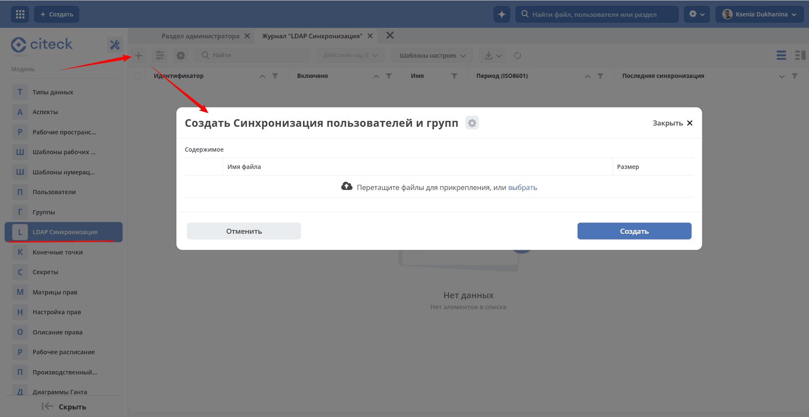

.. _sync_authorities:

Синхронизация Authorities
=========================

Синхронизация Пользователей или Групп с Citeck.

.. contents::
   :depth: 2

Синхронизация выполняется на стороне микросервиса ecos-model.

Настройка осуществляется в разделе **«LDAP Синхронизация» (Рабочее пространство "Раздел администратора" - Модель)** или деплой соответствующего артефакта ``authorities-sync``.

Журнал доступен по адресу: ``v2/journals?journalId=authorities-sync&viewMode=table&ws=admin$workspace``

1. Нажать **«Загрузить конфигурацию»**, выбрать json-файл с настройками LDAP. Запись появляется в журнале, синхронизация стартует без перезапуска приложения.
2. Действием **«Скачать»** получить json, изменить и загрузить повторно — существующая запись обновляется, дубликат не создаётся.
3. Действием **«Удалить»** убрать запись — синхронизация останавливается и снимается с расписания без перезапуска приложения.

.. _ldap_sync:

Синхронизация пользователей и групп из LDAP
------------------------------------------------

Тип: ``emodel-ldap``

.. note::

    Доступно только в enterprise версии

Подключение к LDAP осуществляется через Spring LDAP. 

Вы можете создать несколько конфигураций синхронизации, указав различные настройки - например, сервера, домены, фильтры и т.д.

Синхронизация настраивается одной конфигурацией с ``authorityType: PERSON`` и выполняется в два этапа:

1. Импорт пользователей.
2. Импорт групп и членства в них - необязательный этап, включается блоком ``config.groups``.

Оба этапа используют общий идентификатор синхронизации, параметры подключения, расписание и распределенную блокировку. Если синхронизация уже выполняется (в том числе на другом экземпляре ecos-model), запуск по расписанию пропускается, а ручной запуск ожидает освобождения блокировки до 5 секунд и затем завершается ошибкой. Отдельная синхронизация с ``authorityType: GROUP`` не поддерживается.

LDAP используется только для чтения: синхронизация не создает и не изменяет записи в LDAP. Параметр ``manageNewAuthorities`` должен быть ``false``. Локальное редактирование уже импортированных пользователей и групп в Citeck допускается.

.. attention::

   При синхронизации из Active Directory (или другого LDAP-каталога) необходимо соблюдать следующие ограничения:

   - Имена групп не должны содержать кириллические символы, например ``Группа_Тест_группа``.
   - Имена учётных записей не должны содержать пробелы.

.. contents::
   :depth: 2

.. _ldap_sync_persons:

Синхронизация пользователей
~~~~~~~~~~~~~~~~~~~~~~~~~~~~~~~~~~~~

Пример конфигурации:

.. code-block:: json

    {
        "id": "emodel-ldap-person-sync",
        "name": {
            "ru": "Пользователи из LDAP",
            "en": "Persons from LDAP"
        },
        "type": "emodel-ldap",
        "repeatDelayDuration": "PT5M",
        "enabled": true,
        "config": {
            "ldapConnection": {
                "base": "dc=example,dc=org",
                "urls": [
                    "ldap://localhost:389"
                ],
                "credentials": "ldap-cred"
            },
            "ldapSearch": {
                "base": "ou=people",
                "filter": "(objectClass=inetOrgPerson)",
                "scope": "SUBTREE"
            },
            "usernameAttributeName": "uid",
            "attributes": {
                "email": "mail",
                "lastName": "sn",
                "firstName": "givenName"
            },
            "batchSize": 100,
            "differential": true,
            "modifyTimestampAttName": "modifyTimestamp",
            "modifyTimestampFormat": "yyyyMMddHHmmss'Z'"
        },
        "version": 1,
        "authorityType": "PERSON",
        "manageNewAuthorities": false
    }

.. list-table:: Общие атрибуты конфигурации синхронизации
      :widths: 5 10
      :header-rows: 1
      :class: tight-table

      * - Атрибут
        - Описание
      * - id
        - Идентификатор синхронизации. Записывается импортированным пользователям и группам в атрибут ``ldap-sync:ldapSyncId`` (по нему выбираются пользователи для отключения, см. :ref:`ldap_sync_deletions`), а ссылка на синхронизацию - в атрибут ``managedBySync`` (по нему определяется принадлежность, см. :ref:`ldap_sync_ownership`). Не должен быть пустым. Не меняйте его после первого запуска
      * - name
        - Отображаемое название синхронизации
      * - type
        - Тип синхронизации - ``emodel-ldap``
      * - authorityType
        - Только ``PERSON``. Группы синхронизируются в рамках этой же конфигурации через ``config.groups``
      * - enabled
        - Флаг включения синхронизации
      * - repeatDelayDuration
        - Интервал между запусками в формате ISO-8601, например ``PT5M``. Первый запуск выполняется через минуту после регистрации синхронизации. Если значение пустое или некорректное, синхронизация не запускается по расписанию (некорректное значение записывается в лог как ошибка) и может быть запущена только вручную
      * - manageNewAuthorities
        - Должен быть ``false``: создание записей в LDAP не поддерживается. При ``true`` создание новых пользователей в Citeck будет завершаться ошибкой
      * - priority
        - Приоритет синхронизации (см. :ref:`ldap_sync_ownership`). По умолчанию - ``0``
      * - version
        - Версия конфигурации. При повышении версии сохраненное состояние синхронизации сбрасывается
      * - config
        - Параметры синхронизации LDAP (см. ниже)

.. list-table:: Описание атрибутов config для синхронизации пользователей
      :widths: 5 10
      :header-rows: 1
      :class: tight-table

      * - Атрибут
        - Описание
      * - ldapConnection
        - | Параметры подключения к LDAP серверу

            * urls - список URL серверов (обязательный), например ``ldaps://directory.example.org:636``
            * base - базовый DN подключения, например ``dc=example,dc=org``. Базы поиска пользователей и групп указываются относительно него
            * credentials - идентификатор credentials для подключения к LDAP серверу (обязательный). Сейчас это credentials из мкр. ecos-integrations: из записи берутся ``username`` (DN для подключения) и ``password``. Если мкр. ecos-integrations недоступен, синхронизация завершается ошибкой

      * - ldapSearch
        - | Параметры поиска пользователей

            * base - базовый DN для поиска относительно ``ldapConnection.base``, например ``ou=people``. По умолчанию - пустая строка
            * filter - LDAP-фильтр для поиска (обязательный), например ``(objectClass=inetOrgPerson)``
            * scope - область поиска. Допустимые значения: ``BASE``, ``ONE_LEVEL``, ``SUBTREE``. По умолчанию - ``SUBTREE``

      * - usernameAttributeName
        - Атрибут LDAP, содержащий имя пользователя (username); становится идентификатором пользователя в Citeck и должен быть уникальным без учета регистра: идентификаторы пользователей в Citeck хранятся в нижнем регистре. Для Active Directory обычно ``sAMAccountName``. Записи с пустым значением пропускаются. По умолчанию - ``uid``
      * - attributes
        - Атрибуты для синхронизации (обязательный). Ключ - имя атрибута в Citeck, значение - атрибут в LDAP. В значении можно использовать процессоры атрибутов Records через ``|`` или ``!``, например ``"lastName": "sn|or('-')"``
      * - batchSize
        - Размер страницы при постраничном поиске в LDAP и размер пакета при записи в Citeck. Должен быть больше 0. По умолчанию - ``30``
      * - differential
        - Флаг, указывающий на необходимость синхронизации только измененных пользователей. По умолчанию - ``true``
      * - modifyTimestampAttName
        - Атрибут LDAP, содержащий время последнего изменения записи, необходим для дифференциальной синхронизации. Для Active Directory - ``whenChanged``. По умолчанию - ``modifyTimestamp``
      * - modifyTimestampFormat
        - Формат времени последнего изменения в LDAP (значения атрибута ``modifyTimestampAttName``), время интерпретируется в UTC. Для Active Directory обычно ``yyyyMMddHHmmss.0'Z'``. По умолчанию - ``yyyyMMddHHmmss'Z'``
      * - allowDeletions
        - Отключение в Citeck пользователей, отсутствующих в LDAP (см. :ref:`ldap_sync_deletions`). По умолчанию - ``false``
      * - referral
        - Обработка LDAP referrals: ``ignore``, ``throw`` или ``follow``. По умолчанию - ``ignore``. При ``allowDeletions: true`` или включенной синхронизации групп значение ``follow`` запрещено (синхронизация завершается ошибкой конфигурации), а полученный referral при обоих допустимых значениях считается ошибкой
      * - ignorePartialResultException
        - Игнорировать ``PartialResultException`` при поиске. По умолчанию - ``false``. Должен быть ``false`` при ``allowDeletions: true`` и при включенной синхронизации групп
      * - ignoreNameNotFoundException
        - Игнорировать отсутствие базового DN поиска. По умолчанию - ``false``. Должен быть ``false`` при ``allowDeletions: true`` и при включенной синхронизации групп
      * - groups
        - Параметры синхронизации групп (см. :ref:`ldap_sync_groups`). Если не указан или равен ``null``, синхронизируются только пользователи

При синхронизации каждому пользователю добавляются два служебных атрибута:

- **ldap-sync:lastLdapSyncDate** - дата последней синхронизации пользователя с LDAP;
- **ldap-sync:ldapSyncId** - id конфигурации синхронизации, которая создала или последней обновила пользователя. Например, в примере выше это свойство будет равно *emodel-ldap-person-sync*.

Эти же атрибуты записываются группам, импортированным на этапе синхронизации групп.

.. _ldap_sync_ownership:

Принадлежность пользователей синхронизации
""""""""""""""""""""""""""""""""""""""""""""""""""""""

Синхронизация, которая создала или обновила пользователя, записывается в его атрибут ``managedBySync``. При обновлении пользователя из LDAP:

- новый пользователь создается и закрепляется за текущей синхронизацией;
- существующий пользователь без ``managedBySync`` (например, созданный локально в Citeck) обновляется и закрепляется за текущей синхронизацией;
- пользователь, закрепленный за другой синхронизацией, обновляется и переходит к текущей синхронизации, только если ее ``priority`` строго выше. При равном или более низком приоритете пользователь не изменяется - ошибки нет, запись есть только в debug-логе. Пользователь также не изменяется, если синхронизация, за которой он закреплен, удалена или не зарегистрирована.

Пользователи и группы, закрепленные за включенной синхронизацией, можно редактировать в Citeck локально; изменения в LDAP не записываются.

Дифференциальная синхронизация
""""""""""""""""""""""""""""""""""""

При ``differential: true`` к фильтру ``ldapSearch.filter`` добавляется условие на время изменения записи:

.. code-block:: text

    (&<ldapSearch.filter>(<modifyTimestampAttName>>=<время последней успешной синхронизации>))

Первая синхронизация всегда полная. Время последней успешной синхронизации хранится в состоянии синхронизации отдельно для пользователей и для групп:

.. code-block:: json

    {
        "lastSyncTimeStamp": "2026-10-02T10:00:00Z",
        "groups": {
            "lastSyncTimeStamp": "2026-10-02T10:00:05Z",
            "lastFullSyncTimeStamp": "2026-10-02T00:00:00Z"
        }
    }

``lastSyncTimeStamp`` в корне - метка пользователей, блок ``groups`` - метки групп. Состояния, сохраненные до появления синхронизации групп, читаются без изменений.

.. note::

    Если включена дифференциальная синхронизация и была изменена конфигурация с повышением версии, то первая синхронизация после изменения будет полной (для пользователей и для групп).

Для корректной работы дифференциальной синхронизации время изменения записей в LDAP должно обновляться при изменениях (в том числе при изменении состава групп), а часы серверов LDAP и Citeck должны быть согласованы.

.. _ldap_sync_deletions:

Отключение удаленных пользователей
""""""""""""""""""""""""""""""""""""

Параметр **config.allowDeletions** (true/false) включает отключение в Citeck пользователей, которые были удалены из LDAP. Записи пользователей при этом не удаляются.

Пример конфигурации:

.. code-block:: json

  {
      "id": "emodel-ldap-person-sync-with-delete",
      "name": {
          "ru": "Пользователи из LDAP c удалением",
          "en": "Persons from LDAP with allowed deletion"
      },
      "type": "emodel-ldap",
      "repeatDelayDuration": "PT5M",
      "enabled": true,
      "config": {
          "ldapConnection": {
              "base": "dc=example,dc=org",
              "urls": [
                  "ldap://localhost:389"
              ],
              "credentials": "ldap-cred"
          },
          "ldapSearch": {
              "filter": "(objectClass=person)"
          },
          "usernameAttributeName": "uid",
          "attributes": {
              "email": "mail",
              "lastName": "sn",
              "firstName": "givenName"
          },
          "batchSize": 100,
          "differential": false,
          "allowDeletions": true,
          "referral": "throw",
          "ignorePartialResultException": false,
          "ignoreNameNotFoundException": false
      },
      "version": 1,
      "authorityType": "PERSON",
      "manageNewAuthorities": false
  }

Логика:

1. При каждой синхронизации обновляются все пользователи, данные по которым пришли из LDAP.
2. Пользователи с ``ldap-sync:ldapSyncId``, равным id текущей синхронизации, по которым данные из LDAP не пришли (т.е. удаленные из LDAP или не попадающие в поисковый запрос), при **allowDeletions = true** отключаются в Citeck: пользователю устанавливаются ``personDisabled: true`` и ``personDisableReason: "Removed form AD (ldap sync)"``. Запись пользователя, его членство в группах и ссылки на него сохраняются. Имена пользователей сравниваются без учета регистра.

   Если флаг **allowDeletions = false**, пользователи остаются активными в Citeck, даже если были удалены из LDAP.

Чтобы неполный ответ LDAP не привел к ошибочному отключению, в этом режиме синхронизация завершается ошибкой без отключения пользователей, если:

- сервер не подтвердил постраничную выдачу (paged results) или ответ неполный;
- превышен лимит размера выборки (size limit);
- базовый DN поиска не найден;
- получен referral;
- у какой-либо возвращенной записи пустой атрибут ``usernameAttributeName``.

.. warning::

   1. Флаги **allowDeletions** и **differential** не могут быть **true** одновременно: корректно определить пользователей на отключение можно только при полной синхронизации (**differential = false**).

   2. Параметры **ignorePartialResultException** и **ignoreNameNotFoundException** должны быть **false**, **referral** - ``ignore`` или ``throw``.

   3. Если флаг **allowDeletions = true**, то крайне не рекомендуется менять поисковый запрос (ldapSearch) при наличии уже синхронизированных пользователей, иначе не попавшие в новый запрос пользователи будут отключены. Если требуется изменить запрос, нужно убедиться, что в новый запрос входят все пользователи из старого, либо установить **allowDeletions = false**. Полностью пустой результат поиска приведет к отключению всех пользователей этой синхронизации.

   4. **allowDeletions** действует только на пользователей. Группы не отключаются и физически не удаляются.

.. _ldap_sync_groups:

Синхронизация групп
~~~~~~~~~~~~~~~~~~~~

Синхронизация групп включается блоком ``config.groups`` и выполняется после успешного импорта пользователей в рамках того же запуска.

Пример конфигурации:

.. code-block:: json

    {
        "id": "corporate-ldap",
        "name": {
            "ru": "Пользователи и группы из LDAP",
            "en": "Persons and groups from LDAP"
        },
        "type": "emodel-ldap",
        "repeatDelayDuration": "PT5M",
        "enabled": true,
        "config": {
            "ldapConnection": {
                "urls": ["ldaps://directory.example.org:636"],
                "base": "dc=example,dc=org",
                "credentials": "corporate-ldap"
            },
            "ldapSearch": {
                "base": "ou=people",
                "filter": "(objectClass=inetOrgPerson)",
                "scope": "SUBTREE"
            },
            "usernameAttributeName": "uid",
            "attributes": {
                "firstName": "givenName",
                "lastName": "sn",
                "email": "mail"
            },
            "batchSize": 100,
            "differential": true,
            "modifyTimestampAttName": "modifyTimestamp",
            "modifyTimestampFormat": "yyyyMMddHHmmss'Z'",
            "groups": {
                "ldapSearch": {
                    "base": "ou=groups",
                    "filter": "(objectClass=groupOfNames)",
                    "scope": "SUBTREE"
                },
                "attributes": {
                    "name": "cn",
                    "description": "description"
                },
                "differential": true,
                "idAttributeName": "cn",
                "idPrefix": "ldap_",
                "memberAttributeName": "member",
                "memberIdType": "DN",
                "personObjectClasses": ["person", "inetOrgPerson", "user"],
                "fullSyncInterval": null
            }
        },
        "version": 1,
        "authorityType": "PERSON",
        "manageNewAuthorities": false
    }

.. list-table:: Описание атрибутов config.groups
      :widths: 5 10
      :header-rows: 1
      :class: tight-table

      * - Атрибут
        - Описание
      * - ldapSearch
        - | Параметры поиска групп

            * base - базовый DN для поиска относительно ``ldapConnection.base``, например ``ou=groups``. По умолчанию - пустая строка
            * filter - LDAP-фильтр для поиска (обязательный), например ``(objectClass=groupOfNames)``, ``(objectClass=group)`` для Active Directory, ``(objectClass=posixGroup)``
            * scope - область поиска. Допустимые значения: ``BASE``, ``ONE_LEVEL``, ``SUBTREE``. По умолчанию - ``SUBTREE``

      * - idAttributeName
        - Атрибут LDAP, из которого формируется идентификатор группы. Для Active Directory обычно ``sAMAccountName``. Если у группы нет этого атрибута, синхронизация завершается ошибкой. По умолчанию - ``cn``
      * - idPrefix
        - Префикс идентификатора группы в Citeck: из ``cn=sales`` получится группа ``ldap_sales``. Итоговые идентификаторы должны быть уникальны в выборке, иначе синхронизация завершается ошибкой. По умолчанию - ``ldap_``
      * - attributes
        - Атрибуты группы для синхронизации. Ключ - имя атрибута в Citeck, значение - атрибут в LDAP. Допустимы только ключи ``name`` и ``description``, состав группы синхронизируется отдельно. Поддерживаются процессоры атрибутов, как и для пользователей. По умолчанию - ``{"name": "cn", "description": "description"}``
      * - memberAttributeName
        - Атрибут LDAP со списком участников группы. Для ``groupOfUniqueNames`` - ``uniqueMember``, для ``posixGroup`` - ``memberUid``. Ответы Active Directory вида ``member;range=...`` дочитываются полностью. По умолчанию - ``member``
      * - memberIdType
        - | Формат значений атрибута участников:

            * ``DN`` - DN пользователей и вложенных групп. DN участников, не являющихся группами из выборки, должны находиться внутри ``ldapConnection.base``
            * ``USERNAME`` - имена пользователей (например, ``memberUid`` в ``posixGroup``). Пустые значения не допускаются. Вложенные группы в этом режиме не поддерживаются

          По умолчанию - ``DN``
      * - personObjectClasses
        - Используется при ``memberIdType: DN``. Если участник не является группой из выборки, по его ``objectClass`` (без учета регистра) проверяется, что это пользователь; имя пользователя берется из атрибута ``usernameAttributeName``. Участник, который не является ни пользователем, ни группой из выборки, приводит к ошибке. По умолчанию - ``["person", "inetOrgPerson", "user"]``
      * - differential
        - Флаг дифференциальной синхронизации групп - читаются только группы, измененные после последней успешной синхронизации групп. Не зависит от ``differential`` пользователей. ``false`` - полная синхронизация при каждом запуске. По умолчанию - ``true``
      * - modifyTimestampAttName
        - Переопределяет ``modifyTimestampAttName`` для групп. Если не задан, используется значение из ``config``
      * - modifyTimestampFormat
        - Переопределяет ``modifyTimestampFormat`` для групп. Если не задан, используется значение из ``config``
      * - fullSyncInterval
        - Интервал периодической полной сверки групп в формате ISO-8601, например ``PT24H``: первый запуск после истечения интервала выполняет полную синхронизацию. Пустое значение или ``null`` - сверка отключена. Нулевые, отрицательные и некорректные значения не допускаются. По умолчанию - ``null``

Из основного блока ``config`` синхронизация групп использует ``ldapConnection``, ``batchSize``, ``usernameAttributeName``, а также ``modifyTimestampAttName`` и ``modifyTimestampFormat``, если они не переопределены в ``groups``.

.. warning::

   При включенной синхронизации групп в ``config.attributes`` пользователей нельзя указывать ``authorityGroups``, ``ldapGroups`` и их варианты ``att_add_*`` / ``att_rem_*``: членство в группах управляется этапом синхронизации групп.

Членство в группах
"""""""""""""""""""

Для групп и пользователей хранятся служебные атрибуты:

.. list-table::
      :widths: 5 10
      :header-rows: 1
      :class: tight-table

      * - Атрибут
        - Описание
      * - ldapGroups
        - У пользователя или группы - прямые родительские группы, полученные из LDAP при последней успешной синхронизации. Не дает прав доступа
      * - ldapDn
        - У группы - исходный DN в LDAP. Сохраняется, даже если группа исчезла из LDAP
      * - ldapPresent
        - У группы - присутствовала ли группа в последней успешной выборке из LDAP
      * - managedBySync
        - У группы - синхронизация, которой принадлежит группа

Изменения членства вычисляются сравнением двух снимков LDAP (``ldapGroups``), а не сравнением LDAP с текущим составом групп в Citeck (``authorityGroups``):

- новые связи из LDAP добавляются в ``authorityGroups``;
- удаленные в LDAP связи удаляются из ``authorityGroups``;
- неизмененные связи из LDAP и вручную добавленные в Citeck связи не изменяются.

Таким образом, связь из LDAP, вручную удаленная в Citeck, не восстанавливается, пока она не изменится в LDAP (в том числе при полной синхронизации и после сброса состояния). Если связь удалена в LDAP, она удаляется и в Citeck, даже если была добавлена вручную повторно.

Синхронизация не может забрать себе локальную группу Citeck или группу другой синхронизации с тем же идентификатором. Сохраненный ``ldapDn`` не позволяет использовать существующий идентификатор для группы с другим DN. В обоих случаях этап групп завершается ошибкой без изменений. Изменение ``idAttributeName``, ``idPrefix`` или DN групп требует плановой миграции.

Порядок выполнения
""""""""""""""""""

Один запуск синхронизации выполняет следующие шаги:

1. Проверка конфигурации групп и отсутствия атрибутов членства в маппинге пользователей.
2. Импорт пользователей пакетами и сохранение метки времени пользователей.
3. Чтение измененных групп LDAP и их полного состава.
4. Проверка итогового графа групп и атомарная запись атрибутов групп, снимков, изменений членства и метки времени групп.

При включенной синхронизации групп пакеты пользователей и метка пользователей сохраняются в отдельных транзакциях, а группы - в своей транзакции. Ошибка на этапе групп не отменяет уже импортированных пользователей и не сдвигает метки времени групп: следующий запуск повторит этап групп с последней успешной метки. Ошибка на этапе пользователей не дает запустить этап групп.

Полная и дифференциальная синхронизация групп
""""""""""""""""""""""""""""""""""""""""""""""""""""""

Первый запуск (или запуск после сброса состояния) всегда полный. Последующие запуски читают только группы, измененные с момента последней успешной синхронизации групп. Новые группы, в том числе вложенные, создаются в дифференциальном режиме, если их время изменения попадает в фильтр.

Полная синхронизация дополнительно обрабатывает группы, исчезнувшие из LDAP или из поисковой выборки: у них снимаются связи, полученные из LDAP, и устанавливается ``ldapPresent: false``. Это происходит и при полностью пустом результате поиска групп - тогда так обрабатываются все группы этой синхронизации. Сама группа, ``ldapDn``, ручные назначения и ссылки на группу в правах и процессах сохраняются. При отключенной периодической сверке исчезнувшие группы сохраняют членство из LDAP до следующей полной синхронизации; удаление участников из существующих измененных групп обрабатывается и в дифференциальном режиме.

Полная синхронизация групп выполняется, если:

- это первый запуск или состояние сброшено;
- ``groups.differential: false``;
- истек ``groups.fullSyncInterval`` с момента последней полной синхронизации групп.

Проверки и ограничения
""""""""""""""""""""""""

При включенной синхронизации групп требования к полноте ответа LDAP действуют и на этапе пользователей: импорт пользователей завершается ошибкой, если сервер не подтвердил постраничную выдачу, превышен size limit, базовый DN поиска не найден или получен referral. В этом случае этап групп не запускается.

Синхронизация групп завершается ошибкой без каких-либо изменений групп, если:

- ответ LDAP неполный: нет подтверждения постраничной выдачи, превышен size limit, базовый DN поиска групп не найден, неполный диапазон ``member;range`` в Active Directory, получен referral;
- в выборке есть группы с одинаковым итоговым идентификатором или группа без атрибута ``idAttributeName``;
- в итоговом графе групп (с учетом ручных связей) появляется цикл или группа включает сама себя;
- итоговый идентификатор группы (с учетом ``idPrefix``) равен ``ECOS_ADMINISTRATORS``, ``ALFRESCO_ADMINISTRATORS`` или ``EVERYONE``. Проверяется именно итоговый идентификатор: с префиксом по умолчанию совпадение невозможно (группа ``cn=EVERYONE`` будет импортирована как ``ldap_EVERYONE``), но оно возможно при пустом или другом префиксе - например, ``idPrefix: "ECOS_"`` и ``cn=ADMINISTRATORS``;
- новые связи из LDAP ведут к группам администраторов напрямую или через родительские группы. Существующие ручные назначения в группы администраторов сохраняются;
- участник новой связи из LDAP не найден среди пользователей Citeck (в том числе если он не попадает в поисковый запрос пользователей). Удаление связи для несуществующего в Citeck участника пропускается без ошибки;
- участник группы не является ни пользователем, ни группой из выборки, его DN находится вне ``ldapConnection.base`` или при ``memberIdType: USERNAME`` значение участника пустое;
- группа с тем же идентификатором уже существует и не принадлежит этой синхронизации, либо связана с другим DN;
- во время синхронизации изменились группы Citeck или их связи (например, при одновременном ручном редактировании) - в этом случае достаточно повторить запуск;
- при дифференциальной синхронизации измененная группа содержит группу, которая ранее исчезла из выборки (``ldapPresent: false``) и не попала в текущий набор измененных групп. Такой участник проверяется как пользователь и не проходит проверку по ``personObjectClasses``. Чтобы исправить ошибку, верните группу в поисковый запрос или удалите ее из состава родительской группы в LDAP.

Также необходимо учитывать:

- вложенные группы должны попадать в поисковый запрос групп ``groups.ldapSearch``;
- учетная запись LDAP должна иметь права на чтение всех групп, их участников и пользователей. Атрибут, скрытый правами доступа LDAP, неотличим от пустого;
- имена пользователей из атрибута участников (или из ``usernameAttributeName`` участника при ``memberIdType: DN``) приводятся к нижнему регистру перед поиском пользователя в Citeck;
- основная группа Active Directory (``primaryGroupID``) не учитывается - учитывается только атрибут ``member``;
- проверка графа читает все связи групп Citeck, а запись выполняется в одной транзакции - для крупных инсталляций рекомендуется нагрузочное тестирование;
- глобальной блокировки от одновременного ручного редактирования групп нет: изменения, обнаруженные во время чтения, приводят к ошибке этапа групп, и запуск нужно повторить.

Настройки для разных LDAP серверов
~~~~~~~~~~~~~~~~~~~~~~~~~~~~~~~~~~~~

.. list-table::
      :widths: 5 10
      :header-rows: 1
      :class: tight-table

      * - Сервер / класс групп
        - Настройки
      * - OpenLDAP, ``groupOfNames``
        - ``groups.ldapSearch.filter: (objectClass=groupOfNames)``, ``memberAttributeName: member``, ``memberIdType: DN`` (значения по умолчанию)
      * - ``groupOfUniqueNames``
        - ``memberAttributeName: uniqueMember``, ``memberIdType: DN``. Значения должны быть DN без необязательного суффикса UID
      * - ``posixGroup``
        - ``memberAttributeName: memberUid``, ``memberIdType: USERNAME``. Вложенные группы не поддерживаются
      * - Active Directory
        - ``usernameAttributeName: sAMAccountName``, ``modifyTimestampAttName: whenChanged``, ``modifyTimestampFormat: yyyyMMddHHmmss.0'Z'``, ``groups.ldapSearch.filter: (objectClass=group)``, ``groups.idAttributeName: sAMAccountName``

