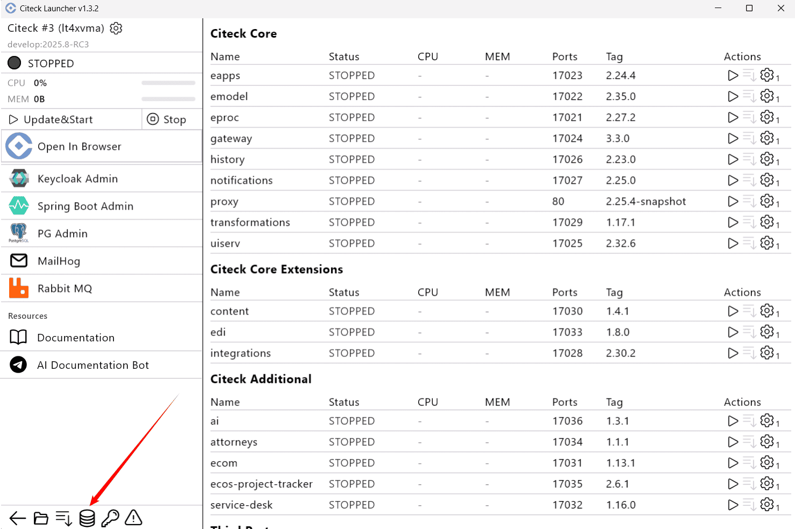
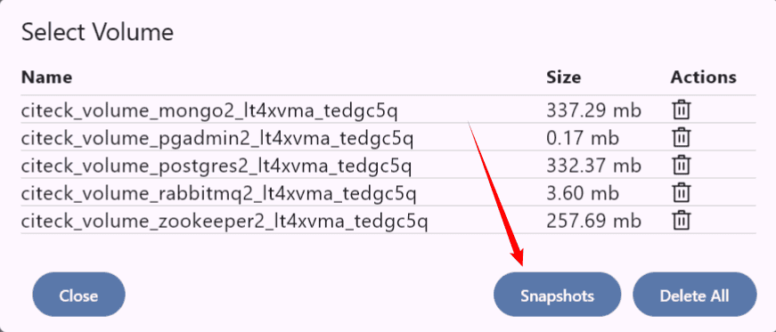
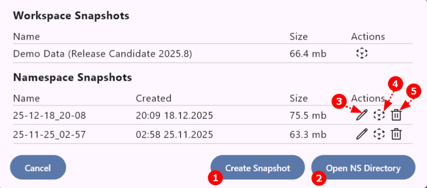

.. _launcher_dump:

Работа со снэпшотами
=====================

**Снэпшот** — архив данных выбранных томов (volume) namespace на момент создания. Он позволяет восстановить сохранённое состояние данных. Для резервного копирования всей установки дополнительно сохраняйте конфигурацию workspace и namespace, сведения о версиях и необходимые секреты.

Снэпшот содержит физические копии данных томов в архивах ``*.tar.xz`` и файл ``meta.json`` с метаданными и пинами версий зависимостей. Они упакованы в ZIP. При восстановлении поддерживаются также архивы томов ``*.tar.zst`` из предыдущих версий Launcher. Конфигурацию контейнеров и Docker-образы снэпшот не заменяет.

.. note::

    Перед созданием или восстановлением снэпшота остановите namespace и дождитесь статуса **Остановлен**.

Перейдите в **список томов**:

Далее нажмите **Снапшоты**:

В списке представлены два типа снэпшотов:

- **Снэпшоты воркспейса** — снэпшоты, настроенные в конфигурации workspace (например, демо-данные).
- **Снэпшоты Namespace** — локальные для namespace снэпшоты, которыми можно управлять вручную.

Для workspace-снэпшота может быть задана минимальная совместимая версия бандла. Если выбранный бандл не подходит, Launcher показывает причину недоступности. Это ограничение относится к определениям снэпшотов в workspace и не является проверкой совместимости любого произвольного ZIP-архива.

|

Доступные действия со снэпшотами:

1. **Создать новый снэпшот** — укажите название, выберите тома и подтвердите создание. По умолчанию выбраны все тома; дождитесь завершения экспорта:

   .. grid:: 2
       :gutter: 2

       .. grid-item::

           .. image:: _static/snapshot_04.png
               :width: 400
               :align: center

       .. grid-item::

           .. image:: _static/snapshot_05.png
               :width: 400
               :align: center

2. **Импорт zip-архива снэпшота** — восстанавливает данные из выбранного ZIP-файла. Если в namespace уже есть тома, Launcher запросит подтверждение замены данных. После выбора файла не нужно отдельно запускать ещё одно восстановление.

3. **Перейти в директорию со снэпшотами** — открывает папку с созданными архивами:

   .. image:: _static/snapshot_06.png
       :width: 600
       :align: center

4. **Переименовать** снэпшот:

   .. image:: _static/snapshot_09.png
       :width: 400
       :align: center

5. **Развернуть данные** из локального снэпшота — восстанавливает сохранённые данные в остановленный namespace. Для снэпшота workspace сначала выполняется скачивание, после чего доступно восстановление локальной копии:

   .. image:: _static/snapshot_07.png
       :width: 400
       :align: center

6. **Удалить** снэпшот:

   .. image:: _static/snapshot_08.png
       :width: 400
       :align: center

.. _launcher_snapshot_transfer:

Перенос снэпшота на другой компьютер
-------------------------------------

Обычный снэпшот, созданный в GUI, не включает секреты. Он рассчитан на восстановление в окружении, где сохранены прежние ключи. При переносе в новый namespace могут потребоваться исходные секреты namespace и системные ключи, в частности ключи S3, JWT и OIDC.

**На исходном рабочем месте:**

#. Сохраните конфигурацию workspace и namespace, а также версию бандла.
#. Для экспорта вместе с ключами используйте CLI той же версии, подключённый к исходному desktop-профилю. Выполняйте команду от пользователя, под которым работает Launcher. Для стандартного desktop-профиля на Linux/macOS:

   .. code-block:: shell

       CITECK_DESKTOP=true citeck snapshot export --include-secrets --dir /absolute/path

   На Windows в PowerShell:

   .. code-block:: powershell

       $env:CITECK_DESKTOP = 'true'
       citeck snapshot export --include-secrets --dir C:\CiteckSnapshots

   Укажите свой абсолютный каталог назначения. Если профиль использует нестандартные ``CITECK_HOME`` или ``CITECK_RUN``, CLI должен использовать те же значения. CLI предложит остановить работающий namespace и после экспорта запустит его обратно. Альтернатива — API ``POST /api/v1/snapshots/export`` с JSON ``{"includeSecrets": true}``; для API namespace нужно остановить заранее. В диалоге создания снэпшота GUI параметра включения секретов нет.

#. Дождитесь завершения экспорта и перенесите полученный ZIP на целевой компьютер.

.. important::

    В архиве с секретами файл ``secrets.json`` содержит открытые значения ключей. Ограничьте доступ к архиву. Учётные данные Git и реестров Docker в него не входят; на целевом компьютере задайте их отдельно.

**На целевом рабочем месте:**

#. Подготовьте workspace с нужной версией бандла и создайте :ref:`namespace <launcher_new_space>` с совместимой конфигурацией. Для восстановления используйте версии зависимостей, соответствующие данным снэпшота.
#. Остановите целевой namespace, если он запущен, и откройте список снэпшотов.
#. Нажмите **Импорт zip-архива снэпшота**, выберите перенесённый файл и при необходимости подтвердите замену существующих данных.
#. Дождитесь завершения восстановления. Секреты из архива будут применены к целевому namespace; архив без ``secrets.json`` не изменяет его секреты.
#. Нажмите **Обновить и запустить**, дождитесь готовности приложений и проверьте доступ к платформе и хранилищу контента.
