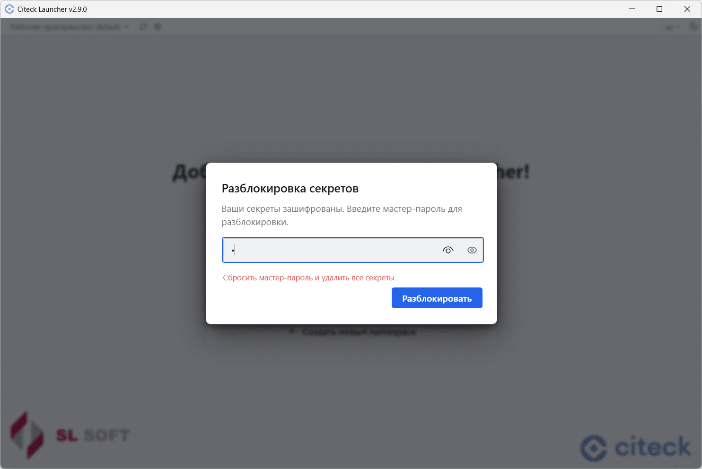
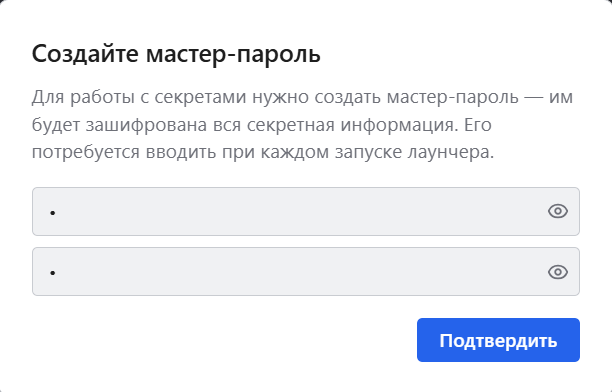
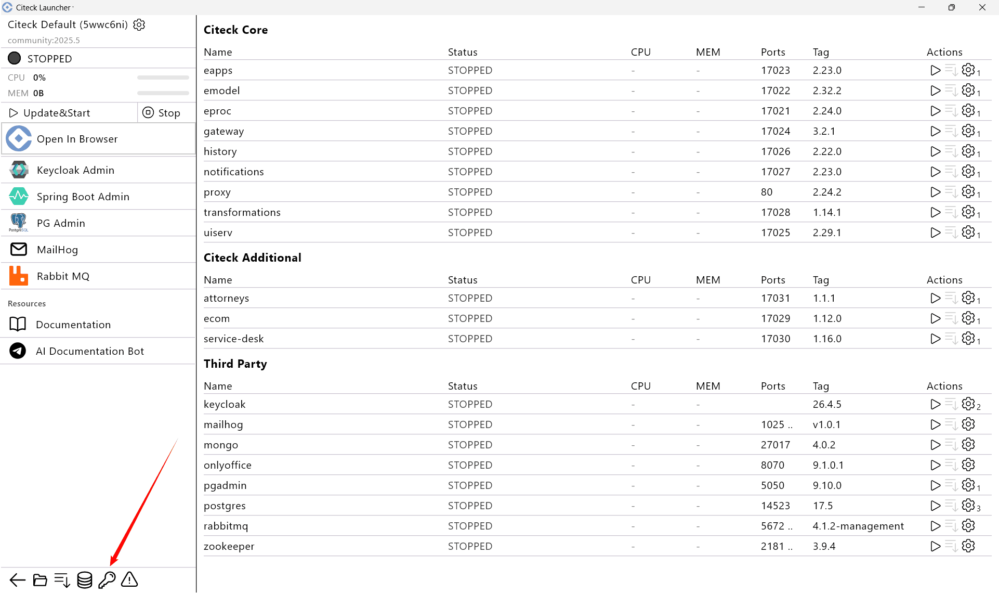
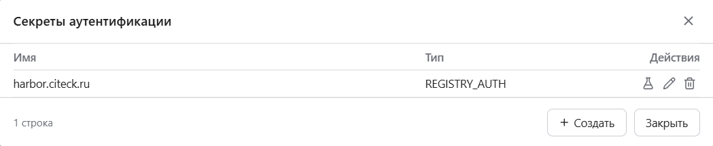
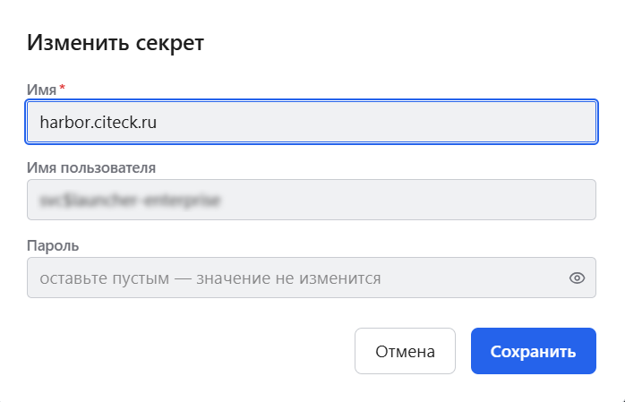
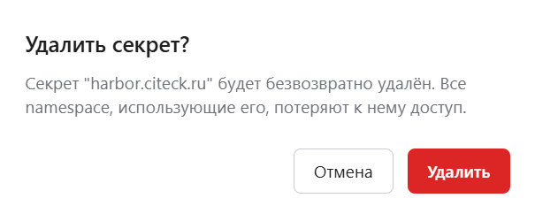
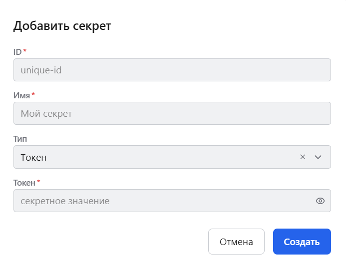

.. _launcher_secrets:

Работа с секретами и мастер-паролем
--------------------------------------------------------------------

.. contents::

**Мастер-пароль** защищает хранилище секретов Launcher. Перед сохранением пользовательских учётных данных, например токена Git или пароля реестра Docker, необходимо установить мастер-пароль. После перезапуска Launcher настроенное хранилище потребуется разблокировать.

Секреты namespace, например ключи инфраструктурных сервисов, могут создаваться автоматически до установки мастер-пароля. До этого они хранятся без шифрования; после установки мастер-пароля шифруются вместе с остальными записями хранилища. Системные ключи Launcher имеют отдельный механизм хранения.

Сброс мастер-пароля
~~~~~~~~~~~~~~~~~~~
.. note::

  Забытый мастер-пароль не может быть восстановлен. Сброс удаляет секреты из хранилища Launcher. Пароли и ключи, уже записанные в БД и данные сервисов, при этом не заменяются. Перед сбросом учтите, что удалённые учётные данные придётся задать заново, а доступ к сервисам может потребовать отдельного восстановления.

Нажмите кнопку сброса и подтвердите действие:

.. grid:: 2
    :gutter: 2

    .. grid-item::

        .. image:: _static/secret_reset.png
            :width: 350
            :align: center

    .. grid-item::

        .. image:: _static/secret_confirm.png
            :width: 350
            :align: center

Затем задайте новый мастер-пароль:

Установка мастер-пароля
~~~~~~~~~~~~~~~~~~~~~~~~~~~~~~~~~~~~~~~~~~~~~~~

При установке, например, Enterprise версии для скачивания закрытых образов необходимо ввести учетные данные и задать мастер-пароль, который будет использоваться для шифрования секретов. Если мастер-пароль не установлен, Launcher предложит его создать.

Введите и подтвердите мастер-пароль:

Просмотр, создание и удаление секретов
~~~~~~~~~~~~~~~~~~~~~~~~~~~~~~~~~~~~~~

Для перехода к управлению секретами нажмите:

Откроется список секретов с возможностью создания, проверки, изменения и удаления:

Форма редактирования секрета:

Удаление секрета необходимо подтвердить:

Форма создания нового секрета:

