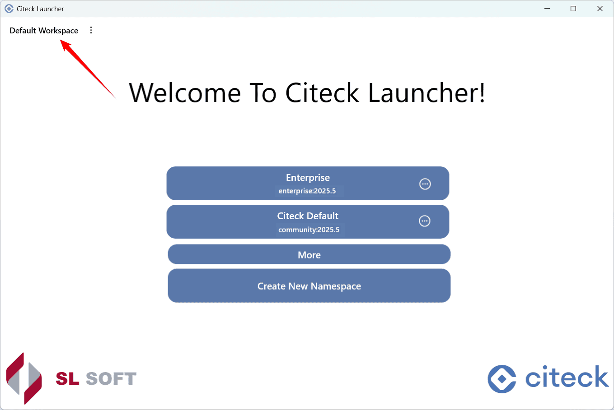
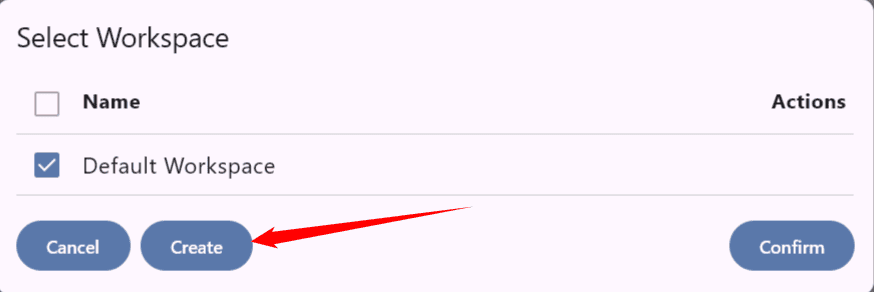
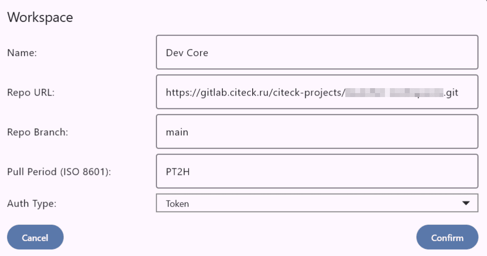
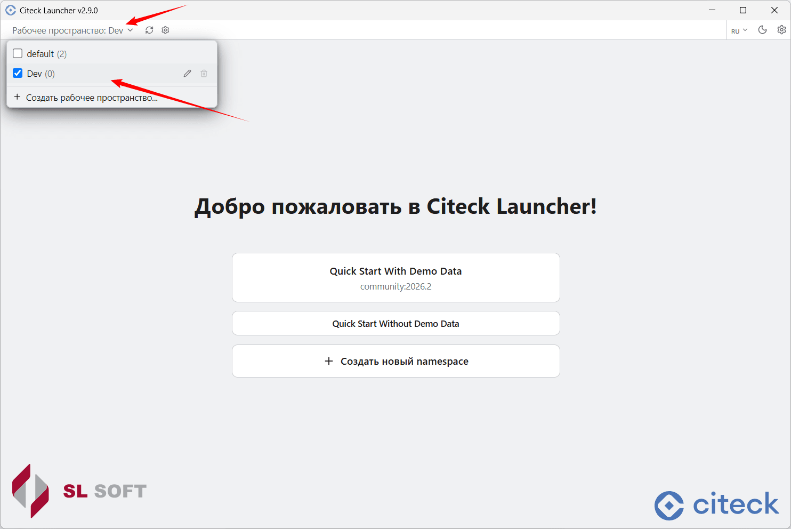
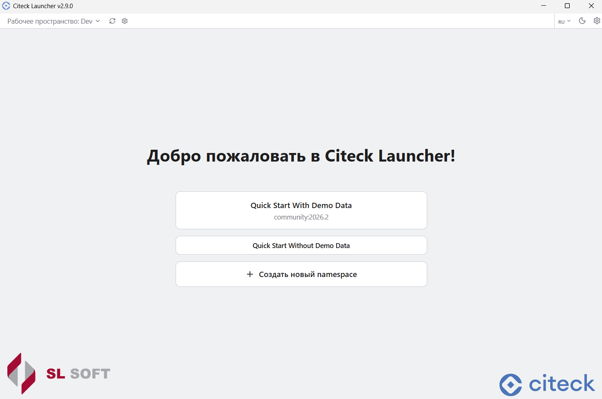

.. _launcher_workspace:

Рабочие пространства
------------------------------------------

В Launcher доступно создание нескольких рабочих пространств. Например, одно пространство можно использовать для запуска релизных версий, второе — для внутренних сборок разработки.

Для перехода к списку пространств нажмите:

Создание нового
~~~~~~~~~~~~~~~~~~~~~~~~~~~~~~~~

Нажмите кнопку создания нового пространства:

Введите параметры:

.. list-table::
   :header-rows: 1
   :class: tight-table

   * - Параметр
     - Описание
   * - **Имя**
     - Имя пространства.
   * - **URL адрес**
     - URL адрес репозитория.
   * - **Ветка**
     - Ветка репозитория. По умолчанию — ``main``.
   * - **Период обновления**
     - Длительность в формате ISO 8601, например ``PT2H`` — каждые два часа (значение по умолчанию).
   * - **Тип аутентификации**
     - **Нет** (публичный репозиторий) или **Токен** (приватный репозиторий).

Для типа аутентификации **Токен** до сохранения workspace выберите существующий секрет либо создайте новый и укажите токен доступа к вашему Git-серверу. Например, для GitHub используется `персональный access-токен <https://docs.github.com/en/authentication/keeping-your-account-and-data-secure/creating-a-personal-access-token>`_. Секрет можно использовать в нескольких рабочих пространствах.

.. note::

    В GitHub токены создаются в **Settings → Developer settings → Personal access tokens**. Токену нужен доступ на чтение выбранного репозитория.

При создании секрета введите токен и сохраните секрет. Если хранилище ещё не настроено или заблокировано, Launcher предложит установить или ввести :ref:`мастер-пароль <launcher_secrets>`:

.. grid:: 2
    :gutter: 2

    .. grid-item::

        .. image:: _static/ws_4.png
            :width: 350
            :align: center

    .. grid-item::

        .. image:: _static/ws_4_1.png
            :width: 350
            :align: center

После выбора секрета нажмите **Сохранить** в форме workspace. При типе аутентификации **Нет** секрет не требуется.

Выбор из созданных
~~~~~~~~~~~~~~~~~~~~~~~~~~~~~~~~~~~~~

Из списка пространство можно отредактировать или удалить. Внутри пространства доступен запуск уже настроенного namespace и создание нового:

