.. _sample_request_ai:

Создание процесса с помощью AI-ассистента
==========================================

.. contents::
   :depth: 3

.. note::

   Функция доступна только в Enterprise-версии.

В данной статье рассматривается создание учебного процесса :ref:`«Заявка на закупку оборудования»<sample_request>` с помощью :ref:`AI Ассистента<AI_assistant>` — без ручной настройки.

.. note::

   Созданные артефакты доступны только в рабочем пространстве, в котором они были созданы.

Сгенерируем минимальный набор артефактов: **тип данных** и **бизнес-процесс**.

Создание типа данных
---------------------

Перейдите в AI Ассистент:

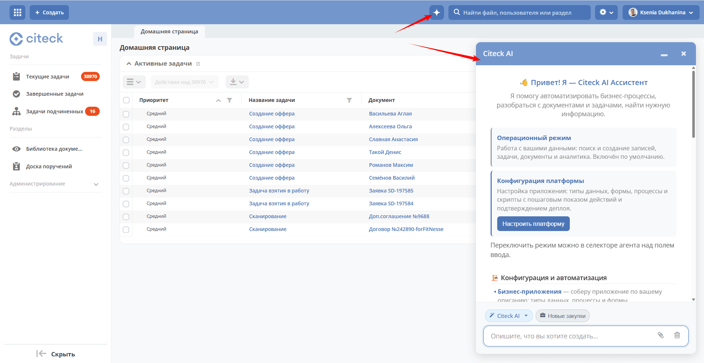

Перейдите в **"Агент конфигурации платформы"**:

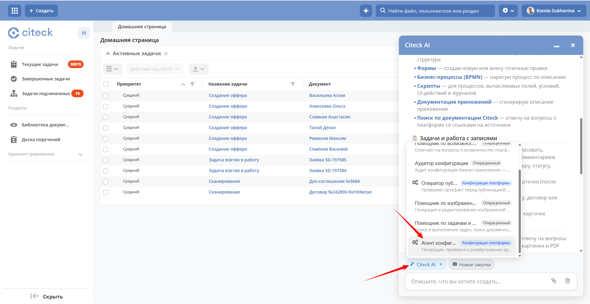

Создайте тип данных по заранее подготовленному запросу. В запросе описана сущность заявки, её атрибуты, роли и статусы:

.. code-block:: text

   Создай тип данных по описанию ниже.

   Заявка на оборудование – заявка, которая необходима для закупки оборудования
   для операционной деятельности сотрудников.
   Например, для подключения монитора к компьютеру сотруднику необходим специальный
   кабель, которого на данный момент нет в наличии.
   Обычно сотрудник обращается к своему руководителю с просьбой приобрести необходимое
   оборудование. После успешного согласования и в соответствии с внутренними регламентами
   происходит закупка. Согласующий также может отказать в покупке.

   Атрибуты:
   1. name, Название оборудования, Text
   2. price, Стоимость, Number
   3. requester, Инициатор, Person
   4. approver, Согласующий, Person

   Роли:
   5. requestor, Инициатор, из атрибута Инициатор
   6. approver, Согласующий, из атрибута Согласующий

   Статусы:
   7. request-created, Заявка создана
   8. approving, На согласовании
   9. approved, Согласовано
   10. rejected, Отказано

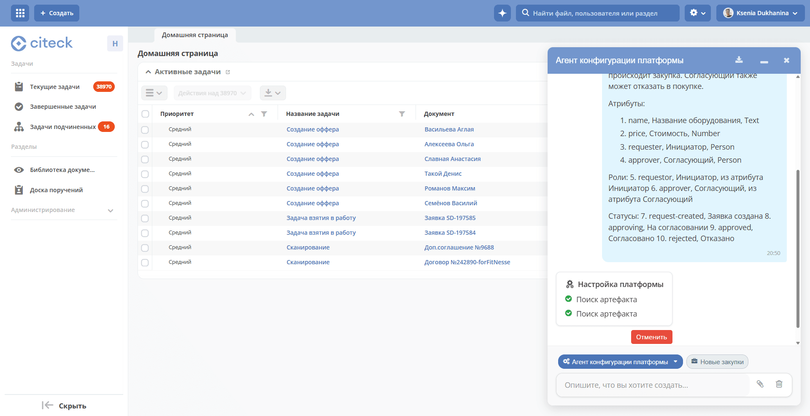

Ассистент обрабатывает запрос и возвращает сформированный тип данных:

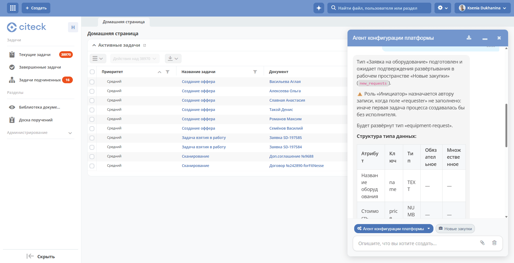

Все необходимые атрибуты, роли и статусы заданы. Подтвердите развёртывание типа данных в системе:

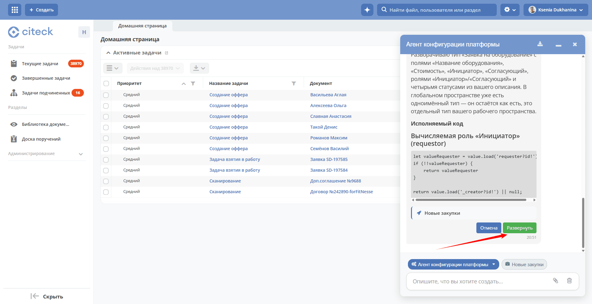

По появившейся ссылке перейдите в созданный тип данных и проверьте его содержимое.

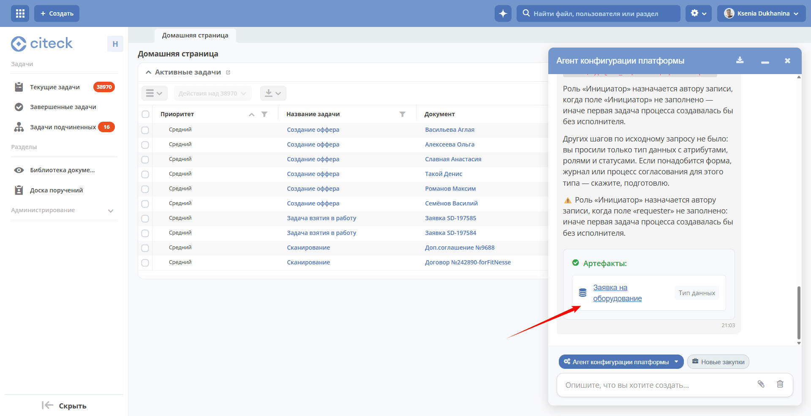

Вкладка **«Основные»** — родитель «Кейс», форма и журнал созданы по умолчанию:

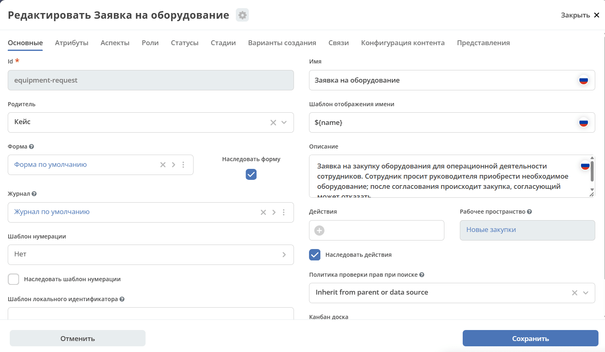

Вкладка **«Атрибуты»**:

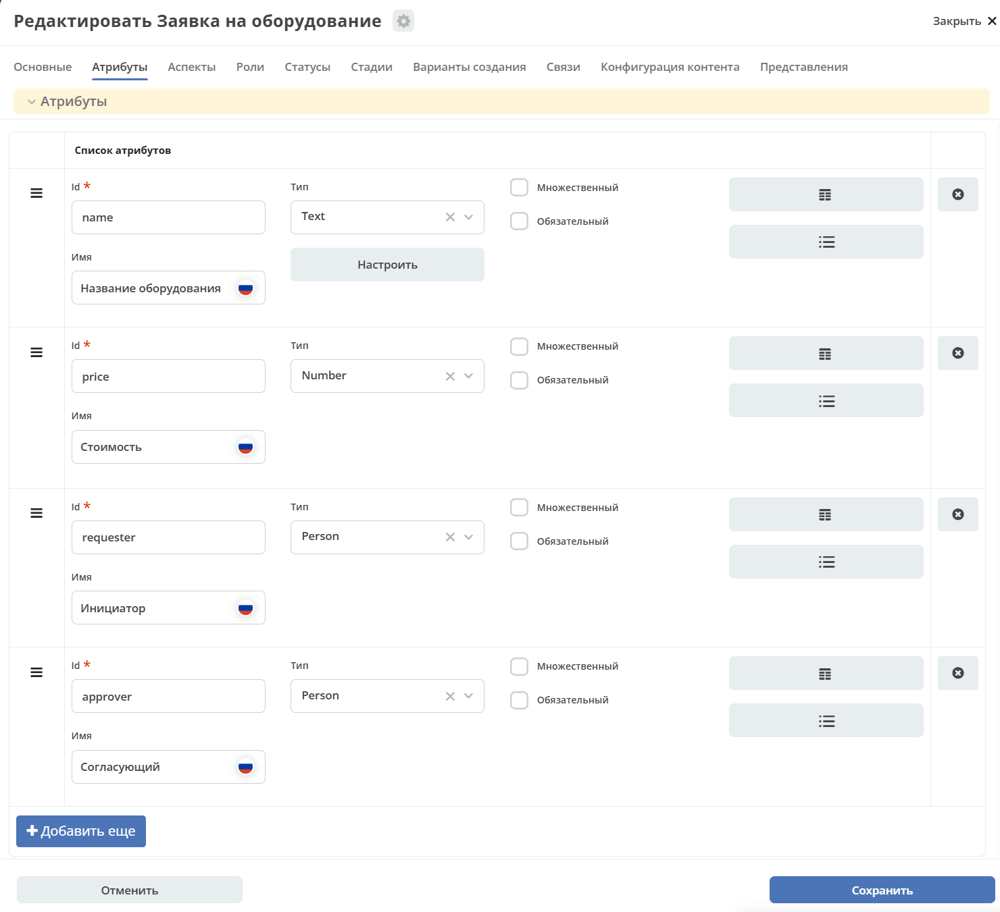

Вкладка **«Роли»**:

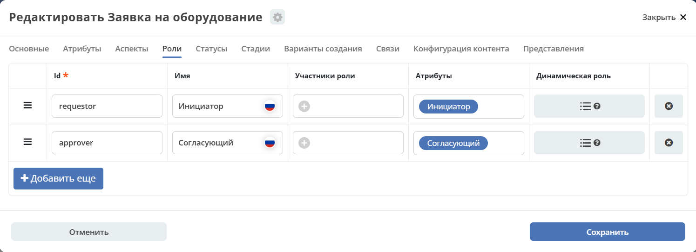

Вкладка **«Статусы»**:

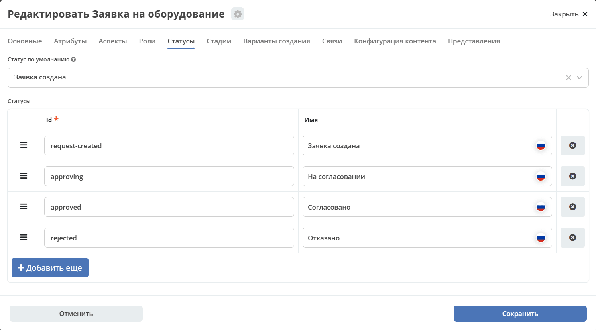

Тип данных готов. Переходим к созданию бизнес-процесса.

Создание бизнес-процесса
-------------------------

Для генерации бизнес-процесса используйте следующий запрос:

.. code-block:: text

   Создай бизнес-процесс на основе типа данных Заявки на оборудование.

   Описание процесса:
   1. Заявка создана -> Задача на инициатора — «На согласование».
   2. После отправки на согласование назначается задача на Согласующего —
      «На согласовании согласующим». У задачи 2 выхода: «Согласовать» и «Отказать».

   Добавь соответствующие статусы и уведомления.

.. note::

   В запросе явно указано добавить уведомления — ассистент учтёт это при генерации процесса.

Сначала будут сгенерированы уведомления, затем бизнес-процесс. После обработки запроса ассистент вернёт сообщение о готовности каждого уведомления к развёртыванию:

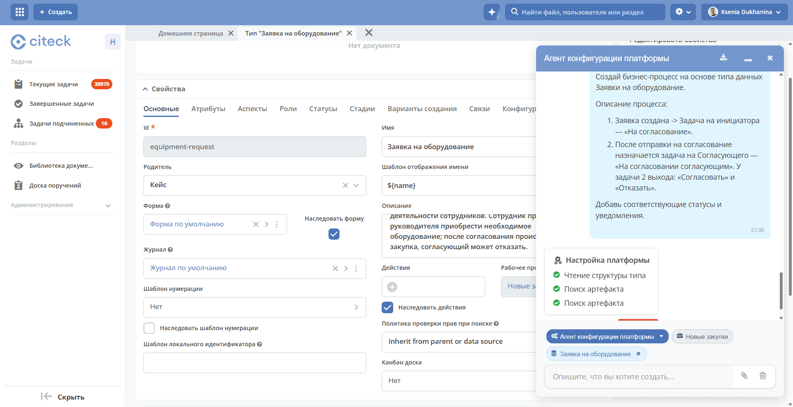

.. grid:: 2
   :gutter: 2

   .. grid-item::

      .. image:: _static/equipment_request_ai/AI_11.png
         :width: 700
         :align: center

   .. grid-item::

      .. image:: _static/equipment_request_ai/AI_12.png
         :width: 700
         :align: center

Далее будет сгенерирован бизнес-процесс:

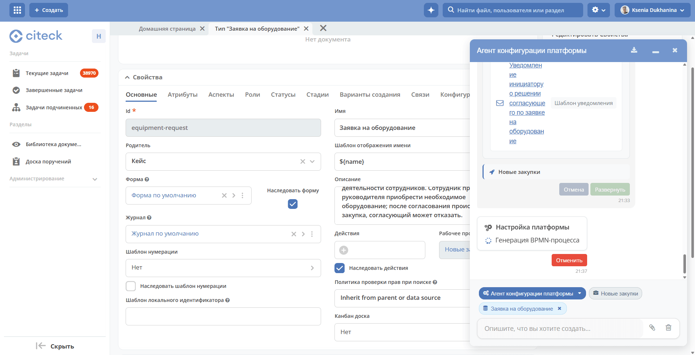

По появившейся ссылке перейдите в карточку созданного бизнес-процесса

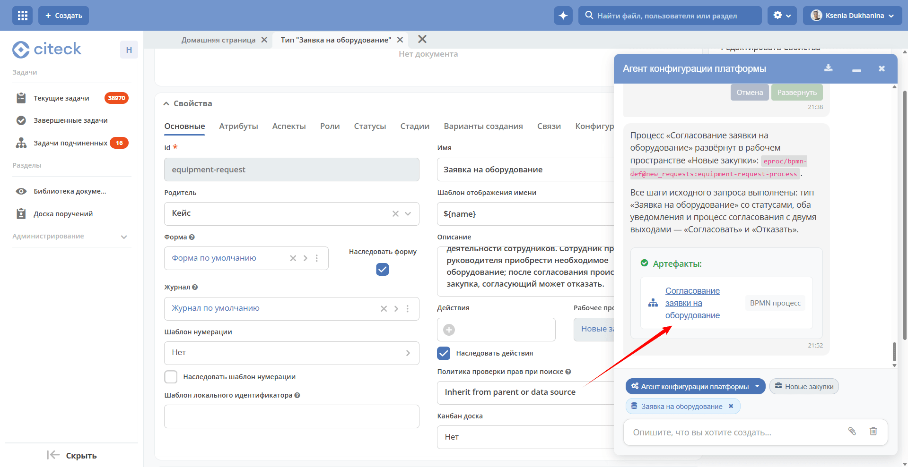

Перейдите в редактор:

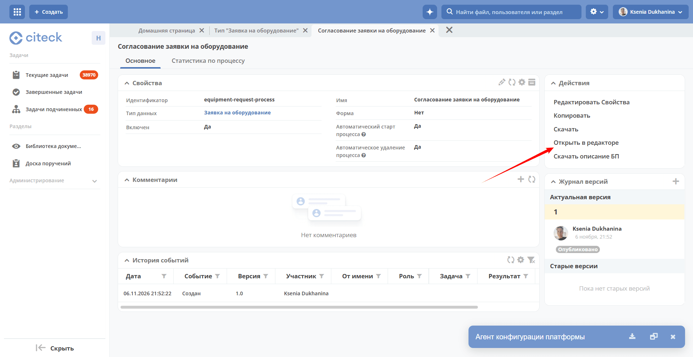

И проверьте содержимое бизнес-процесса:

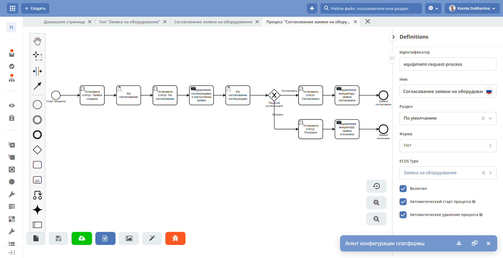

.. note::

   Созданный процесс уже автоматически опубликован и готов к запуску. В случае необходимости, вы можете внести изменения в процесс вручную.

Настройки ключевых элементов процесса:

.. tab-set::

   .. tab-item:: Установить статус: Заявка создана

      .. image:: _static/equipment_request_ai/elements/1-1.png
         :width: 100
         :align: center

      .. image:: _static/equipment_request_ai/elements/1-2.png
         :width: 300
         :align: center

   .. tab-item:: Задача «На согласование»

      .. image:: _static/equipment_request_ai/elements/2-1.png
         :width: 100
         :align: center

      .. image:: _static/equipment_request_ai/elements/2-2.png
         :width: 300
         :align: center

   .. tab-item:: Установить статус: На согласовании

      .. image:: _static/equipment_request_ai/elements/3-1.png
         :width: 100
         :align: center

      .. image:: _static/equipment_request_ai/elements/3-2.png
         :width: 300
         :align: center

   .. tab-item:: Уведомление согласующему о поступлении заявки

      .. image:: _static/equipment_request_ai/elements/4-1.png
         :width: 100
         :align: center

      .. image:: _static/equipment_request_ai/elements/4-2.png
         :width: 300
         :align: center

   .. tab-item:: Задача «На согласовании согласующим»

      .. image:: _static/equipment_request_ai/elements/5-1.png
         :width: 100
         :align: center

      .. image:: _static/equipment_request_ai/elements/5-2.png
         :width: 300
         :align: center

   .. tab-item:: Установить статус: Согласовано

      .. image:: _static/equipment_request_ai/elements/6-1.png
         :width: 100
         :align: center

      .. image:: _static/equipment_request_ai/elements/6-2.png
         :width: 300
         :align: center

   .. tab-item:: Уведомление инициатору: заявка согласована

      .. image:: _static/equipment_request_ai/elements/7-1.png
         :width: 100
         :align: center

      .. image:: _static/equipment_request_ai/elements/7-2.png
         :width: 300
         :align: center

   .. tab-item:: Установить статус: Отказано

      .. image:: _static/equipment_request_ai/elements/8-1.png
         :width: 100
         :align: center

      .. image:: _static/equipment_request_ai/elements/8-2.png
         :width: 300
         :align: center

   .. tab-item:: Уведомление инициатору: заявка отклонена

      .. image:: _static/equipment_request_ai/elements/9-1.png
         :width: 100
         :align: center

      .. image:: _static/equipment_request_ai/elements/9-2.png
         :width: 300
         :align: center

   .. tab-item:: Потоки управления

      .. image:: _static/equipment_request_ai/elements/10.png
         :width: 300
         :align: center

      .. image:: _static/equipment_request_ai/elements/11.png
         :width: 300
         :align: center

Запуск и проверка процесса
---------------------------

.. note::

   Процесс можно запустить только в том рабочем пространстве, в котором он был создан.

   Журнал **Заявка на оборудование** уже добавлен в меню рабочего пространства.

Откройте журнал и создайте заявку. Нажмите **«Сохранить»** — это запустит процесс:

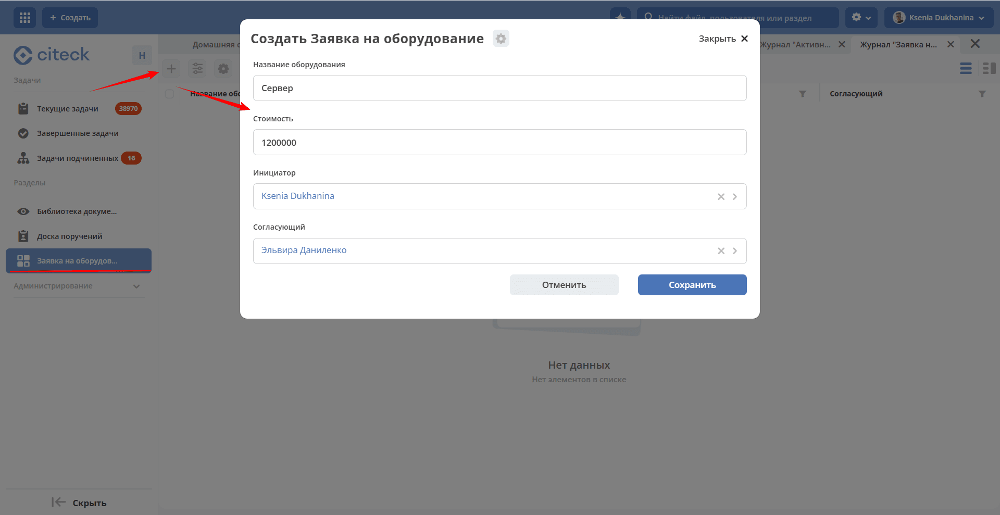

Появится первая задача **«На согласование»**. Нажмите **«Отправить на согласование»**:

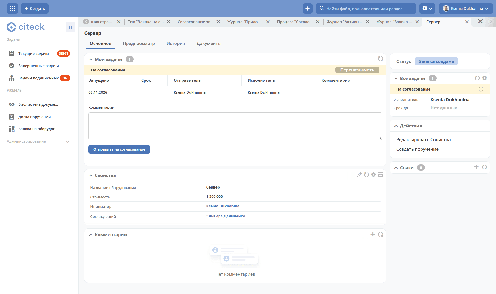

Откроется вторая задача **«На согласовании согласующим»**. Укажите комментарий и нажмите **«Отказать»**:

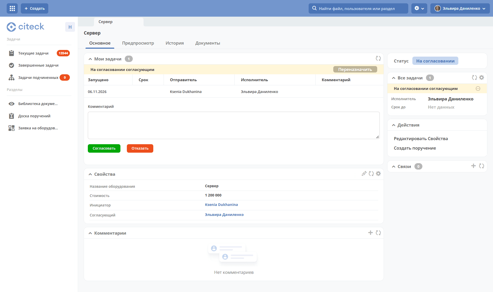

Заявка переходит в статус **«Отказано»**:

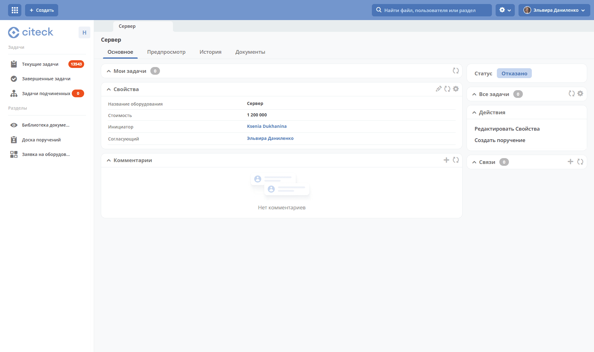
