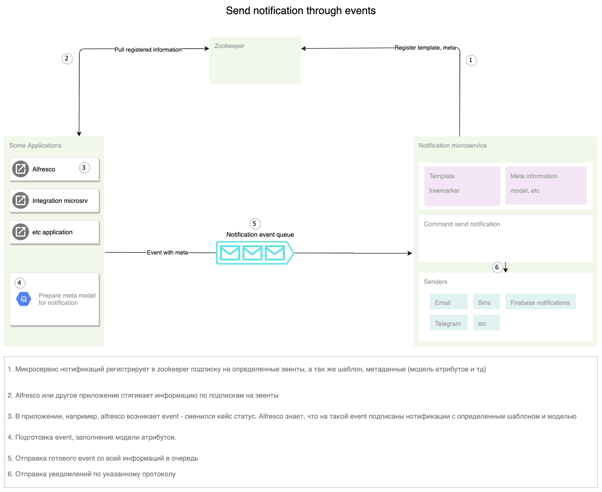
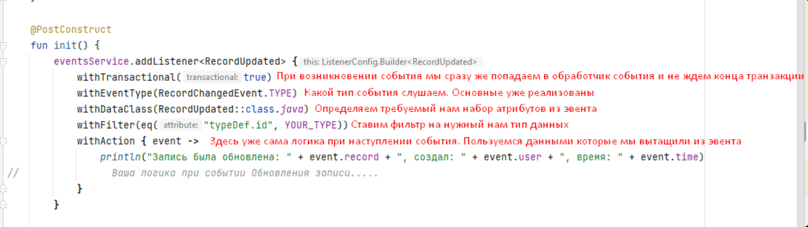

.. _ecos_events:

Работа с событиями (events)
===========================================

.. contents::
   :depth: 3

**События (Events)** — механизм локального и межсервисного взаимодействия в платформе Citeck. Подписчики выбирают тип события и необходимые им атрибуты. Ниже описаны API и ограничения ``ecos-events2 2.14.0-SNAPSHOT``.

Библиотека предоставляет стандартные события записей и средства публикации собственных событий. Их генерация при создании, изменении или удалении записей, назначении задач и других действиях определяется интеграцией соответствующего источника данных.

Слушатели поддерживают два режима обработки:

- **Нетранзакционный** (по умолчанию) — локальный обработчик при транзакционном вызове ставится на выполнение после commit; для удалённой нетранзакционной доставки используется RabbitMQ;
- **Транзакционный** — обработчик вызывается синхронно в транзакционном пути; удалённый слушатель вызывается через web-запрос. Исключение обработчика может повлиять на успех вызывающей операции.

Events 2.0
-----------

Модель событий и локальная обработка предоставляются библиотекой `ecos-events <https://github.com/Citeck/ecos-events>`_, модуль ``ecos-events2``. Межсервисная RabbitMQ-интеграция реализована отдельным модулем ``ecos-events2-rabbitmq`` и использует также ZooKeeper и web-клиент. Локальные события могут обрабатываться без удалённого транспорта.

Пример интеграции с микросервисом уведомлений:

Схема показывает частный сценарий отправки уведомлений через очередь. Шаблоны и каналы доставки относятся к сервису уведомлений; локальные обработчики и синхронный web-путь на схеме не показаны.

Описание работы
-----------------------------

Подписчик задаёт атрибуты в формате Records API через карту ``withAttributes`` или DTO-класс. Для получения дополнительных данных не нужно менять payload источника, если эти данные доступны через его граф атрибутов.

При настроенной удалённой интеграции подписки публикуются в ZooKeeper по типу события и требуемым атрибутам. Подписки можно добавлять и удалять во время работы; регистрация не ограничена стартом приложения.

Producer загружает объединение атрибутов всех заинтересованных слушателей, включая поля для фильтров. Для каждого слушателя формируется его проекция данных. Чтение атрибутов producer выполняется в системном контексте; это нужно учитывать при выборе данных события и обработчиков.

Удалённое транзакционное событие передаётся синхронным web-вызовом executor ``/events``, нетранзакционное — публикацией в RabbitMQ exchange ``ecos-events``. Получатель RabbitMQ обрабатывает событие в новой транзакции.

Момент публикации сообщения зависит от транспортной и транзакционной интеграции. Выполнение локального обработчика после commit само по себе не означает, что любая публикация RabbitMQ происходит только после успешного commit producer.

Транзакционные слушатели
-----------------------------------------------

Транзакционные слушатели позволяют реагировать на события "здесь и сейчас", не дожидаясь пока транзакция завершится.
Такие слушатели можно использовать для валидации с возможностью прервать вызывающую операцию исключением. Границы транзакций между приложениями определяются интеграцией webapp/txn: синхронный вызов сам по себе не гарантирует единую атомарную DB-транзакцию нескольких микросервисов.

Удалённый транзакционный слушатель создаёт зависимость доступности: если приложение со слушателем недоступно или возвращает ошибку, отправляющая операция может завершиться ошибкой. В примерах ниже ``withTransactional(true)`` выбран явно; по умолчанию этот параметр равен ``false``.

Параметры подписки
-----------------------------

.. list-table::
   :widths: 20 15 55
   :header-rows: 1
   :class: tight-table

   * - Параметр
     - По умолчанию
     - Назначение
   * - ``transactional``
     - ``false``
     - Синхронная обработка в транзакционном пути
   * - ``local``
     - ``false``
     - При ``true`` подписка остаётся локальной и не экспортируется для удалённых событий
   * - ``exclusive``
     - ``true``
     - Удалённое событие обрабатывается одним экземпляром приложения; при ``false`` каждый экземпляр получает отдельную доставку
   * - ``filter``
     - Без условий
     - Предикат отбора событий
   * - ``id``
     - UUID
     - Идентификатор подписки для последующего удаления

``dataClass`` и ``action`` обязательны. Сочетание ``transactional=true`` и ``exclusive=false`` запрещено.

``addListener`` возвращает ``ListenerHandle`` с методом ``remove()``. Также доступны ``eventsService.removeListener(id)`` и удаление по конфигурации.

Стандартные события записей
--------------------------------

В файле ``RecordEventTypes.kt`` модуля ``ecos-events2`` определены следующие типы:

.. list-table::
   :widths: 35 30 45
   :header-rows: 1
   :class: tight-table

   * - Класс
     - Значение ``TYPE``
     - Поля payload
   * - ``RecordCreatedEvent``
     - ``record-created``
     - ``record``, ``typeDef``
   * - ``RecordChangedEvent``
     - ``record-changed``
     - ``record``, ``typeDef``, ``before``, ``after``, вычисляемый ``diff``
   * - ``RecordDeletedEvent``
     - ``record-deleted``
     - ``record``, ``typeDef``
   * - ``RecordStatusChangedEvent``
     - ``record-status-changed``
     - ``record``, ``typeDef``, ``before``, ``after``
   * - ``RecordDraftStatusChangedEvent``
     - ``record-draft-status-changed``
     - ``record``, ``typeDef``, ``before``, ``after``

Другие прикладные и пользовательские события определяются их источниками. Набор доступных полей нужно проверять по payload конкретного события.

Метаданные события доступны через контекстный атрибут ``$event``: ``id``, ``time``, ``type``, ``user``, ``source``. В ``source`` содержатся идентификатор источника, имя приложения и его экземпляра. ``time`` и ``user`` фиксируются при отправке события; ``user`` не обязательно совпадает с создателем записи.

Примеры
---------------

Подписка на событие с произвольными атрибутами
~~~~~~~~~~~~~~~~~~~~~~~~~~~~~~~~~~~~~~~~~~~~~~~

Фрагменты ниже предполагают доступный ``eventsService``, предоставленный интеграцией приложения. Для Java-фрагмента нужны, в частности, импорты ``DataValue``, ``RecordCreatedEvent``, ``Map``, ``HashMap`` и ``kotlin.Unit``.

.. tab-set::

   .. tab-item:: Kotlin

      .. code-block:: kotlin

        eventsService.addListener<DataValue> {
            withTransactional(true)
            withEventType(RecordCreatedEvent.TYPE)
            withAction {
                println("Event for record with type: ${it["type"].asText()} Display name: ${it["disp"].asText()}")
            }
            withDataClass(DataValue::class.java)
            withAttributes(mapOf("type" to "record._type?id", "disp" to "record?disp"))
        }

   .. tab-item:: Java

      .. code-block:: java

        Map<String, String> attributes = new HashMap<>();
        attributes.put("type", "record._type?id");
        attributes.put("disp", "record?disp");

        eventsService.<DataValue>addListener(b -> {
            b.withTransactional(true);
            b.withEventType(RecordCreatedEvent.TYPE);
            b.withActionJ((event) -> {
                System.out.printf(
                    "Event for record with type: %s Display name: %s%n",
                    event.get("type").asText(),
                    event.get("disp").asText()
                );
            });
            b.withDataClass(DataValue.class);
            b.withAttributes(attributes);
            return Unit.INSTANCE;
        });

Пример listener-а событий для определенного типа данных
~~~~~~~~~~~~~~~~~~~~~~~~~~~~~~~~~~~~~~~~~~~~~~~~~~~~~~~~~~~~~~~~~~~~~~~~~~~~~~~~~~~~~~~~~~~~~~~~~~~~~~~~~~~~~~~

В следующем примере фильтр ``typeDef.id`` сравнивает точный ID типа. Включение наследников таким условием не подразумевается. Карта ``withAttributes`` может переопределять пути DTO по совпадающим алиасам; атрибуты фильтра загружаются дополнительно.

.. code-block:: kotlin

    import org.springframework.stereotype.Component
    import ru.citeck.ecos.events2.EventsService
    import ru.citeck.ecos.events2.type.RecordChangedEvent
    import ru.citeck.ecos.events2.type.RecordCreatedEvent
    import ru.citeck.ecos.events2.type.RecordDeletedEvent
    import ru.citeck.ecos.records2.RecordRef
    import ru.citeck.ecos.records2.predicate.model.Predicates.eq
    import ru.citeck.ecos.records3.record.atts.schema.annotation.AttName
    import java.time.Instant
    import javax.annotation.PostConstruct

    @Component
    class SomeTypeEventsListener(
        private val eventsService: EventsService,
    ) {

        companion object Constants {
            private const val YOUR_TYPE = "ID вашего типа данных"
        }

        @PostConstruct
        fun init() {
            eventsService.addListener<RecordUpdated> {
                withTransactional(true)
                withEventType(RecordChangedEvent.TYPE)
                withDataClass(RecordUpdated::class.java)
                withFilter(eq("typeDef.id", YOUR_TYPE))
                withAction { event ->
                    println("Запись была обновлена: " + event.record + ", пользователь события: " + event.user + ", время: " + event.time)
                }
            }

            eventsService.addListener<RecordCreated> {
                withTransactional(true)
                withEventType(RecordCreatedEvent.TYPE)
                withDataClass(RecordCreated::class.java)
                withFilter(eq("typeDef.id", YOUR_TYPE))
                withAction { event ->
                    println("Создана новая запись: " + event.record + ", пользователь события: " + event.user + ", время: " + event.time)
                }
            }

            eventsService.addListener<RecordDeleted> {
                withTransactional(true)
                withEventType(RecordDeletedEvent.TYPE)
                withDataClass(RecordDeleted::class.java)
                withFilter(eq("typeDef.id", YOUR_TYPE))
                withAction { event ->
                    println("Запись была удалена: " + event.record + ", пользователь события: " + event.user + ", время: " + event.time)
                }
            }
        }

        data class RecordUpdated(
            @AttName("record?id")
            val record: RecordRef,
            @AttName("\$event.time")
            val time: Instant,
            @AttName("\$event.user")
            val user: String,
        )

        data class RecordCreated(
            @AttName("record?id")
            val record: RecordRef,
            @AttName("\$event.time")
            val time: Instant,
            @AttName("\$event.user")
            val user: String,
        )

        data class RecordDeleted(
            @AttName("record?id")
            val record: RecordRef,
            @AttName("\$event.time")
            val time: Instant,
            @AttName("\$event.user")
            val user: String
        )

    }

В теле каждого ``withAction`` вместо ``println`` должна быть ваша бизнес-логика. Аналогичным образом можно подписаться на другие стандартные события из таблицы выше и на события, публикуемые вашим приложением. Импорт ``javax.annotation.PostConstruct`` соответствует показанному поколению зависимостей; для приложений с Jakarta следует использовать подходящий импорт из их зависимостей.

В data-классах (``RecordUpdated``, ``RecordCreated``, ``RecordDeleted``) определяется проекция данных для обработчика. Поля payload стандартных событий описаны в файле ``RecordEventTypes.kt``, а метаданные ``$event`` — в ``EcosEventInfo``.

Иллюстрация настройки слушателя. Поле ``user`` в ней следует понимать как пользователя отправки события:

