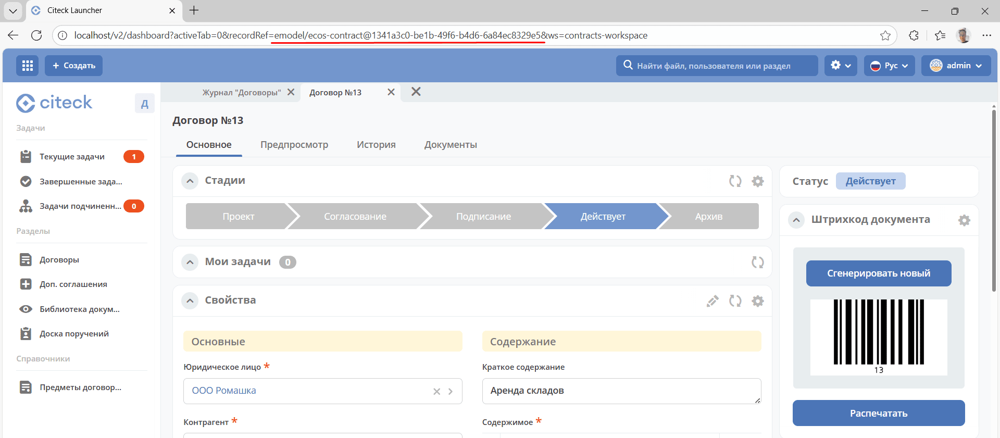

.. _RecordRef:

RecordRef
==========

**RecordRef** — идентификатор записи вида ``appName/sourceId@localId``, где **/** и **@** — особые разделители.

Состоит из трёх частей:

 * **appName** — идентификатор приложения, к которому относится запись (например, системные микросервисы emodel, eproc или пользовательские микросервисы);
 * **sourceId** — идентификатор локального (для приложения) источника данных, к которому относится запись;
 * **localId** — локальный идентификатор, который должен быть уникален в пределах источника.

В контексте известного приложения допустима сокращённая ссылка ``sourceId@localId``. При передаче ссылки между приложениями используйте полный формат, чтобы источник определялся однозначно.

**RecordRef**, например, указывается в строке браузера при обращении к сущности:

RecordRef является реализацией интерфейса EntityRef.

.. code-block:: java

  RecordRef.create("emodel", "type", "testdl-counterpartyToAuthority");

* **emodel** – appName
* **type** – sourceId
* **testdl-counterpartyToAuthority** — localId

Примеры ссылок для пользователей и групп
--------------------------------------------------------------------------------

Ниже приведены форматы ссылок на источники приложения ``emodel``:

.. list-table::
      :widths: 10 20 20
      :header-rows: 1
      :align: center
      :class: tight-table

      * - Тип сущности
        - Формат ссылки
        - Пример
      * - Пользователь
        - ``emodel/person@{username}``
        - ``emodel/person@ivan.petrov``
      * - Группа
        - ``emodel/authority-group@{localId}``
        - ``emodel/authority-group@accountant``

.. _broken_refs:

Корректный формат ссылок
------------------------------------------------

При записи значений в ASSOC-like атрибуты (Association, Authority, Person, Group) рекомендуется использовать полные ссылки в формате ``{appName}/{sourceId}@{localId}``: это обеспечивает однозначную адресацию между приложениями. Поддержка сокращённых ссылок зависит от контекста и целевого источника.

Проверить формат хранимых ссылок можно через:

.. code-block:: javascript

    Records.get('emodel/your-type@doc-id').load('myAssocAtt[]?raw')
