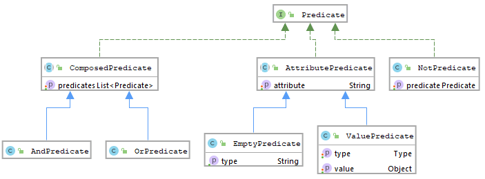

.. _ecos-predicate_main:

Язык предикатов
================

.. contents::
   :depth: 3

Предикат описывает условие, которое для проверяемого значения даёт результат ``true`` или ``false``. В ``ecos-records`` предусмотрены JSON-представление и модель классов для работы с предикатами на Java/Kotlin.

Ниже описана реализация ``ecos-records 3.60.0-SNAPSHOT``. Следует различать:

* модель предиката и её сериализацию;
* локальную проверку через ``PredicateService.isMatch``, фильтрацию и сортировку через ``filter``/``filterAndSort``;
* выполнение поискового запроса целевым Records DAO или преобразователем языка запроса.

Набор поддерживаемых операций и особенности сравнения при поиске определяются источником. Локальная проверка использует ``DefaultValueComparator`` либо переданный пользователем ``ValueComparator``.

JAVA представление
------------------

Диаграмма показывает основные связи классов; ``VoidPredicate`` и метод ``copy`` на ней не представлены. В реализации значение ``ValuePredicate`` хранится как ``DataValue``.

.. list-table:: Классы предикатов
   :widths: 20 60
   :header-rows: 1
   :class: tight-table

   * - Класс
     - Описание
   * - ``Predicate``
     - Базовый интерфейс с методом копирования ``copy()``
   * - ``AttributePredicate``
     - Предикат, связанный с атрибутом
   * - ``EmptyPredicate``
     - Проверка пустого значения атрибута
   * - ``ValuePredicate``
     - Сравнение атрибута со значением. Операция задаётся ``type``, значение хранится как ``DataValue``
   * - ``NotPredicate``
     - Отрицание вложенного предиката
   * - ``ComposedPredicate``
     - Объединение нескольких предикатов
   * - ``AndPredicate``
     - Логическое И
   * - ``OrPredicate``
     - Логическое ИЛИ
   * - ``VoidPredicate``
     - Предикат без условий; в локальной проверке обычного элемента соответствует истине

JSON представление
------------------

.. code-block:: json

   {
     "t": "and",
     "val": [
       {
         "t": "or",
         "val": [
           {"t": "contains", "att": "country", "val": "milan"},
           {"t": "contains", "att": "state", "val": "milan"},
           {"t": "contains", "att": "name", "val": "milan"}
         ]
       }
     ]
   }

Поле ``t`` задаёт тип предиката, ``att`` — имя атрибута, ``val`` — значение или вложенные предикаты. Не все операции используют все три поля. Для чтения поддерживаются также сокращения ``a`` вместо ``att`` и ``v`` вместо ``val``; при сериализации используются канонические имена ``att`` и ``val``.

Если ``t`` отсутствует или пуст, создаётся ``VoidPredicate``, который сериализуется как ``{}``. Неизвестный непустой тип вызывает ошибку ``Type is unknown``.

Для преобразования модели в JSON и обратно используется настроенный ``Json`` mapper. Методов ``writeJson``/``readJson`` у ``PredicateService`` нет.

.. code-block:: java

   String predicateStr = Json.getMapper().toString(predicate);
   Predicate restoredPredicate = Json.getMapper().read(predicateStr, Predicate.class);

Получение предиката из ``RecordsQuery``:

.. code-block:: java

   Predicate predicate = recordsQuery.getQuery(Predicate.class);

.. note::

   При сериализации выполняется оптимизация предиката. Поэтому после JSON → модель → JSON структура может измениться: удаляются лишние вложения, нормализуются имена полей, сокращения ``starts``/``ends`` представляются через ``like``. Исходный текст JSON не сохраняется побайтово.

Типы предикатов
---------------

Ниже приведены операции модели. Детали сравнения в следующем разделе относятся к стандартному локальному comparator; поведение SQL/FTS-поиска нужно учитывать отдельно.

.. list-table::
   :widths: 15 45 40
   :header-rows: 1
   :class: tight-table

   * - Тип
     - Назначение
     - Пример JSON
   * - ``starts``
     - Строка начинается с указанного значения; при чтении преобразуется в ``like`` с шаблоном ``value%``
     - ``{"t":"starts","att":"title","val":"Contract"}``
   * - ``ends``
     - Строка заканчивается указанным значением; при чтении преобразуется в ``like`` с шаблоном ``%value``
     - ``{"t":"ends","att":"title","val":"2026"}``
   * - ``or``
     - Объединение массива предикатов по ИЛИ
     - ``{"t":"or","val":[{"t":"eq","att":"name","val":"A"},{"t":"eq","att":"name","val":"B"}]}``
   * - ``and``
     - Объединение массива предикатов по И
     - ``{"t":"and","val":[{"t":"ge","att":"amount","val":10},{"t":"le","att":"amount","val":20}]}``
   * - ``empty``
     - Проверка пустого значения атрибута
     - ``{"t":"empty","att":"title"}``
   * - ``not``
     - Отрицание одного предиката в ``val``
     - ``{"t":"not","val":{"t":"empty","att":"title"}}``
   * - ``eq``
     - Равенство с учётом правил comparator
     - ``{"t":"eq","att":"title","val":"Contract"}``
   * - ``gt``
     - Больше
     - ``{"t":"gt","att":"amount","val":10}``
   * - ``ge``
     - Больше или равно
     - ``{"t":"ge","att":"amount","val":10}``
   * - ``lt``
     - Меньше
     - ``{"t":"lt","att":"amount","val":20}``
   * - ``le``
     - Меньше или равно
     - ``{"t":"le","att":"amount","val":20}``
   * - ``like``
     - Сопоставление строки с шаблоном: ``%`` — любое количество символов, ``_`` — один символ
     - ``{"t":"like","att":"title","val":"Contract%"}``
   * - ``in``
     - Значение атрибута равно одному из элементов массива ``val``
     - ``{"t":"in","att":"_status?str","val":["draft","Canceled"]}``
   * - ``contains``
     - Для строки — наличие подстроки, для массива — наличие равного элемента
     - ``{"t":"contains","att":"title","val":"contract"}``

Отрицание поддерживаемого типа можно записать через префикс ``not-``. Например:

.. code-block:: json

   {"t":"not-eq","att":"title","val":"Contract"}

Десериализатор преобразует его в ``not`` с вложенным ``eq``.

Особенности локального сравнения
--------------------------------

В ``DefaultValueComparator``:

* ``eq`` не является строгим сравнением JSON-типов: числовые строки могут сравниваться с числами; для чисел используется допуск ``1e-7``.
* Строковый поиск ``contains`` нечувствителен к регистру. Для массива сравниваются элементы через ``isEquals``; поиск подстроки в каждом элементе массива не выполняется.
* Для объекта и строкового аргумента ``contains`` проверяет строковые поля объекта. При ``eq`` объект также может сравниваться со строковыми значениями своих полей.
* ``in`` ожидает массив в ``val``; для другого типа ``val`` возвращается ``false``.
* ``like`` сравнивает строки без учёта регистра: ``%`` заменяется на ``.*``, ``_`` — на ``.``, затем применяется регулярное выражение ко всей строке. Остальные метасимволы регулярных выражений не экранируются, поэтому это не полная копия SQL LIKE.
* ``empty`` проверяет ``null`` и пустоту значения согласно его типу.
* При пустом или неподдерживаемом значении ``starts``/``ends`` resolver возвращает ``alwaysTrue``.
* При прямом локальном вычислении пустые ``and`` и ``or`` считаются истинными. Это особенность реализации, а не математическое правило пустого ИЛИ.

Поисковый источник может использовать собственный comparator или преобразование в SQL/FTS. Из локального результата нельзя выводить полную эквивалентность поисковому запросу.

Дополнительные возможности предикатов
--------------------------------------

Даты и диапазоны
~~~~~~~~~~~~~~~~~~~~~~~~~~~~~~~

Для сравнения абсолютных дат используйте значения ISO 8601 с часовым поясом. Стандартный comparator распознаёт Instant-строки с ``T`` и окончанием ``Z`` при сравнении больше/меньше; в иных случаях применяются его общие правила преобразования и сравнения.

Диапазон с включёнными границами можно выразить через ``and`` с ``ge`` и ``le``. Например, от 2020-01-01 00:00 UTC до 2020-02-01 00:00 UTC включительно:

.. code-block:: json

   {
     "t": "and",
     "val": [
       {"t":"ge","att":"_created","val":"2020-01-01T00:00:00Z"},
       {"t":"le","att":"_created","val":"2020-02-01T00:00:00Z"}
     ]
   }

Для относительного периода можно заранее вычислить абсолютные границы. Пример для последних десяти суток:

.. code-block:: javascript

   const to = new Date();
   const from = new Date(to.getTime() - 10 * 24 * 60 * 60 * 1000);
   const predicate = {
     t: 'and',
     val: [
       { t: 'ge', att: '_created', val: from.toISOString() },
       { t: 'le', att: '_created', val: to.toISOString() }
     ]
   };

.. note::

   Строки ``-P10D``, ``date/duration``, ``$NOW`` и ``$TODAY`` не разбираются как относительные даты или диапазоны стандартным ``PredicateService`` этой версии. Их применение требует явной поддержки преобразователя конкретного источника. Аналогично, перевод предикатов в FTS и его шаблоны определяются Alfresco-интеграцией, а не JSON-моделью ecos-records.

Дебаг предикатов и отладка
-----------------------------

.. dropdown:: Отладка предикатов
   :color: secondary

   Источник ``predicate`` входит в стандартные DAO ecos-records и позволяет локально проверить условие для записи. Префикс приложения, например ``uiserv/``, выбирает место выполнения диагностики.

   1. Проверить один предикат:

   .. code-block:: javascript

      await Records.queryOne({
        sourceId: 'uiserv/predicate',
        query: {
          record: 'emodel/your-type@doc-id',
          predicate: {
            t: 'not',
            val: { t: 'eq', att: '_status?str', val: 'Canceled' }
          }
        }
      }, 'result?bool');

   ``record`` и ``predicate`` — одиночные формы полей ``records`` и ``predicates``. Для каждой записи источник возвращает поле ``record`` и список ``result`` с одним булевым значением на предикат. Для нескольких предикатов передавайте ``predicates`` и запрашивайте ``result[]?bool``.

   Диагностика загружает нужные атрибуты и вызывает локальный PredicateService. Она не проверяет преобразование условия в SQL/FTS целевого источника.

   2. Загрузить значения сравниваемых атрибутов:

   .. code-block:: javascript

      await Records.get('emodel/your-type@doc-id').load([
        '_status?str',
        '_status?disp',
        '_roles.isCurrentUserMemberOf.author?bool',
        '_roles.isCurrentUserMemberOf.admin?bool'
      ]);

   Замените ссылку, статусы и роли значениями своей установки. Наличие этих атрибутов и их представления определяются источником записи.

Отображение кнопки при определённых условиях, описанных предикатом
---------------------------------------------------------------------

Если настройка кнопки принимает предикат, можно задать условие, исключающее несколько статусов. В этом примере ``_status?str`` запрашивает строковый код статуса, предоставляемый источником. Внешний вид и применение условия определяются UI и настройкой действия.

Пример в YAML:

.. code-block:: yaml

   t: not
   val:
     t: in
     att: _status?str
     val:
       - draft
       - Canceled
       - Rejected
