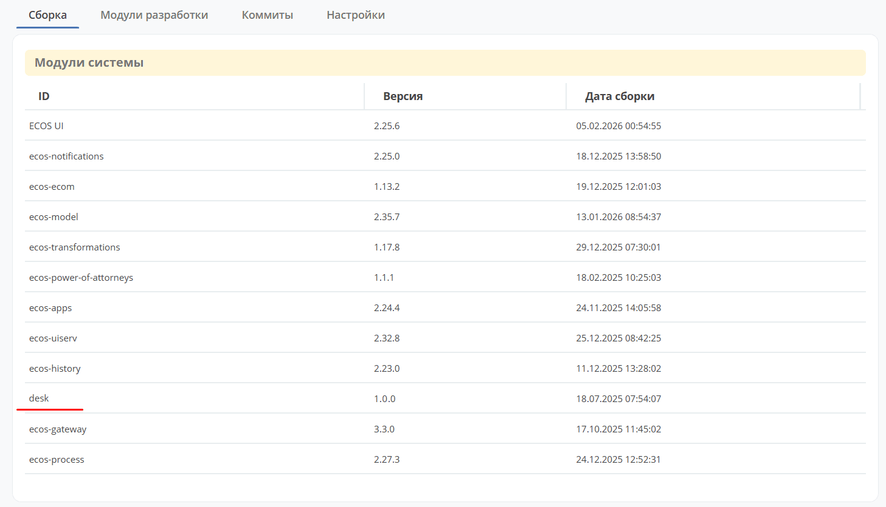

.. _mcs_setup:

Создание нового микросервиса
========================================================

.. contents::
   :depth: 2

**Микросервисы в Citeck** — самостоятельные приложения на базе Spring Boot, которые регистрируются в системе через Service Discovery и взаимодействуют с остальными компонентами платформы через :ref:`Records API <Records_API>`, Commands API и шину событий (RabbitMQ).

Создать собственный микросервис стоит, когда требуется:

* реализовать изолированную бизнес-логику с отдельным жизненным циклом развёртывания;
* подключить стороннюю библиотеку или внешнюю систему, не затрагивая основные сервисы;
* масштабировать отдельный компонент независимо от остальной платформы.

Статья описывает два способа создания микросервиса: вручную через IDE и с помощью плагина для IntelliJ IDEA.

.. note::

    Для создания микросервиса используется `Spring Boot <https://docs.spring.io/spring-boot/documentation.html>`_

Пример минимального проекта: `Citeck/ecos-webapp-sample <https://github.com/Citeck/ecos-webapp-sample/tree/main/minimal-sample>`_. Версии зависимостей примера следует согласовать с используемым выпуском платформы.

Создание микросервиса в интегрированной среде разработки
------------------------------------------------------------------------------------------------------------

Настройка pom.xml
~~~~~~~~~~~~~~~~~~~~~~~~~~~~~~~~~~

Для создания нового микросервиса Citeck нужно создать новый **maven spring-boot проект** и в ``pom.xml`` добавить в качестве родителя один из следующих pom файлов:

.. list-table::
   :widths: 30 70
   :header-rows: 1
   :class: tight-table

   * - Артефакт
     - Описание
   * - ru.citeck.ecos.webapp:ecos-webapp-spring-base-parent
     - | Базовый родитель для spring-boot микросервисов, где требуется ручная настройка плагинов для сборки.
       | Этот проект является родительским для всех остальных в этой таблице.
   * - ru.citeck.ecos.webapp:ecos-webapp-spring-hibernate-parent
     - | Родитель для spring-boot микросервисов, в которых предполагается использование hibernate.
       | Настройка плагинов для сборки не требуется.
   * - ru.citeck.ecos.webapp:ecos-webapp-spring-simple-parent
     - Родитель для spring-boot микросервисов без состояния или микросервисов, которые работают с БД через jdbc или :ref:`ecos-data <ecos_data_main>`.

Версию родительского POM выбирайте в соответствии с используемым выпуском платформы и требованиями его библиотек. Например, на 10.11.2026 в ветках ``develop`` сервисов ``ecos-model`` и ``ecos-integrations`` используются версии ``hibernate-parent`` **3.39.0** и **3.38.5** соответственно, а в ``ecos-uiserv`` и ``ecos-notifications`` — **3.37.1**. Это примеры используемых версий, а не указание последнего релиза для всех parent POM.

JDK и Maven должны соответствовать требованиям выбранного parent POM. В CI перечисленных ``ecos-model``, ``ecos-integrations`` и ``ecos-notifications`` используется **JDK 25**. Требования предыдущих выпусков могут отличаться.

Родительские POM управляют версиями зависимостей Spring Boot и библиотек Citeck. Состав тестовых зависимостей и настройки сборки зависят от выбранного parent и его версии. Для загрузки зависимостей нужен доступ к настроенным Maven-репозиториям.

Пример структуры POM с ``simple-parent`` приведён ниже. В нём используется фиксированная версия **3.22.9**; перед созданием проекта замените её совместимой версией ``simple-parent`` для вашего окружения. Наличие нужного выпуска проверяйте для выбранного артефакта: версии ``simple-parent`` и ``hibernate-parent`` нужно согласовать с их зависимостями.

.. code-block:: xml

    <?xml version="1.0" encoding="UTF-8"?>
    <project xmlns="http://maven.apache.org/POM/4.0.0" xmlns:xsi="http://www.w3.org/2001/XMLSchema-instance"
            xsi:schemaLocation="http://maven.apache.org/POM/4.0.0 http://maven.apache.org/maven-v4_0_0.xsd">
        <modelVersion>4.0.0</modelVersion>

        <groupId>ru.citeck.ecos.webapp.sample</groupId>
        <artifactId>minimal-sample</artifactId>
        <version>1.0.0-SNAPSHOT</version>

        <parent>
            <groupId>ru.citeck.ecos.webapp</groupId>
            <artifactId>ecos-webapp-spring-simple-parent</artifactId>
            <version>3.22.9</version>
        </parent>

        <repositories>
            <repository>
                <id>citeck-public</id>
                <url>https://nexus.citeck.ru/repository/maven-public</url>
            </repository>
        </repositories>

    </project>

Главный класс приложения
~~~~~~~~~~~~~~~~~~~~~~~~~~~~~~~~~~~~~~~~

Следующим шагом нужно создать **главный класс** для запуска spring-boot приложения по следующему пути:

.. code-block:: text

    src/main/java/ru/citeck/ecos/webapp/sample/minimal/MinimalWebAppSample.java

* ``ru/citeck/ecos/webapp/sample/minimal`` — java пакет для нашего приложения, который может быть произвольным;

* ``MinimalWebAppSample.java`` — файл с основным классом для запуска приложения. Может быть произвольным. Есть поддержка как Kotlin так и Java файлов.

Содержимое основного класса:

.. code-block:: java

    package ru.citeck.ecos.webapp.sample.minimal;

    import org.springframework.boot.autoconfigure.SpringBootApplication;
    import org.springframework.cloud.client.discovery.EnableDiscoveryClient;
    import ru.citeck.ecos.webapp.lib.spring.EcosSpringApplication;

    @SpringBootApplication
    @EnableDiscoveryClient
    public class MinimalWebAppSample {

        public static final String NAME = "minimal-webapp";

        public static void main(String[] args) {
            new EcosSpringApplication(MinimalWebAppSample.class).run(args);
        }
    }

где

* ``public static final String NAME = "minimal-webapp";`` — имя приложения (app name). Выберите отдельное имя для нового сервиса; экземпляры одного сервиса используют одинаковое имя. Оно применяется в нескольких механизмах платформы:

  - При использовании распределённого кэша Hazelcast одноимённые экземпляры сервиса объединяются согласно настройкам кэша;

  - Commands API работает на базе этого имени. При отправке команды мы указываем имя приложения и сообщение уходит в персональную очередь для этого приложения;

  - Records API работает на базе этого имени. Имя приложения используется при поиске и указывается в sourceId до символа “/" (напр. emodel/person). Ссылки на сущности формируются с учетом имени приложения (напр. emodel/person@someuser);

  - Service discovery механизм работает на основе имени приложения.

* ``EcosSpringApplication`` — наше расширение штатного SpringApplication. Для корректной работы микросервиса нужно использовать EcosSpringApplication.

Файл настроек
~~~~~~~~~~~~~~~~~~~~~~~~~~

Создать **файл с настройками** по пути (опционально):

.. code-block:: text

    src/main/resources/config/application.yml

Содержимое файла:

.. code-block:: yaml

    ---
    server:
      port: 8686 # указываем порт, на котором будет развернут микросервис

В этом файле можно разместить настройки приложения. Пример задаёт только HTTP-порт. Для подключения к платформе настройте используемые сервисом Service Discovery, транспорт сообщений и источники данных согласно конфигурации окружения. Набор обязательных подключений зависит от функций сервиса и выбранного parent POM.

Логирование
~~~~~~~~~~~~~~~~~~~~~~

Добавить **файл для настройки логирования**:

.. code-block:: text

    src/main/resources/logback-spring.xml

со следующим содержимым:

.. code-block:: xml

    <?xml version="1.0" encoding="UTF-8"?>
    <!DOCTYPE configuration>
    <configuration>
        <include resource="ecos/logback-base.xml" />
    </configuration>

Запуск
~~~~~~~~~~~~~~~~

Перед запуском проверьте выбранный JDK, доступ к зависимостям и необходимым внешним сервисам. Для запуска микросервиса локально с parent, подключающим ``spring-boot-maven-plugin``, используйте команду из корня проекта:

.. code-block:: bash

    mvn spring-boot:run

Или стандартные механизмы IDE для запуска spring-boot приложений.

Тестирование
~~~~~~~~~~~~~~~~~~~~~~~~

Создать файл с **настройками логирования для тестов** (опционально):

.. code-block:: text

    src/test/resources/logback-test.xml

с содержимым:

.. code-block:: xml

    <?xml version="1.0" encoding="UTF-8"?>
    <!DOCTYPE configuration>
    <configuration>
        <include resource="ecos/logback-base.xml" />
    </configuration>

Создать файл с **настройками для автотестов** (опционально):

.. code-block:: text

    src/test/resources/config/application-test.yml

В этом файле можно разместить настройки тестового профиля. Ресурсы из ``src/test/resources`` доступны тестам и не включаются в основной артефакт приложения. Файл ``application-test.yml`` загружается при активном профиле ``test``; в примере ниже он включён явно через ``@ActiveProfiles("test")``.

Создать **файл для тестирования микросервиса**:

.. code-block:: text

    src/test/java/ru/citeck/ecos/webapp/sample/minimal/MinimalWebAppSampleTest.java

где

* ``ru/citeck/ecos/webapp/sample/minimal`` — java пакет с тестами. Может быть любым, но крайне желательно размещать тесты в том же пакете или подпакетах, что и основной класс из раздела «Главный класс приложения»;

* ``MinimalWebAppSampleTest.java`` — имя файла с тестами. Может быть любым.

Пример smoke-теста загрузки Spring-контекста и регистрации главного класса приложения:

.. code-block:: java

    package ru.citeck.ecos.webapp.sample.minimal;

    import org.junit.jupiter.api.Test;
    import org.junit.jupiter.api.extension.ExtendWith;
    import org.springframework.beans.factory.annotation.Autowired;
    import org.springframework.boot.test.context.SpringBootTest;
    import org.springframework.context.ApplicationContext;
    import org.springframework.test.context.ActiveProfiles;
    import ru.citeck.ecos.webapp.lib.spring.test.extension.EcosSpringExtension;

    import static org.assertj.core.api.AssertionsForClassTypes.assertThat;

    @ExtendWith(EcosSpringExtension.class)
    @SpringBootTest(classes = { MinimalWebAppSample.class })
    @ActiveProfiles("test")
    public class MinimalWebAppSampleTest {

        @Autowired
        private ApplicationContext context;

        @Test
        public void contextLoads() {
            assertThat(context.getBean(MinimalWebAppSample.class)).isNotNull();
        }
    }

где

* ``EcosSpringExtension`` — расширение Citeck для интеграции с тестовым Spring-контекстом и тестовой инфраструктурой. Тип БД, mocks и необходимость контейнерного окружения зависят от версии библиотек и настроек. Например, тестовая инфраструктура WebApp поддерживает PostgreSQL в контейнере; наличие расширения само по себе не гарантирует использование in-memory БД;

* ``MinimalWebAppSample.class`` — класс из раздела «Главный класс приложения».

Такой тест проверяет загрузку контекста. Проверки бизнес-логики и взаимодействия через Records API добавляйте отдельно для компонентов вашего сервиса.

Для запуска автотестов нужно выполнить следующую команду:

.. code-block:: bash

    mvn clean test

Сборка
~~~~~~~~~~~~~~

Для сборки Docker-образа нужен доступный Docker daemon, JDK выбранного выпуска и доступ к зависимостям и базовому образу. Следующая команда рассчитана на parent с подключёнными ``jib-maven-plugin`` и ``ecos-webapp-maven-plugin``. При использовании ``base-parent`` эти плагины и их выполнения в жизненном цикле Maven нужно настроить отдельно.

Из корня проекта выполните:

.. code-block:: bash

    mvn clean package jib:dockerBuild -Djib.docker.image.tag=1.0.0-snapshot

.. note::

    В стандартной конфигурации образа entrypoint использует следующие файлы:

    * ``/entrypoint.sh``;
    * ``/app/jib-classpath-file``;
    * ``/app/jib-main-class-file``.

    Подготовку скрипта запуска выполняет цель ``prepare-image`` плагина ``ecos-webapp-maven-plugin``; Jib добавляет подготовленные файлы в образ и формирует файлы classpath и главного класса. В подключающем эти настройки parent они выполняются при стандартной сборке. Если конфигурация плагинов изменена, проверьте выполнение подготовки образа и соответствие путей его entrypoint.

В конфигурации parent, использующей ``${project.artifactId}:${jib.docker.image.tag}``, приведённая команда создаёт образ с тегом ``1.0.0-snapshot`` в локальном Docker daemon.

Проверка версии в интерфейсе
~~~~~~~~~~~~~~~~~~~~~~~~~~~~~~~~~~~~~~~~~~~~

В списке модулей системы UI использует поле ``label`` как ID и название модуля. Версия и дата сборки загружаются из ``info.version`` и ``info.buildDate`` источника build-info. Поле ``info.repo`` используется отдельно для сведений о репозиториях и коммитах; оно не является прямым источником столбца ID.

Метаданные сборки создаёт цель ``build-info`` плагина ``ecos-webapp-maven-plugin``. При стандартной конфигурации ресурсы находятся по путям:

* в проекте — ``target/classes/ecos/build-info.json``;
* в образе Jib со стандартной раскладкой приложения — ``/app/resources/ecos/build-info.json``.

При изменении расположения ресурсов или конфигурации образа пути могут отличаться.

Создание микросервиса с использованием плагина для IntelliJ IDEA
------------------------------------------------------------------------------------------------------------

Быстрее и удобнее создавать микросервис с использованием плагина для IntelliJ IDEA см. :ref:`как <plugin_app_mks>`.
