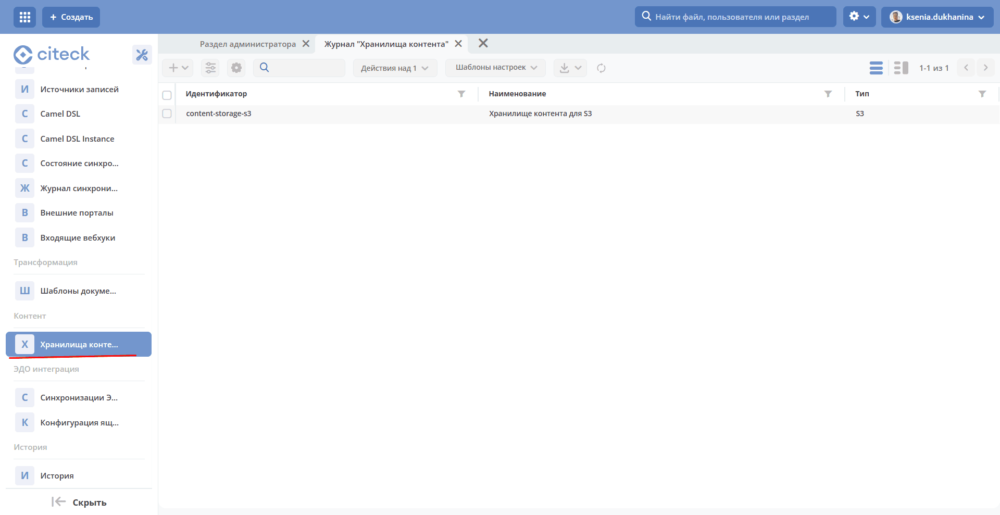
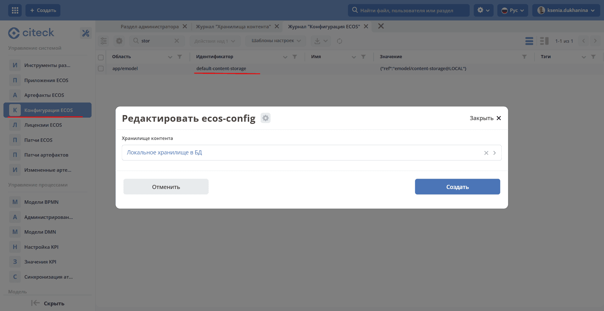

.. _content_deployment:

Развертывание микросервиса и первичная настройка
============================================================================================

Для развёртывания **ecos-content** используйте образ и конфигурацию, совместимые с вашей версией Citeck. Описанные в этом разделе возможности сервиса сверены с исходниками версии **1.8.0**. Тег образа и его доступность в Enterprise registry нужно уточнять для конкретной поставки.

Ниже приведён шаблон подключения к **docker-compose.yml**. Задайте ``ECOS_CONTENT_IMAGE`` с полным именем образа и тегом, создайте ``content.env`` с настройками окружения поставки и подключите сервис к общей сети микросервисов:

.. code-block:: yaml

    #=== ECOS CONTENT ===#

    content-app-dev:
      container_name: content-app-dev
      image: ${ECOS_CONTENT_IMAGE}
      ports:
        - "8088:8088"
      env_file:
        - content.env
      environment:
        SERVER_PORT: "8088"

В шаблоне порт приложения явно задан как ``8088``. Параметры подключения к инфраструктуре, профили Spring, аутентификацию и лимиты ресурсов берите из конфигурации вашего релиза. Старые настройки Eureka и Config Server не являются универсальной конфигурацией для всех версий. Для чанковой загрузки обеспечьте доступное место в каталоге временных файлов контейнера.

После запуска микросервиса и деплоя его UI-артефактов в рабочем пространстве **Раздел администратора** появляется пункт **Контент** с журналом **Хранилища контента**:

Настройка конфигурации Citeck после поднятия системы с микросервисом
---------------------------------------------------------------------------------------------------------------------------------------

Параметр **default-content-storage**

Создайте :ref:`конфигурацию хранилища <content_new_config>` и выберите её в параметре **default-content-storage**. Настройка предназначена для выбора хранилища по умолчанию, когда оно не задано явно у типа. Это позволяет использовать разные хранилища на разных стендах без изменения конфигурации типа.

Применение настройки выполняет компонент, загружающий контент, например ecos-model. Сам ecos-content принимает конкретный идентификатор хранилища; поведение значения по умолчанию необходимо согласовать с версией вызывающего компонента.

