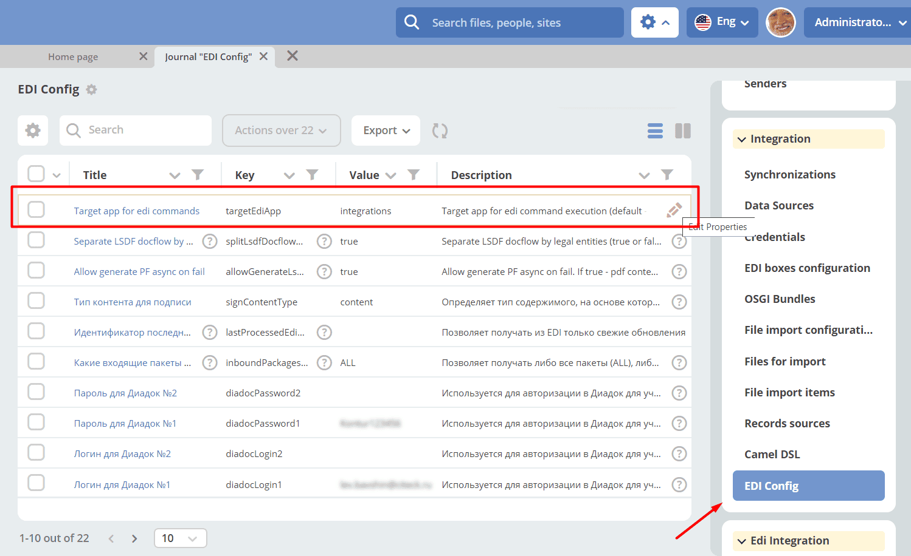
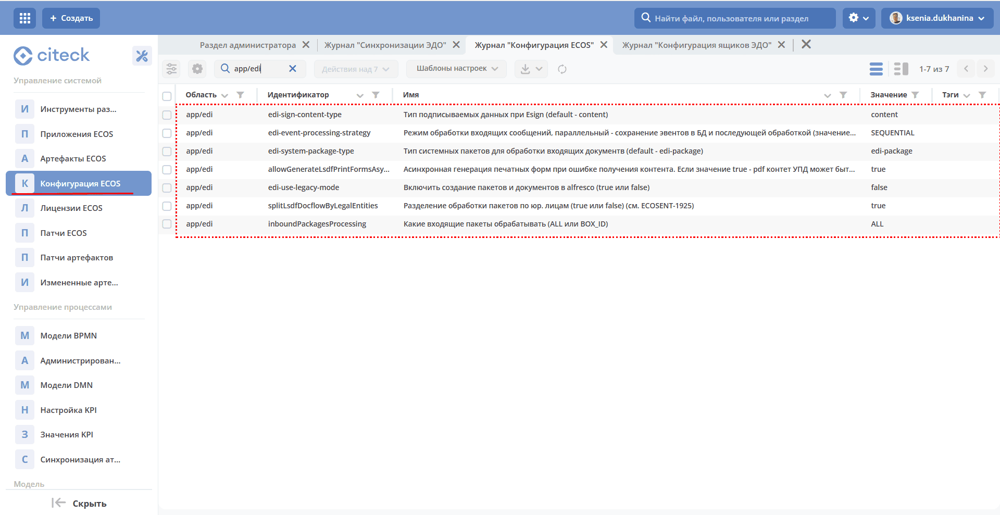

.. _edi_configuration:

Настройка синхронизации и конфигурация
========================================

.. note::

  На текущий момент логика синхронизации с провайдером для **targetApp = integrations** работает **ТОЛЬКО** для версий с alfresco.

  Если **targetApp = edi**, то обе версии (с alfresco и без).

Ниже описана настройка синхронизации с провайдерами **Диадок** и **СБИС**. В текущей модели также предусмотрены варианты создания ящиков **CORUS** и **DIDOX**; их параметры зависят от провайдера.

Принцип действия и настройки ящиков и синхронизаций edi практически идентичны настройкам на integrations.

Перед созданием ящиков необходимо создать записи в журналах **Секреты** и **Конечные точки**.

.. dropdown:: Как добавить новую синхронизацию с ящиком диадок или СБИС
   :color: secondary

   1. Cоздать ящик в журнале **Конфигурация ящиков ЭДО**:

      .. note::

         Журнал располагается в разделе **(Рабочее пространство "Раздел администратора" - ЭДО интеграция)**, не путать с журналом, который располагается в разделе **Интеграция**

      .. image:: _static/edi_1.png
         :width: 700
         :align: center

   2. Настройка ящика такая же как и в integrations:

      .. image:: _static/edi_2.png
         :width: 600
         :align: center

      .. list-table::
         :widths: 20 50
         :header-rows: 1
         :class: tight-table

         * - Поле
           - Описание
         * - **Name**
           - Произвольное название ящика. Для удобства различения ящиков рекомендуется использовать уникальные названия.
         * - **URL**
           - Endpoint. Указывается в журнале :ref:`Конечные точки<ECOS_endpoints>`.
         * - **Авторизационные данные**
           - Креды у учетной записи. Указывается в журнале :ref:`Секреты<ECOS_secrets>`.
         * - **Идентификатор ящика**
           - ID ящика в провайдере.
         * - **Ключ разработчика**
           - API ключ, получаемый от провайдера.

   3. Создание новой синхронизации также идентично тому что в integrations на данный момент.

      .. image:: _static/edi_3.png
         :width: 700
         :align: center

      |

      .. image:: _static/edi_4.png
         :width: 600
         :align: center

      .. list-table::
         :widths: 20 50
         :header-rows: 1
         :class: tight-table

         * - Поле
           - Описание
         * - **Наименование**
           - Название синхронизации. Рекомендуется использовать уникальные названия.
         * - **Включена**
           - Флаг включения/выключения.
         * - **Ящик ЭДО**
           - Конфигурация ящика.
         * - **Id первого события**
           - Начальная позиция синхронизации (``defaultEventId``, опционально). Используется только при отсутствии сохранённого ``lastEventId``. Правила продолжения с указанного ID зависят от провайдера.
         * - **Источник данных для контрагентов**
           - Кастомный sourceID для поиска контрагентов.
         * - **Источник данных для юр.лиц**
           - Кастомный sourceID для поиска юридических лиц (``legalEntitySourceId``).
         * - **Стратегия обработки эвентов**
           - | Режим обработки входящих сообщений:
             | — **PARALLEL** — параллельный, сохранение событий в БД и последующей обработкой;
             | — **SEQUENTIAL** — стандартный последовательный, обработка событий "на лету" при получении. Используется, если стратегия в записи синхронизации не задана.
         * - **Приложение внешней обработки событий**
           - App, если требуется предобработка событий.
         * - **Url адрес для внешней обработки**
           - URL в app, описанном выше, по которому обрабатываются события.
         * - **Крон выражение**
           - Cron, по которому работает синхронизация. Корректное выражение имеет приоритет над периодическим расписанием.
         * - **Фиксированный запуск**
           - Режим периодического расписания (``triggerFixedRate``): true — фиксированная частота запусков, false — задержка между завершением предыдущего и началом следующего выполнения. Применяется при заданном положительном периоде и отсутствии корректного cron.
         * - **Периодичность запуска**
           - Период в миллисекундах (``triggerPeriod``). Должен быть больше нуля.
         * - **Первоначальная задержка**
           - Задержка первого периодического запуска в миллисекундах (``triggerInitialDelay``).

      Если корректный cron и положительный период не заданы, используется расписание по умолчанию: каждые 30 секунд.

      .. note::

         Если необходимо включить синхронизацию по ящику в edi микросервисе (**ЭДО интеграция - Синхронизации ЭДО**), то эту же синхронизацию необходимо отключить в integrations микросервисе (**Интеграция - Синхронизации**), иначе возможны ошибки и конкурентные потоки записывающие различные данные в одни и те же документы.

      .. note::

         При переносе синхронизации между edi и integrations сначала отключите текущую синхронизацию и зафиксируйте последнюю обработанную позицию. Перед включением синхронизации в другом сервисе согласуйте её состояние с этой позицией.

         В edi сохранённый ``lastEventId`` имеет приоритет над **Id первого события** (``defaultEventId``). Если синхронизация уже запускалась, изменения одного поля **Id первого события** недостаточно. При необходимости начать с новой позиции задайте ``defaultEventId`` и сбросьте сохранённое состояние при выключенной синхронизации.

         В edi для сброса используется Records DAO ``edi/reset-sync@`` с параметром ``syncRef``. Сброс сохраняет прежний ID в ``lastEventIdBeforeReset`` и очищает ``lastEventId`` и ``lastSyncDateTime``. После сброса проверьте настройки и включите синхронизацию. Процедуру изменения состояния в integrations следует выполнять по инструкции для используемой версии этого сервиса.

   4. Переключение логики по исходящим пакетам, а также любым действиям с нашей стороны.

      Для того чтобы переключить логику выполнения запросов к провайдеру между edi и integrations микросервисами существует настройка **TargetEdiApp** (значения edi или integrations). Актуально только для систем с alfresco, для чистых ecos системы вся логика общения с провайдерами идет через edi.

В системах с Alfresco для направления исходящих команд в ecos-edi задайте **TargetEdiApp = edi**. Эта настройка Alfresco отличается от поля ``targetApp`` в записи синхронизации, которое задаёт приложение внешней обработки входящих событий.

Настройки и конфигурация
----------------------------

Основные настройки, на которые следует обратить внимание:

**TargetEdiApp**

Настройка alfresco, служит для того чтобы определять в какой именно микросервис будут отправлены команды завязанные на edi логику с нашей стороны (подписание и отправка титулов, отказ, аннулирование и т.д.). Принимает 2 значения:

- **integrations** - команды отсылаются в микросервис ecos-integrations (старая логика)
- **edi** - команды отсылаются в новый микросервис ecos-edi

Если данное поле пустое, то команды отсылаются в микросервис integrations по умолчанию.

**Конфигурация из ecos конфига** (Рабочее пространство "Раздел администратора" - Управление системой - Конфигурация ECOS):

.. list-table::
   :widths: 25 50
   :header-rows: 1
   :class: tight-table

   * - Параметр
     - Описание
   * - **edi-event-processing-strategy**
     - Для синхронизаций v2 задавайте стратегию в поле **Стратегия обработки эвентов** самой записи синхронизации. При отсутствии значения используется SEQUENTIAL. В режиме PARALLEL события сохраняются в БД и затем обрабатываются по пакетам: разные пакеты параллельно, события внутри пакета последовательно.
   * - **edi-system-package-type**
     - Тип системного пакета при хранении в ECOS. По умолчанию — edi-package. Режим хранения в Alfresco выбирается отдельно через edi-use-legacy-mode.
   * - **allowGenerateLsdfPrintFormsAsyncOnFail**
     - Разрешает асинхронную генерацию печатных форм при ошибке получения контента. В поставляемой конфигурации — true. Для последующего заполнения контента должна работать задача UpdatePrintFormJob.
   * - **edi-use-legacy-mode**
     - Выбирает хранение входящих пакетов и документов: false — в ECOS (значение поставляемой конфигурации), true — в Alfresco для гибридного окружения. Выбирайте значение в соответствии с архитектурой системы.
   * - **splitLsdfDocflowByLegalEntities**
     - Разделение обработки пакетов по юридическим лицам. В поставляемой конфигурации — true.
   * - **inboundPackagesProcessing**
     - Настройка, перенесённая из ecos-integrations, какой тип эвентов обрабатывать: все (ALL — по умолчанию) или по BOX_ID.
