.. _transformation:

Transformations микросервис
==========================================

.. note::

    Доступность отдельных функций зависит от состава и условий поставки. В частности, автоматическая генерация контента использует Enterprise-библиотеку трансформаций.

Опциональный микросервис **ecos-transformations** для генерации документов по шаблонам, которые можно подгрузить с проектом или добавить через инструменты администратора.

.. contents::
   :depth: 2

Подключение микросервиса
------------------------------------------------

**Микросервис Трансформации (ecos-transformations)** — самостоятельный микросервис, шаблоны которого хранятся через ecos-model. Для них используется тип ``tfm-document-template`` и источник ``emodel/tfm-document-template``; обращение через ``transformations/template`` проксируется к этому источнику.

Описание сверено с исходниками ecos-transformations **1.26.0-SNAPSHOT**. Версии ecos-model и других компонентов выбирайте по совместимой поставке платформы. Подключение OnlyOffice требуется для операций, использующих его конвертер.

Параметры подключения через docker-compose.yml
~~~~~~~~~~~~~~~~~~~~~~~~~~~~~~~~~~~~~~~~~~~~~~~~~~~~~~~~~~~~~~~~~~~~~~~~~~~

Задайте ``ECOS_TRANSFORMATIONS_IMAGE`` с полным именем образа и тегом вашего релиза. Наличие образа с тегом, совпадающим с версией исходников, необходимо уточнять для поставки. Создайте файл ``transformations.env`` с настройками инфраструктуры и подключите сервис к общей сети микросервисов. Шаблон для добавления в секцию ``services``:

.. code-block:: yaml

  transformations-app-dev:
    container_name: transformations-app-dev
    image: ${ECOS_TRANSFORMATIONS_IMAGE}
    ports:
      - "8087:8087"
    env_file:
      - transformations.env
    environment:
      SERVER_PORT: "8087"
      ECOS_INTEGRATIONS_ONLYOFFICE_HOST: only-office-app

Порт ``8087`` и группа настроек ``ecos.integrations.onlyoffice`` соответствуют конфигурации приложения. Адрес OnlyOffice измените под своё окружение. Параметры RabbitMQ, аутентификации, профили Spring и лимиты ресурсов берите из конфигурации вашего релиза; старые настройки Eureka и Config Server не являются универсальным примером для всех версий.

.. _doc_template:

Создание нового шаблона
--------------------------------------------

Для работы с новыми шаблонами документов в Citeck есть журнал **"Шаблоны документов" (Рабочее пространство "Раздел администратора" - Трансформации)**:

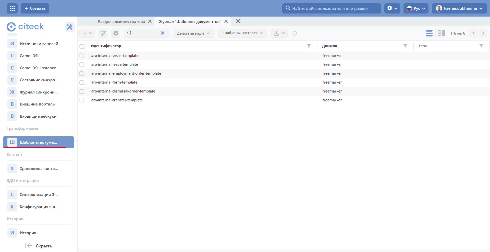

Существует 2 способа создавать шаблоны документов в системе:

  1. Располагая их в проекте в определенной директории.

  2. Загрузив их через действие Добавить в журнале Шаблоны документов.

Создание шаблона документа в проекте
~~~~~~~~~~~~~~~~~~~~~~~~~~~~~~~~~~~~~~~~~~~~~~~~~~~~~~~~~~~~~~~~~~~~~~~~~~~~~~~~~~~~

Для успешного добавления в систему вашего шаблона необходимо учитывать некоторые вещи:

* Вместе с самим шаблоном должен храниться файл ``meta.yml``, который будет хранить метаинформацию о шаблоне.

  **Особенность наименования файлов:**

  Если файл шаблона один, то мета-файл называется по шаблону ``${Полное_имя_файла_с_расширением}.meta.yml``

  Пример:

   .. image:: _static/transformation/trans_2.png
       :width: 200
       :align: center

  Если файлов шаблона несколько в результате разделения их по локализации, то мета-файл именуется по следующему шаблону ``${Имя_файла_до_указания_локали}.meta.yml``

  Пример:

   .. image:: _static/transformation/trans_3.png
       :width: 200
       :align: center

  **Структура мета-файла**

  Мета-файл должен содержать следующие поля в своей структуре:

  .. list-table::
        :widths: 10 50
        :header-rows: 1
        :class: tight-table

        * - Поле
          - Описание
        * - **id**
          - | Уникальный идентификатор шаблона в системе

            .. code-block:: yaml

              id: test-template

        * - **engine**
          - | Наименование движка, который будет обрабатывать заполнение шаблона
            | Доступные движки:
            | - ``freemarker`` — для формирования документов в формате docx, txt с обработкой Freemarker.
            | - ``ecos-table`` — для формирования xlsx таблиц, которые поддерживают обработку Freemarker
            | - ``none`` — для обработки шаблонов без какой-либо трансформации. Возвращается шаблон как есть.

            .. code-block:: yaml

              engine: freemarker

        * - **name**
          - | Имя шаблона

            .. code-block:: yaml

              name: TestTemplate

        * - **mimeType**
          - | Тип файла шаблона

            .. code-block:: yaml

              mimeType: application/vnd.openxmlformats-officedocument.wordprocessingml.document

        * - **model**
          - | Представляет собой мапу ключ-значение, где в качестве ключа используется атрибут из шаблона, а в качестве значения — атрибут, который возьмется из карточки.

            .. code-block:: yaml

              model:
                regNumber: registrationNumber
                regDate: registrationDate|fmt('dd.MM.yyyy')
                initiator: initiator.firstName

            | В значениях можно использовать все возможности обращения с атрибутами через :ref:`Records API <Records_API>`

        * - **computedAttributes**
          - | Вычисляемые атрибуты модели.
            | Задается списком атрибутов.
            | Перед генерацией шаблона преобразует полученные атрибуты в модели согласно типу преобразования.

            .. code-block:: yaml

              computedAttributes:
                - id: docInvestigationInfo
                  type: html-to-text

            | См. подробнее :ref:`Вычисляемые атрибуты для шаблонов <calculated_attr>`

        * - **tags**
          - | Список вспомогательных меток для удобного поиска

            .. code-block:: yaml

              tags:
                - Template
                - Test
                - Example

  Пример:

    .. code-block:: yaml

      ---
      id: test-docx-template
      engine: freemarker
      name: TestDocxTemplate
      mimeType: application/vnd.openxmlformats-officedocument.wordprocessingml.document
      model:
        modelValue: ?disp

* Файлы должны располагаться в проекте по определенному пути.

  Путь для расположения файлов имеет следующий паттерн:

  В микросервисе: ``${home_dir}/src/main/resources/eapps/artifacts/transformation/template/``

  В старых проектах: ``${module_name}/src/main/resources/alfresco/module/${module_name}/transformation/template/``

        В данных директориях можно создавать внутреннюю структуру папок. Поддержка пути старых Alfresco-проектов зависит от загрузчика приложений соответствующей версии. В ecos-transformations поставляемые шаблоны находятся в ``eapps/artifacts/transformation/template/``.

Создание шаблона через журнал
~~~~~~~~~~~~~~~~~~~~~~~~~~~~~~~~~~~~~~~~~~~~~~~~~~~~~~~

Для создания шаблона документа необходимо перейти в журнал **"Шаблоны документов" (Рабочее пространство "Раздел администратора" - Трансформации)** и создать новую запись.

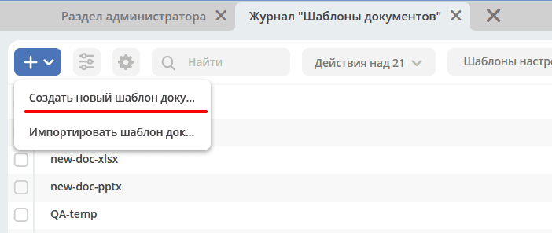

|

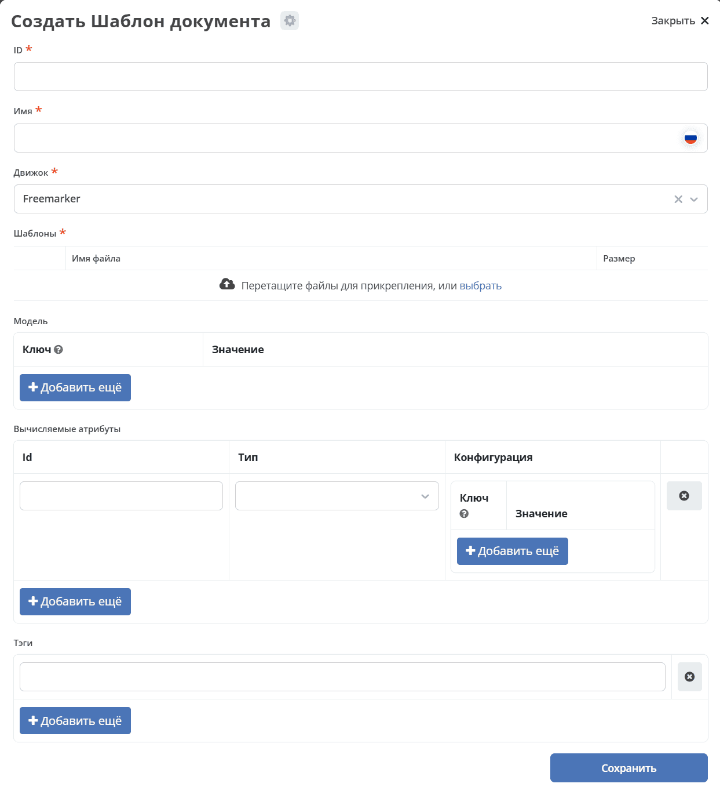

Необходимо заполнить следующие поля:

.. list-table::
      :widths: 5 10
      :header-rows: 1
      :class: tight-table

      * - Поле
        - Описание
      * - **ID**
        - Уникальный идентификатор шаблона в системе
      * - **Имя**
        - Имя шаблона
      * - **Движок**
        - | Наименование движка, который будет обрабатывать заполнение шаблона
          | В стандартной форме доступны ``freemarker`` для DOCX и текста и ``ecos-table`` для XLSX.
          | Сервер также поддерживает ``none`` — выдачу шаблона без преобразования. Это значение можно задать в метаданных или JSON; в списке стандартной формы его нет.
      * - **Шаблоны**
        - | Загружается файл шаблона
          | Шаблон должен быть добавлен в zip-архиве (так как именно так шаблоны хранятся в базе).
          | В архиве размещаются файлы содержимого: DOCX или FTL для ``freemarker``, XLSX для ``ecos-table``. Файлы располагайте в корне архива. Имя желательно согласовать с ID шаблона.
          | Если шаблонов несколько (разделены по локализации), то при названии файлов в конце нужно приписывать суффиксы _ru, _en и т.п.
          | Метафайл добавляется в архив для отдельного действия импорта. В обычное поле «Шаблоны» загружается архив содержимого без метафайла.
      * - **Модель**
        - Представляет собой маппинг ключ-значение, где в качестве ключа используется атрибут из шаблона, а в качестве значения — атрибут, который берется из карточки.
      * - **Вычисляемые атрибуты**
        - | Лист объектов с информацией о вычисляемых атрибутах.
          | См. подробнее :ref:`Вычисляемые атрибуты для шаблонов <calculated_attr>`
      * - **Теги**
        - Список вспомогательных меток для удобного поиска

.. _calculated_attr:

Вычисляемые атрибуты для шаблонов
---------------------------------------------------------------

Вычисляемые атрибуты в метафайле шаблона предназначены для того, чтобы совершить постобработку над значениями, которые пришли в модели, и обновить эти значения в модели или добавить под новыми именами.

**Структура записи:**

Указание вычисляемых атрибутов начинается с ключевого атрибута ``computedAttributes`` в корневой структуре метафайла, содержащего в себе список объектов следующего вида:

.. list-table::
      :widths: 10 10
      :header-rows: 1
      :class: tight-table

      * - Поле
        - Описание
      * - **id**
        - | Уникальный идентификатор атрибута. Именно с этим значением атрибут попадет в итоговую модель.
          | Если в модели есть атрибут с таким именем, то значение в модели обновится.
      * - **type**
        - Указание типа преобразования значения.
      * - **config**
        - | Представляет собой мапу ключ-значение из дополнительных параметров конфигурации и их значений.

          .. code-block:: yaml

              config:
                attribute: test1

          | Имеет общий параметр для всех видов — ``attribute``. Данный параметр в качестве значения принимает имя атрибута, значение которого возьмется для преобразования.
          | Если данный параметр не задан, то из модели возьмется значение атрибута с именем из поля **id** вычисляемого атрибута.

**Пример:**

.. code-block:: yaml

  model:
    test1: ecos:text1
    test2: ecos:text2
  computedAttributes:
    - id: test3
      type: html-to-text
      config:
        attribute: test1
    - id: test2
      type: html-to-text

Типы вычисляемых атрибутов
~~~~~~~~~~~~~~~~~~~~~~~~~~~~~~~~~~~~~~~~~~~~~~~~~~

**html-to-text** — преобразует входной текст из HTML кода в текст, убирая из него лишние теги (такие как 
,  , <li>).

Преобразование сохраняет структуру текста: для ``br`` и ``p`` добавляются переносы строк, для ``li`` — перенос и отступ. Вычисляемые атрибуты обрабатываются последовательно, поэтому последующие преобразования могут использовать результат предыдущих. При неизвестном типе преобразования или отсутствии исходного атрибута обработка списка прерывается с записью ошибки в лог; оставшиеся вычисляемые атрибуты не выполняются.

.. _download_by_template:

Действие сгенерировать и скачать документ
------------------------------------------------------------------------------

В системе предусмотрено действие, позволяющее на основе карточки сгенерировать документ из шаблона документов и сразу его скачать. Для этого необходимо в системе создать новое действие (подробнее о: :ref:`действиях <ui_actions>`) с типом ``download-by-template``.

Для работы действия необходимо заполнить следующие атрибуты в конфиге действия:

.. list-table::
      :widths: 10 10
      :header-rows: 1
      :class: tight-table

      * - Атрибут
        - Значение

      * - **resultName**
        - | Имя итогового документа.

          .. code-block:: yaml

                resultName: 'test-docx.docx'

          | Если значение отсутствует или пустое, используется поле ``name`` записи шаблона. Если тип файла не определяется по имени результата, расширение дописывается по MIME-типу шаблона.

      * - **templateRef**
        - | Ссылка на вызываемый шаблон

          .. code-block:: yaml

                  templateRef: 'transformations/template@test-template'

**Принцип работы:**

Вызывая действие из меню действий карточки, система сделает запрос к шаблону, достанет модель из шаблона, заполнит её соответствующими значениями и отправит все данные в микросервис трансформации, где на основе модели и шаблона сгенерируется документ и вернется обратно на UI для скачивания.

В ``TemplateServiceImpl`` после вычисляемых атрибутов и перед передачей модели в движок выполняется рекурсивная санитизация строк в объектах и массивах. Удаляются диапазоны ``U+0000–U+0008`` и ``U+000E–U+001F``, а также ``U+000B`` и ``U+000C``. Табуляция (``U+0009``), перевод строки (``U+000A``) и возврат каретки (``U+000D``) сохраняются.

Санитизация модели выполняется для всех движков на этом пути генерации. Разметка самого файла шаблона при этом не исправляется.

Если модель содержит зашифрованные поля, их расшифровку до отправки должен обеспечивать клиентский компонент с учётом прав пользователя. Микросервис получает готовую модель; возможность расшифровки зависит от клиентского пути генерации.

Примеры действий:

.. code-block:: yaml

  ---
  id: download-by-test-template
  type: download-by-template
  config:
    templateRef: 'transformations/template@test-template'

.. code-block:: yaml

  ---
  id: download-by-test-docx-template
  type: download-by-template
  name:
    ru: Скачать DOCX шаблон
    en: Download DOCX template
  config:
    templateRef: 'transformations/template@test-docx-template'
    resultName: 'test-docx.docx'

Импорт/экспорт шаблонов
--------------------------------------------

Импорт и экспорт шаблонов помогает легко и просто переносить шаблоны документов между стендами. Мы скачиваем необходимые шаблоны на одном стенде и импортируем их на другом. Также можно сгенерировать архив с шаблоном самостоятельно и импортировать нужный шаблон на стенд в одно несложное действие.

При импорте/экспорте будет осуществляться работа с zip-архивом, который содержит метаинформацию шаблона и непосредственно сам шаблон документа:

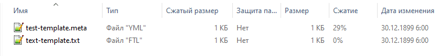

Импорт
~~~~~~~~~~~~

Импорт шаблонов осуществляется через вариант создания шаблона **Импортировать шаблон документа** в журнале **Шаблоны документов**:

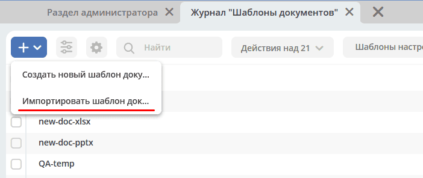

Для импорта необходимо приложить zip-архив с файлами:

* Файл с метаданными от шаблона. Имя файла должно быть сформировано по принципу: **Имя_файла.meta.yml**

* Непосредственно сам шаблон (или шаблоны с разной локализацией).

.. important::

  Именно такой архив формируется при экспорте шаблона

Экспорт
~~~~~~~~~~~~~~

Экспорт осуществляется с помощью действия **Скачать** при наведении на необходимый шаблон документа.

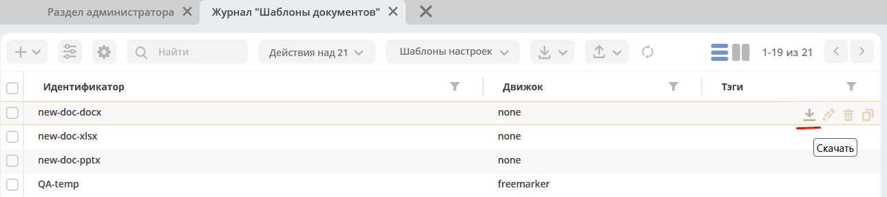

После нажатия на действие будет осуществляться скачивание zip-архива с шаблоном и его метаданными.

.. _templated_content:

Автоматическая генерация контента из шаблона
------------------------------------------------------------------------------------

Для автоматической генерации контента из шаблона при создании рекорда необходимо:

    1. В тип данных добавить :ref:`аспект <aspects_user>` ``templated-content``

    2. В конфигурации аспекта выбрать шаблон:

    .. image:: _static/transformation/templated_content.png
          :width: 600
          :align: center

.. note::

  Если при создании рекорда включен аспект ``templated-content``, но автоматическую генерацию нужно выключить, то можно выставить атрибут ``templated-content:autoGenerate`` в ``false``.

Автоматическая генерация при создании записи обеспечивается интеграцией вызывающего компонента, например ecos-model, с Enterprise-библиотекой ``TemplatedContentGenerator``. Её подключение и момент выполнения зависят от версии и конфигурации платформы. Для явной генерации микросервис также предоставляет источник ``transformations/templated-content``; атрибут результата по умолчанию — ``_content``.

После сохранения контента его скачивание, предпросмотр и сравнение версий обеспечиваются соответствующими компонентами платформы.

Синтаксис условных операторов
~~~~~~~~~~~~~~~~~~~~~~~~~~~~~~~~~~~~~~~~~~~~~~~~~~~~~~~~

В микросервис трансформации перенесена логика из класса **DocxFreeMarkerProcessor** из проекта ecos-community-core. Расположена в классе **DocxFreemarkerTemplateService**.

Необходимо обратить внимание на описание сервиса, а именно на синтаксис условных операторов:

    .. image:: _static/transformation/template_syntax_01.png
          :width: 600
          :align: center

Выражения, которые содержат открывающий и закрывающий теги, необходимо оборачивать в теги группировки ``[#`` ``#]``:

Для DOCX используются директивы с квадратными скобками, например ``[#if ...]...[/#if]``. Вариант ``<#if ...>`` для этого движка не поддерживается. Пример сгруппированного выражения:

.. code-block:: text

    [#[#if approved]Согласовано[#else]На согласовании[/#if]#]

    .. image:: _static/transformation/template_syntax_02.png
          :width: 800
          :align: center

.. _transformation_onlyoffice:

Параметры работы с документом во встроенном редакторе OnlyOffice
~~~~~~~~~~~~~~~~~~~~~~~~~~~~~~~~~~~~~~~~~~~~~~~~~~~~~~~~~~~~~~~~~~~~~~~~~~~~~~~~~~~~~~~~~~~~~~~~~~~~~~~~~~~~~~~~~~~~~~~~~~~~~~~

В действии, в **url**, через **"&config=JSON"** необходимо прописать конфиг, предварительно сгенерировав его в **encodeURIComponent** прямо в браузере:

    .. image:: _static/transformation/doc_param_1.png
          :width: 800
          :align: center

|

    .. image:: _static/transformation/doc_param_2.png
          :width: 800
          :align: center

В данном примере мы разрешаем пользователю редактировать только определённые поля, и при этом убираем возможность скачать файл.

Варианты конфигурации редактора описаны в `официальной документации <https://api.onlyoffice.com/editors/config/document/permissions#review>`_

    .. image:: _static/transformation/doc_param_3.png
          :width: 400
          :align: center

Для создания документа с редактируемыми полями необходимо выполнить следующие шаги:

.. dropdown:: Пример: создание документа с редактируемыми полями
   :color: secondary

   1. Исходный **.docx** файл локально открыть в редакторе OnlyOffice и сохранить в формате **.docxf**.

       .. image:: _static/transformation/doc_param_4.png
             :width: 400
             :align: center

   2. Открыть уже в этом формате и с помощью вкладки **Формы → Текстовое поле** разметить необходимые поля.

      При этом нужно убедиться, что **«Заполнитель»** и **«Значение по умолчанию»** пустые (для избежания проблем вёрстки и изменения цвета текста после генерации по шаблону).

       .. image:: _static/transformation/doc_param_5.png
             :width: 200
             :align: center

   3. Отметив необходимые поля, снова сохранить документ в формате **.docx**, открыть в Word, заполнить необходимыми тегами и сохранить.

       .. image:: _static/transformation/doc_param_6.png
             :width: 300
             :align: center

   4. Снова открыть документ с помощью OnlyOffice, через вкладку **Защита → Защитить документ** указать **пароль** и **«Заполнение форм»**.

       .. image:: _static/transformation/doc_param_7.png
             :width: 500
             :align: center

       .. image:: _static/transformation/doc_param_8.png
             :width: 300
             :align: center

Перед использованием проверьте генерацию подготовленного **.docx** на нужной версии платформы и редактора. Если возникает ошибка обработки условия, см. :ref:`диагностику шаблонов с условиями <temporary_solution>`.

.. _temporary_solution:

Диагностика ошибки при генерации шаблона с условиями
~~~~~~~~~~~~~~~~~~~~~~~~~~~~~~~~~~~~~~~~~~~~~~~~~~~~~~~~~~~~~~~~~~~~~~~~~~~~~~~~~~~~~~~~~~~~~~~~~~~~~~~~~~~~~~~~~~~~~~~~~~~~~

При ошибке обработки ``if``, ``else`` или ``elseif`` сначала проверьте квадратный синтаксис директив и группировку ``[# ... #]``. Текущий DOCX-обработчик умеет собирать выражение из нескольких текстовых фрагментов XML, поэтому само наличие условия или его разбиение редактором на теги не означает обязательный сбой.

Ниже показан пример проблемного шаблона и ручной способ исправления. Применяйте его только к воспроизводимому случаю после проверки синтаксиса и минимального примера; предварительно сохраните копию файла.

    .. image:: _static/transformation/error_1.png
          :width: 500
          :align: center

В этом примере условие в **document.xml** разделено между несколькими тегами:

    .. image:: _static/transformation/error_2.png
          :width: 500
          :align: center

.. dropdown:: Work around для решения проблемы
   :color: secondary

   1. Открыть **docx** как архив.

       .. image:: _static/transformation/error_3.png
             :width: 500
             :align: center

   2. В папке **word** открыть файл **document.xml**

       .. image:: _static/transformation/error_4.png
             :width: 500
             :align: center

       Найти условие, разбитое на теги:

       .. image:: _static/transformation/error_5.png
             :width: 700
             :align: center

   3. Собрать в один тег:

       .. image:: _static/transformation/error_6.png
             :width: 700
             :align: center

   4. Сохранить архив и проверить, что документ открывается. Затем загрузить шаблон и повторить генерацию.

Движок «ECOS table»
---------------------------

Данный движок в системе Citeck служит для работы с шаблонами документов в формате **xlsx**. Движок представляет собой смесь обработчика **xlsx файлов** и обработчика **Freemarker**, что дает следующие возможности:

   - обработка текстовых ячеек через Freemarker при выполнении условия распознавания подстановки, описанного ниже;
   - использование специального синтаксиса для генерирования строк в xlsx файле.

Общий принцип работы движка:

   - сканирует все страницы шаблона, заменяя, где необходимо, значения в ячейках на значения из модели, используя обработчик Freemarker;
   - при нахождении блока строк между ``#LIST`` и ``#END`` повторяет его для каждого объекта списка из модели. Если список содержит ``n`` объектов, а блок — ``k`` шаблонных строк, формируется ``n × k`` строк данных. При заполнении используются значения текущего объекта списка.

Вывод данных в ячейку
~~~~~~~~~~~~~~~~~~~~~~~~~~~~~~~~~~~~~~~

Перед обработкой движок проверяет строку ячейки на наличие подстановки вида ``${name}`` или ``${user.name}`` — с буквами, цифрами, подчёркиванием и точкой в имени. Только совпавшая ячейка передаётся в Freemarker.

Конструкция:

.. code-block:: text

  Карточка: ${name}

подставит значение переменной **name** в указанное место, взяв его из модели данных.

В такой ячейке можно использовать и более сложные конструкции Freemarker. Например, следующая строка содержит простую подстановку ``${annotation.annotation.ru}``, которая позволяет распознать ячейку:

.. code-block:: text

  <#if annotations??><#list annotations as annotation>"${annotation.annotation.ru}"<#sep>, </#list></#if>

Чистая директива без простой подстановки, а также выражение только вида ``${name?upper_case}`` или ``${amount + 1}`` не запускают обработку сами по себе. Это ограничение распознавания ячейки в ``ecos-table``.

Обрабатываемые ячейки должны содержать текст; результат записывается строкой. Числовые, логические и формульные ячейки требуют проверки на конкретном шаблоне: реализация читает строковое значение без предварительной проверки типа ячейки.

Вывод в шаблон произвольного количества строк
~~~~~~~~~~~~~~~~~~~~~~~~~~~~~~~~~~~~~~~~~~~~~~~~~~~~~~~~~~~~~~~~~~~~~~~~~~~~~~~~~~~~~~~~~~~~~~~~~~~~~

Для вывода в шаблон произвольного количества строк в виде таблицы необходимо использовать следующую конструкцию:

На том месте, где ожидаются сгенерированные на основе списка объектов строки, в первой ячейке пишется следующая конструкция:

.. code-block:: text

  #LIST list_name

где **list_name** — название переменной из модели, в которой записан список объектов.

Элементы списка должны быть объектами с именованными полями. Блок необходимо закрыть маркером ``#END``; незакрытый блок приводит к ошибке генерации.

Следующие строки строятся таким образом, как мы хотим их сгенерировать на основе объектов из списка **list_name**

Например:

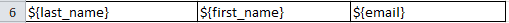

|

В строках при заполнении ячеек используем имена переменных из объектов данного списка (также можем использовать и переменные из общей модели; если имена у переменной из объекта и из общей модели совпадут, то возьмется значение из объекта).

После описания шаблонных строк необходимо поставить в первую ячейку на новой строке конструкцию:

.. code-block:: text

  #END

Она будет указывать на то, что далее строки не являются шаблонными и их не нужно генерировать.

Строки с маркерами ``#LIST`` и ``#END`` удаляются из результата. Для каждого элемента списка повторяются только строки между ними.

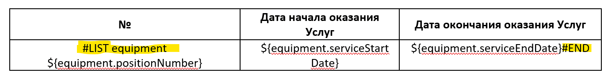

Пример
~~~~~~~~~~~~

Мы имеем тип данных со следующими атрибутами:

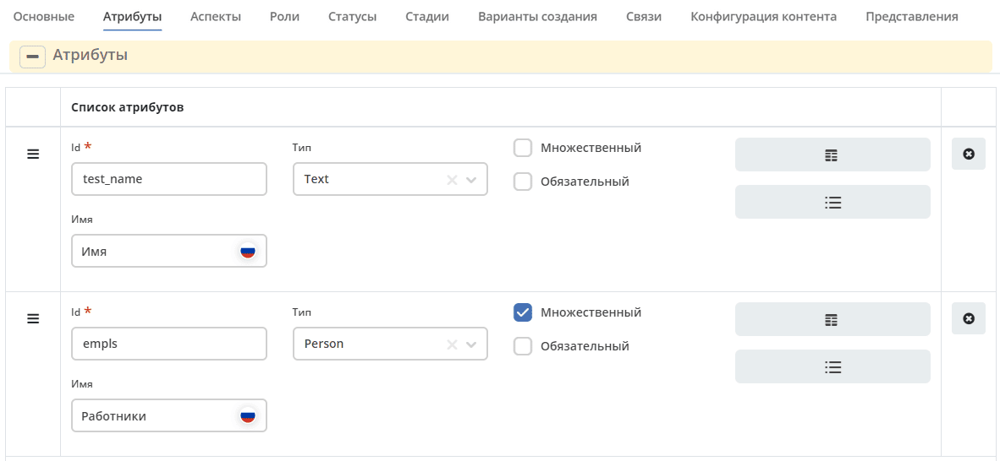

Атрибут **empls** — является списком пользователей системы.

Для данного типа мы делаем шаблон со следующей моделью:

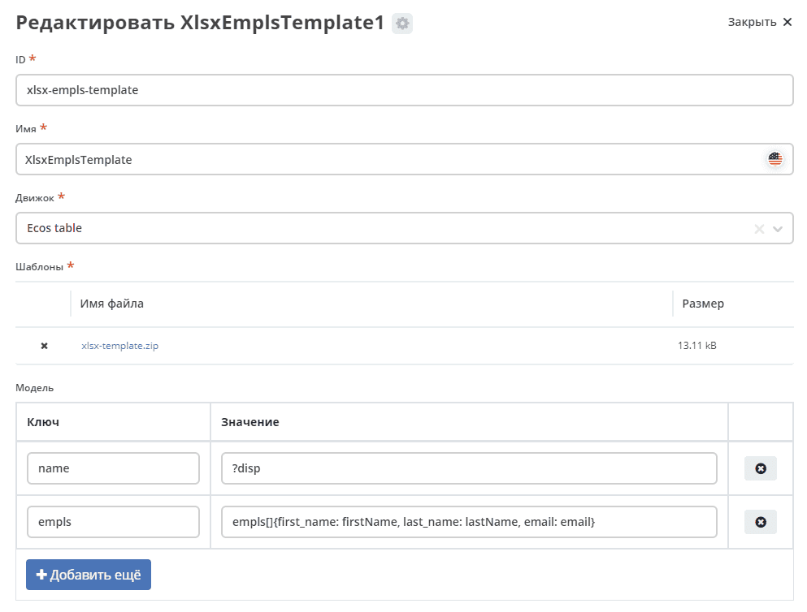

Переменная **empls** хранит список объектов, состоящих из 3 полей, на основе пользователей системы.

Шаблон xlsx выглядит следующим образом:

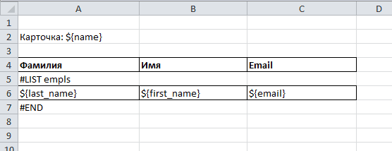

Где:

- В ячейке **А2** мы хотим записать значение из модели с ключом **name**
- В ячейке **А5** мы указываем, что дальше мы хотим строки на основе объектов из списка с ключом **empls** в модели
- В ячейках **A6-C6** указываем как должны быть заполнены ячейки в сгенерированных строках
- В ячейке **А7** мы указываем, что здесь заканчиваются шаблонные строки для списка с ключом **empls** (т.е. мы можем сделать 2 шаблонные строки и для каждой записи из списка будет генерироваться по 2 строки в итоговом файле)

В итоге, для карточки с данными параметрами:

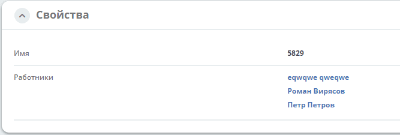

Будет сгенерирован следующий шаблон:

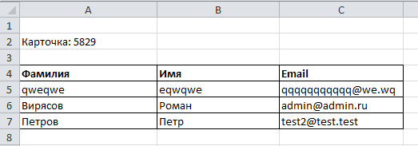
