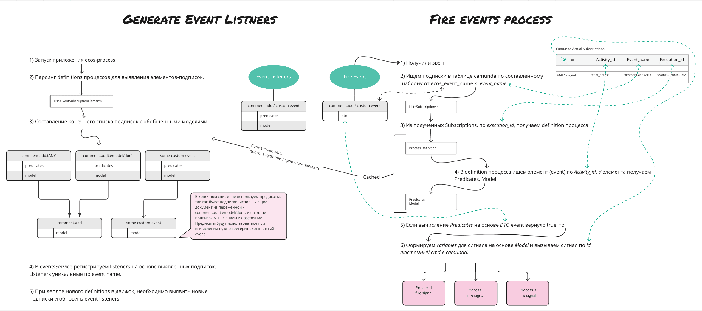

.. _bpmn_events_integrations:

Интеграция Событий в движок BPMN
=========================================================

В Citeck могут происходить различные события, такие как:

      * создание нового документа;
      * смена статуса;
      * добавление комментария;
      * изменение свойств документа;
      * и т.д.

В бизнес-процессе мы должны иметь возможность реагировать на эти события - отправлять уведомления, если был добавлен комментарий, или запускать подпроцесс, если были изменены определенные свойства документа. При этом, настройка реакции на события должна быть как можно более простой и удобной для пользователя.

Были выдвинуты следующие требования к интеграции событий в движок BPMN:

      1. Выбор типа события из списка доступных событий.
      2. Поддержка сторонних "пользовательских" событий, в том числе возникающих в пользовательских модулях.
      3. При реакции на события должна быть возможность получить информацию о событии и настраивать дополнительную модель на основе Records API.
      4. Catch события должны поддерживать предикаты для определения необходимости реакции на событие.

Для этой интеграции Citeck используются :ref:`signals <ecos_bpmn_events>` Camunda. Подписка задаёт тип события, фильтры по записи и типу ECOS, предикат и модель данных события. Поддерживаются пользовательские имена событий и ручной режим сигнала.

Фильтры проверяются при валидации модели. Например, для события создания записи необходимо задать тип ECOS или предикат. Фильтрация по типу ECOS доступна в режиме выбора любой записи (``ANY``).

Базовая архитектура:

Обработка состоит из следующих этапов:

1. При старте приложения сервис находит подписки развёрнутых определений. После деплоя новых ревизий подписки обновляются.

2. Подписки объединяются по имени события. В общую модель включаются атрибуты пользовательской модели, атрибуты для вычисления предикатов и служебные данные события, записи, типа и рабочего пространства.

3. В ``EventsService`` регистрируются транзакционные слушатели. Общий оптимизационный фильтр исключает события записей элементов BPMN; индивидуальные условия подписок проверяются при обработке конкретного события.

4. После получения события сервис находит подходящие подписки Camunda, вычисляет атрибуты модели и проверяет предикат каждой подписки.

5. Для совпавшей подписки выполняется ``SendSignalEventByIdCmd``. Данные события передаются в переменные процесса, и Camunda продолжает исполнение.

На схеме отсутствие предикатов в общей подписке означает, что индивидуальные условия BPMN не применяются при её регистрации. Атрибуты, необходимые этим условиям, при этом включаются в общую модель. Предикат проверяется отдельно для каждой найденной подписки.

Для conditional events предусмотрен отдельный обработчик ``BpmnConditionalEventsProcessor``. Описанный выше механизм signals относится к интеграции событий Citeck и не определяет поведение всех видов событий BPMN.
