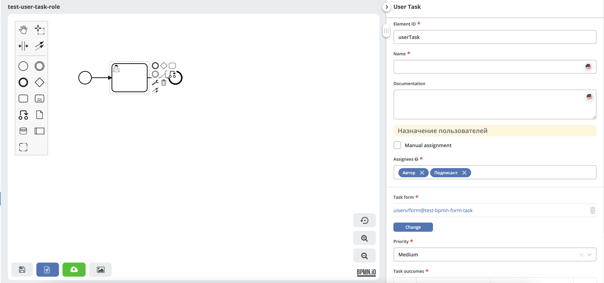

.. _process_bpmn_unit_tests:

Тестирование BPMN-процессов
=====================================================================

.. contents::
   :depth: 2

Тестирование реализаций бизнес процессов BPMN
------------------------------------------------------------------------------------------

В ecos-process процессы и компоненты Citeck проверяются сценариями, которые развёртывают BPMN-модель, запускают процесс и проверяют задачи, переменные и результат исполнения.

Ниже описан способ тестирования в проекте ecos-process. Показанный пример использует Spring-контекст приложения и движок Camunda, поэтому имеет интеграционный характер.

Для сценариев и проверок используются библиотеки Camunda:

    * https://github.com/camunda-community-hub/camunda-platform-scenario - написание unit тестов по стилю `GivenWhenThen <https://martinfowler.com/bliki/GivenWhenThen.html>`_
    * https://github.com/camunda/camunda-bpm-platform/tree/master/test-utils/assert - удобные bpmn ассерты для тестов

Тестирование Citeck компонентов BPMN
----------------------------------------------------------------------

Тесты написанные для проверки Citeck компонентов bpmn представляют собой небольшие процессы BPMN, которые реализуют варианты использования Citeck компонентов, с дальнейшем запуском процесса и проверкой результатов.

Kotlin-тесты находятся в ``src/test/java/ru/citeck/ecos/process/domain/bpmn/`` и тематических подкаталогах. BPMN-ресурсы компонентов располагаются в ``src/test/resources/test/bpmn/elements/``. Для сценариев используется стиль `GivenWhenThen <https://martinfowler.com/bliki/GivenWhenThen.html>`_.

Пример назначения задачи по ролям находится в классе ``BpmnMonsterTestWithRunProcessTest``, метод ``task assignment by roles``. Его BPMN-модель — ``src/test/resources/test/bpmn/elements/usertask/test-user-task-role.bpmn.xml``.

Пример сценарного теста BPMN
~~~~~~~~~~~~~~~~~~~~~~~~~~~~~~~~~~~~~

Проверка назначения userTask по роли.

Процесс:

Фрагмент теста из подготовленного окружения:

.. code-block:: kotlin
    :caption: Назначение задачи по ролям

    @Test
    fun `task assignment by roles`() {
        val procId = "test-user-task-role"
        helper.saveAndDeployBpmn(USER_TASK, procId)

        `when`(process.waitsAtUserTask("userTask")).thenReturn {
            assertThat(it).hasCandidateUser(USER_IVAN)
            assertThat(it).hasCandidateUser(USER_PETR)

            assertThat(it).hasCandidateGroup(GROUP_MANAGER)
            assertThat(it).hasCandidateGroup(GROUP_DEVELOPER)
            it.complete()
        }

        run(process).startByKey(procId, variables_docRef).engine(processEngine).execute()

        verify(process).hasFinished("endEvent")
    }

Класс использует ``@SpringBootTest`` с ``EprocApp`` и расширение ``EcosSpringExtension``. Вне показанного метода подготавливаются:

* ``helper`` типа ``BpmnProcHelper`` для сохранения и деплоя модели;
* ``processEngine`` — экземпляр движка Camunda;
* ``process`` — mock сценария ``ProcessScenario``;
* ``variables_docRef`` — переменные запуска со ссылкой на документ;
* BPMN-ресурс ``USER_TASK``, пользователи, группы и данные для разрешения ролей.

Этот фрагмент следует использовать вместе с настройкой класса теста. Он проверяет кандидатов задачи — пользователей и группы, полученные из ролей, — завершает **userTask** и проверяет достижение **endEvent**.
