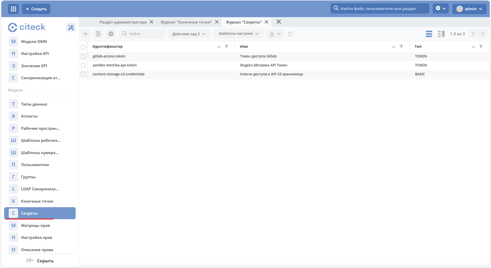

.. _ecos_secret:

Секреты
=========

.. contents::
   :depth: 3

**ECOS Секрет** — объект, содержащий конфиденциальные данные, такие как пароль, токен или ключ.

Расположение артефактов с данным типом: **model/secret**

Модель конфигурации:

.. code-block:: yaml

    id: String # идентификатор секрета
    name: MLText # локализованное название
    type: String # тип секрета: BASIC, TOKEN или CERTIFICATE
    data: ObjectData # данные секрета. Полностью зависят от типа

Обычное чтение записи секрета через Records API возвращает описание без содержимого ``data``. Для получения данных в коде используйте API ``EcosSecrets``. При обновлении определения пустое или отсутствующее ``data`` сохраняет прежние данные; замена выполняется при передаче непустого объекта.

Типы секретов:

.. list-table::
   :widths: 10 10
   :header-rows: 1
   :class: tight-table

   * - Тип
     - Содержимое поля data
   * - BASIC
     -
       .. code-block:: yaml

         username: String
         password: String
   * - TOKEN
     -
       .. code-block:: yaml

         token: String
   * - CERTIFICATE
     -
       .. code-block:: yaml

         privateKey: String
         certificate: String

Пример конфигурации:

.. code-block:: yaml

    ---
    id: content-storage-s3-credentials
    name:
      ru: Ключи доступа к API S3 хранилища
      en: S3 storage API Keys
    type: BASIC
    data:
      username: sMJjtYPxFGjPEKeFp1lC
      password: KenKpEhD6Lag3acImDAq2ZeLtlSij1vyaYZt8lyH

Информация о секретах по умолчанию хранится и загружается из БД микросервиса ecos-model, но также есть возможность указать настройки через переменные среды. Для этого следует взять идентификатор секрета и сконвертировать его по следующим правилам:

.. dropdown:: Правила преобразования идентификатора в имя переменной окружения
   :color: secondary

   1. Разбиваем camelCase на части через символ **'_'**. Например: **camelCase → camel_Case**

   2. Заменяем все символы **'-'** и **'.'** на **'_'**

   3. Заменяем все символы, которые не входят в перечень ``[a-zA-Z0-9_]`` на ``_X{код_символа}_``

   4. Переводим получившуюся строку в верхний регистр и добавляем префикс **"ECOS_SECRET_"**

Таким образом для примера выше мы можем задать следующие переменные среды:

.. code-block:: text

    ECOS_SECRET_CONTENT_STORAGE_S3_CREDENTIALS_TYPE=BASIC
    ECOS_SECRET_CONTENT_STORAGE_S3_CREDENTIALS_USERNAME=sMJjtYPxFGjPEKeFp1lC
    ECOS_SECRET_CONTENT_STORAGE_S3_CREDENTIALS_PASSWORD=KenKpEhD6Lag3acImDAq2ZeLtlSij1vyaYZt8lyH

Переменные среды приоритетнее хранилища секретов в БД микросервиса ecos-model и они могут быть заданы как непосредственно в микросервисе, который будет использовать эти секреты, так и в ecos-model.

Использование секретов в коде
-------------------------------

Получение:

.. code-block:: java

    BasicSecretData basicData = EcosSecrets.getBasicData("content-storage-s3-credentials");
    String username = basicData.getUsername();
    String password = basicData.getPassword();

Подписка на изменения:

.. code-block:: java

    EcosSecrets.listenChanges((secretId) -> {
        // здесь можем пересоздать подключения, которые зависят от secretId
        return Unit.INSTANCE;
    });

.. _ECOS_secrets:

В интерфейсе
--------------

Настройки доступны в разделе **«Секреты» (Рабочее пространство "Раздел администратора" - Модель)**:

Журнал доступен по адресу: ``v2/journals?journalId=ecos-secrets&viewMode=table&ws=admin$workspace``

Форма создания:

.. grid:: 2
   :gutter: 2

   .. grid-item::

      .. image:: _static/secrets_02.png
         :width: 500
         :align: left

   .. grid-item::

      .. image:: _static/secrets_03.png
         :width: 500
         :align: left

.. _secrets_encryption:

Шифрование секретов
---------------------

1. Секреты хранятся в базе данных в зашифрованном виде.
2. Ключ шифрования задается через переменные окружения (ENV) микросервиса ecos-model.

Настройки шифрования
~~~~~~~~~~~~~~~~~~~~~

Поддержка в Helm
"""""""""""""""""""

При развёртывании через Helm передайте приведённые ниже переменные окружения в микросервис ``ecos-model``. Способ их задания зависит от используемой версии чарта.

Переменные окружения
"""""""""""""""""""""

.. list-table::
   :widths: 10 15 5
   :header-rows: 1
   :class: tight-table

   * - Переменная
     - Описание
     - По умолчанию
   * - **ECOS_SECRET_ENCRYPTION_CURRENT_KEY**
     - Текущий AES-ключ в Base64. На продакшн-серверах встроенный ключ необходимо заменить. При активном профиле ``prod`` без ``test`` использование встроенного ключа вызывает диагностические сообщения в логах.
     - Встроенный ключ; требуется замена в production.
   * - **ECOS_SECRET_ENCRYPTION_CURRENT_ALGORITHM**
     - Алгоритм шифрования.
     - AES/GCM/NoPadding
   * - **ECOS_SECRET_ENCRYPTION_CURRENT_IV_SIZE**
     - Размер вектора инициализации (IV).
     - 12
   * - **ECOS_SECRET_ENCRYPTION_CURRENT_TAG_SIZE**
     - Размер тега аутентификации (TAG).
     - 128
   * - **ECOS_SECRET_ENCRYPTION_PREVIOUS_KEY**
     - Предыдущий AES-ключ в Base64. Используется при ротации для расшифровки данных, которые затем шифруются текущим ключом.
     - Пустое значение.

Пример генерации ключа для **ECOS_SECRET_ENCRYPTION_CURRENT_KEY**:

.. code-block:: kotlin

   import java.util.Base64
   import javax.crypto.KeyGenerator

   fun main() {

       val keyGen = KeyGenerator.getInstance("AES")
       keyGen.init(128) // AES key size 128
       val secretKey = keyGen.generateKey()
       val base64Key = Base64.getEncoder().encodeToString(secretKey.encoded)

       println("Base64 Key: $base64Key")

   }

Ротация ключей шифрования
~~~~~~~~~~~~~~~~~~~~~~~~~~~~

.. dropdown:: Как ротировать ключ шифрования
   :color: secondary

   1. Сгенерируйте новый **AES-ключ**.
   2. Установите новый ключ в переменную окружения **ECOS_SECRET_ENCRYPTION_CURRENT_KEY**.
   3. Старый ключ укажите в переменной **ECOS_SECRET_ENCRYPTION_PREVIOUS_KEY**.

   4. Перезапустите ``ecos-model`` и проверьте логи ротации и доступ к секретам.

   При запуске ``ecos-model`` данные, зашифрованные другим ключом, расшифровываются предыдущим ключом и шифруются текущим. Уже использующие текущий ключ записи не перешифровываются. Старые незашифрованные данные шифруются текущим ключом.

   Предыдущий ключ должен соответствовать сохранённому хешу ключа записи. Если он отсутствует, не соответствует хешу или метаданные шифрования не читаются, запись пропускается с ошибкой в логах. Сам факт запуска сервиса не гарантирует завершения ротации всех секретов.

   Обычное чтение данных использует текущий ключ. При незавершённой ротации исправьте причину ошибки и повторите её до следующей смены ключа.

Инструкция для администраторов
~~~~~~~~~~~~~~~~~~~~~~~~~~~~~~~~

.. dropdown:: Чек-лист при развёртывании нового сервера
   :color: secondary

   1. При развертывании нового сервера необходимо каждый раз генерировать уникальный ключ шифрования.
   2. Используйте приведённый выше код для генерации AES-ключа.
   3. Убедитесь, что встроенный ключ заменён на новый. Диагностические сообщения о встроенном ключе зависят от профиля запуска и не заменяют проверку конфигурации.
