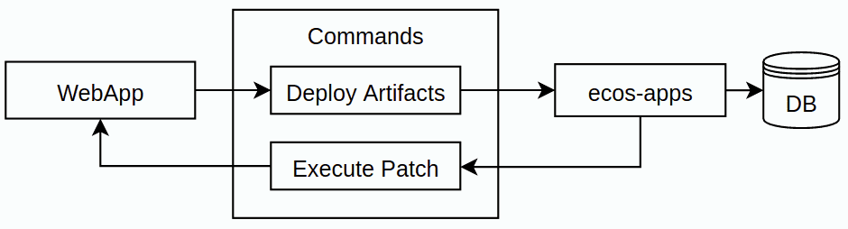

.. _patches:

Патчи Citeck
=================

.. contents::
  :depth: 2

**Патч** — операция миграции данных или конфигурации, запускаемая автоматически или вручную после запуска системы. Успешно завершённый патч обычно не выполняется повторно, но ошибки, продолжение работы по шагам и явный перезапуск могут приводить к нескольким вызовам исполнителя. Операции патча должны учитывать возможность повторного вызова.

Патчи Citeck реализованы как артефакты типа **app/patch** и подчиняются общим правилам деплоя артефактов. Уникальность патча в рамках системы определяется комбинацией **targetApp + id**.

Для изменения содержимого артефактов используется другой механизм — :ref:`патчи артефактов <artifact_patch>` типа ``app/artifact-patch``.

Модель
------------

.. code-block:: text

    id: String // идентификатор патча
    name: MLText // имя патча
    targetApp: String // целевое приложение где патч будет выполнен. По умолчанию - текущее приложение.
    date: Instant // дата патча. Подробнее ниже.
    manual: Boolean // при true первоначальный запуск требует явного применения; по умолчанию false
    dependsOn: String[] // зависимость от других патчей
    dependsOnApps: String[] // приложения, доступность которых учитывается при выборе патча
    type: String // тип патча
    config: ObjectData // конфигурация патча
    batch: // пакетная обработка массива внутри config
      field: String // имя поля-массива; пустое значение отключает пакетный режим
      size: Int // размер пачки; по умолчанию 20

При загрузке артефакта без ``targetApp`` используется имя текущего приложения. Поле ``date`` задавайте явно: значение по умолчанию в модели — ``1970-01-01T00:00:00Z``.

Типы патчей
---------------------

Тип определяет исполнитель в целевом приложении. Помимо базовых типов ``bean``, ``delete`` и ``mutate``, платформа поддерживает ``import-data``; набор типов может расширяться зарегистрированными исполнителями.

.. list-table::
      :widths: 3 5 10
      :header-rows: 1
      :class: tight-table

      * - Тип
        - Конфигурация
        - Описание
      * - **bean**
        - **beanId: String** - идентификатор бина для исполнения
        - | Запустить бин в контексте приложения.
          | Поддерживаются следующие интерфейсы:

              * Runnable
              * Function0<*>
              * Callable<*>
              * StatefulEcosPatch<*>
      * - **delete**
        - **records: RecordRef[]**
        - Удалить указанные записи
      * - **mutate**
        - | **records: RecordAtts[]**
          | **record: RecordAtts**

             где RecordAtts:

                * id: String
                * attributes: Map<String, Any?>
        - | Произвести мутацию указанных записей;
          | Если в конфигурации указаны records, то используются они и поле **record** игнорируется;
          | Если в конфигурации не указаны records, то используется record.
      * - **import-data**
        - | **typeRef: EntityRef** — тип импортируемых записей
          | **keyAtts: String[]** — атрибуты поиска существующих записей
          | **templateAtts: ObjectData** — шаблоны значений атрибутов
          | **records: ObjectData[]** — данные записей
        - Создать или обновить записи по ключевым атрибутам. Для больших массивов можно использовать ``batch.field: records``. Дополнительные настройки зависят от версии исполнителя в целевом приложении.

Зависимости
-------------------

В ``dependsOn`` указываются идентификаторы патчей, которые должны завершиться успешно до запуска текущего патча. Идентификатор без разделителя ``$`` относится к тому же ``targetApp``. Для зависимости от другого приложения используется формат ``<appName>$<patchId>``.

Например, при ``targetApp: emodel`` значение ``prepare-data`` означает зависимость от ``emodel$prepare-data``, а ``eapps$prepare-config`` — от патча приложения ``eapps``.

Помимо явных зависимостей между патчами, исполнитель может объявить зависимости от развёрнутых артефактов через метаданные ``dependsOnRefs``. Для типов, использующих регистрацию метаданных, патч также ожидает её публикации целевым приложением. Базовые типы ``bean``, ``delete`` и ``mutate`` сохраняют совместимость с приложениями без такой регистрации.

Дата патча
-------------------

**Дата патча** — значение даты и времени ISO8601 в UTC, например ``2022-01-01T00:00:00Z``. При создании определения укажите текущую дату вручную. Точное время не обязательно, но желательно указывать дату хотя бы с точностью до дня. Дата патча используется для нескольких вещей:

1. Для сортировки доступных к выполнению патчей одного целевого приложения по возрастанию даты. Состояния ожидания и зависимости влияют на фактическую последовательность исполнения. Для обязательного порядка используйте ``dependsOn``.

2. Для повторного запуска при обновлении определения. Старая и новая даты сравниваются при сохранении патча:

.. list-table::
      :widths: 5 5
      :header-rows: 1
      :class: tight-table

      * - Условие
        - Результат
      * - Старая дата отсутствует (новый патч)
        - Устанавливаются статус ``PENDING``, пустое состояние и нулевой счётчик ошибок. Запуск зависит от ``manual``, доступности приложений и зависимостей.
      * - Старая дата >= новая дата
        - Дата сама по себе не перезапускает патч и не меняет его статус на успешный. Сохранённое состояние выполнения остаётся прежним.
      * - Старая дата < новая дата
        - Устанавливаются ``PENDING``, пустое состояние и нулевой счётчик ошибок. Дальнейший запуск подчиняется обычным условиям, включая ``manual``.

Таким образом, если мы хотим, чтобы уже сработавший патч перевыполнился при следующем обновлении, то мы просто увеличиваем время в date.

Увеличение даты сбрасывает и прогресс пакетной обработки: записи обрабатываются с первой пачки.

Ручной запуск и состояния
--------------------------------------

Журнал **«Патчи ECOS»** доступен по адресу ``v2/journals?journalId=ecos-patches&viewMode=table&ws=admin$workspace``. Его источник — ``eapps/ecos-patch``. В журнале доступны применение, скачивание, удаление и редактирование JSON.

Изменение определения и действие **«Применить патч»** доступны под SYSTEM или ADMIN. Действие ставит патч в очередь; исполнение выполняет планировщик ``ecos-apps``.

При ``manual: true`` патч не запускается автоматически из начального состояния ``PENDING``. После явного запуска продолжение шагов и повторы после ошибок выполняются автоматически. Повторное применение уже завершённого пакетного патча начинает обработку с первой пачки.

.. list-table::
   :header-rows: 1
   :widths: 2 5

   * - Статус
     - Значение
   * - ``PENDING``
     - Ожидает первоначального запуска.
   * - ``IN_PROGRESS``
     - Выполнена часть работы; ожидается следующий шаг.
   * - ``DEPS_WAITING``
     - Ожидает успешного применения зависимых патчей или развёртывания зависимых артефактов.
   * - ``TARGET_WAITING``
     - Ожидает регистрации метаданных типов патчей целевым приложением.
   * - ``FAILED``
     - Последняя попытка завершилась ошибкой. Следующий запуск определяется ``nextExecDate``.
   * - ``APPLIED``
     - Успешно завершён.

После ошибки сохраняются ``lastError`` и ``errorsCount``. Предусмотрено девять отложенных повторов: через 1, 1, 1, 5, 10, 30 минут, затем 1, 2 и 3 часа после соответствующей неудачной попытки. После исчерпания повторов ``nextExecDate`` очищается и автоматические попытки прекращаются. Явное применение патча после остановки повторов возвращает его в очередь с новым бюджетом попыток.

Использование в коде
--------------------------------------

Для описания патчей можно использовать аннотацию **@EcosPatch**

Для указания зависимостей можно использовать аннотацию **@EcosPatchDependsOn**

.. code-block:: kotlin

    @Component
    @EcosPatchDependsOn("other-patch")
    @EcosPatch("test-patch", "2022-01-01T00:00:00Z")
    class TestComponent : Callable<Any> {

        override fun call(): Any {
            println("Patch executed")
            // Результат будет записан в БД ecos-apps, чтобы его можно было потом посмотреть.
            // Из требований к результату - только возможность конвертации через Json.mapper.toString в json строку.
            return "custom-result"
        }
    }

.. warning::

    Команда выполнения патча отправляется с TTL 30 секунд. Долгую работу разбивайте на шаги через **StatefulEcosPatch** или на пачки через ``batch``. Каждый отдельный вызов исполнителя должен укладываться в это время.

Stateful патчи
-------------------

Для выполнения некоторой объемной работы можно использовать Stateful патчи (патчи с состоянием).

Их суть заключается в том, что при выполнении патча мы не делаем всю работу сразу, а выполняем некоторую часть работы, после чего возвращаем промежуточное состояние процесса.

Для реализации Stateful патча нужно реализовать интерфейс **StatefulEcosPatch<State>**,

    где **State** — тип состояния выполнения; это не поле ``config`` определения патча.

Важно, чтобы экземпляр состояния можно было создать из пустого объекта ``{}``, так как это начальное состояние патча. Класс исполнителя должен быть зарегистрирован как Spring bean, например через ``@Component``.

Пример в коде:

.. code-block:: kotlin

    @Component
    @EcosPatch("stateful-patch", "2022-01-01T00:00:00Z")
    class TestWithState : StatefulEcosPatch<ObjectData> {

        override fun execute(state: ObjectData): PatchExecutionState<ObjectData> {
            val counter = state.get("counter", 0) + 1
            val completed = counter == 5
            return PatchExecutionState(
                ObjectData.create()
                    .set("counter", counter),
                completed
            )
        }
    }

Пакетная обработка
----------------------

Настройка ``batch`` разбивает массив внутри ``config`` на части. Например:

.. code-block:: yaml

    id: update-items
    targetApp: emodel
    date: '2026-11-10T00:00:00Z'
    type: mutate
    batch:
      field: records
      size: 20
    config:
      records:
        - id: 'emodel/example@item-1'
          attributes:
            name: Первый элемент
        - id: 'emodel/example@item-2'
          attributes:
            name: Второй элемент

В примере замените идентификаторы на ссылки на изменяемые записи. Исполнитель получает очередную часть ``config.records`` и остальные поля конфигурации без изменений. При неположительном ``size`` используется размер 20.

Прогресс хранится в ``state.batchOffset``, а собственное состояние исполнителя — в ``state.commandState``. Вне пакетного режима исполнитель использует всё поле ``state``. Таким образом, ``batch`` управляет разбиением массива в ``ecos-apps``, а Stateful-исполнитель — своей логикой продолжения работы.

.. warning::

    ``batch.field`` должен точно указывать на поле-массив внутри ``config``. Пустой массив завершается без вызова исполнителя. Если поле отсутствует или не является массивом, патч также завершается без обработки элементов, а в журнал сервиса записывается предупреждение.

Архитектура
----------------------

1. Из приложения артефакты патчей попадают в **ecos-apps** по стандартному механизму деплоя артефактов и сохраняются в БД.

2. Планировщик **ecos-apps** выбирает доступные к выполнению патчи с учётом целевого приложения, зависимостей, статуса, ручного запуска и времени следующей попытки.

3. Если патч для применения нашелся, то мы выполняем команду на выполнение патча и отправляем её в **targetApp**. Результат выполнения команды мы кладем в БД.

4. Если работа не закончена, сохраняются состояние и параметры продолжения. При ошибке сохраняются её описание и параметры ограниченных повторных попыток. После успешного завершения устанавливается ``APPLIED`` и активируются ожидавшие его зависимые патчи.
