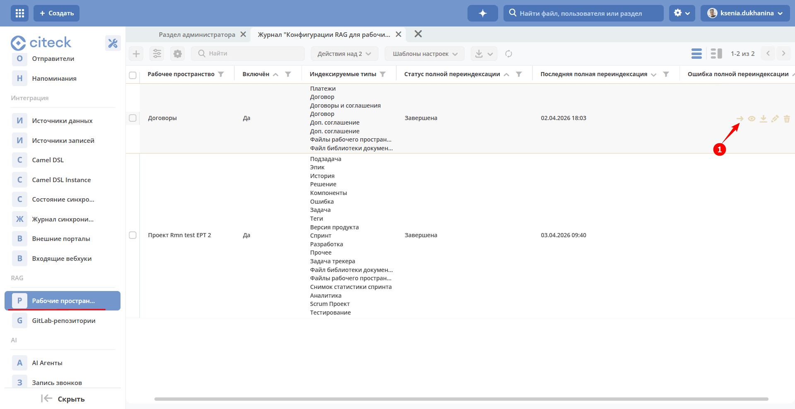
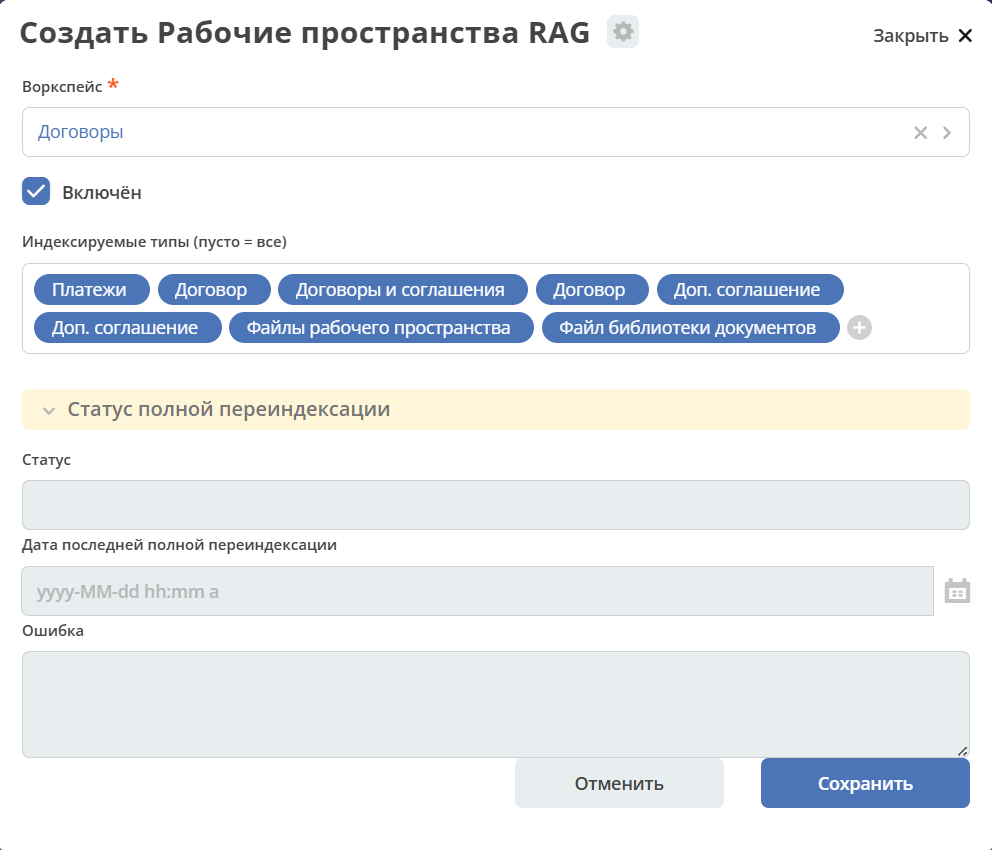
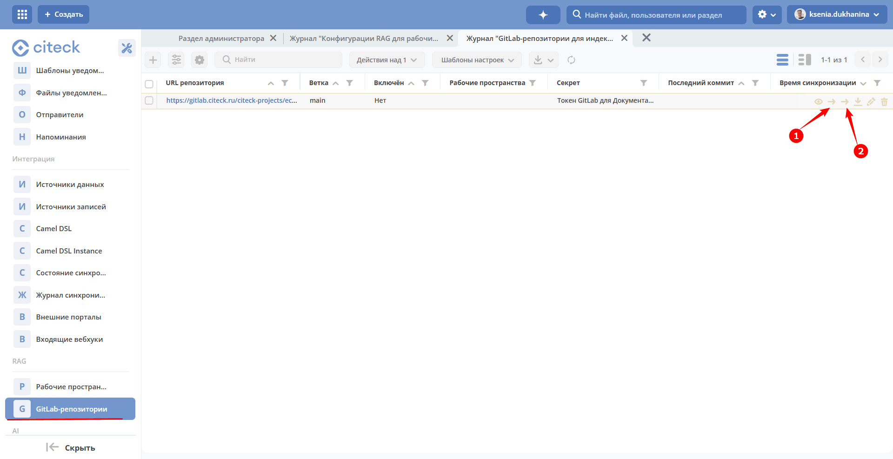
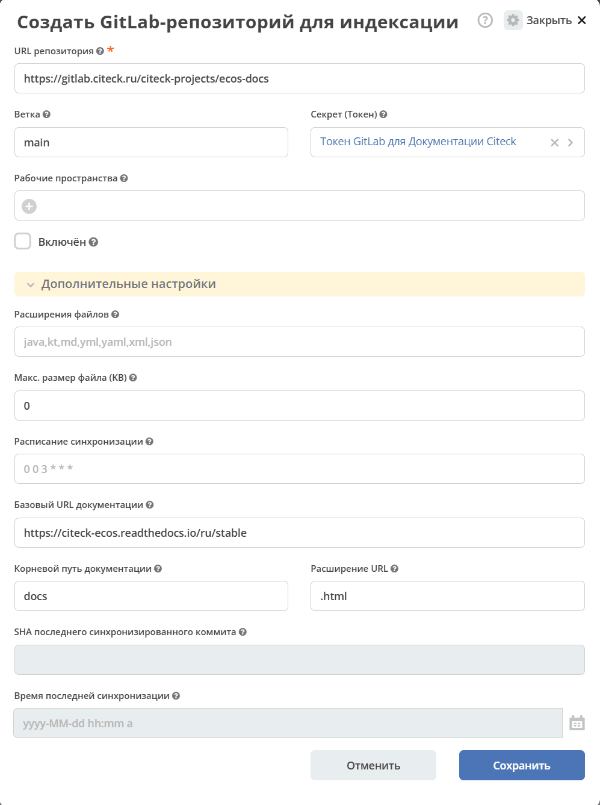

.. _rag-config:

Настройка семантического поиска и индексации документов
===========================================================

Микросервис семантического поиска и индексации документов для платформы Citeck на базе RAG (Retrieval-Augmented Generation).

Сервис индексирует данные из **Citeck-записей** и **GitLab-репозиториев**, строит векторные представления с помощью OpenAI Embeddings и обеспечивает семантический поиск через Qdrant.

Возможности:

.. grid:: 1
   :gutter: 2

   .. grid-item-card:: Семантический поиск
      :class-header: sd-font-weight-bold

      По содержимому документов Citeck и исходному коду GitLab.

      - Поиск по записям Citeck и содержимому GitLab-репозиториев с использованием эмбеддингов (по умолчанию OpenAI ``text-embedding-3-large``) и векторной БД Qdrant.
      - Поиск по записям Citeck учитывает доступ к рабочему пространству и права на документы. Результаты ранжируются по релевантности; Records API дополнительно исключает повторения одной записи.

   .. grid-item-card:: Индексация рабочих пространств
      :class-header: sd-font-weight-bold

      - Для каждого рабочего пространства создаётся отдельная Qdrant-коллекция.
      - Инкрементальная индексация по событиям CRUD с объединением повторных изменений (debounce).
      - Параллельная полная переиндексация с пропуском неизменённых документов по SHA-256.

   .. grid-item-card:: Индексация GitLab-репозиториев
      :class-header: sd-font-weight-bold

      - Репозитории настраиваются через отдельный тип ``rag-gitlab-repo`` с указанием секрета-токена, списка расширений и предельного размера файла.
      - Инкрементальная синхронизация через GitLab Commits API — по расписанию или вручную.
      - Репозиторий можно привязать к одному или нескольким рабочим пространствам для выбора источников при поиске в пространстве. Ограничения этой настройки описаны ниже.
      - При удалении репозитория соответствующая векторная коллекция удаляется автоматически.

   .. grid-item-card:: API поиска
      :class-header: sd-font-weight-bold

      - REST-эндпоинт ``POST /api/rag/search`` и ECOS Records DAO (source ID ``rag-search``).
      - Фильтрация по идентификаторам репозиториев (``includeRepoIds`` / ``excludeRepoIds``).
      - Вместе с документом публикуется базовый URL документации — результаты поиска могут ссылаться на публичные страницы документации.

   .. grid-item-card:: Развёртывание преднастроенных записей
      :class-header: sd-font-weight-bold

      - ECOS-артефакты для типов ``rag-gitlab-repo`` и ``rag-workspace-config`` позволяют разворачивать готовые конфигурации (например, документация Citeck ECOS) при старте приложения.
      - Изменения таких записей синхронизируются обратно через ``EventsService``.

   .. grid-item-card:: База знаний AI-агентов
      :class-header: sd-font-weight-bold

      Инструменты микросервиса ``citeck-ai`` используют проиндексированные источники через REST API сервиса ``rag``.

Архитектура
-------------

``citeck-rag`` — одно приложение с идентификатором ``rag`` и HTTP-портом **8614** по умолчанию. Оно выполняет индексацию и поиск, предоставляет REST API и Records DAO. Микросервис ``citeck-ai`` обращается к нему как REST-клиент.

**Стек:**

- Java 25
- Spring Boot (через родительский проект ``ecos-webapp-spring-simple-parent``)
- Spring AI 1.1.3
- OpenAI ``text-embedding-3-large`` (1536 измерений)
- Qdrant
- GitLab4J
- ECOS Records API

Требования
----------------------------------------------------------------

Компоненты Citeck, необходимые для работы сервиса:

- zookeeper
- rabbitmq
- ecos-registry
- ecos-model (workspace-конфигурация)
- ecos-apps (Records API)

Внешние зависимости:

- **Qdrant** — векторная БД, gRPC-порт ``6334``
- **OpenAI API** — сервис эмбеддингов, ключ передаётся через переменную ``CTK_OPENAI_API_KEY``

Для поиска по содержимому вложений также требуется доступный конвертер текста платформы. Если конвертация поддерживаемого формата завершается ошибкой, индексация записи повторяется по правилам, описанным в разделе :ref:`Обработка ошибок <rag-extraction-errors>`.

Параметры сервера
----------------------------------------------------------------

.. list-table::
   :header-rows: 1
   :widths: 45 20 35
   :class: tight-table

   * - Параметр
     - По умолчанию
     - Описание
   * - ``CTK_OPENAI_API_KEY``
     - —
     - API-ключ OpenAI для эмбеддингов
   * - ``QDRANT_HOST``
     - ``localhost``
     - Хост Qdrant
   * - ``QDRANT_GRPC_PORT``
     - ``6334``
     - gRPC-порт Qdrant
   * - ``citeck.rag.search.default-top-k``
     - ``5``
     - Количество результатов поиска
   * - ``citeck.rag.search.default-threshold``
     - ``0.4``
     - Порог сходства (cosine similarity)
   * - ``citeck.rag.chunking.default-chunk-size``
     - ``800``
     - Размер чанка в токенах
   * - ``citeck.rag.chunking.code-chunk-size``
     - ``1200``
     - Размер чанка для файлов с кодом

Значения в таблицах соответствуют поставляемому ``application.yml`` и значениям Java-свойств, которые в нём не переопределены. В частности, YAML задаёт модель ``text-embedding-3-large``, минимальный размер чанка ``50`` символов и лимит ECOS-контента ``5120 KB``; резервные значения Java-класса отличаются.

В следующей таблице имена параметров указаны относительно префикса ``citeck.rag.``:

.. list-table::
   :header-rows: 1
   :widths: 40 25 35
   :class: tight-table

   * - Параметр
     - По умолчанию
     - Назначение
   * - ``embedding.model``
     - ``text-embedding-3-large``
     - Модель эмбеддингов
   * - ``embedding.dimensions``
     - ``1536``
     - Размерность векторов
   * - ``embedding.base-url``
     - ``https://api.openai.com``
     - Базовый URL OpenAI-совместимого API эмбеддингов
   * - ``embedding.api-key``
     - Значение ``spring.ai.openai.api-key``
     - Отдельный ключ для эмбеддингов; по умолчанию используется ключ из ``CTK_OPENAI_API_KEY``
   * - ``chunking.min-chunk-size-chars``
     - ``50``
     - Минимальный размер фрагмента в символах
   * - ``indexing.fetch-concurrency``
     - ``10``
     - Параллельные запросы извлечения записей ECOS
   * - ``indexing.index-concurrency``
     - ``4``
     - Параллельные операции вычисления эмбеддингов и записи в Qdrant
   * - ``ecos.content-attribute``
     - ``_content.convertedTo.text?str``
     - Атрибут извлечения текста вложения
   * - ``ecos.content-locale``
     - ``ru``
     - Локаль отображаемых имён и значений при построении поискового текста
   * - ``ecos.max-content-size-kb``
     - ``5120``
     - Лимит текста записи ECOS в KB; превышающий лимит текст обрезается
   * - ``ecos.convertible-mime-types``
     - PDF, DOC, DOCX, ODT, ``text/*``
     - Белый список MIME-типов для конвертации вложений в текст
   * - ``gitlab.default-max-file-size-kb``
     - ``500``
     - Предельный размер файла GitLab; более крупные файлы пропускаются
   * - ``gitlab.default-file-extensions``
     - ``java, kt, md, yml, yaml, xml, json, rst, adoc, txt``
     - Расширения индексируемых файлов, если в репозитории не задан свой список
   * - ``search.permission-check-enabled``
     - ``true``
     - Фильтрация результатов по authorities, сохранённым в метаданных чанков. При выключении эта проверка прав не выполняется
   * - ``qdrant.workspace-collection-prefix``
     - ``ecos_ws_``
     - Префикс коллекций рабочих пространств
   * - ``qdrant.gitlab-repo-collection-prefix``
     - ``gitlab_repo_``
     - Префикс коллекций GitLab-репозиториев
   * - ``event.debounce-delay-ms``
     - ``5000``
     - Задержка объединения повторных событий записи, мс
   * - ``event.retry.max-attempts``
     - ``3``
     - Число повторов после первой неудачной попытки индексации; ``0`` отключает повторы
   * - ``event.retry.delays``
     - ``PT1M, PT5M, PT30M``
     - Задержки перед повторными попытками в ISO-8601
   * - ``jobs.gitlab-sync.cron``
     - ``0 */5 * * * *``
     - Общее расписание синхронизации GitLab: каждые пять минут

Для обращения к API эмбеддингов через прокси задайте ``citeck.rag.proxy.enabled=true``. Параметры ``host``, ``port`` и ``protocol`` в том же блоке по умолчанию равны ``localhost``, ``8080`` и ``HTTP``. При необходимости задайте ``username`` и ``password``; по умолчанию они пусты.

Смена модели или способа построения текста требует проверки актуальности индекса и полной переиндексации источников: см. :ref:`Обновление эмбеддингов <rag-embedding-freshness>`.

Records API
----------------------------------------------------------------

Сервис предоставляет Records DAO для интеграции с платформой Citeck:

- ``rag-search`` — семантический поиск через ECOS Records Query; поля запроса: ``text``, ``maxItemsForType`` (не более 50), ``workspaceId``, ``sourceType``. Результаты дедуплицируются по ссылке записи с сохранением наибольшего score.
- ``rag-index`` — чтение состояния коллекций и операций: ``collections`` и ``activeOperations``.
- ``gitlab-sync`` — мутация для запуска синхронизации GitLab-репозитория: ``repoRef`` — ссылка на настройку репозитория; ``fullReindex=true`` сбрасывает SHA и запускает полное сканирование.
- ``workspace-reindex`` — мутация для переиндексации рабочего пространства: ``configRef`` — ссылка на его настройку ``emodel/rag-workspace-config@<id>``.

Чтение ``rag-index`` и обе управляющие мутации доступны системному пользователю и администратору. Мутации запускают фоновые задачи: ответ ``true`` означает принятие задачи, а результат проверяется по состоянию индекса и настройки источника.

REST API
----------------------------------------------------------------

.. list-table::
   :header-rows: 1
   :widths: 12 42 46
   :class: tight-table

   * - Метод
     - Эндпоинт
     - Описание
   * - ``POST``
     - ``/api/rag/search``
     - Семантический поиск
   * - ``POST``
     - ``/api/rag/indexing/full-reindex``
     - Обход включённых GitLab-репозиториев с запуском синхронизации
   * - ``POST``
     - ``/api/rag/indexing/incremental``
     - Инкрементальная синхронизация
   * - ``POST``
     - ``/api/rag/indexing/document``
     - Индексация одного документа
   * - ``DELETE``
     - ``/api/rag/indexing/document``
     - Удаление документа из индекса
   * - ``GET``
     - ``/api/rag/status``
     - Статус индексации и коллекций
   * - ``GET``
     - ``/api/rag/status/collections``
     - Статистика коллекций Qdrant
   * - ``GET``
     - ``/api/rag/document``
     - Получение содержимого документа

Поиск
~~~~~~

``POST /api/rag/search`` принимает JSON с параметрами:

- ``query`` — текст запроса;
- ``sourceType`` — ``ECOS`` или ``GITLAB``; если не задан, используются доступные источники обоих типов;
- ``workspaceId`` — идентификатор рабочего пространства. Для поиска ECOS-записей обязательны пространство, членство пользователя в нём и включённая настройка RAG. Без пространства выполняется только поиск GitLab;
- ``topK`` и ``threshold`` — число фрагментов и порог сходства. При отсутствии положительного значения используются серверные значения по умолчанию;
- ``ecosType`` и ``fileType`` — фильтры по типу записи и расширению файла;
- ``includeRepoIds`` и ``excludeRepoIds`` — списки локальных идентификаторов настроек ``rag-gitlab-repo`` для включения и исключения репозиториев.

Пример запроса по записям рабочего пространства ``contracts``:

.. code-block:: json

   {
     "query": "условия оплаты",
     "sourceType": "ECOS",
     "workspaceId": "contracts",
     "topK": 5,
     "threshold": 0.4
   }

Ответ — массив фрагментов с полями ``documentId``, ``sourceId``, ``content``, ``score`` и ``metadata``. REST API может вернуть несколько чанков одного документа; ``topK`` ограничивает число фрагментов. После проверки прав и дедупликации в Records API итоговых документов может быть меньше запрошенного количества. Полномочия пользователя берутся из серверного контекста авторизации, переданное клиентом поле ``userAuthorities`` заменяется.

.. important::

   Привязка GitLab-репозитория к пространствам используется при обычном выборе источников с ``workspaceId``. В текущей реализации поиск без пространства выбирает все включённые репозитории, а непустой ``includeRepoIds`` разрешает репозитории напрямую, минуя выбор по пространству и признаку включения. Эти параметры нельзя использовать как границу доступа к конфиденциальному репозиторию.

Управление индексом и получение документа
~~~~~~~~~~~~~~~~~~~~~~~~~~~~~~~~~~~~~~~~~~

Все операции ``/api/rag/indexing/*``, общий статус и статистика коллекций требуют системных или административных прав. При отсутствии прав возвращается ``403``.

- ``POST /api/rag/indexing/full-reindex`` требует query-параметр ``sourceType``. При ``GITLAB`` обходит включённые репозитории и вызывает синхронизацию каждого; сохранённый SHA не сбрасывается, поэтому при его наличии синхронизация остаётся инкрементальной. Для полного сканирования используйте действие переиндексации репозитория или ``gitlab-sync`` с ``fullReindex=true``. Значение ``ECOS`` возвращает ``400``: полная индексация всех ECOS-пространств одним запросом не поддерживается. Используйте действие журнала или DAO ``workspace-reindex`` для отдельного пространства.
- ``POST /api/rag/indexing/incremental`` требует ``sourceType`` и ``since`` — дату в ISO-8601, например ``2026-11-01T00:00:00Z``. Некорректная дата возвращает ``400``.
- ``POST /api/rag/indexing/document`` требует ``sourceType`` и ``sourceId``.
- ``DELETE /api/rag/indexing/document`` требует ``sourceType`` и ``sourceId``; для ``ECOS`` также обязателен ``workspaceId``.

Параметры управляющих REST-операций передаются в строке запроса. Запуски полной и инкрементальной индексации возвращают ``operationId`` и ``status=STARTED``; завершение проверяйте по статусу операции. Операции одного документа возвращают ``sourceId`` и статус ``INDEXED`` или ``REMOVED``.

``GET /api/rag/document?sourceId=<id>`` восстанавливает текст из доступных пользователю чанков в порядке ``chunk_index``. Ответ содержит ``sourceId``, ``content``, ``chunkCount`` и ``metadata``. Если доступных чанков нет, возвращается ``404``. Это текст из индекса, а не исходный файл вложения.

``GET /api/rag/status`` возвращает:

- ``collections`` — имена коллекций, число векторных точек и состояние Qdrant;
- ``activeOperations`` — операции с ``operationId``, ``totalDocuments``, ``processedDocuments``, ``startedAt``, ``completedAt``, ``finished``, ``error``. Завершённые операции хранятся в памяти до часа и теряются при перезапуске сервиса;
- ``embeddingFreshness`` — результат проверки актуальности поколения эмбеддингов, описанный ниже.

``GET /api/rag/status/collections`` возвращает только статистику коллекций. Число точек Qdrant отражает число чанков, а не исходных документов.

Журналы настройки
---------------------------

В рабочем пространстве администратора в разделе **RAG** доступны журналы для управления:

- **Рабочие пространства** — какие рабочие пространства участвуют в семантическом поиске и какие типы записей индексируются.
- **GitLab‑репозитории** — какие GitLab‑репозитории подключены к поиску.

Рабочие пространства
~~~~~~~~~~~~~~~~~~~~~

Действия помимо стандартных:

  - **(1) Принудительная переиндексация** — ручной запуск полной переиндексации рабочего пространства. Применяйте при рассинхронизации индекса и после обновления модели эмбеддингов. Неизменённые документы могут пропускаться; незавершённая совместимая операция возобновляется.

**Создание новой настройки:**

Настройки:

- **Воркспейс** — обязательная ссылка на одно рабочее пространство, записи которого индексируются в отдельную коллекцию.
- **Включён** — разрешает индексацию и поиск записей пространства. При выключении запускается удаление его коллекции, при повторном включении — полная переиндексация. Удаление настройки также запускает удаление коллекции.
- **Индексируемые типы** (пусто = все) — типы записей для индексации. Пустой список не ограничивает типы; служебный тип ``workspace-directory`` исключён. Изменение списка у включённой настройки автоматически запускает переиндексацию.

Создание включённой настройки автоматически запускает начальную индексацию. Последующие изменения записей обрабатываются по событиям.

Статус (заполняется автоматически):

- **Статус** — состояние последней полной переиндексации: ``NOT_STARTED`` (не запускалась), ``IN_PROGRESS`` (в процессе), ``COMPLETED`` (завершена), ``CANCELLED`` (отменена), ``PARTIALLY_COMPLETED`` (завершена частично), ``FAILED`` (ошибка). Частичное завершение означает, что отдельные документы не удалось обработать; изучите поле ошибки и повторите запуск после устранения причины.
- **Дата последней полной переиндексации** — дата последней полной переиндексации всех данных этого рабочего пространства.
- **Ошибка** — ошибки последней переиндексации.

Служебные атрибуты настройки также хранят подпись поколения эмбеддингов (``lastEmbeddingModel``), отпечаток незавершённого запуска (``reindexRunFingerprint``) и дату его начала (``reindexRunStartedDate``). Следующий запуск с совместимой подписью использует отпечаток для возобновления и проверки уже обработанных документов.

GitLab‑репозитории
~~~~~~~~~~~~~~~~~~~

Действия помимо стандартных:

  - **(1) Принудительная синхронизация** — инкрементальная синхронизация: обрабатываются только изменения начиная с последнего зафиксированного коммита (по SHA). По результату идентична плановому запуску по расписанию, но выполняется немедленно.
  - **(2) Принудительная переиндексация** — полная переиндексация: весь репозиторий сканируется заново, SHA сбрасывается. Применяйте, если индекс повреждён или после изменения параметров (расширения файлов, максимальный размер файла).

**Создание новой настройки:**

Основные:

- **URL репозитория** — полный URL GitLab-репозитория для индексации. Должен содержать схему, хост и путь проекта (Группа/Проект).
- **Ветка** — Git-ветка для индексации. Данные загружаются только из этой ветки.
- **Секрет (Токен)** — секрет ECOS с GitLab Personal/Project Access Token (права ``read_api`` и ``read_repository``). У владельца токена в проекте должна быть роль не ниже Reporter. Обязателен для приватных репозиториев.
- **Рабочие пространства** — список пространств для выбора репозитория при поиске с ``workspaceId``. Пустой список означает общий источник. На индексацию не влияет: репозиторий индексируется в свою отдельную коллекцию. Учитывайте ограничения выбора источников, указанные в разделе REST API.
- **Включён** — при выключении плановая синхронизация и обычный выбор репозитория для поиска прекращаются. Векторы сохраняются; при повторном включении источник снова доступен, а изменения загружаются синхронизацией. Явный выбор через ``includeRepoIds`` имеет ограничение, описанное выше.

Индексация:

- **Расширения файлов** — список расширений файлов для индексации через запятую (без точки). Файлы с другими расширениями пропускаются. Если пусто — применяется значение по умолчанию из настроек сервера.
- **Макс. размер файла (KB)** — файлы больше указанного размера пропускаются, чтобы избежать проблем с памятью и лишних расходов на эмбеддинги. Оставьте пустым или ``0``, чтобы использовать значение по умолчанию из настроек сервера.
- **Расписание синхронизации** — поле сохраняется, но индивидуальное расписание в текущей реализации не применяется. Все включённые репозитории обрабатываются по общему ``citeck.rag.jobs.gitlab-sync.cron``; по умолчанию — каждые пять минут.

Публикация документации:

- **Базовый URL документации** — базовый URL опубликованного сайта документации. Вместе с «Корневой путь документации» и «Расширение URL» используется для построения публичной ссылки на страницу-источник в результатах поиска. Оставьте пустым, если репозиторий не публикуется на сайт.
- **Корневой путь документации** — путь внутри репозитория, соответствующий корню опубликованного сайта. Например, при ``docsRootPath=docs`` файл ``docs/guide/intro.md`` отображается на ``/guide/intro``.
- **Расширение URL** — расширение, подставляемое в конце URL на опубликованном сайте вместо расширения исходного файла. Например, ``.html`` для статических сайтов (ReadTheDocs, MkDocs) или пустая строка, если сайт использует «чистые» URL без расширения.

При изменении только параметров публикации метаданные уже сохранённых векторов обновляются без пересчёта эмбеддингов. При изменении URL проекта или ветки сервис сбрасывает состояние синхронизации и выполняет соответствующую очистку старых данных.

Служебные (заполняются автоматически):

- **SHA последнего синхронизированного коммита** — SHA последнего коммита, обработанного инкрементальной синхронизацией. Используется для вычисления изменений при следующем запуске. Очистите поле, чтобы принудительно пересканировать ветку целиком.
- **Время последней синхронизации** — время последней успешной синхронизации этого репозитория.
- ``lastEmbeddingModel`` — подпись поколения эмбеддингов последней полной синхронизации.

Содержимое записей и вложений
------------------------------

Поисковый текст ECOS-записи включает отображаемые имена записи и типа, значения атрибутов модели, человекочитаемые значения связей и персон. Повторяющиеся описательные значения исключаются; числа и даты сохраняются с подписями атрибутов. Имена и значения разрешаются в локали ``citeck.rag.ecos.content-locale`` (по умолчанию ``ru``).

Текст вложения извлекается через конвертер платформы. Наличие файла определяется в том числе по атрибуту ``CONTENT`` в модели типа, поэтому вложения бизнес-документов индексируются также у типов без слова ``file`` в имени.

По умолчанию разрешены MIME-типы:

.. code-block:: yaml

   citeck:
     rag:
       ecos:
         convertible-mime-types:
           - application/pdf
           - application/msword
           - application/vnd.openxmlformats-officedocument.wordprocessingml.document
           - application/vnd.oasis.opendocument.text
           - text/*

Для формата вне списка конвертер не вызывается: запись индексируется по атрибутам. Если конвертер вернул пустой текст, например для скана без текстового слоя, используется тот же вариант. Наличие PDF в списке не гарантирует распознавание текста сканов. XLSX, PPTX, ODS и ODP по умолчанию в список не включены; добавляйте форматы только при поддержке конвертером платформы.

Текст ECOS-записи обрезается до ``ecos.max-content-size-kb``. Файлы GitLab, превышающие заданный размер, полностью пропускаются.

Для Markdown и reStructuredText (``md``, ``rst``) применяется разбиение по структуре документа; заголовок сохраняется в подфрагментах крупных секций. Для кода используется ``code-chunk-size``, для остальных текстов — ``default-chunk-size``. Размеры заданы в токенах, минимальная длина фрагмента — в символах.

.. _rag-extraction-errors:

Обработка ошибок извлечения
-----------------------------

Ошибка чтения записи, её метаданных, прав или модели типа, а также ошибка конвертации поддерживаемого MIME-типа считаются временными сбоями. Предыдущая версия документа сохраняется в индексе: её не заменяют неполным текстом из одних атрибутов.

При обработке событий после неудачи выполняются до трёх повторов с задержками 1, 5 и 30 минут. Число повторов и интервалы настраиваются через ``citeck.rag.event.retry``. Новое событие изменения записи обновляет задачу; удаление отменяет ожидающую индексацию. Очередь повторов хранится в памяти и не переживает перезапуск сервиса.

При полной переиндексации ошибки отдельных документов учитываются в итоговом состоянии; успешно сохранённые старые версии таких документов не удаляются как устаревшие. После устранения причины сбоя или исчерпания повторов запустите индексацию документа либо переиндексацию пространства и проверьте результат.

.. _rag-embedding-freshness:

Обновление эмбеддингов и проверка индекса
------------------------------------------

Векторы сравнимы, если получены одной моделью, с одной размерностью и одинаковым способом построения входного текста. Сервис хранит подпись поколения ``model:dimensions:inputRevision``; текущая ревизия входного текста — ``r3``. Пустая или отличающаяся сохранённая подпись означает необходимость полной переиндексации.

При запуске сервис пишет предупреждения об устаревших источниках. В ``GET /api/rag/status`` поле ``embeddingFreshness`` содержит:

- ``checked`` — удалось ли прочитать настройки и выполнить проверку;
- ``error`` — причину невозможности проверки;
- ``outdated`` — источники, которым нужна полная переиндексация, с полями ``kind``, ``id``, ``storedSignature`` и ``currentSignature``.

Если ``checked=false``, пустой список ``outdated`` не подтверждает актуальность индексов.

После изменения модели, размерности или обновления, меняющего ревизию входного текста:

1. Проверьте ``embeddingFreshness`` и сообщения сервиса.
2. Запустите полную переиндексацию каждого указанного рабочего пространства и GitLab-репозитория через соответствующий журнал.
3. Дождитесь завершения, устраните ошибки или частичное завершение и повторите проверку актуальности и контрольный поиск.

Сама проверка не запускает полную переиндексацию. Обработка новых событий и плановая инкрементальная синхронизация также не гарантируют обновления всех старых векторов.

Первоначальное подключение источника
--------------------------------------

Для ECOS создайте включённую настройку рабочего пространства и укажите индексируемые типы. Начальная индексация запустится автоматически. Дождитесь её завершения и выполните контрольный поиск от имени пользователя с доступом к пространству.

Для GitLab:

1. Настройте секрет с токеном, URL репозитория и ветку.
2. Проверьте расширения и лимит размера файлов, привязки к пространствам и параметры публикации документации.
3. Включите источник и запустите синхронизацию либо дождитесь планового запуска.
4. Проверьте SHA и время последней синхронизации, состояние коллекции и контрольный поисковый запрос.

Предустановленный артефакт ``citeck-docs`` поставляется с ``enabled=false``. Чтобы документация появилась в поиске, настройте токен и включите источник.

Использование базы знаний AI-агентами
--------------------------------------

Проиндексированные источники доступны :ref:`AI-агентам <user-agents>` через инструменты ``ragSearch``, ``ragGetDocument`` и ``searchDocumentation`` в белом списке агента. Поиск ECOS-записей учитывает права пользователя и рабочее пространство диалога. Для GitLab действуют ограничения выбора источников из раздела REST API. Подробнее о подключении инструментов — в разделе :ref:`Подключение базы знаний агенту <agent-knowledge-base>`.

Настройки на стороне citeck-ai
-------------------------------

Микросервис ``citeck-ai`` обращается к ``citeck-rag`` как клиент. Параметры клиента задаются блоком ``citeck.ai.rag``:

.. list-table::
   :header-rows: 1
   :widths: 45 15 40
   :class: tight-table

   * - Параметр
     - По умолчанию
     - Описание
   * - ``citeck.ai.rag.enabled``
     - ``false``
     - Включение RAG-инструментов агентов (``ragSearch``, ``ragGetDocument``, ``searchDocumentation``); при ``false`` инструменты не регистрируются
   * - ``citeck.ai.rag.search.top-k``
     - ``5``
     - Количество результатов, запрашиваемых инструментом поиска
   * - ``citeck.ai.rag.search.threshold``
     - ``0.4``
     - Порог сходства для результатов на стороне клиента
   * - ``citeck.ai.rag.search.max-content-length``
     - ``2000``
     - Максимальная длина фрагмента результата поиска, передаваемого модели (символы)
   * - ``citeck.ai.rag.document.max-content-length``
     - ``50000``
     - Максимальная длина полного текста документа, передаваемого модели (символы)
   * - ``citeck.ai.rag.documentation.repo-id``
     - ``citeck-docs``
     - Идентификатор репозитория с документацией платформы для инструмента ``searchDocumentation``
