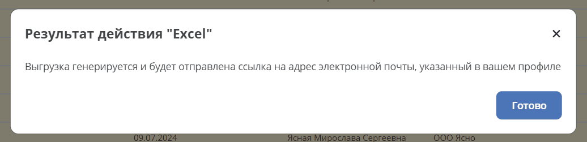

.. _group_actions:

Групповые действия
====================================

.. contents::
   :depth: 3

Групповые действия позволяют обработать набор элементов на сервере в фоновой задаче. Ниже описан API библиотеки ``ecos-group-actions 1.3.0`` и её интеграция с webapp и UI.

Примеры групповых действий:

1. Выгрузка в Excel
2. Скачивание Zip архива со всеми выбранными элементами

Условия подключения
----------------------

Для работы нужны библиотека групповых действий, зарегистрированные источники значений и исполнители, а также настроенные Records API и executor. Для EMAIL-вывода требуется сервис уведомлений. Доступность конкретных действий и условия поставки определяются используемыми компонентами; сама библиотека не устанавливает универсальное требование Enterprise или ``features.group-actions``.

Описание новых групповых действий в микросервисе
--------------------------------------------------------------------------------------------------

Для добавления возможности описывать групповые действия в микросервисе нужно добавить в **pom.xml** зависимость:

.. code-block:: xml

    <!-- Версия задаётся совместимым parent/BOM; иначе укажите её явно -->
    <dependency>
        <groupId>ru.citeck.ecos.groupactions</groupId>
        <artifactId>ecos-group-actions</artifactId>
    </dependency>

В приложении с ``EcosGroupActionsAutoConfiguration`` из ``ecos-webapp-lib-spring`` реализация следующего интерфейса регистрируется как Spring-бин. Автоконфигурация собирает фабрики и передаёт их сервису групповых действий. Вне этой интеграции сервис и фабрики нужно инициализировать и регистрировать явно.

.. code-block:: kotlin

    interface GroupActionExecutionFactory<in T : Any, in C : Any> {

        fun createExecution(config: C): GroupActionExecution<T>

        fun getType(): String
    }

Метод **getType** должен вернуть тип, по которому можно будет вызвать реализуемое действие.

Метод **createExecution** вызывается каждый раз когда запускается новое действие.

Интерфейс **GroupActionExecution** выглядит следующим образом:

.. code-block:: kotlin

    interface GroupActionExecution<in T : Any> {

        fun getRequiredAttributes(): Map<String, *> {
            return emptyMap<String, String>()
        }

        @Throws(Exception::class)
        fun execute(context: GroupActionContext<T>): ActionResult

        @Throws(Exception::class)
        fun dispose()
    }

.. list-table::
   :widths: 10 30
   :header-rows: 1
   :align: center
   :class: tight-table

   * - Метод
     - Описание
   * - **getRequiredAttributes**
     - Возвращает мапу с атрибутами, которые нужны для выполнения действия. Атрибуты можно запрашивать и в ходе выполнения действия, но эффективнее вернуть их список заранее, чтобы не делать лишних запросов.
   * - **execute**
     - | Вызывается в момент запуска действия. Все основные манипуляции с данными выполняются именно в этом методе.
       | В метод передаётся контекст действия с методами **getValues(): Iterable<T>** и **getBatchedValues(batchSize: Int): Iterable<List<T>>** — любой из них можно вызвать и перебрать все значения через цикл или вручную.
       | Если предполагается, что при возникновении ошибки обработку не нужно прерывать, исполнитель действия должен сам это учитывать: при выбрасывании исключения из **execute** выполнение действия сразу завершается.
   * - **dispose**
     - Вызывается в finally выполнения задачи, в том числе при ошибке. При кооперативной отмене освобождение ресурсов произойдёт после выхода из исполняемого кода, а не обязательно в момент запроса отмены.

Варианты результата групповой операции:

.. list-table::
   :widths: 5 5 10 20
   :header-rows: 1
   :align: center
   :class: tight-table

   * - Класс
     - ID
     - Данные
     - Описание
   * - **ActionResultLink**
     - LINK
     - url: String
     - | Вернуть ссылку на что-то для скачивания.
       | Для платформенного клиент-серверного взаимодействия используйте относительную ссылку (без протокола, хоста и порта). Сам класс результата хранит строку и не проверяет её формат.
       | Например:

         .. code-block:: text

             /gateway/emodel/api/ecos/webapp/content?ref=temp-file@1c1bf32d-07ad-422c-85e4-4789058e0fb1

       | Для получения ссылки на скачивание контента записи можно пользоваться методом **getDownloadUrl** в сервисе **EcosContentApi**.
       | Там же есть API для создания временного файла.
   * - **ActionResultMessage**
     - MESSAGE
     - message: String
     - Вернуть сообщение
   * - **ActionResultOk**
     - OK
     -
     - Вернуть простой результат о том что действие успешно выполнено
   * - **ActionResultResults**
     - RESULTS
     -

         .. code-block:: text

             results: List<Result>

             Типы:

             Result:
             message: String,
             status: ResultStatus,
             recordRef: EntityRef

             enum ResultStatus {
             OK,
             ERROR,
             PERMISSION_DENIED,
             SKIPPED
             }

     - Вернуть список результатов по каждой обрабатываемой записи

Потоки исполнения
----------------------------------

Сервис передаёт задачу настроенному ``EcosTaskExecutorApi``. Стандартная webapp-интеграция использует executor ``group-actions`` с пятью core-потоками по умолчанию.

Настройка количества потоков исполнения через spring свойства:

.. code-block:: yaml

    ecos:
      webapp:
        task:
          executors:
            group-actions:
              corePoolSize: 5 # по умолчанию действия выполняют пять потоков

В задачу переносятся контексты инициатора: аутентификация и runAs, локали, данные клиента и UTC offset. Проверки прав на конкретные записи выполняют используемые источники и исполнитель.

Запуск группового действия
----------------------------------------------------

Для запуска группового действия необходимо подготовить следующие параметры:

.. code-block:: text

    GroupActionParams(
        values: GroupActionValuesParams, # параметры формирования списка значений для обработки
        execution: GroupActionExecutionParams, # параметры обработки
        output: GroupActionOutputParams? = null # дополнительная серверная обработка результата
    )

    GroupActionValuesParams(
        type: String, # тип источника значений для обработки
        config: ObjectData, # конфигурация для формирования списка значений для обработки
        limit: Long = -1 # ограничение на количество элементов в списке значений. -1 - без ограничений
    )

    GroupActionExecutionParams(
        type: String, # тип действия
        config: ObjectData = ObjectData.create(), # конфигурация действия
        timeout: Duration = Duration.ofHours(5) # лимит, включая ожидание в очереди; остановка кооперативная
    )

    GroupActionOutputParams(
        type: GroupActionOutputType, # EMAIL или NONE
        config: ObjectData? # для EMAIL используется notificationRef
    )

При ``output=null`` дополнительная серверная обработка результата не выполняется. ``NONE`` не инициирует отправку уведомления. ``EMAIL`` требует результата ``ActionResultLink``.

Источники значений:

.. list-table::
   :widths: 10 10 20
   :header-rows: 1
   :align: center
   :class: tight-table

   * - Тип
     - Конфигурация
     - Описание
   * - records-list
     -
       .. code-block:: text

          records: List<EntityRef>

     - Список конкретных сущностей
   * - records-query
     -

       .. code-block:: text

         query: RecordsQuery
         pageSize: Int = 100
         pageStrategy: PageStrategy = CREATED

     - Результаты поискового запроса; обычный запрос обходится постранично через IterableRecords

При пустом ``getRequiredAttributes`` источник ``records-list`` передаёт ссылки на записи, иначе предварительно загружает их атрибуты. ``records-query`` также возвращает ссылки или данные в зависимости от запрошенных атрибутов.

.. note::

   В версии ``1.3.0`` запрос с непустым ``groupBy`` выполняется одной выборкой с ``maxItems=1000``, без обычного постраничного обхода. Не рассчитывайте, что такой запрос обработает любое число групп. Для обычного запроса ``totalCount`` может быть ``-1``, если точное число элементов неизвестно.

Архитектура решения
--------------------------------------

Общий принцип работы групповых действий следующий:

При наличии библиотеки и зависимостей её webapp-интеграции ``EcosGroupActionsAutoConfiguration`` регистрирует:

1. Сервис групповых действий
2. Регистратор групповых действий
3. RecordsDAO для групповых действий с ID «group-action»

Также регистрируются источники значений ``records-list`` и ``records-query``. Доступные типы исполнения определяются подключёнными фабриками, а не только наличием базовой библиотеки.

Для запуска группового действия выполняется мутация записи:

.. code-block:: text

    {appName_микросервиса}/group-action@

В атрибутах заполняются поля **GroupActionParams**: ``values``, ``execution`` и при необходимости ``output``.

RecordsDAO подготавливает исполнителя и источник значений, ставит задачу в executor и возвращает ссылку, не ожидая завершения обработки:

.. code-block:: text

    {appName_микросервиса}:{appInstance_микросервиса}/group-action@{actionId}

Например:

.. code-block:: text

    transformations:nrfdsvbocapo/group-action@7c269f9c-262b-4426-8865-7309dec07f2c

Далее инициатор действия может загрузить по вернувшемуся рефу атрибуты для получения информации о состоянии действия:

.. code-block:: text

    status: GroupActionStatus
    initiator: EntityRef
    processedCount: Long
    totalCount: Long
    result: GroupActionResult? # null, пока Promise результата не завершён

    Типы:

    enum GroupActionStatus = {
        WAITING, // действие ожидает пока освободится поток для его выполнения
        RUNNING, // действие выполняется
        COMPLETED, // действие завершено успешно
        ERROR // ошибка при выполнении действия
    }

    GroupActionResult(
        type: String, # Тип результата. Может быть одним из штатных типов результата (LINK, OK, и т.д.) или ошибочным - "ERROR"
        data: ObjectData # Данные по результату. Например, для LINK здесь будет ссылка, для OK пустой объект.
    )

Инициатор периодически опрашивает ``status`` и ``result``. Эти поля читаются неатомарно: Promise результата может завершиться до установки конечного статуса. При ошибке возвращается результат ``ERROR`` с ``data.message``, содержащим сообщение корневой причины.

``processedCount`` отражает продвижение по итератору, а не число успешных бизнес-операций. При пакетном обходе счётчик обновляется по мере перехода между пакетами; размер пакета должен быть не меньше 1. Новый итератор сбрасывает счётчик. При неизвестном ``totalCount=-1`` процент готовности вычислить нельзя.

Хранение состояния и таймаут
~~~~~~~~~~~~~~~~~~~~~~~~~~~~~~~~~~~~~~~~

Действия хранятся в памяти экземпляра приложения. Сохраняйте возвращённую ссылку с ``appInstance`` при опросе. Завершённые действия удаляются периодической проверкой после более чем 60 секунд в статусе ``COMPLETED`` или ``ERROR``; период проверки — около 30 секунд. После удаления, остановки или перезапуска экземпляра запись действия недоступна. Это не долговременная история операций.

Лимит ``timeout`` отсчитывается при создании действия и включает ожидание в очереди. Периодическая проверка запрашивает кооперативную остановку: устанавливает флаг прерывания и удаляет действие из реестра. Принудительной остановки произвольного кода исполнителя не происходит.

Итерация через контекст проверяет прерывание при ``hasNext``. Для длительных операций вне итератора учитывайте ``context.isInterrupted()`` самостоятельно. После таймаута запись может исчезнуть из опроса, хотя исполнитель ещё завершает работу.

.. _ui_group_actions:

UI действие
----------------------

Тип действия — **server-group-action-v2**

Конфиг действия:

.. code-block:: yaml

  targetApp: String # целевое приложение где описана реализация групповой операции
  valuesParams:
    limit: Number # Лимит обрабатываемых элементов
    config:
      pageSize: Number # Размер страницы для records-query; по умолчанию 100
      pageStrategy: CREATED # Стратегия пагинации records-query
  executionParams:
    type: String # Тип действия
    timeout: Duration # Лимит с учётом очереди; например PT1H
    config: Map<String, *> # Конфигурация действия. Содержимое зависит от типа действия
  outputParams:
    type: String # EMAIL или NONE для дополнительной серверной обработки
    config: Map<String, *> # Конфигурация, описывающая дополнительные свойства для возвращения результата действия

UI формирует ``records-list`` для выбранных записей и ``records-query`` для запроса, дополняет их ``valuesParams`` и передаёт ``executionParams`` в серверное поле ``execution``. Необязательный ``outputParams`` передаётся как серверное поле ``output``.

Пример конфигурации:

.. code-block:: yaml

  id: group-action-export-xlsx
  type: server-group-action-v2
  name:
    ru: Скачать Excel-файл
    en: Download Excel-file

  config:
    targetApp: transformations
    valuesParams:
      limit: 1000000
    executionParams:
      type: export-xlsx
      timeout: PT1H
      config:
        fileName: "report"
        columns: [{name: Column, attribute: "?disp"}]

  features:
    execForRecords: true
    execForQuery: true
    execForRecord: false

В примере ``export-xlsx`` — тип исполнителя, который должен быть зарегистрирован в целевом приложении. Параметры колонок и генерации файла определяются этим исполнителем.

В обычном UI-пути отображается окно ожидания: при известном ``totalCount`` — процент готовности, при ``-1`` — число обработанных записей:

Пример конфигурации с outputParams:

.. code-block:: yaml

  id: group-action-export-xlsx
  type: server-group-action-v2
  name:
    ru: Скачать Excel-файл
    en: Download Excel-file

  config:
    targetApp: transformations
    valuesParams:
      limit: 1000000
    executionParams:
      type: export-xlsx
      timeout: PT1H
      config:
        fileName: "${$context.journalName}_${$now|fmt('yyyy-MM-dd_HH-mm-ss')}"
        columns: "${$context.reportColumns[]?json}"
    outputParams:
      type: EMAIL
      config:
        notificationRef: notifications/template@default-link-for-export-file-notification

  features:
    execForQuery: true
    execForRecord: false
    execForRecords: true

Для ``EMAIL`` UI показывает информационное сообщение сразу после запуска и не ожидает окончания действия:

Это сообщение не подтверждает отправку или доставку письма. Нужны настроенный сервис уведомлений, существующий ``notificationRef``, непустая ссылка результата и email инициатора в ``emodel/person``.

При отсутствии необходимых данных output-сервис может записать ошибку в лог и пропустить отправку без перевода действия в ``ERROR``. Исключение при обработке output, напротив, может завершить действие с ошибкой даже после успешного ``execute``.
