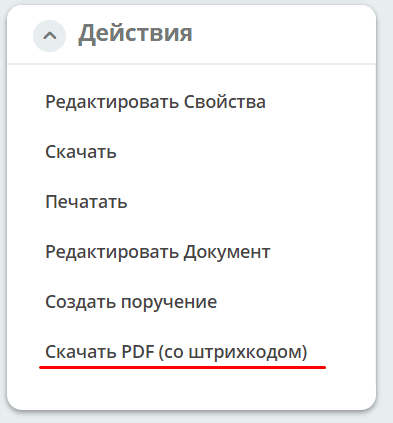

.. _barcode:

Штрих-код
==================

.. note::

   Доступность функции зависит от состава и условий поставки, включая подключённые компоненты трансформации и конвертеры.

Citeck позволяет формировать PDF-документ со встроенным штрих-кодом — это упрощает идентификацию и отслеживание документов в рамках бизнес-процессов. Функционал реализован в микросервисе :ref:`ecos-transformations <transformation>`: изображение генерируется через ZXing, а компонент трансформации ``barcode`` накладывает его на PDF через iText.

На основе атрибута записи генерируется изображение штрих-кода, которое можно:

1. Отобразить в карточке;
2. Открыть для печати;
3. Наложить на PDF-документ.

.. dropdown:: Процесс формирования PDF-документа со штрих-кодом
   :color: secondary

   1. Исходный контент загружается пользователем или генерируется из :ref:`шаблона <doc_template>`.
   2. Если исходник не PDF, выполняется конвертация в PDF. Для DOC/DOCX необходим доступный конвертер офисных форматов, например OnlyOffice.
   3. Компонент ``barcode`` получает данные штрих-кода из указанной сущности или сущности входного контента и добавляет его в PDF. Без сущности-источника компонент завершится ошибкой.
   4. Результат скачивается или сохраняется согласно настройке цели трансформации (``output``). Запись в контент документа или дочерней сущности настраивается отдельно.

   По умолчанию штрих-код размещается внизу по центру на всех страницах. Пример:

   .. image:: _static/barcode/barcode_1.png
      :width: 400
      :align: center

Настройка штрих-кода
-----------------------------------------

Настройка осуществляется через :ref:`аспект <aspects>`, который добавляется к требуемому типу:

Аспект: **Имеет штрих-код (barcode)**

В настройках аспекта для типа есть три поля:

1. ``format`` — формат штрих-кода, по умолчанию ``CODE_128``.
2. ``attribute`` — атрибут с кодируемым содержимым, по умолчанию ``_docNum``.
3. ``textAttribute`` — атрибут подписи под изображением. Если он не задан, подпись берётся из атрибута кодируемого содержимого.

Аспект задаёт способ получения данных. Автоматическое создание и сохранение PDF требует отдельного действия или настройки процесса.

Добавление штрих-кода в PDF-документ
------------------------------------------------

Для добавления штрих-кода в PDF можно воспользоваться возможностями :ref:`трансформации содержимого <content_transformation>`.

Пример настройки UI-действия ``transform`` для наложения штрих-кода на существующий PDF:

.. code-block:: yaml

   ---
   id: download-with-barcode
   name: Скачать со штрих-кодом
   type: transform
   config:
     transformations:
       - type: barcode

Если содержимое документа нужно предварительно конвертировать в PDF (например, из **doc**/**docx**), добавьте трансформер ``convert`` перед ``barcode``:

.. code-block:: yaml

   ---
   id: download-with-barcode-converted
   name: Скачать PDF со штрих-кодом
   type: transform
   config:
     transformations:
       - type: convert
         config:
           toMimeType: application/pdf
       - type: barcode

Эти примеры описывают UI-действия; подготовка источника и цели зависит от клиентского компонента. Полная серверная конфигурация включает ``input``, ``transformations`` и ``output`` — см. :ref:`трансформации содержимого <content_transformation>`.

Все параметры компонента ``barcode`` имеют значения по умолчанию. Для изменения положения и выбора страниц можно добавить ``config`` к шагу трансформации:

.. code-block:: yaml

   - type: barcode
     config:
       layout: BOTTOM_CENTER
       pages: FIRST
       altText: true

``layout`` поддерживает ``TOP_LEFT``, ``TOP_CENTER``, ``TOP_RIGHT``, ``BOTTOM_LEFT``, ``BOTTOM_CENTER`` и ``BOTTOM_RIGHT``. Для ``pages`` доступны ``ALL`` (по умолчанию), ``FIRST`` и ``LAST``. Также можно задать ``entityRef``, ``barcodeAttribute``, размеры, отступы, масштаб и цвета; подробнее см. :ref:`конфигурацию трансформаций <content_transformation>`.

В настроенной карточке действие может отображаться, например, как **Скачать PDF (со штрих-кодом)**. Его наличие и название зависят от конфигурации действий:

Подробнее о трансформациях — в :ref:`трансформации содержимого <content_transformation>`.

REST API
----------

Для загрузки штрих-кода в виде изображения можно воспользоваться следующим API:

``GET /gateway/transformations/api/barcode/image?content=123``

Путь внутри микросервиса — ``/api/barcode/image``; префикс ``/gateway/transformations`` определяется маршрутизацией платформы.

Доступны два режима:

* Без ``entityRef`` используются ``content`` и ``barcodeFormat``.
* При переданном ``entityRef`` содержимое и формат берутся из записи и конфигурации её аспекта. ``attribute`` может переопределить атрибут содержимого; ``content`` и ``barcodeFormat`` в этом режиме не используются.

Для прямой генерации по ``content`` полностью опускайте ``entityRef``, а не передавайте пустое значение. Значения query-параметров URL-кодируйте.

Параметры:

.. list-table::
   :widths: 10 5 20
   :header-rows: 1
   :align: center
   :class: tight-table

   * - Параметр
     - Тип
     - Описание
   * - barcodeFormat
     - String?
     - Формат штрих-кода при генерации по ``content``. По умолчанию ``CODE_128``. В режиме ``entityRef`` используется формат из аспекта.
   * - imageFormat
     - String?
     - Формат изображения. Текущая реализация поддерживает только ``PNG``; это значение используется по умолчанию.
   * - width
     - Int?
     - Ширина матрицы штрих-кода в пикселях. По умолчанию ``0``; итоговый размер определяется также форматом и подписью.
   * - height
     - Int?
     - Высота матрицы штрих-кода в пикселях. По умолчанию ``0``; для одномерного формата при нулевой высоте используется ``50``.
   * - margin
     - Int?
     - Отступ кодировщика. По умолчанию ``-1`` — явный отступ не задаётся, используются правила выбранного формата.
   * - altText
     - Boolean?
     - Рендерить текстовое содержимое штрих-кода. По умолчанию — Да
   * - content
     - String?
     - Кодируемое содержимое. Используется только при отсутствии ``entityRef``.
   * - entityRef
     - String?
     - Ссылка на сущность для получения данных. При наличии имеет приоритет над ``content``; формат и параметры атрибутов берутся из аспекта типа.
   * - attribute
     - String?
     - Атрибут кодируемого содержимого в режиме ``entityRef``. Если пуст или не задан, используется ``attribute`` аспекта с fallback на ``_docNum``. Для подписи применяется ``textAttribute`` аспекта или атрибут кодируемого содержимого.
   * - download
     - Boolean?
     - При ``true`` устанавливается ``Content-Disposition: attachment``. Формат результата этим параметром не выбирается. При отсутствии или ``false`` заголовок вложения не устанавливается.
   * - print
     - Boolean?
     - При ``true`` возвращается PDF со штрих-кодом для печати, независимо от ``outputType``. Сервер не открывает диалог печати и не отправляет документ на принтер. По умолчанию флаг не включён.
   * - outputType
     - String?
     - | При выключенном ``print`` точное значение ``json`` возвращает JSON с полем ``data`` (base64 изображения).
       | При другом или отсутствующем значении возвращается изображение. ``outputType=pdf`` сам по себе не включает PDF; для него требуется ``print=true``.

Значения ``barcodeFormat`` и ``imageFormat`` приводятся к верхнему регистру, но неизвестный формат вызывает ошибку. Значение ``outputType=json`` проверяется с учётом регистра.

Для двумерных штрих-кодов при нулевых ширине и высоте используется матрица ``60 × 60``. Если задана только одна сторона, вторая принимается равной ей. Текстовая подпись может увеличить размер итогового PNG.

При сочетании ``download`` с ``print`` или JSON учитывайте, что текущий контроллер формирует имя вложения до выбора формата ответа и дописывает расширение по формату изображения. Соответствующее PDF/JSON-расширение имени не гарантируется.

Пример получения изображения по записи:

.. code-block:: text

   GET /gateway/transformations/api/barcode/image?entityRef=emodel/anysrc@123&attribute=_docNum

Хотя HTTP-параметры необязательны в сигнатуре, для генерации нужны корректные данные. Допустимая длина и алфавит содержимого зависят от выбранного формата.

Поддерживаемые форматы штрих-кода:

- AZTEC
- CODABAR
- CODE_39
- CODE_93
- CODE_128
- DATA_MATRIX
- EAN_8
- EAN_13
- ITF
- PDF_417
- QR_CODE
- UPC_A
- UPC_E
