.. _intellij_idea_plugin:

Плагин для IntelliJ IDEA для работы с платформой Citeck
========================================================

.. contents::
   :depth: 2

**Citeck DevKit** — плагин для IntelliJ IDEA, который ускоряет работу с проектами и артефактами платформы Citeck. Ниже описана версия ``3.5.0``.

Общие функции рассчитаны на Community и Ultimate при наличии обязательных плагинов Java, YAML и Kotlin. Создание проектов требует Maven-плагина, а JavaScript-возможности форм — JavaScript-плагина, доступного в соответствующей редакции IDE.

Исходный код плагина: `ecos-idea-plugin <https://github.com/Citeck/ecos-idea-plugin>`_

.. note::

   В сборке ``3.5.0`` указан ``sinceBuild=231.9423.9``. Выбирайте дистрибутив, совместимый с build вашей IDE. SDK сборки — IntelliJ IDEA Ultimate 2025.1; это не означает поддержку только этой версии. Отсутствие верхней границы совместимости не гарантирует работу во всех будущих IDE.

   В версиях плагина ``3.0.0+`` удалена поддержка Alfresco. Для неё в README проекта указана ветка плагина ``2.x``.

Установка плагина
------------------

Скачайте дистрибутив плагина из `release page <https://github.com/Citeck/ecos-idea-plugin/releases>`_ или соберите из исходников самостоятельно.

Далее установите плагин в IDEA: **Settings -> Plugins -> Install Plugin from disk**

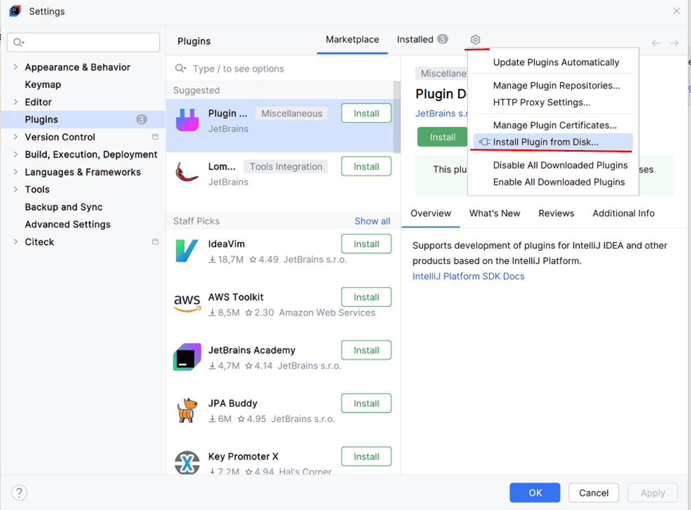

Обновление плагина
-------------------

Для обновления скачайте последнюю версию дистрибутива плагина из `release page <https://github.com/Citeck/ecos-idea-plugin/releases>`_

Установите выбранный дистрибутив через **Settings -> Plugins -> Install Plugin from disk** и следуйте запросам IDE об обновлении и перезапуске. Совместимость нужно проверять для устанавливаемой версии плагина.

Функционал плагина
------------------

Создание новых проектов Citeck
~~~~~~~~~~~~~~~~~~~~~~~~~~~~~~~

При включённом Maven-плагине доступны проекты приложения и микросервиса Citeck. Мастер использует архетипы ``ru.citeck.ecos:ecos-application-archetype`` и ``ru.citeck.ecos:ecos-webapp-archetype`` с версией ``LATEST``; необходим доступ к Maven-репозиторию Citeck.

.. _plugin_app_mks:

**File -> New project**

Доступен пункт **Citeck** и варианты создания :ref:`приложения<applications>`/ :ref:`микросервиса<mcs_setup>`:

.. grid:: 2
   :gutter: 2

   .. grid-item::

      .. image:: _static/idea_plugin/01.png
         :width: 500
         :align: left

   .. grid-item::

      .. image:: _static/idea_plugin/02.png
         :width: 500
         :align: left

Структура проекта определяется загруженной версией архетипа. Ниже приведены примеры:

.. grid:: 2
   :gutter: 2

   .. grid-item::

      **Приложение**

      .. image:: _static/idea_plugin/03.png
         :width: 400
         :align: left

   .. grid-item::

      **Микросервис**

      .. image:: _static/idea_plugin/04.png
         :width: 400
         :align: left

Создание артефактов по шаблону
~~~~~~~~~~~~~~~~~~~~~~~~~~~~~~~

По правой кнопке в контекстном меню доступен пункт **New - Citeck Artifact**:

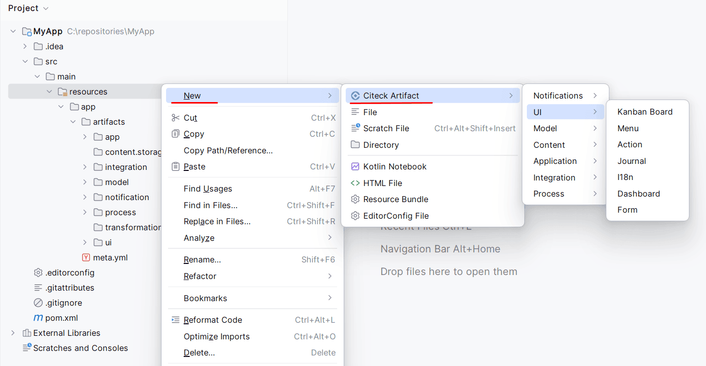

Вводим название:

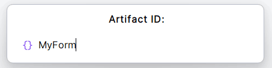

Артефакт генерируется в соответствии с шаблоном:

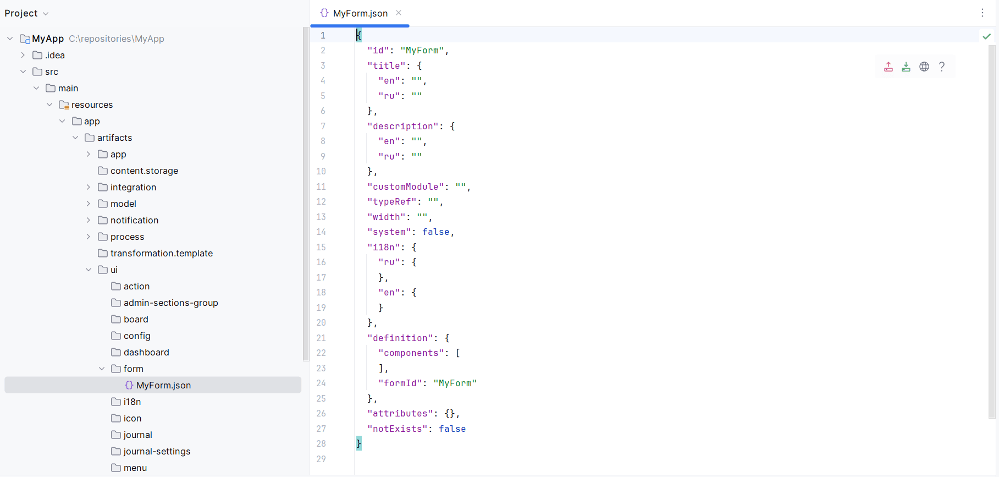

Загрузка и выгрузка артефактов
~~~~~~~~~~~~~~~~~~~~~~~~~~~~~~~

Загрузка и выгрузка распознанных артефактов на настроенный сервер Citeck: локальный или удалённый. Поддерживаемые операции зависят от типа артефакта и его метаданных.

Для артефакта доступны следующие действия:

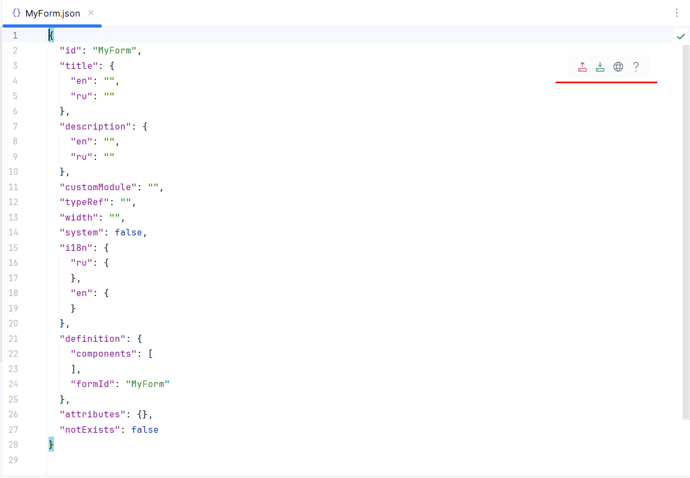

* **Deploy File** — выгрузка артефакта на сервер.
* **Fetch File** — загрузка артефакта с сервера
* **Open In Browser** — открытие страницы артефакта; наличие редактора определяется его типом
* **Open Documentation** — переход на страницу с документацией по артефакту

``Fetch File`` записывает серверные данные в локальный файл. После загрузки проверьте diff, прежде чем сохранять изменения в системе контроля версий.

.. dropdown:: Пример: редактирование формы через no-code редактор
   :color: secondary

   1. Выгрузите артефакт по кнопке **Deploy File** на стенд или локально:

      .. grid:: 3
         :gutter: 2

         .. grid-item::

            .. image:: _static/idea_plugin/deploy_a.png
               :width: 200
               :align: left

         .. grid-item::

            .. image:: _static/idea_plugin/select_server.png
               :width: 200
               :align: left

         .. grid-item::

            .. image:: _static/idea_plugin/deploy_b.png
               :width: 250
               :align: left

   2. Для формы с доступным редактором выберите **Open In Browser** и отредактируйте её на сервере:

      .. grid:: 2
         :gutter: 2

         .. grid-item::

            .. image:: _static/idea_plugin/form_1.png
               :width: 500
               :align: left

         .. grid-item::

            .. image:: _static/idea_plugin/form_2.png
               :width: 500
               :align: left

   3. Загрузите измененный артефакт обратно по кнопке **Fetch File**:

      .. image:: _static/idea_plugin/08_1.png
         :width: 600
         :align: center

JSON-схемы для артефактов
~~~~~~~~~~~~~~~~~~~~~~~~~~

Для распознанных типов артефактов подключаются JSON-схемы, помогающие редактировать JSON/YAML-конфигурацию. Состав схем зависит от ресурсов плагина; это не универсальная схема любого файла проекта.

.. grid:: 2
   :gutter: 2

   .. grid-item::

      .. image:: _static/idea_plugin/scheme_01.png
         :width: 600
         :align: left

   .. grid-item::

      .. image:: _static/idea_plugin/scheme_02.png
         :width: 600
         :align: left

Поиск артефактов
~~~~~~~~~~~~~~~~~

Поиск артефактов по их идентификаторам (расширение для search everywhere):

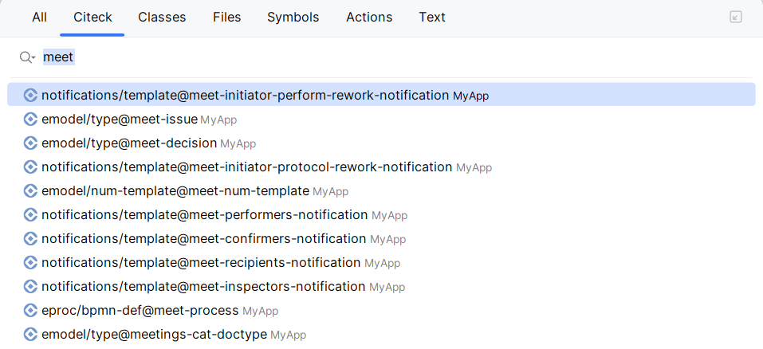

Навигация в коде по артефактам
~~~~~~~~~~~~~~~~~~~~~~~~~~~~~~~

Навигация в коде по артефактам Citeck через гиперссылки:

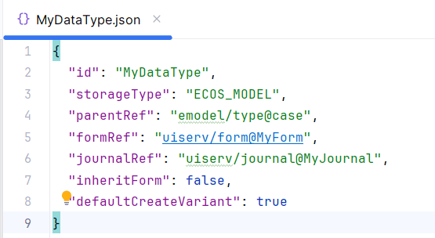

Автодополнение ссылок в JSON/YAML
~~~~~~~~~~~~~~~~~~~~~~~~~~~~~~~~~~

В распознанных артефактах доступны подсказки из индекса проекта:

* ``formRef`` — ссылки на формы;
* ``journalRef`` — ссылки на журналы;
* ``parentRef`` — ссылки на типы в определении типа данных;
* ``typeRef`` — ссылки на типы в других артефактах.

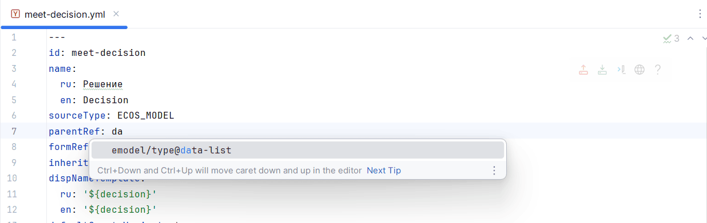

Автодополнение JavaScript в формах
~~~~~~~~~~~~~~~~~~~~~~~~~~~~~~~~~~~

При наличии JavaScript-плагина, например в IDEA Ultimate, объект **data** дополняется компонентами формы:

.. grid:: 2
   :gutter: 2

   .. grid-item::

      .. image:: _static/idea_plugin/11.png
         :width: 500
         :align: left

   .. grid-item::

      .. image:: _static/idea_plugin/12.png
         :width: 500
         :align: left

Навигация в файлах
~~~~~~~~~~~~~~~~~~~

- Формы (быстрый переход к компонентам по их имени);
- Журналы (навигация по колонкам);
- Типы данных (быстрый переход к атрибутам, ролям, статусам и т.д.)

.. grid:: 2
   :gutter: 2

   .. grid-item::

      .. image:: _static/idea_plugin/13.png
         :width: 500
         :align: left

   .. grid-item::

      .. image:: _static/idea_plugin/13_1.png
         :width: 500
         :align: left

Инспекции кода
~~~~~~~~~~~~~~~

Для артефактов ``model/type`` и ``model/aspect`` в JSON/YAML проверяется длина имени колонки атрибута в PostgreSQL. Предел — **63 байта UTF-8**, а не 63 символа. Для аспекта учитывается его префикс.

При превышении лимита инспекция предлагает сократить идентификатор атрибута или префикс аспекта. Проверка дубликатов ключей компонентов форм не входит в текущий набор зарегистрированных инспекций версии ``3.5.0``.

Генерация компонентов формы
~~~~~~~~~~~~~~~~~~~~~~~~~~~~

Если в форме задан **typeRef**:

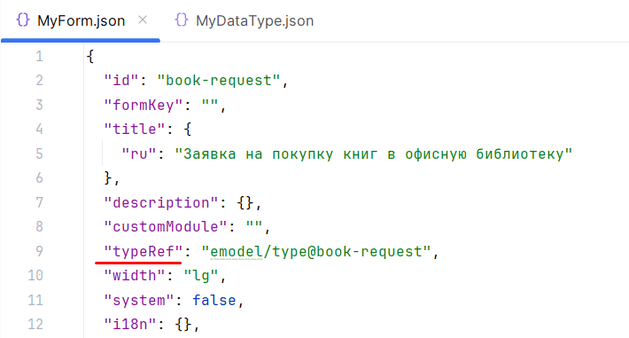

то команда **Component** может предложить атрибуты указанного типа. Файл типа должен быть доступен в локальном индексе проекта: генератор читает его ``model.attributes``. Одной ссылки на тип, существующий только на сервере, недостаточно.

.. grid:: 3
   :gutter: 2

   .. grid-item::

      .. image:: _static/idea_plugin/comp_gen_02.png
         :width: 500
         :align: left

   .. grid-item::

      .. image:: _static/idea_plugin/comp_gen_03.png
         :width: 500
         :align: left

   .. grid-item::

      .. image:: _static/idea_plugin/comp_gen_04.png
         :width: 500
         :align: left

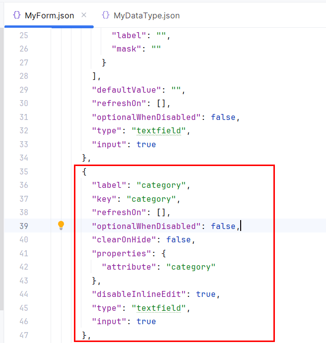

Генерация локализаций формы
~~~~~~~~~~~~~~~~~~~~~~~~~~~~~~

Команда **Generate -> Localization** позволяет выбрать текстовые ``label``, ``description`` и ``title`` компонентов JSON-формы и добавить для них пустые значения в ``i18n.ru`` и ``i18n.en``. Эти объекты локализации должны присутствовать в форме. Переводы заполняются вручную; команда не переводит тексты автоматически.

Расширение областей поиска
~~~~~~~~~~~~~~~~~~~~~~~~~~~

Расширение областей поиска файлами, содержащими артефакты Citeck:

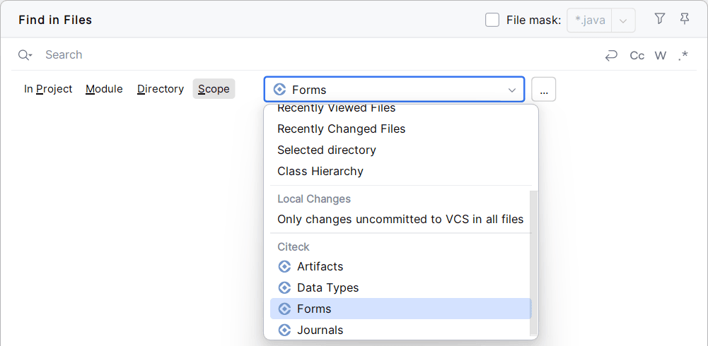

Конвертация YAML и JSON
~~~~~~~~~~~~~~~~~~~~~~~~

Конвертация **YAML -> JSON**, **JSON -> YAML**:

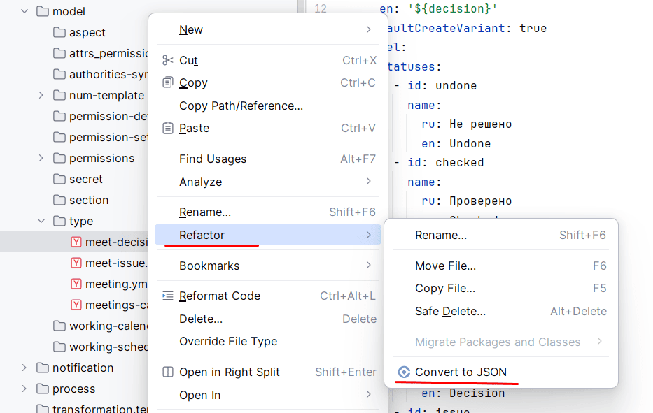

Language Injection (JavaScript) в формах
~~~~~~~~~~~~~~~~~~~~~~~~~~~~~~~~~~~~~~~~~

При наличии JavaScript-плагина внедрение языка применяется к настроенным полям формы, например ``calculateValue``, ``customDefaultValue``, ``customConditional`` и ``validate/custom``. Произвольное строковое поле не становится JavaScript автоматически.

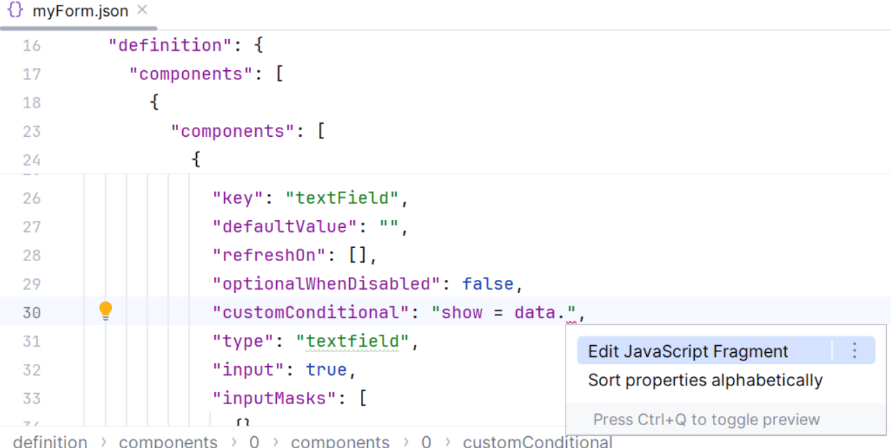

Деплой приложения целиком
~~~~~~~~~~~~~~~~~~~~~~~~~~~~

В версии ``3.5.0`` команда **Deploy Application** и деплой приложения через ``meta.yml`` не зарегистрированы как активные возможности. Для отдельных распознанных артефактов используйте **Deploy File**.

Конфигурация серверов
----------------------

Настройка серверов Citeck: **Settings -> Citeck -> Servers**.

Обязательное поле — **Host**. Указывайте явную схему, например ``http://localhost:8080`` или ``https://example.org``. Поля **Name**, **Client ID** и **Client Secret** заполняются по настройкам сервера и клиента аутентификации; отсутствие обязательности в форме не гарантирует подключение к любому серверу без дополнительных параметров.

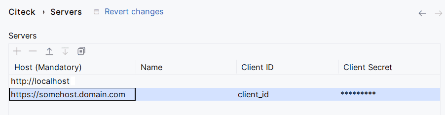

Способ аутентификации определяется автоматически по ``<host>/eis.json``: при ``eisId=EIS_ID`` используется Basic, иначе OIDC. Адрес локального стенда сам по себе не задаёт Basic. При Basic логин и пароль вводятся в диалоге IDE.

При OIDC пользователь входит через браузер; плагин получает код авторизации через локальный callback ``http://127.0.0.1:<port>/callback`` и обменивает его на токены. Пароль пользователя в этом потоке не вводится в плагине.

Если **Client ID** не задан, используется ``citeck-idea-plugin``. При использовании другого клиента настройте допустимый redirect для callback плагина. **Client Secret**, если нужен, хранится в PasswordSafe IDE. :ref:`Инструкция по клиенту Keycloak <keycloak_postman>` описывает общие настройки, но redirect клиента Postman не заменяет redirect плагина.

Сборка дистрибутива плагина
-----------------------------

1. Для корректной сборки дистрибутива плагина необходимо убедиться, что используемая версия **Gradle JVM не ниже 17**.

   Настроить используемую JVM для Gradle в IDEA можно по следующему пути: **Settings -> Build, Execution, Deployment -> Build Tools -> Gradle -> Gradle JVM**

2. Сборка осуществляется **Gradle** задачей **buildPlugin**.

3. Собранный дистрибутив будет расположен по следующему пути: ``build/distributions/``

В исходниках ``3.5.0`` настроены Java/Kotlin toolchain 17, Gradle Wrapper 8.13 и SDK IntelliJ IDEA Ultimate 2025.1. JDK сборки и среда выполнения запускаемой IDE имеют отдельные требования.

Из корня проекта в Windows:

.. code-block:: powershell

   .\gradlew.bat buildPlugin

Разработка
-----------

Для разработки плагина можно использовать Gradle задачу **runIde**.

При выполнении задачи будет запущен новый экземпляр IDEA с пересобранным плагином.

.. code-block:: powershell

   .\gradlew.bat runIde
