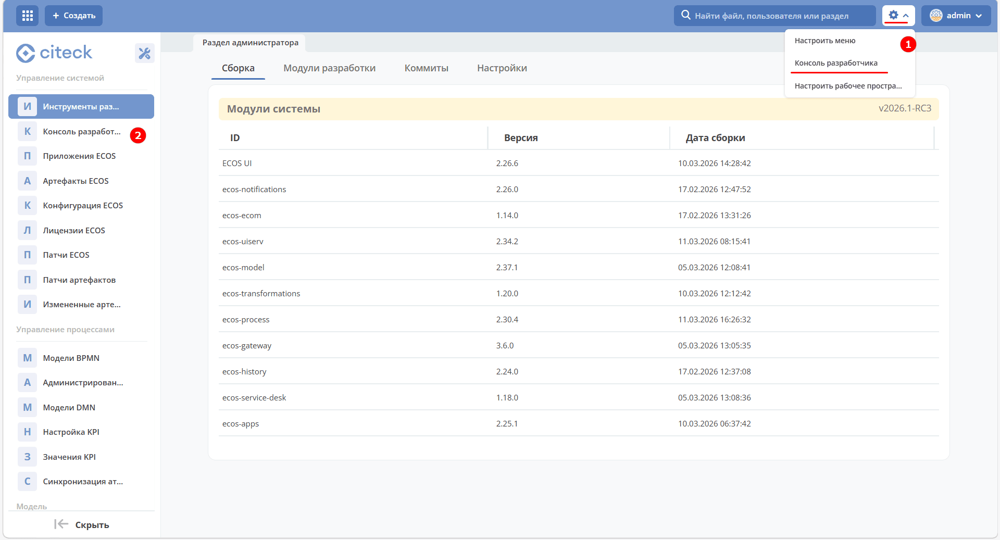
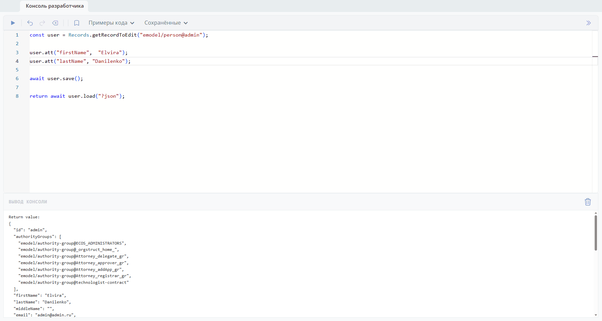
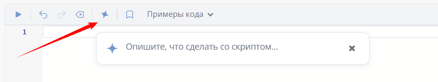
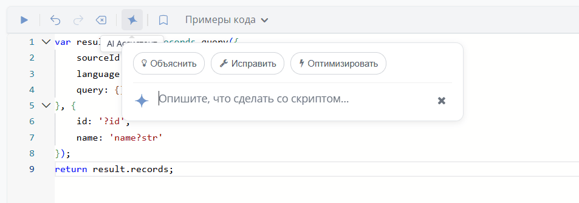

.. _developer_console:

Консоль разработчика
========================================

Консоль разработчика для администраторов позволяет выполнять **JavaScript код** непосредственно в браузере с отображением результатов.

Вызвать консоль можно из рабочего пространства "Раздел администратора" в верхнем правом углу через шестеренку **(1)** или через соответствующий пункт меню **(2)**:

Общий вид панели консоли разработчика:

- Вверху **панель инструментов** с кнопками управления (**Выполнить, Отменить, Повторить, Очистить редактор, Сохранить код**), меню **«Примеры кода»** и переключателем расположения области вывода. Меню **«Сохранённые»** появляется после сохранения первого сниппета.
- Основная область — **редактор кода** с нумерацией строк и синтаксической подсветкой.
- По умолчанию секция **«Вывод консоли»** расположена снизу. Её можно перенести вправо и изменить размер перетаскиванием границы. Размер и расположение сохраняются в текущем браузере.

Кнопки **«Отменить»** и **«Повторить»** отменяют и повторяют изменения текста в редакторе. Они не отменяют выполнение кода или уже выполненные операции. Кнопка **«Очистить редактор»** удаляет текст кода, а отдельная кнопка **«Очистить вывод»** в заголовке области вывода очищает результат.

Код можно запустить кнопкой **«Выполнить»** или сочетанием клавиш **Shift + Enter**, когда фокус находится в редакторе.

В коде доступны ``Records``, ``Citeck``, ``_`` (lodash) и ``console``; поддерживается ``await``. В области вывода отображаются сообщения ``console.log``, ``console.error``, ``console.warn``, ``console.info`` и возвращаемое значение. Например:

.. code-block:: javascript

   const result = 2 + 2;
   console.log('Результат:', result);
   return result;

Работа со сниппетами
----------------------------------------

**Сниппет** — сохранённый фрагмент кода, который можно загрузить в редактор, чтобы не писать с нуля. Выбор сниппета или примера кода заменяет весь текущий текст редактора.

Сниппеты хранятся локально в текущем браузере для этого сайта. Они не синхронизируются между браузерами и могут быть удалены при очистке данных сайта. Текущий текст редактора также автоматически сохраняется в браузере и восстанавливается при следующем открытии консоли.

.. list-table::
   :header-rows: 1
   :widths: 30 70
   :class: tight-table

   * - Действие
     - Результат
   * - Сохранение кода
     - Кнопка **«Сохранить код»** → ввести название сниппета → **«Сохранить»**. Сниппет появляется в выпадающем меню **«Сохранённые»** и доступен для загрузки в редактор. Для сохранения нужны непустые название и код.
   * - Повторное сохранение с тем же названием
     - Обновляется код сохранённого сниппета с совпавшим названием, независимо от того, какой сниппет активен. Названия сравниваются без учёта регистра; пробелы по краям введённого названия удаляются. В модальном окне отображается подсказка **«Существующий сниппет будет обновлён»**.
   * - Удаление сниппета из меню «Сохранённые»
     - Появляется модальное окно с запросом подтверждения. После подтверждения сниппет удаляется.

Кнопка AI Ассистент
-------------------------------------

.. note::

   Доступно только в enterprise версии.

   Кнопка отображается, когда настроенный AI-сервис доступен. Если проверка доступности сервиса не проходит, кнопка не отображается.

В панель инструментов консоли разработчика добавлена кнопка :ref:`AI Ассистент <AI_assistant>` — позволяет использовать AI для генерации и редактирования кода прямо в консоли.

Например, можно попросить AI Ассистент написать код для получения списка всех пользователей:

.. grid:: 2
   :gutter: 2

   .. grid-item::

      .. image:: _static/console/04.png
         :width: 400
         :align: left

   .. grid-item::

      .. image:: _static/console/05.png
         :width: 700
         :align: left

Если в редакторе уже есть код, то при запросе к AI Ассистенту появятся подсказки:

