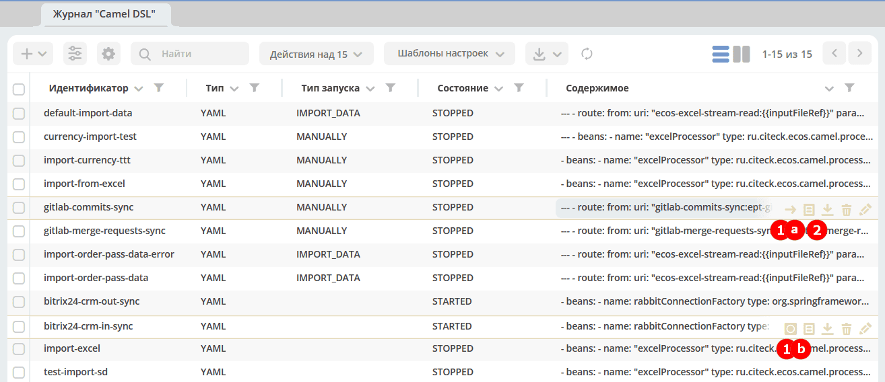
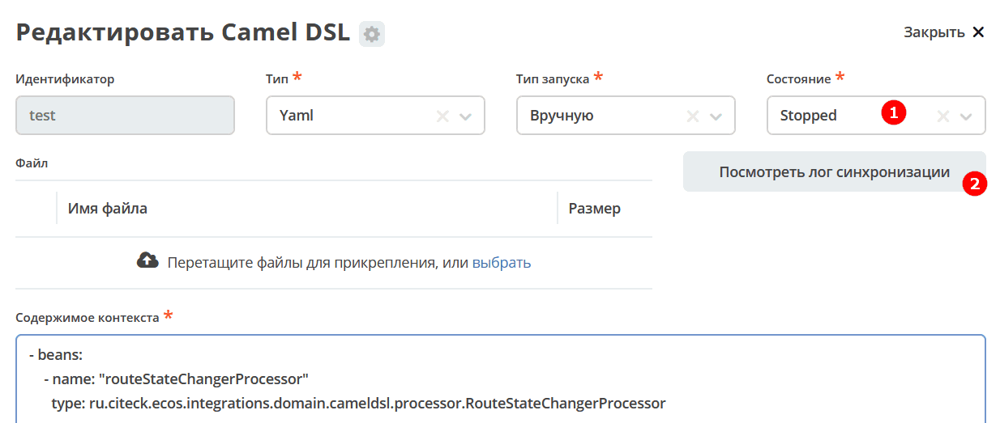

.. _camel_dsl_actions:

Действия, доступные с Camel DSL
================================

Для каждого артефакта Camel DSL в журнале доступны действия управления контекстом. Помимо стандартных операций (скачать, редактировать, удалить), предусмотрены дополнительные действия, специфичные для Camel DSL: запуск и остановка контекста, а также просмотр лога последней синхронизации.

|

Описание дополнительных действий:

.. list-table::
   :widths: 10 90
   :header-rows: 1
   :class: tight-table

   * - Действие
     - Описание
   * - **1a** — Старт
     - Запускает Camel-контекст. Доступно для состояний STOPPED и SUSPENDED.
   * - **1b** — Стоп
     - Останавливает выполняющийся Camel-контекст.
   * - **2** — Лог
     - Открывает журнал последней синхронизации с подробной информацией о ходе выполнения и возможных ошибках.

Стандартные действия **Старт** и **Стоп** доступны администратору для контекстов с ручным запуском (MANUALLY; условия действий также допускают незаполненный startupType). Сервер проверяет право записи и допускает ручной запуск только с startupType MANUALLY. Действие **Стоп** отображается для состояния STARTED.

Кнопки **Старт** и **Стоп** также доступны непосредственно внутри карточки артефакта:

|

.. note::
   После запуска контекст останавливается, если у него нет активных маршрутов. Например, ``file-from-camel-dsl`` обрабатывает вложенный файл при старте и затем не считается активным потребителем. Если других активных маршрутов нет, ручной контекст после обработки файла переходит в состояние **STOPPED**. Постоянно работающие потребители, например подписка на события, продолжают работу.

   Для импорта с типом запуска IMPORT_DATA создается отдельный инстанс: после завершения обработки он останавливается со статусом STOPPED, а при ошибке получает ERROR. Состояния инстанса описаны в разделе :ref:`Инстансы контекста Camel DSL <camel_instance>`.
