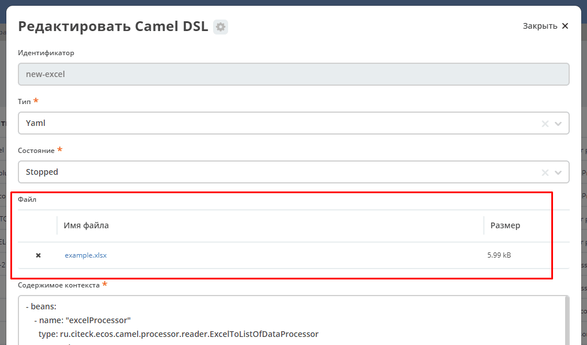

.. _endpoints_dsl:

Конечные точки
================================

.. contents::
   :depth: 3

**Конечные точки** используются для чтения или записи данных в определенном источнике.

Подробнее - https://camel.apache.org/manual/endpoint.html

.. _camel_file_from_camel_dsl:

FileFromCamelDslEndpoint
--------------------------

Данный компонент позволяет работать с файлом, добавленным на форму конфигурации Camel DSL:

Ключ для использования компонента в camel-контексте: *file-from-camel-dsl*

**FileFromCamelDslConsumer** вычитывает данные из файла в виде ByteArray и кладет их в exchange для дальнейшей обработки

Пример:

.. code-block:: yaml

   - route:
       from:
         uri: "file-from-camel-dsl:randomName"
         steps:
           - process:
               ref: csvToListOfDataProcessor
           - split:
               simple: "${body}"
               steps:
                 - to: ecos-records-mutate:?sourceId=emodel/camel-example-employee

.. _camel_ecos_records_sync_consumer:

EcosRecordsSyncConsumer
-----------------------

Эндпоинт для последовательной выгрузки любого количества записей из указанного источника данных.

URI
~~~

**ecos-records-sync-consumer:syncName**

**ecos-records-sync-consumer** - константа

**syncName** - имя синхронизации. Может быть любым и используется для сохранения и доступа к состоянию. Т.е. если поменять syncName, то консьюмер будет работать "с нуля".

Выходные данные
~~~~~~~~~~~~~~~~~~~~~~~~~~~~~~

Тип данных: **List<DataValue>**

Описание: Лист **DataValue** объектов с атрибутами, которые были загружены у записей. Глобальный идентификатор записи в атрибуты не попадает. Если он нужен, то следует его явно прописать в атрибутах:

.. code-block:: yaml

  attributes:
    ?id: ?id

Параметры
~~~~~~~~~~~~~~~~~~

.. list-table::
      :widths: 5 5 5 5 20
      :header-rows: 1
      :class: tight-table

      * - Параметр
        - Тип
        - Значение по умолчанию
        - Обязательность
        - Описание
      * - sourceId
        - String?
        - null
        - Нет
        - | Идентификатор источника данных откуда мы будем загружать записи.
          | Можно не задавать если указан ecosType.
          | Примеры: *emodel/source0, emodel/source1*
      * - ecosType
        - String?
        - null
        - Нет
        - | Локальный идентификатор типа.
          | Если не указан sourceId, то он берется из типа.
          | Примеры: *contract, attorney*
      * - predicate
        - Predicate?
        - Always True
        - Нет
        - | Критерии поиска записей.
          | Примеры: {"t": "eq", "a": "_type", "v": "emodel/type@case"}
      * - initDate
        - Instant
        - 1970-01-01T00:00:00Z
        - Нет
        - | Начальная дата для стратегий CREATED и MODIFIED; для KEY не используется.
          | При MODIFIED запись, созданная раньше initDate, может попасть в выгрузку, если изменена после этой даты.
          | Значение запоминается в состоянии синхронизации при первом запуске и в дальнейшем берется оттуда, поэтому изменение параметра у уже работающего консьюмера ни на что не влияет. Чтобы применить новую дату, нужно поменять syncName.
      * - iterationStrategy
        - CREATED_MODIFIED | CREATED | MODIFIED | KEY
        - CREATED_MODIFIED
        - Нет
        - | Какие стратегии перебора будут использованы (см. раздел «Стратегии» ниже).
          | CREATED_MODIFIED — сначала перебор по дате создания, затем по дате изменения;
          | CREATED — только перебор по дате создания;
          | MODIFIED — только перебор по дате изменения.
          | KEY — однократный обход по стабильному уникальному ключу keyAttribute.
      * - keyAttribute
        - String?
        - null
        - Для KEY
        - Атрибут уникального ключа. Источник должен поддерживать сортировку и сравнение ключей
      * - keyType
        - NUMBER | TEXT
        - NUMBER
        - Нет
        - Тип ключа стратегии KEY
      * - partitions
        - Int
        - 1
        - Нет
        - Число разделов ключевого диапазона для KEY; 1 отключает разбиение
      * - partitionStrategy
        - COUNT | SKIP
        - null
        - Нет
        - Разбиение KEY по количеству записей в диапазонах либо по смещениям выборки. По умолчанию COUNT для NUMBER, SKIP для TEXT
      * - failedRecords
        - RETRY | REGISTER
        - RETRY
        - Нет
        - Повторять ошибочную пачку либо регистрировать проблемные записи и продолжать обход
      * - batchRetries
        - Int
        - 3
        - Нет
        - Число повторов пачки перед выделением ошибочных записей в режиме REGISTER
      * - maxFailedPerBatch
        - Int
        - -1
        - Нет
        - Порог ошибок пачки. При отрицательном значении — 10% batchSize, минимум одна запись
      * - maxFailedTotal
        - Int
        - 1000
        - Нет
        - Порог общего количества зарегистрированных ошибок синхронизации
      * - stopOnMassFailure
        - Boolean
        - true
        - Нет
        - Останавливать синхронизацию при массовых ошибках
      * - batchSize
        - Int
        - 100
        - Нет
        - Размер пачки одновременно обрабатываемых записей
      * - attributes
        - Map<String, String>
        -
        - Да
        - Атрибуты для загрузки у записей
      * - addAuditAttributes
        - Boolean
        - true
        - Нет
        - Добавить атрибуты аудита (_created,_creator,_modified,_modifier) в список атрибутов для загрузки
      * - delay
        - Long
        - 500
        - Нет
        - Количество миллисекунд между обработкой пачек записей
      * - greedy
        - Boolean
        - false
        - Нет
        - Если true и количество обработанных записей больше нуля, то не ждать delay перед следующей обработкой, а сразу вызвать следующий poll
      * - initialDelay
        - Long
        - 1000
        - Нет
        - Задержка перед первой обработкой записей

.. note::

  Доп. параметры можно посмотреть в исходниках класса org.apache.camel.support.ScheduledPollEndpoint

Пример использования
~~~~~~~~~~~~~~~~~~~~~~~~~~~~~~~~~~~~~~~~

.. code-block:: yaml

   - route:
       from:
         uri: ecos-records-sync-consumer:legalEntity-mgr-from
         parameters:
           delay: 30000
           sourceId: emodel/source1
           predicate:
             t: eq
             a: type
             v: legalEntity
           addAuditAttributes: true
           attributes:
             ?id: ?id
             id: ?localId
             title: title
             name: name
         steps:
           - to: log:ecos-records-sync

Принцип работы
~~~~~~~~~~~~~~~~~~~~~~~~~~~~

Раз в **{delay}** миллисекунд идет запрос в источник данных **{sourceId}** который или задан явно или загружается из **{ecosType}**. Из источника данных загружается пачка записей размером <= **{batchSize}**. Загруженная пачка отправляется в обработку на указанные в роуте шаги.

В режиме **failedRecords=RETRY** состояние продвигается после успешной обработки пачки; при ошибке следующая попытка начинается с прежнего состояния. Режим **REGISTER** позволяет зарегистрировать проблемные записи и продолжить обработку с учётом заданных порогов ошибок.

Индивидуальная обработка записей
~~~~~~~~~~~~~~~~~~~~~~~~~~~~~~~~~~~~~~~~~~~~~~~~~~~~~~~~~~~~~~~~~~~~~~~~~~~~~~~~

Если требуется индивидуальная обработка записей, то можно разделить элементы листа и обрабатывать каждый по отдельности:

.. code-block:: yaml

   - route:
       from:
         uri: ecos-records-sync-consumer:routeStage-mgr-from
         parameters:
           initialDelay: 10000
           delay: 15000
           sourceId: emodel/source1
           predicate:
             t: eq
             a: type
             v: routeStage
           batchSize: 30
           addAuditAttributes: true
           attributes:
             id: ?localId
             title: title
             name: name
         steps:
           - split:
               simple: "${body}"
               steps:
                 - to: log:result # в этих шагах каждый элемент будет обработан отдельно

Если требуется как-то индивидуально обработать записи и затем опять собрать их в одну пачку, то можно воспользоваться стратегией агрегации:

.. code-block:: yaml

   - beans:
       - name: customJsonPatch
         type: ru.citeck.ecos.camel.processor.data.JsonPatchOperationsProcessor

       - name: collectToListStrategy
         type: org.apache.camel.processor.aggregate.GroupedBodyAggregationStrategy
   - route:
       from:
         uri: ecos-records-sync-consumer:routeStage-mgr-from
         parameters:
           initialDelay: 10000
           delay: 15000
           sourceId: emodel/source1
           predicate:
             t: eq
             a: type
             v: routeStage
           batchSize: 30
           addAuditAttributes: true
           attributes:
             id: ?localId
             title: title
             name: name
         steps:
           - split:
               simple: "${body}"
               aggregationStrategy: collectToListStrategy # это ключевое отличие
               steps:
                 - setHeader:
                     name: JsonPatchOperations
                     constant:
                       - op: set
                         path: "_parentAtt"
                         value: templateRouteApprovingStages
                 - process:
                     ref: customJsonPatch
           - to: log:result # после split мы будем обрабатывать лист, который собрался после индивидуальной обработки записей

Стратегии
~~~~~~~~~~~~~~~~~~

Итерация выполняется одной или несколькими стратегиями. При каждом срабатывании poll'а (обработка следующей пачки записей) выполняется запрос следующей пачки записей через одну из описанных ниже стратегий. Используется первый не пустой результат и дальнейший перебор стратегий не выполняется. Каждая стратегия имеет состояние, которое хранит данные для продолжения итерации с последнего обработанного места.

Набор стратегий задается параметром **iterationStrategy**:

.. list-table::
      :widths: 5 20
      :header-rows: 1
      :class: tight-table

      * - Значение
        - Используемые стратегии
      * - CREATED_MODIFIED
        - Обе стратегии: сначала «по дате создания», затем «по дате изменения». Значение по умолчанию
      * - CREATED
        - Только «по дате создания». Изменения уже обработанных записей не подхватываются
      * - MODIFIED
        - Только «по дате изменения»
      * - KEY
        - Обход в порядке keyAttribute; последующие изменения записей по датам не отслеживаются

Перебор по датам начинается с **initDate**. В стратегии KEY используются состояние ключа и, при включённом разбиении, состояния разделов. Для параллельного опроса задаётся ``scheduler.concurrentConsumers``; у стандартного планировщика размер пула автоматически согласуется с числом потребителей, если ``scheduler.poolSize`` не задан явно.

По дате создания
^^^^^^^^^^^^^^^^^^^^^^

Перебор идет по атрибуту **_created** от начального значения **initDate**.

**Состояние:**

.. list-table::
      :widths: 5 5 5 20
      :header-rows: 1
      :class: tight-table

      * - Свойство
        - Тип
        - По умолчанию
        - Описание
      * - totalCount
        - Long
        - -1
        - | Ожидаемое полное количество всех записей для синхронизации.
          | Заполняется в начале и не обновляется в ходе итерации
      * - lastCreated
        - Instant
        - Instant.EPOCH
        - Дата последней созданной ноды, которую мы обработали
      * - lastRef
        - EntityRef
        - EntityRef.EMPTY
        - Ссылка на последнюю обработанную запись
      * - skipCount
        - Int
        - 0
        - | Количество элементов, которые нужно пропустить при следующем запросе.
          | Используется для обработки записей, у которых дата создания совпадает.
      * - processedCount
        - Long
        - 0
        - Количество обработанных записей
      * - lastCreatedCounter
        - Int
        - 0
        - | Счетчик записей с одинаковой датой создания.
          | Используется чтобы в результирующих данных скорректировать дату создания добавив к ней lastCreatedCounter микросекунд.
          | Это нужно чтобы после загрузки этих данных в другую БД сохранился порядок при сортировке по полю _created.

**Особенности стратегии:**

Сохранение порядка — если в выгружаемых данных записи имеют одинаковую дату создания, то первая из них будет иметь оригинальную дату, а все последующие будут иметь дату создания на N микросекунд больше. Количество микросекунд увеличивается с каждой новой записью с одинаковой датой создания.

По дате изменения
^^^^^^^^^^^^^^^^^^^^^^

Перебор идет по атрибуту **_modified** от даты начала синхронизации.

**Состояние:**

.. list-table::
      :widths: 5 5 5 20
      :header-rows: 1
      :class: tight-table

      * - Свойство
        - Тип
        - По умолчанию
        - Описание
      * - lastModified
        - Instant
        - Дата начала синхронизации
        - Дата последней измененной записи, которую мы обработали
      * - lastRef
        - EntityRef
        - EntityRef.EMPTY
        - Ссылка на последнюю обработанную запись
      * - skipCount
        - Int
        - 0
        - | Количество элементов, которые нужно пропустить при следующем запросе.
          | Используется для обработки записей, у которых дата изменения совпадает.
      * - processedCount
        - Long
        - 0
        - Количество обработанных записей

**Особенности стратегии:**

Синхронизация проходит только для тех записей, которые были созданы до даты создания последней синхронизованной записи из первой стратегии.

.. _EcosRecordsMutateEndpoint:

EcosRecordsMutateEndpoint
--------------------------

Эндпоинт для выполнения мутации через RecordsAPI

URI
~~~

**ecos-records-mutate:?sourceId={sourceId}**

  - **ecos-records-mutate** - константа

  - **sourceId** - идентификатор источника данных куда следует отправить запрос мутации. Например: 'emodel/contract', 'emodel/custom-type'

Параметры
~~~~~~~~~~~~~~~~~~

.. list-table::
      :widths: 5 5 5 5 20
      :header-rows: 1
      :class: tight-table

      * - Параметр
        - Тип
        - Значение по умолчанию
        - Обязательность
        - Описание
      * - sourceId
        - String?
        - null
        - Нет
        - | Идентификатор источника данных, куда отправляется запрос мутации.
          | Можно не задавать, если указан ecosType.
      * - ecosType
        - String?
        - null
        - Нет
        - | Локальный идентификатор типа. Если sourceId не указан, источник данных берется из типа.
          | Если не заданы ни sourceId, ни ecosType, маршрут не запустится с ошибкой «You should define sourceId or ecosType».
      * - ignoreIdScalarAtt
        - Boolean
        - false
        - Нет
        - | Если true, атрибут **?id** удаляется из данных и не используется как ссылка на изменяемую запись.
          | Атрибут **id** сохраняется и может использоваться источником для обновления существующей записи.
          | Если false, значение **?id** определяет, какая запись будет изменена.
      * - logRecords
        - FULL | IDS | ERRORS
        - FULL
        - Нет
        - FULL — атрибуты запросов и результат; IDS — идентификаторы вместо полных атрибутов; ERRORS — только неуспешные мутации

.. note::

  Мутация выполняется от имени системы (**AuthContext.runAsSystem**), то есть без учета прав текущего пользователя.

Входные данные
~~~~~~~~~~~~~~~~~~~~~~~~~~~~

Конечная точка принимает либо одно **map-like значение**, либо список.

Поддерживаются объекты **DataValue**, **ObjectData**, строка с JSON-объектом, коллекция таких значений и массив **DataValue**. Обычную Java Map предварительно преобразуйте в **DataValue** или **ObjectData**.

**map-like значение** по структуре содержит список атрибутов, которые будут использованы для мутации.

Если среди атрибутов есть **"?id"** с полным ref мутируемой сущности, то мутация будет выполнена именно для этой сущности.

Если среди атрибутов есть **"id"** (локальный id сущности), то мутация либо обновит существующую сущность, либо создаст новую если такой еще нет.

**Выход:** тело сохраняется; заголовок ``recordsMutated`` содержит список строковых ссылок на сохранённые записи. Для пустого набора мутаций заголовок не устанавливается заново.

.. code-block:: yaml

   - route:
       from:
         uri: direct:save-imported-record
         steps:
           - setBody:
               constant: '{"id":"example","_name":"Пример"}'
           - to:
               uri: 'ecos-records-mutate:'
               parameters:
                 sourceId: emodel/import-test
                 logRecords: IDS
           - log: '${header.recordsMutated}'

.. _EcosEventEndpoint:

EcosEventEndpoint
--------------------------

Эндпоинт для работы с событиями ECOS. Может использоваться и как потребитель (подписка на событие), и как производитель (публикация события).

Примеры подписки на события с фильтрами приведены в разделе :ref:`Подписка на событие Citeck <camel_subscription>`.

URI
~~~

**ecos-event:eventType**

  - **ecos-event** - константа

  - **eventType** - тип события. Обязателен. Например: *record-created*, *record-status-changed*

Параметры
~~~~~~~~~~~~~~~~~~

.. list-table::
      :widths: 5 5 5 5 20
      :header-rows: 1
      :class: tight-table

      * - Параметр
        - Тип
        - Значение по умолчанию
        - Обязательность
        - Описание
      * - attributes
        - Map<String, String>
        -
        - Нет
        - | Атрибуты события, которые нужно получить. Ключ — имя атрибута в теле сообщения, значение — схема атрибута.
          | Телом сообщения становится объект со всеми перечисленными атрибутами.
      * - attribute
        - String?
        - null
        - Нет
        - | Один атрибут вместо набора. Телом сообщения становится значение самого атрибута, без объекта-обертки.
          | Задавать одновременно с **attributes** нельзя — маршрут не запустится с ошибкой «You should define property 'attribute' or 'attributes' but not both».
      * - filter
        - Predicate
        - Always True
        - Нет
        - Условие, при котором событие попадет в маршрут
      * - transactional
        - Boolean
        - false
        - Нет
        - | Если true, обработка выполняется в транзакции источника события, и исключение в маршруте пробрасывается наружу — то есть приводит к откату транзакции.
          | Если false, ошибка обработки на источник события не влияет.
      * - outputType
        - DEFAULT | DATA_VALUE | JSON_STRING | JAVA
        - DEFAULT
        - Нет
        - | Во что преобразуется тело сообщения:
          | DEFAULT и DATA_VALUE — объект **DataValue** (поведение совпадает);
          | JSON_STRING — строка с JSON;
          | JAVA — обычный объект Java (Map, List, String и т.д.).

Параметры ``attributes``, ``attribute``, ``filter``, ``transactional`` и ``outputType`` относятся к потребителю событий. Производитель публикует событие указанного типа из тела сообщения.

Пример подписки
~~~~~~~~~~~~~~~~~~~~~~~~~~~~~~~~~~~~~~~~

.. code-block:: yaml

   - route:
       from:
         uri: 'ecos-event:record-created'
         parameters:
           attribute: 'record?id'
           outputType: JSON_STRING
         steps:
           - to: log:record-was-created

Публикация события
~~~~~~~~~~~~~~~~~~~~~~~~~~~~~~~~~~~~~~~~

При использовании эндпоинта в шаге **to** тело сообщения публикуется как событие указанного типа. Источник события — *camel*. Публикация выполняется от имени системы (**AuthContext.runAsSystem**).

.. code-block:: yaml

   - route:
       from:
         uri: .....
         steps:
           - to: 'ecos-event:my-custom-event'

.. _EcosRecordsQueryEndpoint:

EcosRecordsQueryEndpoint
--------------------------

Эндпоинт для выполнения запроса к RecordsAPI.

URI
~~~

**ecos-records-query:**

Параметры
~~~~~~~~~~~~~~~~~~

.. list-table::
      :widths: 5 5 5 5 20
      :header-rows: 1
      :class: tight-table

      * - Параметр
        - Тип
        - Значение по умолчанию
        - Обязательность
        - Описание
      * - outputType
        - DEFAULT | DATA_VALUE | JSON_STRING | JAVA
        - DEFAULT
        - Нет
        - | В каком виде атрибуты каждой найденной записи попадут в результат:
          | DEFAULT и DATA_VALUE — объект **DataValue**;
          | JSON_STRING — строка с JSON;
          | JAVA — обычный объект Java.

Входные данные
~~~~~~~~~~~~~~~~~~~~~~~~~~~~

Тело сообщения — объект, преобразуемый в **RecordsQuery**. Дополнительно в нем можно указать поле **attributes**: массив имен атрибутов либо объект вида «псевдоним — атрибут».

Выходные данные
~~~~~~~~~~~~~~~~~~~~~~~~~~~~~~

Тело сообщения заменяется списком. Если **attributes** не заданы, элементы списка — строковые ссылки на найденные записи. Если заданы — атрибуты каждой записи (идентификатор добавляется автоматически, если его нет среди запрошенных атрибутов) в формате, заданном **outputType**.

Заголовки:

.. list-table::
      :widths: 10 20
      :header-rows: 1
      :class: tight-table

      * - Заголовок
        - Значение
      * - EcosRecordsQueryHasMore
        - Признак того, что есть еще записи за пределами выданной страницы
      * - EcosRecordsQueryTotalCount
        - Общее количество найденных записей

.. note::

  Запрос выполняется от имени системы, то есть без учета прав текущего пользователя.

.. code-block:: yaml

   - route:
       from:
         uri: direct:query-imported-records
         steps:
           - setBody:
               constant: >-
                 {"sourceId":"emodel/import-test","language":"predicate",
                  "query":{"t":"eq","a":"id","v":"example"},
                  "page":{"maxItems":100},"attributes":{"name":"_name"}}
           - to:
               uri: 'ecos-records-query:'
               parameters:
                 outputType: DATA_VALUE
           - log: 'Всего: ${header.EcosRecordsQueryTotalCount}'

.. _EcosRecordsDeleteEndpoint:

EcosRecordsDeleteEndpoint
--------------------------

Эндпоинт для удаления записей через RecordsAPI.

URI
~~~

**ecos-records-delete:**

Параметры
~~~~~~~~~~~~~~~~~~

.. list-table::
      :widths: 5 5 5 5 20
      :header-rows: 1
      :class: tight-table

      * - Параметр
        - Тип
        - Значение по умолчанию
        - Обязательность
        - Описание
      * - sourceId
        - String?
        - null
        - Нет
        - | Идентификатор источника данных, который подставляется ссылкам, заданным без него.
          | Значение можно переопределить для конкретного сообщения заголовком **EcosRecordsDeleteSourceId**.
      * - ignoreInvalidRefs
        - Boolean
        - false
        - Нет
        - Если true, некорректные ссылки пропускаются. Иначе обработка завершается ошибкой.

Входные данные
~~~~~~~~~~~~~~~~~~~~~~~~~~~~

Тело сообщения — одна ссылка либо коллекция ссылок. Допустимые формы: **String**, **EntityRef**, **Map**, **DataValue**, **ObjectData**; в последних трех идентификатор читается из атрибута **?id**.

Тело сообщения после обработки не изменяется. Результат удаления записывается в лог синхронизации под именем *records-delete*.

.. note::

  Удаление выполняется от имени системы, то есть без учета прав текущего пользователя.

.. code-block:: yaml

   - route:
       from:
         uri: direct:delete-example-record
         steps:
           - setBody:
               constant: emodel/import-test@example
           - to:
               uri: 'ecos-records-delete:'
               parameters:
                 ignoreInvalidRefs: false

.. _EcosAttributesMapperEndpoint:

EcosAttributesMapperEndpoint
------------------------------

Эндпоинт для приведения «сырых» строковых значений атрибутов к модели атрибутов ECOS-типа. Применяется при импорте данных из внешних источников, где все значения приходят строками.

URI
~~~

**ecos-attributes-mapper:typeId**

  - **ecos-attributes-mapper** - константа

  - **typeId** - локальный идентификатор ECOS-типа, по модели атрибутов которого выполняется преобразование. Обязателен

Параметры
~~~~~~~~~~~~~~~~~~

.. list-table::
      :widths: 5 5 5 5 20
      :header-rows: 1
      :class: tight-table

      * - Параметр
        - Тип
        - Значение по умолчанию
        - Обязательность
        - Описание
      * - delimiter
        - String
        - ,
        - Нет
        - Разделитель, по которому строка разбивается на несколько значений для многозначных атрибутов
      * - assocMapping
        - JSON
        - {}
        - Нет
        - | Карта вида «атрибут — список атрибутов», по которым искать связанную запись.
          | Задается строкой с JSON. По умолчанию поиск идет по атрибуту **_name**.

Входные и выходные данные
~~~~~~~~~~~~~~~~~~~~~~~~~~~~

Тело сообщения — список объектов **DataValue**, каждый из которых представляет собой набор пар «идентификатор атрибута — строковое значение». Тело заменяется тем же списком с преобразованными значениями:

.. list-table::
      :widths: 10 20
      :header-rows: 1
      :class: tight-table

      * - Тип атрибута
        - Преобразование
      * - BOOLEAN
        - Распознаются значения *да*, *нет*, *yes*, *no*, *true*, *false*
      * - OPTIONS
        - Отображаемое название варианта заменяется его значением
      * - ASSOC, PERSON, AUTHORITY_GROUP, AUTHORITY
        - | Значение ищется среди записей по атрибутам из **assocMapping** и заменяется ссылкой на найденную запись.
          | Если запись не найдена, значение считается готовой ссылкой и используется как есть.

.. code-block:: yaml

   - route:
       from:
         # На входе список DataValue со строковыми значениями атрибутов типа import-test.
         uri: direct:map-imported-attributes
         steps:
           - to:
               uri: ecos-attributes-mapper:import-test
               parameters:
                 delimiter: ';'
                 assocMapping: '{"department":["code","_name"]}'

Замените ``import-test`` и ``department`` на тип и атрибут своей модели. Компонент не сохраняет записи; после преобразования используйте ``ecos-records-mutate``.

.. _EcosFtpEndpoint:

EcosFtpEndpoint
--------------------------

Эндпоинт для работы с FTP, SFTP и FTPS, в котором адрес и учетные данные берутся из :ref:`конечной точки ECOS <endpoints_dsl>` и связанного с ней :ref:`секрета <ecos_secret>`. Благодаря этому в тексте маршрута не оказывается ни пароля, ни ключа.

URI
~~~

**ecos-ftp:endpointId**

  - **ecos-ftp** - константа

  - **endpointId** - идентификатор конечной точки ECOS, из которой берутся протокол, адрес, каталог и учетные данные. Обязателен

Параметры
~~~~~~~~~~~~~~~~~~

Собственных параметров у эндпоинта нет. Все остальные параметры строки запроса передаются без изменений в стандартный компонент camel-ftp, camel-sftp или camel-ftps, которому эндпоинт делегирует работу.

.. warning::

  Параметры, содержащие учетные данные, запрещены и приводят к ошибке: **username**, **password**, **account**, **privatekey** и производные от него, **passphrase**, **keypair**, а также любой составной параметр, имя которого заканчивается на *password*, *keypassword* или *passphrase*. Учетные данные задаются только через секрет конечной точки ECOS.

Входные и выходные данные
~~~~~~~~~~~~~~~~~~~~~~~~~~~~

Совпадают с входными и выходными данными стандартного компонента camel-ftp: в режиме производителя тело сообщения — содержимое файла, имя задается заголовком **CamelFileName**; в режиме потребителя маршрут получает прочитанные файлы. Собственных заголовков эндпоинт не добавляет.

.. note::

  Если для SFTP отключена проверка ключа хоста (**strictHostKeyChecking=no**, значение по умолчанию в camel-ftp), в лог выводится предупреждение.

.. code-block:: yaml

   - route:
       from:
         uri: direct:upload-csv
         steps:
           - setHeader:
               name: CamelFileName
               constant: export.csv
           - to: 'ecos-ftp:export-sftp?binary=true'

На вход ``direct:upload-csv`` передаётся содержимое файла. Конечная точка ECOS ``export-sftp`` должна быть настроена заранее. Полный пример выгрузки CSV см. в :ref:`каталоге примеров <camel_dsl_repo_examples>`.

.. _EcosExcelStreamReadEndpoint:

EcosExcelStreamReadEndpoint
------------------------------

Эндпоинт для потокового построчного чтения XLSX-файла. В отличие от :ref:`ExcelToListOfDataProcessor <camel_dsl_processors>`, файл не загружается в память целиком, а выдается в маршрут пачками строк, поэтому подходит для больших файлов.

URI
~~~

**ecos-excel-stream-read:contentRef**

  - **ecos-excel-stream-read** - константа

  - **contentRef** - ссылка на запись с содержимым XLSX-файла. Обязательна. Тип содержимого должен быть XLSX

Параметры
~~~~~~~~~~~~~~~~~~

.. list-table::
      :widths: 5 5 5 5 20
      :header-rows: 1
      :class: tight-table

      * - Параметр
        - Тип
        - Значение по умолчанию
        - Обязательность
        - Описание
      * - batchSize
        - Int
        - 100
        - Нет
        - Количество строк, накапливаемых перед отправкой пачки в маршрут
      * - sheetName
        - String?
        - null
        - Нет
        - Название листа Excel
      * - headRowNumber
        - Int?
        - null
        - Нет
        - Номер строки с заголовками, если он отличается от значения по умолчанию
      * - customAttNames
        - Map<String, String>
        - {}
        - Нет
        - Переименование колонок: ключ — название колонки в заголовке файла, значение — желаемое имя атрибута

Выходные данные
~~~~~~~~~~~~~~~~~~~~~~~~~~~~~~

Тело сообщения — **List<DataValue>**, по одному объекту на строку файла в формате «заголовок колонки — значение ячейки». Значения даты и времени сдвигаются на часовой пояс пользователя, десятичные числа передаются строкой без экспоненциальной записи.

По ходу чтения публикуются события управления импортом: начало, обработка пачки, завершение и ошибка.

Входное тело не используется: файл определяется ссылкой в URI.

.. code-block:: yaml

   - route:
       from:
         uri: ecos-excel-stream-read:emodel/import-file@example
         parameters:
           batchSize: 100
           sheetName: Sheet1
           headRowNumber: 1
         steps:
           - split:
               simple: '${body}'
               steps:
                 - to: 'ecos-records-mutate:?sourceId=emodel/import-test'

.. _EcosRecordsValidateEndpoint:

EcosRecordsValidateEndpoint
---------------------------

**URI:** ``ecos-records-validate:``. Производитель сравнивает ожидаемые атрибуты с целевыми записями и регистрирует расхождения без изменения целевых записей. Контекст должен предоставлять реестр расхождений синхронизации.

Параметры
~~~~~~~~~

.. list-table::
   :header-rows: 1
   :widths: 5 5 5 20
   :class: tight-table

   * - Параметр
     - Тип
     - По умолчанию
     - Назначение
   * - sourceId
     - String?
     - null
     - Целевой источник; обязателен sourceId либо ecosType
   * - ecosType
     - String?
     - null
     - Тип, из которого определяется источник при отсутствии sourceId
   * - syncName
     - String?
     - null
     - Имя синхронизации в реестре расхождений. Если не задано, берётся заголовок журнала синхронизации от ecos-records-sync-consumer
   * - compare
     - String
     - Пустая строка
     - Режимы сравнения через запятую: ``amount=NUMBER,tags=SET``. Режимы: TEXT, NUMBER, BOOL, DATE, DATETIME, SET, LIST, JSON
   * - skipAttributes
     - String
     - Пустая строка
     - Пропускаемые атрибуты через запятую; завершающий ``*`` означает префикс. Атрибуты id и ?id всегда исключаются из сравнения
   * - dateTolerance
     - String
     - PT0S
     - Неотрицательный интервал ISO-8601 для сравнения DATETIME, например PT5S
   * - maxOpenDiffs
     - Int
     - 1000
     - Максимум записей с открытыми расхождениями; отрицательное значение снимает ограничение

**Вход:** тот же формат набора атрибутов, что у ``ecos-records-mutate``. Запись определяется по ``?id`` либо по локальному ``id`` и sourceId. Остальные атрибуты — ожидаемые значения.

**Выход:** тело не меняется. Расхождения регистрируются, а ранее найденные расхождения для совпавших записей закрываются. Чтение и регистрация выполняются от имени системы. Отсутствующая целевая запись регистрируется как расхождение ``_notExists``.

.. code-block:: yaml

   - route:
       from:
         uri: direct:validate-import
         steps:
           - setBody:
               constant: '{"id":"example","_name":"Пример","amount":1500}'
           - to:
               uri: 'ecos-records-validate:'
               parameters:
                 sourceId: emodel/import-test
                 syncName: import-check
                 compare: amount=NUMBER
                 skipAttributes: '_modified,_modifier'

.. _camel_external_endpoints:

Компоненты импорта из Jira и GitLab
-----------------------------------

Потребители наследуют параметры ScheduledPollEndpoint, например delay и initialDelay. В примерах ``{{gitlab.url}}`` и ``{{gitlab.token}}`` — свойства Camel, задаваемые в окружении.

Компоненты GitLab
--------------------------

Оба компонента являются потребителями, периодически опрашивают GitLab и сохраняют состояние синхронизации, поэтому при следующем запуске продолжают с того места, где остановились. Одновременный запуск нескольких опросов (например, на разных узлах) не происходит: повторный запуск пропускается.

.. _GitLabCommitsSyncEndpoint:

gitlab-commits-sync
~~~~~~~~~~~~~~~~~~~~~~~~~~~~

**Входные данные:** Входное тело отсутствует: потребитель.

Выгружает коммиты проектов, обновленных с момента последней синхронизации.

**URI:** ``gitlab-commits-sync:syncName``, где **syncName** — имя синхронизации, под которым хранится состояние. Обязательно.

.. list-table::
      :widths: 5 5 5 5 20
      :header-rows: 1
      :class: tight-table

      * - Параметр
        - Тип
        - Значение по умолчанию
        - Обязательность
        - Описание
      * - gitLabEndpoint
        - String
        -
        - Да
        - Адрес GitLab
      * - gitLabToken
        - String
        -
        - Да
        - Токен доступа к GitLab
      * - batchSize
        - Int
        - 100
        - Нет
        - Количество коммитов, накапливаемых перед отправкой пачки в маршрут
      * - skipErrorRegex
        - String?
        - null
        - Нет
        - Регулярное выражение. Ошибки GitLab, текст которых ему соответствует, пропускаются вместо прерывания опроса

**Выходные данные:** **List<DataValue>** — исходный JSON коммитов.

Пример YAML:

.. code-block:: yaml

   - route:
       from:
         uri: gitlab-commits-sync:example-sync
         parameters:
           gitLabEndpoint: '{{gitlab.url}}'
           gitLabToken: '{{gitlab.token}}'
           delay: 60000
         steps:
           - to: log:gitlab-import

.. _GitLabMergeRequestsSyncEndpoint:

gitlab-merge-requests-sync
~~~~~~~~~~~~~~~~~~~~~~~~~~~~

**Входные данные:** Входное тело отсутствует: потребитель.

Выгружает запросы на слияние, созданные с момента последней синхронизации, в порядке возрастания даты создания.

**URI:** ``gitlab-merge-requests-sync:syncName``.

Параметры **gitLabEndpoint**, **gitLabToken** и **skipErrorRegex** совпадают с параметрами ``gitlab-commits-sync``. Параметра **batchSize** у этого компонента нет: за один опрос выдается одна пачка.

**Выходные данные:** **List<DataValue>** — исходный JSON запросов на слияние.

Пример YAML:

.. code-block:: yaml

   - route:
       from:
         uri: gitlab-merge-requests-sync:example-sync
         parameters:
           gitLabEndpoint: '{{gitlab.url}}'
           gitLabToken: '{{gitlab.token}}'
           delay: 60000
         steps:
           - to: log:gitlab-import

Компоненты Jira
--------------------------

Для производителей Jira требуется общий контекст: свойства обмена ``_workspace`` и ``link-project:project``. Их заполняет ``jira-issues``; при вызове через ``direct:`` передаёт вызывающий маршрут. Заголовки целевых записей указаны у каждого компонента.

Параметр ``jiraClient`` — ссылка на бин ``ru.citeck.ecos.camel.jira.api.JiraApiClient``. Его ``endpointId`` задаёт конечную точку ECOS с адресом Jira и секретом BASIC или TOKEN:

.. code-block:: yaml

   - beans:
       - name: jiraClient
         type: ru.citeck.ecos.camel.jira.api.JiraApiClient
         properties:
           endpointId: jira-host

Примеры производителей предполагают этот бин и переданный контекст. Входное тело — исходная задача после ``split``. Сохраняйте её в переменной и восстанавливайте перед следующим компонентом, если предыдущий заменил тело.

Схема работы такая: потребитель ``jira-issues`` выдает в маршрут исходный JSON задачи Jira и дополнительно кладет в свойства обмена рабочее пространство и ссылку на проект. Дальше производители ``transform-jira-*`` превращают части этой задачи в наборы атрибутов, готовые к сохранению через :ref:`ecos-records-mutate <EcosRecordsMutateEndpoint>`, а производители ``import-jira-*`` сами создают связанные записи и проставляют ссылки на них в задаче EPT.

.. note::

  Производители ``import-jira-*``, ``transform-jira-comment`` и ``transform-jira-worklog`` ожидают в заголовке сообщения ссылку на целевую запись: **eptIssueRef** для большинства из них, **commentLinkToRecord** для комментариев и **worklogLinkToRecord** для записей о затраченном времени. Свойства обмена с рабочим пространством и проектом заполняет ``jira-issues``.

.. _JiraIssuesEndpoint:

jira-issues
~~~~~~~~~~~~~~~~~~~~~~~~~~~~

**Входные данные:** Входное тело отсутствует. Проекты с импортируемыми ключами должны существовать в Citeck и иметь связанное рабочее пространство.

Потребитель. Периодически перебирает задачи одного или нескольких проектов Jira, запоминая смещение по каждому проекту; после обхода последнего проекта цикл начинается заново.

**URI:** ``jira-issues:name``, где **name** — имя синхронизации. Обязательно.

.. list-table::
      :widths: 5 5 5 5 20
      :header-rows: 1
      :class: tight-table

      * - Параметр
        - Тип
        - Значение по умолчанию
        - Обязательность
        - Описание
      * - projectKey
        - String
        -
        - Да
        - Ключи проектов Jira через запятую. Не используется, если задан **issueKey**
      * - jiraClient
        - JiraApiClient
        -
        - Да
        - Ссылка на бин клиента Jira REST API
      * - issueKey
        - String
        - ""
        - Нет
        - | Если задан, импортируется ровно одна указанная задача, после чего потребитель останавливается.
          | Значение должно содержать префикс проекта, например *PROJECT-1*

**Выходные данные:** список с исходным JSON задач — по 10 задач за один опрос в обычном режиме и одна задача в режиме **issueKey**.

**Свойства обмена:** рабочее пространство задачи и ссылка на проект (``link-project:project``) — они нужны остальным компонентам Jira.

Пример YAML:

.. code-block:: yaml

   - beans:
       - name: jiraClient
         type: ru.citeck.ecos.camel.jira.api.JiraApiClient
         properties:
           endpointId: jira-host
   - route:
       from:
         uri: jira-issues:example-import
         parameters:
           jiraClient: '#bean:jiraClient'
           projectKey: DEMO
           delay: 5000
         steps:
           - split:
               simple: '${body}'
               steps:
                 - to: direct:process-jira-issue

.. _TransformJiraIssueEndpoint:

transform-jira-issue
~~~~~~~~~~~~~~~~~~~~~~~~~~~~

**URI:** ``transform-jira-issue:``.

**Входные данные:** Один DataValue с JSON задачи и свойства обмена _workspace и link-project:project. Заголовок eptIssueRef не требуется.

Производитель. Преобразует исходную задачу Jira в набор атрибутов задачи EPT. Правила преобразования задаются не параметрами, а свойствами обмена, имена которых можно переопределить:

Все параметры ``*Property`` имеют тип ``String`` и необязательны; значения по умолчанию приведены в таблице.

.. list-table::
      :widths: 5 10 20
      :header-rows: 1
      :class: tight-table

      * - Параметр
        - Значение по умолчанию
        - Какое свойство обмена задает
      * - attributesMappingProperty
        - attributesMapping
        - Карта «путь в JSON задачи Jira — атрибут задачи EPT»
      * - valuesMappingProperty
        - valuesMapping
        - Карта «атрибут — карта соответствия значений Jira значениям EPT»
      * - valuesConverterProperty
        - valuesConverter
        - Карта «атрибут — имя конвертера значения»
      * - staticAttributesProperty
        - staticAttributes
        - Карта атрибутов с постоянными значениями, добавляемых к каждой задаче
      * - linksMappingProperty
        - linksMapping
        - Карта «тип связи в Jira — атрибут связи в EPT»

Обязательный параметр **jiraClient** используется для получения списка наблюдателей задачи.

.. list-table::
   :widths: 8 8 8 25
   :header-rows: 1
   :class: tight-table

   * - Параметр
     - Тип
     - Обязательность
     - Описание
   * - jiraClient
     - JiraApiClient
     - Да
     - Ссылка на бин клиента Jira, например ``#bean:jiraClient``. Значения по умолчанию нет

**Выходные данные:** один объект **DataValue** с атрибутами задачи EPT: сопоставленные поля, наблюдатели, связи с другими задачами, постоянные атрибуты, идентификатор, номер задачи, а для подзадач — ссылка на родительскую задачу.

Пример YAML:

.. code-block:: yaml

   - route:
       from:
         uri: direct:transform-jira-issue
         steps:
           - setProperty:
               name: attributesMapping
               constant: '{"fields.summary":"summary"}'
           - to:
               uri: 'transform-jira-issue:'
               parameters:
                 jiraClient: '#bean:jiraClient'

.. _TransformJiraCommentEndpoint:

transform-jira-comment
~~~~~~~~~~~~~~~~~~~~~~~~~~~~

**URI:** ``transform-jira-comment:``.

**Параметры:** собственных параметров нет.

**Входные данные:** Один DataValue с JSON задачи и общий контекст импорта. Обязательный заголовок ``commentLinkToRecord`` — ссылка на целевую запись.

Производитель без параметров. Преобразует комментарии задачи в список объектов, готовых к сохранению как комментарии Citeck. Заголовок **commentLinkToRecord** задает запись, к которой они относятся.

При преобразовании текст комментария очищается от особенностей Jira: ссылки на вложения и миниатюры заменяются на адреса содержимого в Citeck, упоминания пользователей — на упоминания в формате Citeck, у изображений убирается заданный в Jira размер.

Пример YAML:

.. code-block:: yaml

   - route:
       from:
         uri: direct:transform-jira-comment
         steps:
           - setHeader:
               name: commentLinkToRecord
               constant: emodel/ept-issue@DEMO-1
           - to:
               uri: 'transform-jira-comment:'

.. _TransformJiraWorkLogEndpoint:

transform-jira-worklog
~~~~~~~~~~~~~~~~~~~~~~~~~~~~

**URI:** ``transform-jira-worklog:``.

**Параметры:** собственных параметров нет.

**Входные данные:** Один DataValue с JSON задачи и общий контекст импорта. Обязательный заголовок ``worklogLinkToRecord`` — ссылка на целевую запись.

Производитель без параметров. Преобразует записи о затраченном времени в список объектов учета времени Citeck. Заголовок **worklogLinkToRecord** задает запись, к которой они привязываются. Длительность пересчитывается из секунд в миллисекунды.

Пример YAML:

.. code-block:: yaml

   - route:
       from:
         uri: direct:transform-jira-worklog
         steps:
           - setHeader:
               name: worklogLinkToRecord
               constant: emodel/ept-issue@DEMO-1
           - to:
               uri: 'transform-jira-worklog:'

.. _ImportJiraReleasesEndpoint:

import-jira-releases
~~~~~~~~~~~~~~~~~~~~~~~~~~~~

**URI:** ``import-jira-releases:``.

**Входные данные:** Один DataValue с fields.fixVersions и fields.versions и общий контекст импорта. Обязательный заголовок ``eptIssueRef`` — ссылка на целевую запись.

Производитель. Создает или обновляет записи релизов из версий задачи Jira и проставляет их в атрибуты задачи EPT «Исправить в версии» и «Затронутые версии». Обязательный параметр **jiraClient** используется для получения полной информации о версии.

Статус релиза берется из признака выпуска в Jira. Выходные данные — список ссылок на созданные релизы.

.. list-table::
   :widths: 8 8 8 25
   :header-rows: 1
   :class: tight-table

   * - Параметр
     - Тип
     - Обязательность
     - Описание
   * - jiraClient
     - JiraApiClient
     - Да
     - Ссылка на бин клиента Jira, например ``#bean:jiraClient``. Значения по умолчанию нет

Пример YAML:

.. code-block:: yaml

   - route:
       from:
         uri: direct:import-jira-releases
         steps:
           - setHeader:
               name: eptIssueRef
               constant: emodel/ept-issue@DEMO-1
           - to:
               uri: 'import-jira-releases:'
               parameters:
                 jiraClient: '#bean:jiraClient'

.. _ImportJiraAttachmentEndpoint:

import-jira-attachment
~~~~~~~~~~~~~~~~~~~~~~~~~~~~

**URI:** ``import-jira-attachment:``.

**Входные данные:** Один DataValue с JSON задачи, содержащий fields.attachment. Обязательный заголовок ``eptIssueRef`` — ссылка на целевую запись.

Производитель. Скачивает вложения задачи Jira и сохраняет их как документы Citeck, вложенные в задачу EPT. Обязательный параметр **jiraClient** используется для загрузки содержимого.

Автор и даты создания и изменения переносятся из Jira. Выходные данные — список ссылок на созданные документы.

.. list-table::
   :widths: 8 8 8 25
   :header-rows: 1
   :class: tight-table

   * - Параметр
     - Тип
     - Обязательность
     - Описание
   * - jiraClient
     - JiraApiClient
     - Да
     - Ссылка на бин клиента Jira, например ``#bean:jiraClient``. Значения по умолчанию нет

Пример YAML:

.. code-block:: yaml

   - route:
       from:
         uri: direct:import-jira-attachment
         steps:
           - setHeader:
               name: eptIssueRef
               constant: emodel/ept-issue@DEMO-1
           - to:
               uri: 'import-jira-attachment:'
               parameters:
                 jiraClient: '#bean:jiraClient'

.. _ImportJiraDevInfoEndpoint:

import-jira-dev-info
~~~~~~~~~~~~~~~~~~~~~~~~~~~~

**URI:** ``import-jira-dev-info:``.

**Входные данные:** Один DataValue с JSON задачи и свойство обмена _workspace. Обязательный заголовок ``eptIssueRef`` — ссылка на целевую запись.

Производитель. Переносит связанные с задачей коммиты и запросы на слияние: из внешних ссылок Jira создаются записи коммитов и запросов на слияние, привязанные к задаче. Обязательный параметр **jiraClient** используется для получения внешних ссылок.

Тело сообщения этот компонент не изменяет.

.. list-table::
   :widths: 8 8 8 25
   :header-rows: 1
   :class: tight-table

   * - Параметр
     - Тип
     - Обязательность
     - Описание
   * - jiraClient
     - JiraApiClient
     - Да
     - Ссылка на бин клиента Jira, например ``#bean:jiraClient``. Значения по умолчанию нет

Пример YAML:

.. code-block:: yaml

   - route:
       from:
         uri: direct:import-jira-dev-info
         steps:
           - setHeader:
               name: eptIssueRef
               constant: emodel/ept-issue@DEMO-1
           - to:
               uri: 'import-jira-dev-info:'
               parameters:
                 jiraClient: '#bean:jiraClient'

.. _ImportJiraComponentEndpoint:

import-jira-component
~~~~~~~~~~~~~~~~~~~~~~~~~~~~

**URI:** ``import-jira-component:``.

**Параметры:** собственных параметров нет.

**Входные данные:** Один DataValue с fields.components и общий контекст импорта. Обязательный заголовок ``eptIssueRef`` — ссылка на целевую запись.

Производитель без параметров. Создает или обновляет записи компонентов из компонентов задачи Jira и проставляет их в атрибут «Компоненты» задачи EPT. Выходные данные — список ссылок на созданные компоненты.

Пример YAML:

.. code-block:: yaml

   - route:
       from:
         uri: direct:import-jira-component
         steps:
           - setHeader:
               name: eptIssueRef
               constant: emodel/ept-issue@DEMO-1
           - to:
               uri: 'import-jira-component:'

.. _ImportJiraSprintEndpoint:

import-jira-sprint
~~~~~~~~~~~~~~~~~~~~~~~~~~~~

**URI:** ``import-jira-sprint:``.

**Входные данные:** Один DataValue с JSON задачи и общий контекст импорта. Обязательный заголовок ``eptIssueRef`` — ссылка на целевую запись.

Производитель. Создает или обновляет записи спринтов из спринта задачи Jira и проставляет их в атрибут «Спринт» задачи EPT.

.. list-table::
      :widths: 5 5 5 5 20
      :header-rows: 1
      :class: tight-table

      * - Параметр
        - Тип
        - Значение по умолчанию
        - Обязательность
        - Описание
      * - sprintFieldId
        - String
        -
        - Да
        - | Имя пользовательского поля Jira, в котором хранятся данные спринта.
          | Поддерживаются оба формата: объект JSON и устаревший строковый формат Greenhopper

Статус спринта определяется по его состоянию в Jira: активный — «в работе», закрытый — «закрыт», остальные — «новый».

**Выходные данные:** список строковых ссылок на созданные или обновленные спринты.

Пример YAML:

.. code-block:: yaml

   - route:
       from:
         uri: direct:import-jira-sprint
         steps:
           - setHeader:
               name: eptIssueRef
               constant: emodel/ept-issue@DEMO-1
           - to:
               uri: 'import-jira-sprint:'
               parameters:
                 sprintFieldId: customfield_10020

.. _ImportJiraTagsEndpoint:

import-jira-tags
~~~~~~~~~~~~~~~~~~~~~~~~~~~~

**URI:** ``import-jira-tags:``.

**Параметры:** собственных параметров нет.

**Входные данные:** Один DataValue с fields.labels и общий контекст импорта. Обязательный заголовок ``eptIssueRef`` — ссылка на целевую запись.

Производитель без параметров. Создает или обновляет записи меток из меток задачи Jira и проставляет их в атрибут «Метки» задачи EPT. Идентификатор метки получается транслитерацией ее названия в нижнем регистре. Выходные данные — список ссылок на созданные метки.

Пример YAML:

.. code-block:: yaml

   - route:
       from:
         uri: direct:import-jira-tags
         steps:
           - setHeader:
               name: eptIssueRef
               constant: emodel/ept-issue@DEMO-1
           - to:
               uri: 'import-jira-tags:'
