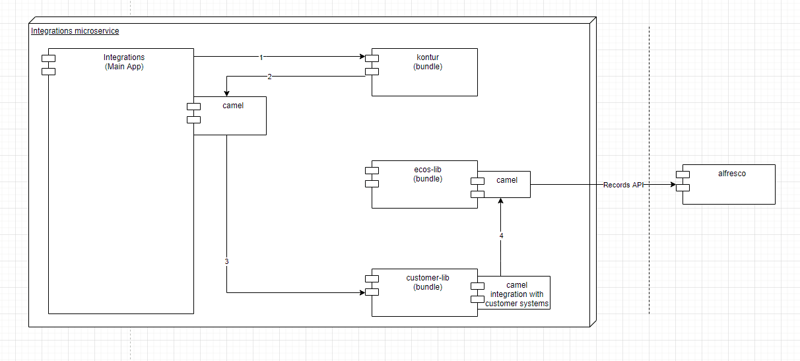

.. _EDI:

EDI
=======

.. contents::
    :depth: 2

Основные принципы
-------------------

В статье описана архитектура интеграции с ЭДО-провайдерами на основе синхронизаций и OSGi-бандлов в микросервисе ``integrations``. Обработка полученных событий и сохранение данных выполняются отдельными компонентами.

Синхронизация связывает интеграцию с конкретным провайдером и настроенным в Citeck ящиком. Стандартные средства управления синхронизациями позволяют включать и отключать интеграцию, а также сбрасывать её состояние для повторной обработки событий.

Механизм синхронизаций использует реализации ``SyncExecutionFactory``. Фабрика создаёт экземпляры ``SyncExecution``, которые управляют запуском интеграции по расписанию.

Для ЭДО используются классы ``EdiSyncExecutionFactory`` и ``EdiSyncExecution``. Фабрика регистрируется в ``SyncService`` и создаёт исполнитель синхронизации. Исполнитель выполняет следующие действия:

1. Регистрирует задачу в соответствии с настройками расписания.
2. При запуске задачи пытается получить блокировку через ShedLock. Выполнение продолжается после получения блокировки.
3. Собирает данные конфигурации и определяет реализацию ``EdiEventsSyncService`` для провайдера, указанного в настройках ящика. Если реализация не зарегистрирована, выбрасывается исключение.
4. Вызывает найденный сервис, передавая конфигурацию, состояние синхронизации и callback для обновления состояния.

``EdiSyncExecution`` отвечает за организацию запуска. Получение событий и взаимодействие с API провайдера делегируются соответствующей реализации сервиса.

Подключение реализаций сервисов
--------------------------------

Библиотека ``ecos-edi-commons`` содержит общие интерфейсы интеграции и структуры данных. Микросервис ``integrations`` использует эти интерфейсы, а реализации для конкретных ЭДО-провайдеров поставляются отдельно.

В рассматриваемой архитектуре реализации загружаются в микросервис в составе OSGi-бандлов. При загрузке бандла его сервисы регистрируются в соответствующих resolver-компонентах микросервиса.

Подробнее: :ref:`Функционал загрузки OSGi-пакетов <OSGI>` и :ref:`Настройка получения событий с ящиком Контур.Диадок <events_kontur>`.

Основные интерфейсы и сервисы ``ecos-edi-commons``:

.. list-table::
    :widths: 25 75
    :header-rows: 1
    :class: tight-table

    * - Класс или интерфейс
      - Назначение
    * - ``EdiEventsSyncService``
      - Интерфейс синхронизации событий с ЭДО-провайдером. Реализация получает события и подготавливает их для дальнейшей обработки.
    * - ``EdiEventsSyncServiceResolver``
      - Реестр реализаций ``EdiEventsSyncService`` по типу ЭДО-провайдера. Сервисы регистрируются при загрузке бандла провайдера. Resolver доступен в микросервисе как bean.
    * - ``EdiBoxService``
      - Интерфейс получения сведений о ящике. Его реализация предоставляется микросервисом как bean.
    * - ``EdiApiService``
      - Интерфейс операций с API ЭДО-провайдера. Реализация определяет доступность конкретных операций для провайдера.
    * - ``EdiApiServiceResolver``
      - Реестр реализаций ``EdiApiService`` по типу ЭДО-провайдера. Сервисы регистрируются при загрузке бандла провайдера. Resolver доступен в микросервисе как bean.
    * - ``EdiService``
      - Единая точка вызова операций провайдеров. Принимает тип провайдера ``EdiProviderType``, получает соответствующий ``EdiApiService`` через ``EdiApiServiceResolver`` и делегирует ему вызов.
    * - ``EdiGenerator`` и специализированные интерфейсы
      - Интерфейсы генерации контента. Например, печатная форма может формироваться через API провайдера или локальными средствами Citeck. Реализации регистрируются в ``EdiGeneratorResolver``.
    * - ``EdiGeneratorResolver``
      - Реестр генераторов по составному ключу: тип ЭДО-провайдера, тип генератора и вид генератора. Тип определяет операцию, например генерацию печатной формы или титула покупателя. Вид — строковый идентификатор реализации, например локальной генерации или генерации через API.
    * - ``EdiStateService``
      - Сервис передачи полученных и преобразованных событий в обработчик через Camel.

Схема взаимодействия сервисов: `edi_services <https://docs.google.com/document/d/1OPjXLsTkOio4ikiG_a2d7aas_0W6fUrIbDGyNKA2uyY/edit?usp=sharing>`_. Для работы с диаграммой используется `draw.io <https://app.diagrams.net/>`_.

Получение и передача событий
------------------------------

Библиотека провайдера получает события с учётом последнего обработанного события, указанного в состоянии синхронизации. Полученные данные преобразуются в структуру ``Event`` из ``ecos-edi-commons`` и передаются в ``EdiStateService``. Сохранение документов и подписей в хранилище выполняет отдельный обработчик.

Схема структур данных: `edi_structures <https://docs.google.com/document/d/1zWTdASmNCthb7vuQkwz1ocGGUTYzKlldM1hXl1JdALQ/edit?usp=sharing>`_.

``EdiStateService`` отправляет событие на настроенный endpoint в Camel-контексте. Контексты отправителя и получателя могут быть разными. Для передачи между контекстами в пределах одной JVM в рассматриваемой архитектуре используется ``direct-vm``; ``direct`` предназначен для вызовов внутри одного Camel-контекста.

Последовательность взаимодействия на схеме:

1. Исполнитель вызывает ``EdiEventsSyncService`` для выбранного провайдера и ящика, передавая состояние синхронизации.
2. Сервис провайдера преобразует полученные события в ``Event`` и через ``EdiStateService`` передаёт их в Camel-контекст микросервиса.
3. Сообщение направляется в Camel-контекст, в котором зарегистрирован настроенный endpoint. При необходимости промежуточную обработку выполняет компонент ``customer-lib`` с собственным контекстом. Если такая обработка не требуется, сообщение передаётся непосредственно в ``ecos-lib``.
4. Маршруты ``customer-lib``, если они используются, передают сообщение в Camel-контекст ``ecos-lib``. Этот компонент обновляет документы, подписи и связанные данные в Alfresco через Records API.

На схеме ``customer-lib`` и ``ecos-lib`` обозначают отдельные OSGi-бандлы. Каждый бандл создаёт и запускает собственный Camel-контекст. Имена endpoint должны совпадать в настройках отправителя и маршрутах получателя.

Структура Event
----------------

``Event`` — объект данных, содержащий сведения об изменениях, произошедших в рамках события. Он должен включать все документы, состояние которых изменилось вследствие этого события.

Для события «Документ подписан» необходимо передать подпись и сведения о документе с актуальным статусом. Передача только подписи не обеспечивает обновление состояния документа.

Если событие содержит корректировку УКД к ранее полученному УПД, в ``Event`` передаются УКД и актуальное состояние связанного УПД. Для УПД достаточно передать изменённые сведения, например статус. Неизменившийся контент и формализованные атрибуты, вычисленные на его основе, могут быть опущены, чтобы сократить объём передаваемых данных.
