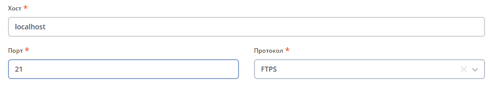
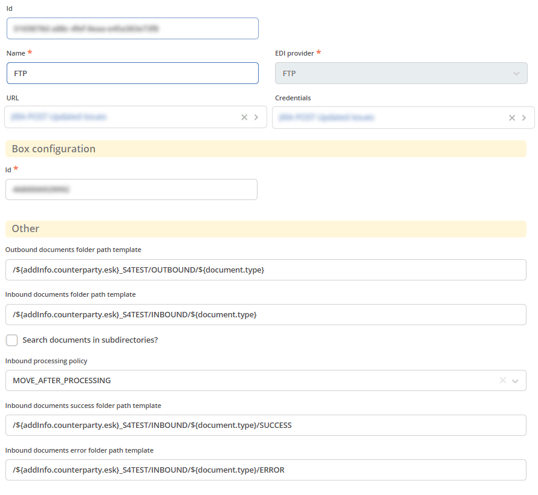

.. _ecos-edi-ftps-lib:

Описание ecos-edi-ftps-lib
===========================

.. contents::
   :depth: 4

1. Назначение
-------------

Библиотека ``ecos-edi-ftps-lib`` предназначена для обмена EDI-сообщениями с контрагентами через FTP- или FTPS-сервер. Описание сверено с версией **1.8.0**.

Общий принцип работы:

Контрагент помещает сообщения во входные папки. При запуске настроенной синхронизации библиотека обходит подходящие каталоги и обрабатывает оставшиеся в них файлы. Поиск в подкаталогах управляется отдельным флагом. Постоянного курсора и отдельной проверки, что файл ранее не обрабатывался, в этой библиотеке нет; подробнее — в разделе 4.

Для отправки библиотека записывает EDI-сообщение в папку, из которой его забирает контрагент; подробнее — в разделе 3.

2. Настройка интеграции
--------------------------

Перед созданием настроек установите совместимый OSGi-бандл по :ref:`инструкции загрузки пакетов <OSGI>`. Загрузку выполняйте от имени системного администратора. При старте бандл регистрирует FTP API, сервис синхронизации и listener событий ящика; при остановке снимает эти регистрации.

В POM версии 1.8.0 заданы **Camel 3.11.2**, **ecos-osgi-loader 2.0.0**, **ecos-edi-commons 2.9.0** и **Commons Net 3.6** со scope ``provided``. Принимающее приложение должно предоставлять совместимые API, OSGi-экспорты и необходимые EDI-сервисы в Spring-контексте. Совместимость этой версии бандла с современным окружением на Camel 4 здесь не подтверждена.

Для настройки создайте сущности **ecos-credentials**, **ecos-data-sources**, **edi-box** и **ecos-sync**. Названия полей и скриншоты ниже относятся к показанной поставке интерфейса; в другой версии формы могут отличаться.

2.1. Создание ecos-credentials сущности
~~~~~~~~~~~~~~~~~~~~~~~~~~~~~~~~~~~~~~~~~

Тут все стандартно, создаем через журнал **ecos-credentials** запись, в которой указываем логин и пароль для подключения к FTP-серверу.

2.2. Создание ecos-data-sources сущности
~~~~~~~~~~~~~~~~~~~~~~~~~~~~~~~~~~~~~~~~~

Создайте сущность **FTP Data source**. Задайте идентификатор и понятное название; ссылку на эту запись затем укажите в ящике.

Важны **host**, **port** и **protocol**:

.. list-table::
    :widths: 15 35
    :header-rows: 1
    :class: tight-table

    * - Поле
      - Описание
    * - ``host``
      - Имя или адрес FTP/FTPS-сервера, доступного из микросервиса интеграций.
    * - ``port``
      - Явно укажите фактический порт сервера. В версии 1.8.0 при пустом поле код выбирает **22**, а не 21; не полагайтесь на это значение для своего FTP/FTPS-сервера.
    * - ``protocol``
      - Поддерживаются **FTP** и **FTPS**. SFTP не поддерживается; значение порта 22 не включает работу по SSH.

Для подключения должны быть заполнены ``host``, распознанный ``protocol``, положительный ``port`` и непустые логин и пароль в связанной записи credentials. Передача файлов выполняется в бинарном и пассивном режиме. Для FTPS библиотека запрашивает защищённый канал данных через ``PBSZ 0`` и ``PROT P``; параметры TLS и доверия сертификатам проверяйте на целевом сервере.

2.3. Создание edi-box сущности
~~~~~~~~~~~~~~~~~~~~~~~~~~~~~~~~

Создаем сущность **"FTP box"**.

Самая основная часть конфигурации именно тут. Тут существует 3 раздела. В верхнем разделе:

.. list-table::
    :widths: 15 35
    :header-rows: 1
    :class: tight-table

    * - Поле
      - Описание
    * - ``id``
      - Указываем любой (или оставляем пустым и оно само сгенерится при создании).
    * - ``name``
      - Любое человеко-читаемое название для этого ящика.
    * - ``URL``
      - Указываем созданный в 2.2 датасорс.
    * - ``Credentials``
      - Указываем созданные в 2.1 креды.

В разделе **Box configuration** задайте идентификатор собственного ящика. GLN организации — один из вариантов. Код извлекает идентификатор из ``OurId.attributes`` в порядке **id → boxId → gln**, выбирая первое непустое значение. Он используется для поиска настроенного ящика с провайдером ``EdiProviderType.FTP`` без учёта регистра.

Этот идентификатор отличается от локального ID записи **edi-box**. При исходящей отправке значения ``OurId`` запроса должны разрешаться в нужный настроенный ящик. Если заполнено несколько атрибутов, приоритет имеет ``id``, затем ``boxId``, затем ``gln``.

Раздел **Other**:

.. list-table::
    :widths: 15 35
    :header-rows: 1
    :class: tight-table

    * - Поле
      - Описание
    * - ``Outbound documents folder path template``
      - Шаблон пути, по которому будут отправляться исходящие сообщения. Подробнее в п.3.
    * - ``Inbound documents folder path template``
      - Обязательный шаблон пути поиска входящих файлов (``inboundFolderPathTemplate``). Подробнее в п.4.
    * - ``Search documents in subdirectories``
      - Чекбокс с говорящим названием, который означает, что мы должны искать документы не только в папке, полностью соответствующей конфигу выше, но и в поддиректориях.
    * - ``Inbound processing policy``
      - Обязательно выберите ``MOVE_AFTER_PROCESSING`` или ``DELETE_ON_SUCCESS`` (``inboundProcessingPolicy``). При пустом или неизвестном значении возникает ошибка конфигурации; политики по умолчанию нет. Подробнее в п.4.
    * - ``Inbound documents success folder path template``
      - Для ``MOVE_AFTER_PROCESSING``: шаблон папки переноса после возврата ``sendEvent`` без исключения (``processingSuccessFolderTemplate``). Папку необходимо создать заранее.
    * - ``Inbound documents error folder path template``
      - Для ``MOVE_AFTER_PROCESSING``: шаблон папки, в которую выполняется попытка переноса при ошибке (``processingErrorFolderTemplate``). Папку необходимо создать заранее.

Папки success/error разместите вне области входного поиска. При включённом обходе подкаталогов специального исключения этих папок нет: перемещённые файлы могут снова попасть в обработку, если соответствуют шаблону.

2.4. Создание ecos-sync сущности
~~~~~~~~~~~~~~~~~~~~~~~~~~~~~~~~

Общий пример создания синхронизации приведён в разделе :ref:`Настройка получения событий с ящиком Контур.Диадок <events_kontur>`. Для FTP выберите **edi-box** из п.2.3 и настройте расписание запуска.

В конфигурации передачи событий обязательно укажите ``stateServiceConfig.endpoint`` — endpoint получателя, который умеет обрабатывать события с провайдером **FTP** и типом ``EDI_RECEIVED_MESSAGE``. Пример настройки Диадока не подтверждает поддержку FTP произвольным маршрутом. Гарантии дальнейшей обработки зависят от реализации ``EdiStateService`` и выбранного endpoint.

3. Принципы работы при отправке сообщений
-----------------------------------------

В конфигурации задаются пути внутри FTP-пространства пользователя. Библиотека добавляет ведущий ``/``, если его нет; пустой исходящий путь нормализуется в ``/``. Связь этого корня с файловой системой сервера определяется настройками сервера. Для явного назначения используйте, например, ``/OUTBOUND``.

Переменные исходящего шаблона берутся из **EdiXmlRequest** библиотеки ``ecos-edi-commons``; см. :ref:`Описание работы интеграции <EDI>`.

Эта структура состоит из следующих полей:

.. code-block:: java

    private OurId ourId;
    private CounterpartyId counterpartyId;
    private EdiXml ediXml;
    private ObjectData data;

где:

* Атрибуты ``ourId`` доступны как ``ourId.key_from_attributes``. Например, для ключей ``key1`` и ``key2`` используются ``ourId.key1`` и ``ourId.key2``.
* Атрибуты ``counterpartyId`` доступны как ``counterpartyId.key_from_attributes``.
* ``ediXml.ediDocumentType`` задаёт ``document.type`` и ``document.lowerType``. Для исходящего сообщения это, например, ``ORDERS`` и ``orders`` соответственно.
* Значения ``data`` доступны как ``addInfo.key``. Ключи и значения с пустым строковым представлением пропускаются.

Вызывающий код заполняет ``EdiXmlRequest.data`` до отправки. В версии 1.8.0 библиотека не вызывает ``FtpCustomAddInfoProvider`` или ``FtpCustomAddInfoProviderRegistry``; проектную логику подготовки значений реализуйте на стороне отправителя. Пример шаблона:

.. code-block:: text

    /${addInfo.counterparty.esk}_S4TEST/OUTBOUND/${document.type}

Это означает, что если в структуре data содержится значение 123456 по ключу ``counterparty.esk`` и ``ediXml.ediDocumentType`` содержит значение ORDERS, то данное сообщение отправится в следующую папку:

.. code-block:: text

    /123456_S4TEST/OUTBOUND/ORDERS/

Можно задать фиксированный путь без переменных, например ``/OUTBOUND``. Тогда все сообщения этого ящика направляются в одну указанную папку.

Например, шаблон:

.. code-block:: text

    /${addInfo.path}

Если вызывающий код запишет в ``request.data`` ключ ``path`` со значением ``some/path/type/kind/outbound``, получится путь:

.. code-block:: text

    /some/path/type/kind/outbound

Для отдельного запроса можно переопределить весь шаблон: непустой ключ ``outboundFolderPathTemplate`` в ``request.data`` имеет приоритет над ``defaultOutboundFolderPathTemplate`` ящика. Например:

.. code-block:: java

    request.setData(ObjectData.create()
        .set("path", "some/path/type/kind/outbound")
        .set("outboundFolderPathTemplate", "/${addInfo.path}"));

Неизвестная или пустая переменная без значения по умолчанию вызывает ``IllegalArgumentException``. Для исходящего пути поддерживается форма ``${key:default}``, например ``${addInfo.path:OUTBOUND}``.

Для подстановки используется ``StringSubstitutor`` из Apache Commons Text с собственным механизмом поиска значений. Эти правила относятся к исходящим путям; входной поиск строит регулярные выражения по правилам раздела 4.1.

Подробнее можно ознакомиться в тестах к либе.

Отправить сообщение можно с помощью интерфейса **EdiService**, передав ему ``EdiProviderType.FTP``. Доступные методы:

* ``generateEdiXml`` делегирует работу зарегистрированному ``EdiXmlGenerator`` для FTP и указанного ID контроллера генерации. Этот бандл не регистрирует встроенные генераторы; для успешного вызова генератор должен предоставить другой модуль или проектный код.

* ``sendEdiXml(EdiXmlRequest)`` отправляет сообщение на FTP/FTPS-сервер. Обязательны ``ediXml``, его содержимое, имя файла и массив байтов. Ящик определяется по ``OurId`` запроса.

Перегрузка ``sendEdiXml(SignedEdiXmlRequest)`` не реализована и выбрасывает ``UnsupportedOperationException``. Большинство других операций ``EdiApiService``, включая отправку пакетов и подписей, этим провайдером также не поддерживается.

Сервис **EdiService** доступен из микросервиса **integrations-app**.

4. Принципы работы при получении сообщений
-------------------------------------------

Получение сообщения состоит из трёх фаз:

1. Найти и прочитать файл.
2. Сформировать событие и передать его в ``EdiStateService``.
3. Удалить или переместить файл в соответствии с политикой.

4.1. Обход в поиске сообщений
~~~~~~~~~~~~~~~~~~~~~~~~~~~~~~~

Для поиска используется итератор ``FtpWalkIterator`` с очередью файлов и папок. Он продолжает обход между файлами в пределах одного вызова синхронизации. Следующий запуск создаёт новый итератор и снова начинает обход от ``/``; сохранённая позиция между запусками не используется. После возврата политики callback получает ``EdiSyncState(null)``.

Итератор использует обязательный ``Inbound documents folder path template`` и флаг ``Search documents in subdirectories`` из п.2.3. Укажите входной путь с ведущим ``/``; отсутствие шаблона не означает поиск по всему серверу и приводит к ошибке.

Шаблон поиска входящих разбивается на уровни по папкам. То есть, например, шаблон ``/${addInfo.counterparty.esk}_S4TEST/INBOUND/${document.type}`` разобьется на 4 части:

.. code-block:: text

    /
    /${addInfo.counterparty.esk}_S4TEST
    /${addInfo.counterparty.esk}_S4TEST/INBOUND
    /${addInfo.counterparty.esk}_S4TEST/INBOUND/${document.type}

Части преобразуются в регулярные выражения с именованными группами. Например, для набора типов документов из четырёх значений:

.. code-block:: text

    /
    /(?<addInfoA1B2C3counterpartyA1B2C3esk>[\w\s-]+)_S4TEST
    /(?<addInfoA1B2C3counterpartyA1B2C3esk>[\w\s-]+)_S4TEST/INBOUND
    /(?<addInfoA1B2C3counterpartyA1B2C3esk>[\w\s-]+)_S4TEST/INBOUND/(?<documentA1B2C3type>ORDERS|ORDRSP|DESADV|RECADV)

Точки в именах групп заменяются строкой ``A1B2C3`` и восстанавливаются при извлечении значений для события. Для обычной переменной используется выражение ``[\w\s-]+``. Значения ``document.type`` и ``document.lowerType`` берутся из enum ``EdiDocumentType`` зависимости ``ecos-edi-commons``; фактический набор и порядок зависят от её версии.

.. important::

    Во входном поиске версии 1.8.0 ``document.lowerType`` использует те же значения enum, что и ``document.type``, без преобразования в нижний регистр. Регулярные выражения компилируются с учётом регистра. Не рассчитывайте на поиск папки ``orders`` только за счёт имени переменной ``document.lowerType``. Это отличается от исходящей подстановки.

Если включён флаг поиска в подкаталогах, к последнему регулярному выражению добавляется ``.*``. Имена файлов и расширения отдельно не фильтруются: для файла проверяется путь содержащей его папки. Папки success/error должны быть вне подходящих путей.

Так же, есть возможность указывать не стандартную регулярку, а свою. Пример -

.. code-block:: text

    /${addInfo.counterparty.esk(\d+)}_S4TEST/INBOUND/${document.type}

Алгоритм обхода:

Итератор внутри себя содержит очередь. В эту очередь вносятся файлы или папки, которые нужно будет в будущем посмотреть и проверить на предмет файлов, соответствующих регуляркам.

1. При первом обращении к новому итератору загрузить в очередь список файлов и папок из ``/``.
2. Взять следующий элемент и выбрать регулярное выражение для его уровня. Для файла использовать последнее выражение и путь его папки.
3. Если папка соответствует выражению, добавить её содержимое в начало очереди. Если соответствует файл, прочитать его содержимое и вернуть на обработку. Несоответствующий элемент исключить из очереди.
4. Продолжить обход до следующего файла или опустошения очереди.

При поиске одного следующего подходящего файла действует защитный предел в 1000 просмотренных элементов, после которого возникает ошибка ``Endless cycle or too many files``. Это не общий лимит числа документов за синхронизацию.

4.2. Обработка сообщения
~~~~~~~~~~~~~~~~~~~~~~~~~

Из значений групп входного пути формируются ``OurId``, ``CounterpartyId``, тип EDI-документа и ``data``. Например, шаблон ``/${addInfo.counterparty.esk}_S4TEST/INBOUND/${document.type}`` передаёт извлечённые значения в данные события. Содержимое XML может дополнить или переопределить часть полей, в том числе GLN получателя и отправителя.

Создаётся **Event** с типом ``EDI_RECEIVED_MESSAGE`` и провайдером ``FTP``. Он содержит один обновлённый документ с состоянием ``RECEIVED`` и направлением ``IN``. Событие передаётся в ``EdiStateService.sendEvent`` с настройками endpoint из синхронизации; дальнейшая обработка определяется этим получателем. Подробнее о модели — :ref:`Описание работы интеграции <EDI>`.

4.3. Фиксация обработанного сообщения
~~~~~~~~~~~~~~~~~~~~~~~~~~~~~~~~~~~~~~~~~~

После возврата ``sendEvent`` без исключения библиотека выполняет действие выбранной ``Inbound processing policy``. Внутри этой библиотеки нет отдельного подтверждения завершения конечной бизнес-обработки: гарантии возврата ``sendEvent`` зависят от внешней реализации и endpoint.

Отправка события и операция с FTP-файлом не образуют общую атомарную операцию. Если событие отправлено, а последующее удаление или перемещение не удалось, оставшийся входной файл может быть обработан повторно. Получатель должен учитывать возможность дублей.

4.3.1. Политика MOVE_AFTER_PROCESSING
""""""""""""""""""""""""""""""""""""""

Сначала вычисляется путь из ``Inbound documents success folder path template``, затем формируется и отправляется событие. После возврата ``sendEvent`` без исключения файл перемещается в success-папку.

Исключение при вычислении пути, формировании события, отправке или перемещении вызывает попытку переноса в папку из ``Inbound documents error folder path template``. Поэтому наличие файла в error-папке не доказывает, что событие не было отправлено.

Оба пути являются шаблонами и могут использовать значения, извлечённые из входного пути. Все получающиеся папки назначения необходимо создать заранее и проверить права на переименование: ``moveFile`` не создаёт каталоги, в отличие от исходящей отправки.

При ответах FTP 550 или 553 код пытается перенести файл с суффиксом `` (N)`` перед расширением; предусмотрено до 50 попыток. Эти повторы не исправляют отсутствие папки назначения. Если перенос в error-папку тоже не удался, ошибка записывается в лог, а файл может остаться во входной папке.

4.3.2. Политика DELETE_ON_SUCCESS
""""""""""""""""""""""""""""""""""""

После возврата ``sendEvent`` без исключения файл удаляется с FTP-сервера.

При ошибке формирования события, отправки или удаления исключение записывается в лог; отдельного переноса в error-папку нет. Если файл остался на сервере, следующий запуск может получить его снова.

4.4. Диагностика ошибок
~~~~~~~~~~~~~~~~~~~~~~~

Ошибки внутри обработки отдельного файла обе политики журналируют и поглощают. Поэтому сообщение об успешном завершении синхронизации не гарантирует успех всех файлов: проверяйте сообщения ``Can not process file for path`` и, для перемещения, ``Exception while move file``.

Чтение файла происходит в итераторе до вызова защищённого обработчика политики. Ошибка поиска или скачивания может прервать весь текущий обход без попытки перенести этот файл в error-папку. Следующий запуск начинает обход заново; отдельного постоянного состояния обработки файлов в библиотеке нет.

