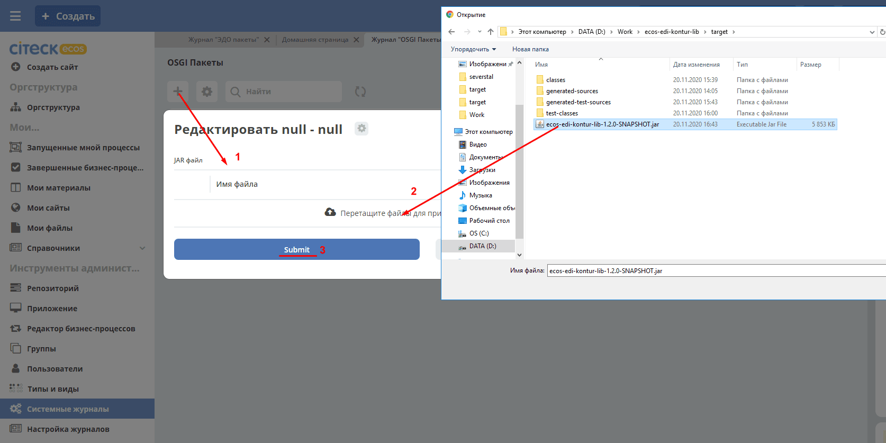
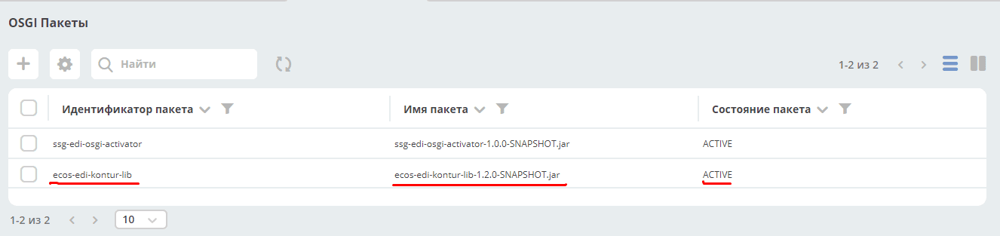

.. _OSGI:

Функционал загрузки OSGI пакетов
================================

.. note::

    Доступно только в Enterprise версии.

.. contents::
   :depth: 3

Микросервис ecos-integrations позволяет загружать пользовательский код в виде бандлов согласно спецификации **OSGi**. Это позволяет расширять микросервис без изменения его базового функционала.

В ecos-integrations 2.40.0-SNAPSHOT используются ``ecos-osgi-loader`` 3.1.0, OSGi Core 8.0.0, Apache Felix 7.0.5 и Camel 4.14.8. Зависимости бандла и импортируемые пакеты должны соответствовать целевой версии микросервиса.

Загрузка самих пакетов производится через журнал **OSGI пакеты** в разделе администратора. Чтобы загрузить пакет, переходим в этот журнал и нажимаем кнопку создания. Появляется модальное окно с предложением загрузки файла. Подкладываем туда свой скомпилированный jar файл и нажимаем **Создать**. Пакет загружен и проинсталлирован, если никаких проблем при инсталляции не возникло. В самом журнале всегда можно найти актуальный статус пакета, имя загруженного файла, символическое имя пакета, а так же, скачать сам jar файл пакета.

Загрузку, обновление и удаление бандлов выполняйте от имени системного администратора. Сервер проверяет право записи системного артефакта; доступ к журналу сам по себе не разрешает эти операции. В используемом механизме прав запись разрешена ролям **ADMIN** и **SYSTEM**.

Что доступно "из коробки" при реализации нового пакета:

* **ApplicationContext ecos-integrations** передаётся OSGi-фабрике в свойстве ``SpringApplicationContext``. Для получения бинов используется обёртка ``ApplicationContextReflection`` из ``ecos-osgi-loader``. При обращении к Spring API необходимо согласовать версии и OSGi imports/exports: доступность библиотеки в микросервисе сама по себе не гарантирует её доступность бандлу.

Полезные ссылки для реализации OSGI пакетов:

1. `http://java-online.ru/osgi.xhtml <http://java-online.ru/osgi.xhtml>`_ – Описание работы OSGI с подробными примерами реализации самих пакетов

2. `https://felix.apache.org/ <https://felix.apache.org/>`_  – Официальный сайт фреймворка Apache Felix, который был использован в качестве реализации спецификации OSGI

3. `https://felix.apache.org/documentation/subprojects/apache-felix-maven-bundle-plugin-bnd.html <https://felix.apache.org/documentation/subprojects/apache-felix-maven-bundle-plugin-bnd.html>`_ – Более подробное описание работы с плагином для создания OSGI пакетов.

При реализации бандла используйте зависимости API, совместимые с целевым микросервисом. В самом ecos-integrations ``ecos-osgi-loader``, **Felix** и **OSGi Core** объявлены отдельными зависимостями. Состав транзитивных зависимостей проекта бандла проверяйте через ``mvn dependency:tree``. API, предоставляемые микросервисом, должны использовать те же классы, что и host; состав зависимостей со scope ``provided`` и экспортируемых пакетов проверяется для конкретной поставки.

В примере ниже используется версия плагина для сборки пакетов 5.1.1. Это пример настройки, а не требование к любой версии микросервиса.

Шаблон настройки плагина; имя активатора и пакет ``com.example.integration`` замените значениями своего проекта:

.. code-block:: xml

    <plugin>
        <groupId>org.apache.felix</groupId>
        <artifactId>maven-bundle-plugin</artifactId>
        <version>5.1.1</version>
        <extensions>true</extensions>
        <configuration>
            <instructions>
                <Bundle-SymbolicName>${project.artifactId}</Bundle-SymbolicName>
                <Bundle-Name>${project.name}</Bundle-Name>
                <Bundle-Version>${project.version}</Bundle-Version>
                <Bundle-Activator>com.example.integration.Activator</Bundle-Activator>
                <Import-Package>ru.citeck.ecos.osgi.spring.context, *</Import-Package>
                <Private-Package>com.example.integration.*</Private-Package>
            </instructions>
        </configuration>
    </plugin>

``Import-Package`` с завершающим ``*`` сохраняет автоматическое определение используемых внешних пакетов средствами bnd. Пакет ``ru.citeck.ecos.osgi.spring.context`` указан явно для примеров с ``ApplicationContextReflection``; если он не используется, явное указание можно убрать. Пакеты, загружаемые только по имени через reflection, при необходимости добавляются явно. После сборки проверьте итоговый ``META-INF/MANIFEST.MF`` и диапазоны версий импортов. См. `справочник bnd Import-Package <https://bnd.bndtools.org/heads/import_package.html>`_.

``Private-Package`` включает собственную реализацию бандла. Если другим бандлам нужен ваш публичный API, добавьте ``Export-Package`` только для его пакетов. Не экспортируйте широкие наборы ``org.apache.*``, ``org.slf4j.*``, ``ru.citeck.*`` или ``lombok.*``: bnd может включить совпавшие пакеты из зависимостей, создав дубли классов платформы. См. `справочник bnd Export-Package <https://bnd.bndtools.org/heads/export_package.html>`_.

Пример создания бандла
-----------------------

В данной статье будет рассмотрено пошаговое создание бандла, а так же внедрение этого бандла в микросервис интеграций.

Пример, на котором рассмотрим - `ecos-edi-kontur-lib <https://gitlab.citeck.ru/citeck-projects/ecos-edi-kontur-lib/-/tree/develop>`_

Это исторический пример с координатами ``ecos-edi-kontur-lib 1.2.0-SNAPSHOT``. Его совместимость с ecos-integrations 2.40.0-SNAPSHOT не подтверждена. Для новой реализации используйте API и настройки бандла, соответствующие целевому runtime; приведённые координаты не являются рекомендацией версии для установки.

1. Сборка
~~~~~~~~~~

**Бандл** — JAR-файл с OSGi-метаданными в ``META-INF/MANIFEST.MF``. Самого наличия manifest недостаточно: для загрузки нового пакета сервису требуется ``Bundle-SymbolicName``, а зависимости бандла должны разрешаться OSGi-фреймворком. Для бандла с активатором указывается ``Bundle-Activator``.

Чтобы получить подобную сборку, делаем следующее:

1.1. Указываем **packaging** свойство в **pom.xml** в значение **bundle**. Пример с контекстом:

.. code-block:: xml

    <project xmlns="http://maven.apache.org/POM/4.0.0"
            xmlns:xsi="http://www.w3.org/2001/XMLSchema-instance"
            xsi:schemaLocation="http://maven.apache.org/POM/4.0.0 http://maven.apache.org/xsd/maven-4.0.0.xsd">
    ...
        <groupId>ru.citeck.ecos</groupId>
        <artifactId>ecos-edi-kontur-lib</artifactId>
        <version>1.2.0-SNAPSHOT</version>
        <packaging>bundle</packaging>
    ...
    </project>

1.2. В разделе ``build/plugins`` добавляем ``maven-bundle-plugin`` по шаблону выше и настраиваем его для своего проекта.

Бандл имеет собственный **ClassLoader**. Для обращения к внешним пакетам требуется OSGi-импорт и соответствующий экспорт в runtime. Собственные классы и явно включённые внутренние библиотеки не требуют импорта из другого бандла. Отсутствие нужного импорта может привести к **ClassNotFoundException** или **NoClassDefFoundError** при выполнении. Если обязательный импорт объявлен, но подходящего экспорта нет, framework не сможет разрешить зависимости бандла.

При настройке импортов учитывайте не только имена пакетов, но и версии, экспортируемые целевым runtime.

Бандл может не стартовать, если пакет экспортируется в версии, не входящей в диапазон импорта. Например, ``com.google.common.*;version="[1.0,26.0)"`` задаёт диапазон от 1.0 включительно до 26.0 исключительно. Выбирайте диапазон по фактически совместимым версиям API; расширение диапазона само по себе не обеспечивает совместимость кода.

1.3. Сборка выполняется командой ``mvn clean package``. При необходимости установки в локальный Maven-репозиторий используйте ``mvn clean install``, для публикации — ``mvn clean deploy``.

2. Активатор
~~~~~~~~~~~~~~~~~~

**Активатор** - аналог main метода для бандла. Он вызывается при старте бандла и при его остановке (методы start и stop).

В историческом примере активатор предназначен для регистрации обработчика провайдера по ключу **KONTUR** для **Diadoc** и **Kontur.EDI**. Интерфейсы регистрации и доступные возможности зависят от версии EDI-библиотек; перед использованием примера проверьте их по исходникам выбранной поставки. При остановке бандла снимайте выполненные регистрации и освобождайте созданные ресурсы.

3. Загрузка в микросервис
~~~~~~~~~~~~~~~~~~~~~~~~~~~

Заходим в **Рабочее пространство "Раздел администратора" → Журнал OSGI пакеты**. Загружаем через кнопку + свой бандл.

Если все ок, увидим следующую картину:

Важный факт, что статус - **ACTIVE**, это означает, что бандл зарезолвен, установлен и фреймворк его успешно стартанул.

Если есть ошибка загрузки - необходимо корректировать либо код, либо настройки бандла (импорт и экспорт).

Обязательно проверьте, что в рантайме нет ошибок при работе бандла. Как писалось выше, отсутствующие импорты могут привести к ошибкам рантайма.

.. important::
    
    При ошибке загрузки сначала проверьте логи установки, разрешение зависимостей и выполнение ``start``/``stop`` активатора. В ``stop`` освобождайте созданные ресурсы и снимайте регистрации, выполненные бандлом.

    При некоторых ошибках установки сервис пытается восстановить предыдущую версию бандла. Это не гарантирует очистку всех ресурсов после частично выполненного ``start``. Если после исправления и повторной загрузки сохраняется некорректное состояние runtime, может потребоваться перезапуск микросервиса; после каждой ошибки он не обязателен.

Сохранённые бандлы повторно устанавливаются после запуска микросервиса: установка планируется через 30 секунд после первого события обновления Spring-контекста.

Способы расширения микросервиса интеграций с помощью бандлов
------------------------------------------------------------

1. Регистрация своего RecordsDao
~~~~~~~~~~~~~~~~~~~~~~~~~~~~~~~~~~

Подготовительная часть - импортировать зависимости records с помощью maven в своем бандле.

Пример пакетов для импорта; окончательный список определяется используемой версией Records и экспортами OSGi runtime:

.. code-block:: text

    kotlin.*,
    ecos.com.fasterxml.jackson210.*,
    ru.citeck.ecos.records2.*,
    ru.citeck.ecos.records3.*,
    ru.citeck.ecos.commons.*,
    ru.citeck.ecos.osgi.spring.context,
    *

Дальше - написать ``RecordsDao`` под свои потребности.

``RecordRef`` и ``getRecordsServiceV1()`` используются в Records API, включая сервис из пакета ``records3``. Имя ``V1`` в getter не означает, что этот API необходимо автоматически заменить. Аналогично ``ecos.com.fasterxml.jackson210`` используется в предоставляемой библиотеке Records; пакет аннотаций должен соответствовать её JSON mapper.

После написания - в ``BundleActivator`` можно получить с помощью ``ApplicationContextReflection`` бин класса ``RecordsService`` и вызываем у него метод **register**, передав свой ``RecordsDao``.

Теперь, запросы по указанному **sourceId** будут попадать в ваш ``RecordsDao``.

В ``stop`` активатора снимите регистрацию через ``recordsService.unregister(sourceId)``. Идентификатор должен принадлежать вашему DAO.

2. Регистрация новых команд
~~~~~~~~~~~~~~~~~~~~~~~~~~~~~

Подготовительная часть - импортировать зависимости commands с помощью maven в своем бандле.

Импортировать пакеты в бандл (в конфиге):

.. code-block:: text

    ecos.com.fasterxml.jackson210.*,
    kotlin.*,
    ru.citeck.ecos.commons.*,
    ru.citeck.ecos.commands.*,
    ru.citeck.ecos.osgi.spring.context,
    *

Дальше объявить свою ``CommandDto``, указать аннотацией ``@CommandType`` тип для нее. Создать ``CommandExecutor`` для этой dto.

После написания - в ``BundleActivator`` можно получить с помощью ``ApplicationContextReflection`` бин класса ``CommandsService`` и вызвать у него метод **addExecutor**, передав свою реализацию ``CommandExecutor``.

Теперь, команды с указанным типом будут попадать в ваш **CommandExecutor**.

3. Возможность работы с camel
~~~~~~~~~~~~~~~~~~~~~~~~~~~~~~~~~

В основном пока что это используется для ЭДО-интеграций, но бывает проще использовать camel для некоторых вещей.

Чтобы его использовать - добавить зависимости camel, которые нужны с помощью maven в своем бандле.

Импортировать пакеты в бандл (в конфиге):

.. code-block:: text

    org.apache.camel.*,
    *

Дальше - в ``BundleActivator`` создать ``DefaultCamelContext``. Добавить в него необходимые маршруты. Запустить контекст.

В ``stop`` активатора остановите созданный Camel-контекст.

Для Camel 4 нельзя использовать ``direct-vm``: компонент удалён при переходе на эту версию. Выбирайте поддерживаемый способ обмена с учётом того, находятся ли маршруты в одном контексте или в разных. ``direct`` не следует считать автоматической заменой межконтекстного обмена. См. `руководство миграции Camel 4 <https://camel.apache.org/manual/camel-4-migration-guide.html>`_.

Пока что возможности Camel вроде динамичного добавления ендпоинтов и тд не тестировались, но до кролика или иного сервиса (исходящий запрос) - очень даже удобно ходить.

4. Регистрация нового endpoint
~~~~~~~~~~~~~~~~~~~~~~~~~~~~~~~

Добавляем зависимость ``spring-webmvc`` со scope ``provided``. Свойство ``spring-framework.version`` в примере должно быть задано в проекте бандла согласно версии Spring целевого микросервиса:

.. code-block:: xml

    <dependency>
    <groupId>org.springframework</groupId>
    <artifactId>spring-webmvc</artifactId>
    <version>${spring-framework.version}</version>
    <scope>provided</scope>
    </dependency>

Добавляем в импорт пакеты:

.. code-block:: text

    org.springframework.web.*,
    org.springframework.http.*,
    ru.citeck.ecos.osgi.spring.context,
    *

В бандле создаем класс(ы) содержащий(ие) методы для обработки запросов. 

Возможные варианты реализации такого метода - использование `RequestEntity  <https://docs.spring.io/spring-framework/docs/current/javadoc-api/org/springframework/http/RequestEntity.html>`_, `ResponseEntity  <https://www.baeldung.com/spring-response-entity>`_, использование `@RequestBody  <https://www.baeldung.com/spring-request-response-body>`_, `пример  <https://www.logicbig.com/tutorials/spring-framework/spring-web-mvc/request-response-entity.html>`_.  Также методы могут принимать переменные пути запроса `@PathVariable  <https://www.baeldung.com/spring-pathvariable>`_ и переменные заголовка `@RequestHeader <https://www.baeldung.com/spring-rest-http-headers>`_.

В ``start`` активатора получаем ``RequestMappingHandlerMapping`` через ``ApplicationContextReflection``. Для Spring MVC с поддержкой ``getBuilderConfiguration()`` используем конфигурацию действующего mapping, чтобы согласовать правила сопоставления путей. См. `API RequestMappingHandlerMapping <https://docs.spring.io/spring-framework/docs/6.2.x/javadoc-api/org/springframework/web/servlet/mvc/method/annotation/RequestMappingHandlerMapping.html>`_.

Ниже — фрагмент регистрации ``/ecos/message``. ``controller`` — экземпляр вашего контроллера с методом ``postLoad(String, CreateDocsRequest)``; ``CreateDocsRequest`` — DTO вашего проекта. ``handlerMapping`` и ``info`` сохраните в полях активатора для последующего удаления регистрации:

.. code-block:: java

    handlerMapping = ApplicationContextReflection.getBean(RequestMappingHandlerMapping.class);
    info = RequestMappingInfo
        .paths("/ecos/message")
        .methods(RequestMethod.POST)
        .consumes(MediaType.APPLICATION_JSON_VALUE)
        .produces(MediaType.APPLICATION_JSON_VALUE)
        .options(handlerMapping.getBuilderConfiguration())
        .build();

    handlerMapping.registerMapping(info, controller,
        controller.getClass().getDeclaredMethod("postLoad", String.class, CreateDocsRequest.class));

В методе ``stop`` предусматриваем отключение endpoint при помощи вызова ``handlerMapping.unregisterMapping(info)``.

Имя Spring-бина, доступность API из бандла и обработку параметров контроллера необходимо проверить на целевой поставке с используемой версией ``ecos-osgi-loader``.

Использование RecordsService через DTO
^^^^^^^^^^^^^^^^^^^^^^^^^^^^^^^^^^^^^^^

Для изменения записей в Citeck можно использовать ``RecordsService``. Есть следующие особенности при работе с сервисом через DTO:

Создание ObjectData из DTO-объекта
""""""""""""""""""""""""""""""""""

.. code-block:: java

    ObjectData targetAttributesData = ObjectData.create(dtoObject);

Псевдоним свойства через JsonProperty
"""""""""""""""""""""""""""""""""""""

Для задания JSON-имени свойства при преобразовании DTO можно использовать ``ecos.com.fasterxml.jackson210.annotation.JsonProperty``, если этот пакет аннотаций соответствует версии JSON mapper вашей библиотеки Records/Commons. Это отличается от задания выражения Records-атрибута через ``@AttName`` при чтении DTO.

.. code-block:: java

    @JsonProperty("nsdb_author")
    private String author;
    ...
    ObjectData targetAttributesData = ObjectData.create(dtoObject);

Свойство с типом ASSOC
""""""""""""""""""""""

Свойство с типом ``ASSOC: private RecordRef nsdb_counterparty``

.. code-block:: java

    ObjectData targetAttributesData = ObjectData.create();
    targetAttributesData.set("nsdb_counterparty", assocRecordRef);
    RecordAtts recordAtts = new RecordAtts(targetRecordRef, targetAttributesData);
    RecordRef result = recordsService.mutate(recordAtts);

Свойство с типом CONTENT
""""""""""""""""""""""""

Следующий фрагмент относится к Alfresco-адаптеру и не является универсальным форматом CONTENT для всех источников Records. Набор полей и тип значения ``base64content`` необходимо согласовать с версией используемого адаптера.

Перед использованием примера проверьте формат содержимого по исходникам адаптера и выполните сохранение с последующим чтением файла. Корректность этого формата для конкретной современной поставки здесь не подтверждена.

Свойство с типом ``CONTENT: private ObjectData nsdb_content``

.. code-block:: java

    ObjectData contentData = ObjectData.create();
    contentData.set("mimetype", "application/xml");
    contentData.set("filename", filename);
    contentData.set("base64content", base64content.getBytes());
    nsdb_content = contentData;

Свойства FileRepresentation
^^^^^^^^^^^^^^^^^^^^^^^^^^^^

Далее приведены примеры для Alfresco-классов ``ru.citeck.ecos.records.source.alf.file.FileRepresentation`` и ``AlfNodeRecord``. Их наличие и импорт в бандле зависят от поставки Alfresco-модуля; эти классы не определяются самим ``ecos-records``.

Эти фрагменты требуют проверки на версии Alfresco-адаптера целевого стенда: имена классов, константы и обработка связей могут различаться между поставками.

Ссылка на родителя из ASSOC
""""""""""""""""""""""""""""

.. code-block:: java

    @AttName("_parent?id")
    RecordRef parentRef;

Свойство на основе атрибута с двоеточием в имени
""""""""""""""""""""""""""""""""""""""""""""""""

Объявление свойства, которое базируется на атрибуте типа с двоеточием (cm:name, idocs:inn)

.. code-block:: java

    @AttName("idocs:inn")
    private String inn;
    @AttName("idocs:fullOrganizationName")
    private String organizationName;

Указание alfresco-типа для родителя
""""""""""""""""""""""""""""""""""""

Указание определенного alfresco-типа для родителя при создании записи

.. code-block:: java

    targetAttributesData.set(AlfNodeRecord.ATTR_TYPE, "dl:dataListItem");
    RecordAtts recordAtts = new RecordAtts(targetRecordRef, targetAttributesData);
    RecordRef result = recordsService.mutate(recordAtts);

где ``ru.citeck.ecos.records.source.alf.meta.AlfNodeRecord.ATTR_TYPE = “type“``

Указание типа связи родитель-потомок
""""""""""""""""""""""""""""""""""""

Указать определенный тип связи между родителем и дочерней записью

.. code-block:: java

    targetAttributesData.set(RecordConstants.ATT_PARENT_ATT, "icase:documents");
    RecordAtts recordAtts = new RecordAtts(targetRecordRef, targetAttributesData);
    RecordRef result = recordsService.mutate(recordAtts);

где ``ru.citeck.ecos.records2.RecordConstants.ATT_PARENT_ATT = “_parentAtt“;``

Локальная проверка Records API
^^^^^^^^^^^^^^^^^^^^^^^^^^^^^^

Логику DAO можно проверить локально через ``RecordsServiceFactory``. Реализуйте интерфейсы для нужных операций: ``RecordAttsDao`` для чтения, ``RecordMutateDao`` для изменения, ``RecordsQueryDao`` для поиска. Ниже — пример чтения атрибута с проверкой результата на API ``ecos-records 3.60.0-SNAPSHOT`` и JUnit 5. Он создаёт настоящий локальный ``RecordsService`` и тестовый источник данных:

.. code-block:: java

    import org.junit.jupiter.api.Test;
    import ru.citeck.ecos.commons.data.ObjectData;
    import ru.citeck.ecos.records3.RecordsService;
    import ru.citeck.ecos.records3.RecordsServiceFactory;
    import ru.citeck.ecos.records3.record.dao.AbstractRecordsDao;
    import ru.citeck.ecos.records3.record.dao.atts.RecordAttsDao;

    import static org.junit.jupiter.api.Assertions.assertEquals;

    class RecordsApiTest {

        static class TestDao extends AbstractRecordsDao implements RecordAttsDao {
            @Override
            public String getId() {
                return "osgi-example";
            }

            @Override
            public Object getRecordAtts(String recordId) {
                return ObjectData.create().set("name", "Example");
            }
        }

        @Test
        void readsAttributeFromLocalDao() {
            RecordsServiceFactory factory = new RecordsServiceFactory();
            RecordsService recordsService = factory.getRecordsServiceV1();
            recordsService.register(new TestDao());
            try {
                assertEquals("Example",
                    recordsService.getAtt("osgi-example@sample", "name").asText());
            } finally {
                recordsService.unregister("osgi-example");
            }
        }
    }

``getRecordsServiceV1()`` возвращает сервис ``ru.citeck.ecos.records3.RecordsService``. Версии Records и Commons для вашего проекта выбирайте совместно; отдельный номер версии в примере не задаёт версию зависимостей ecos-integrations.

Проверка OSGi-бандла на стенде
^^^^^^^^^^^^^^^^^^^^^^^^^^^^^^

Локальный тест DAO не проверяет manifest, разрешение OSGi-пакетов, разделение ClassLoader и работу активатора. Для проверки собранного бандла:

1. Соберите JAR и проверьте ``META-INF/MANIFEST.MF``: символическое имя, активатор, импорты и собственные экспортируемые пакеты.
2. Загрузите JAR в совместимый стенд, проверьте статус **ACTIVE** и логи установки.
3. Выполните запрос к зарегистрированному DAO, команду или HTTP-запрос к новому endpoint и проверьте результат.
4. Остановите или удалите бандл и убедитесь, что его регистрации сняты, а созданные контексты и другие ресурсы освобождены.

Статус **ACTIVE** подтверждает состояние бандла во framework, но не успешность всех прикладных операций. HTTP-пример дополнительно требует проверки аннотаций и DTO контроллера, доступности Spring API и обработки запроса на целевом стенде.

Особенности
~~~~~~~~~~~~~~~~

.. warning::

    ``JsonProperty`` задаёт имя свойства при JSON-преобразовании, а ``AttName`` — выражение атрибута для схемы Records. При несовпадении alias схемы и ожидаемого JSON-имени свойство может не заполниться. Результат зависит от структуры DTO, расположения аннотаций и версии mapper; общего правила «любое сочетание даёт null» нет.

    Например, следующее сочетание требует проверки на используемой версии:

    .. code-block:: java

        @JsonProperty("nsdb_author")
        @AttName("nsdb_author")
        private String author;
        ...
        RecsQueryRes<Dto> docRes = recordsService.query(query, Dto.class);
        ...
        if (!docRes.getRecords().isEmpty()) {
            System.out.println(docRes.getRecords().get(0).getAuthor());
        }

    Проверьте схему запроса и десериализацию результата. Для DTO чтения используйте ``AttName`` с согласованным alias, для DTO записи через ``ObjectData`` — JSON-имена, соответствующие mapper. При разных требованиях к чтению и записи используйте отдельные DTO.
