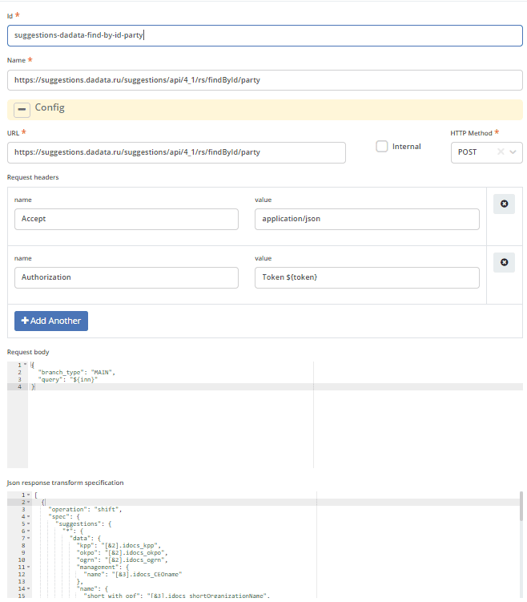
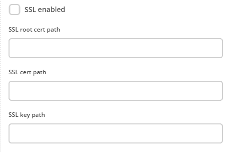
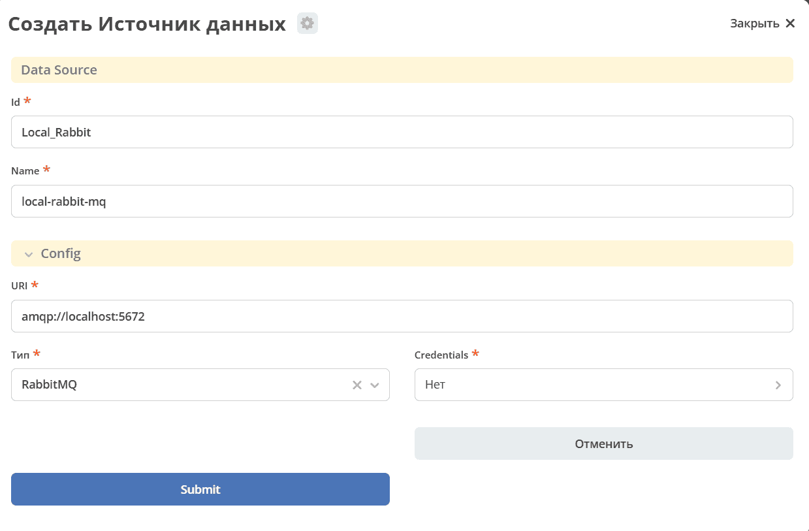

.. _data_sources:

Источники данных
=================

.. contents::
   :depth: 3

REST Data Source
-----------------

Источник данных, который работает через REST запросы

.. list-table::
   :widths: 20 40
   :header-rows: 1
   :class: tight-table

   * - Поле
     - Описание
   * - **Id**
     - Идентификатор источника
   * - **Name**
     - Произвольное имя
   * - **URL**
     - Адрес, по которому будут отправляться запросы. Есть поддержка переменных запроса в фигурных скобках - *{key}*
   * - **Internal**
     - Поле сохранено в конфигурации, но текущая реализация REST Data Source его не использует. Маршрутизация через Eureka и автоматический перенос заголовков и cookie входящего запроса не выполняются.
   * - **HTTP Method**
     - HTTP-метод запроса: POST, GET, PUT и т. д. По умолчанию используется GET.
   * - **Request headers**
     - Заголовки запроса. Есть поддержка переменных запроса в фигурных скобках - *${key}*
   * - **Request body**
     - Тело запроса. Есть поддержка переменных запроса в фигурных скобках - *${key}*
   * - **Json response transform specification**
     - Спецификация, которая описывает преобразование ответа. Формат спецификации - `Jolt <https://jolt-demo.appspot.com/>`_

.. note::

   В Java API настройки метода, заголовков, тела и преобразования ответа применяются при вызове ``getForObject``. Отдельный метод ``getForEntity`` выполняет GET-запрос без применения этих настроек.

DB Data Source
-----------------

Источник данных из базы данных.

SSL/TLS при запросах к БД через ECOS db-data-source
~~~~~~~~~~~~~~~~~~~~~~~~~~~~~~~~~~~~~~~~~~~~~~~~~~~~~~

Общая информация по настройке
^^^^^^^^^^^^^^^^^^^^^^^^^^^^^^

Параметры подключения задаются в конфигурации на форме **DataSource**.

Источник можно использовать для подключения внешней БД в **recsrc**: конфигурация recsrc ссылается на него через ``dataSourceRef``. SSL/TLS настраивается у самого источника данных.

На основе конфигурации создаётся JDBC DataSource с пулом соединений. Для PostgreSQL используется ``PGXADataSource`` в обёртке ``BasicManagedDataSource``, для остальных типов БД — ``HikariDataSource``. Максимальное число соединений в обоих случаях — 30.

SSL-параметры передаются JDBC-драйверу для настройки шифрования соединения с БД. PostgreSQL использует собственный протокол с TLS.

Поля конфигурации:

.. list-table::
   :widths: 30 70
   :header-rows: 1
   :class: tight-table

   * - Поле
     - Описание
   * - ``url``
     - Адрес подключения. Если строка не начинается с ``jdbc``, фабрика добавляет JDBC-префикс выбранного типа БД.
   * - ``type``
     - Тип БД; для PostgreSQL — ``POSTGRESQL``.
   * - ``credentials``
     - Ссылка на credentials с именем пользователя и паролем.
   * - ``schema``
     - Схема БД.
   * - ``table``
     - Таблица БД.
   * - ``sslEnabled``
     - При значении ``true`` фабрика задаёт SSL-свойства драйвера.
   * - ``sslRootCertPath``
     - Путь к корневому сертификату для проверки сертификата сервера.
   * - ``sslCertPath``
     - Путь к сертификату клиента. Передаётся драйверу только при заполненном ``sslKeyPath``.
   * - ``sslKeyPath``
     - Путь к закрытому ключу клиента. При включённом SSL заполнение этого поля выбирает режим ``verify-full``.
   * - ``sslVerifyHostname``
     - Значение ``false`` отключает проверку имени сервера, в том числе в режиме ``verify-full``. При остальных значениях фабрика не переопределяет стандартную проверку имени драйвером.

Файлы сертификатов и ключа должны быть доступны процессу микросервиса integrations. Пути разрешаются через ``ExtFilesService``; отсутствие файла вызывает ошибку при создании источника. Наличие серверных сертификатов только в контейнере БД не обеспечивает доступ к клиентским файлам из integrations.

Для PostgreSQL ключ с окончанием ``.key`` обрабатывается через ``DbPostgresSSLFactory``, в которой предусмотрено чтение PEM-ключей PKCS#1 и PKCS#8.

Выбор SSL-режима фабрикой и его смысл для PostgreSQL:

.. list-table::
   :widths: 20 40 40
   :header-rows: 1
   :class: tight-table

   * - Режим
     - Условие выбора
     - Описание
   * - SSL-свойства не задаются
     - ``sslEnabled`` не равен ``true``.
     - Фабрика не устанавливает явный ``sslmode=disable``. Использование TLS зависит от JDBC URL и поведения драйвера; выключенный флаг не гарантирует незашифрованное соединение.
   * - **require**
     - ``sslEnabled=true``, ``sslRootCertPath`` и ``sslKeyPath`` не заполнены.
     - Соединение шифруется, сертификат сервера не проверяется.
   * - **verify-ca**
     - ``sslEnabled=true``, ``sslRootCertPath`` заполнен, ``sslKeyPath`` не заполнен. ``sslCertPath`` для выбора режима не требуется.
     - Соединение шифруется, проверяется цепочка сертификата сервера до доверенного центра сертификации. Имя сервера не проверяется.
   * - **verify-full**
     - ``sslEnabled=true``, ``sslKeyPath`` заполнен. Выбирается независимо от заполнения ``sslRootCertPath``.
     - Соединение шифруется, проверяются цепочка сертификата и соответствие имени сервера сертификату. Проверка имени отключается при ``sslVerifyHostname=false``.

Условия в таблице описывают выбор режима в коде. Для успешного подключения должны быть доступны необходимые сертификаты и ключи, а настройки клиента и сервера должны быть согласованы. ``sslCertPath`` сам по себе не меняет режим и без ``sslKeyPath`` не передаётся драйверу.

Проверка сертификата клиента на стороне PostgreSQL настраивается отдельно: требуются доверенные CA на сервере и соответствующие правила аутентификации. Выбор клиентского режима ``verify-full`` сам по себе не включает обязательную аутентификацию клиента по сертификату.

Подробнее о параметрах JDBC-драйвера: `Using SSL <https://jdbc.postgresql.org/documentation/ssl/>`_ и `Initializing the Driver <https://jdbc.postgresql.org/documentation/use/>`_. Настройки сервера: `Secure TCP/IP Connections with SSL <https://www.postgresql.org/docs/current/ssl-tcp.html>`_.

.. important::

   Проверяйте подключение и проверку сертификатов на целевом окружении. Поведение SSL-параметров для других типов БД зависит от используемого JDBC-драйвера; описание режимов выше относится к PostgreSQL.

Запуск PostgreSQL с TLS в Docker
^^^^^^^^^^^^^^^^^^^^^^^^^^^^^^^^^^^^^^^^^^^^^^^^^^^^

В Unix-системах закрытый ключ сервера ``server.key`` должен иметь права ``0600`` и быть доступен пользователю PostgreSQL. Допускается вариант с владельцем root и правами ``0640``, если серверный процесс имеет доступ к файлу через группу.

Ниже приведён один из вариантов подготовки файлов для Linux-контейнера при работе с Docker на Windows: сертификаты копируются в образ, а права ключа задаются при сборке.

.. note::

   Это исторический пример с образом ``postgres:10.4-alpine``. Версию PostgreSQL для рабочего окружения необходимо выбирать и проверять отдельно. Пример включает серверный TLS, но не настраивает обязательную проверку сертификатов клиентов.

.. dropdown:: Как собрать и запустить контейнер с сертификатами
   :color: secondary

   1. Сгенерируйте ключи и сертификаты. Для проверки имени сервера сертификат должен соответствовать имени, указанному в адресе подключения. Приведённые команды не задают SAN явно; параметры сертификата необходимо подготовить для своего окружения.

   .. code-block:: bash

       openssl genrsa -out root.key 2048
       openssl req -x509 -new -key root.key -days 10000 -out root.crt
       openssl genrsa -out server.key 2048
       openssl req -new -key server.key -out server.csr
       openssl x509 -req -in server.csr -CA root.crt -CAkey root.key -CAcreateserial -out server.crt -days 5000

   2. Добавьте в директорию с сертификатами файл ``Dockerfile``:

   .. code-block:: dockerfile

       FROM postgres:10.4-alpine

       COPY root.crt /var/lib/postgresql/root.crt
       COPY server.crt /var/lib/postgresql/server.crt
       COPY server.key /var/lib/postgresql/server.key

       # update the privileges on the .key, no need to touch the .crt
       RUN chmod 600 /var/lib/postgresql/server.key
       RUN chown postgres:postgres /var/lib/postgresql/server.key

   3. Соберите и запустите контейнер:

   .. code-block:: bash

       docker build -t mypg:01 .

       docker run -e "POSTGRES_USER=test_user" -e "POSTGRES_PASSWORD=test_password" -p 5430:5432 -d --name postgres mypg:01 -c ssl=on -c ssl_cert_file=/var/lib/postgresql/server.crt -c ssl_key_file=/var/lib/postgresql/server.key

Проверка соединения
^^^^^^^^^^^^^^^^^^^^

Проверить клиентов и признак использования шифрования с их стороны можно с помощью SQL скрипта:

.. code-block:: sql

    SELECT *
    FROM pg_stat_ssl
    JOIN pg_stat_activity
        ON pg_stat_ssl.pid = pg_stat_activity.pid;

Запрос показывает состояние соединений и использование шифрования. Он не подтверждает корректность проверки доверия к сертификату или имени сервера. Копирование ``root.crt`` в контейнер без настройки ``ssl_ca_file`` и правил аутентификации также не включает обязательную проверку сертификатов клиентов.

[Deprecated] MQ Data Source
-------------------------------

.. note::

    Для интеграции с MQ лучше использовать :ref:`Camel DSL<rabbitmq_camel>`

Источник данных для подключения к очереди сообщений

.. list-table::
   :widths: 20 40
   :header-rows: 1
   :class: tight-table

   * - Поле
     - Описание
   * - **Id**
     - Идентификатор источника данных
   * - **Name**
     - Произвольное имя источника данных
   * - **URI**
     - Строка для подключения к очереди
   * - **Type**
     - Тип очереди
   * - **Credentials**
     - Ссылка на credentials где указаны login/pass для подключения к очереди

