.. _ext_portal:

Внешний портал
===============

.. note::

       Доступно только в enterprise версии.

.. contents::
   :depth: 2

**Внешний портал** — механизм двусторонней синхронизации данных между двумя независимыми инстансами Citeck. Используется в сценариях, когда внешним пользователям (клиентам, заказчикам) предоставляется отдельный :ref:`портал технической поддержки <portal_sd>`, изолированный от основного стенда SD.

На внешнем портале пользователи могут:

* создавать заявки;
* отслеживать их статус;
* просматривать историю, комментарии и вложения;
* общаться со специалистами поддержки через комментарии и обмениваться файлами.

Синхронизация ведётся через **RabbitMQ**: заявки, комментарии и вложения, созданные на одном стенде, автоматически передаются на другой. Направление передачи и состав синхронизируемых типов и атрибутов задаются в конфигурации внешнего портала.

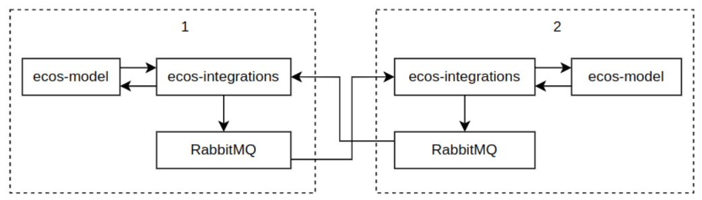

Пример настройки в **values.yaml** для стенда. Структуру параметров TLS и имена секретов необходимо согласовать с используемой версией Helm-чарта:

.. code-block:: yaml

    # Настройка tls для rabbitmq
    RabbitmqApp:
      tls:
        enabled: true # для примера используется TLS-порт 5671 и секрет ecos-tls-secret

    # Пример параметров TLS чарта RabbitMQ
    tls:
      enabled: false
      trustedCa:
        secretName: ecos-tls-secret
        keyName: trusted-ca
      keySecret:
        secretName: ecos-tls-secret
        keyName: rabbitmq-app-tls
      port: 5671
      verifyPeer: verify_peer
      failIfNoPeerCert: true

Пример подключения внешнего портала к RabbitMQ основного стенда:

.. code-block:: yaml

    EcosIntegrationsApp:
      cloudConfig:
        ecos:
          webapp:
            dataSources:
              sd-main-instance-rmq: #это id датасорса. На него ссылается ext-portal конфиг внутри системы
                name: Основной инстанс SD # это имя видно на форме ext-portal конфига
                type: rabbitmq
                host: host
                port: 5671 # важно - для tls.enabled true/false разные порты
                username: "******"
                password: "******"
                tls:
                  enabled: true # в идеале подключаться к внешнему RMQ через tls, но не обязательно
                  clientKey: application
                  trustedCerts: citeck-test-ca # замените на идентификатор CA вашего окружения
                  verifyHostname: false

На основном стенде аналогично настройте подключение к RabbitMQ внешнего портала с идентификатором ``sd-ext-instance-rmq`` и адресом его брокера. В примерах ниже ``main-rabbitmq`` обозначает подключение к локальному RabbitMQ каждого стенда; проверьте наличие этого подключения в окружении.

``dataSource`` — идентификатор подключения из ``ecos.webapp.dataSources``, а ``queue`` — имя очереди в выбранном брокере. Это разные параметры:

.. list-table:: Подключения и очереди для двух направлений
   :widths: 20 20 30 30
   :header-rows: 1
   :class: tight-table

   * - Стенд
     - Направление
     - dataSource
     - queue
   * - Основной
     - Экспорт
     - main-rabbitmq
     - export-from-main-sd-portal
   * - Основной
     - Импорт
     - sd-ext-instance-rmq
     - export-from-external-sd-portal
   * - Внешний
     - Экспорт
     - main-rabbitmq
     - export-from-external-sd-portal
   * - Внешний
     - Импорт
     - sd-main-instance-rmq
     - export-from-main-sd-portal

Настройки доступны в журнале **«Внешние порталы» (Рабочее пространство "Раздел администратора" — Интеграция)**.

Журнал доступен по адресу: ``https://portal_host/v2/journals?journalId=ext-portals&viewMode=table&ws=admin$workspace``

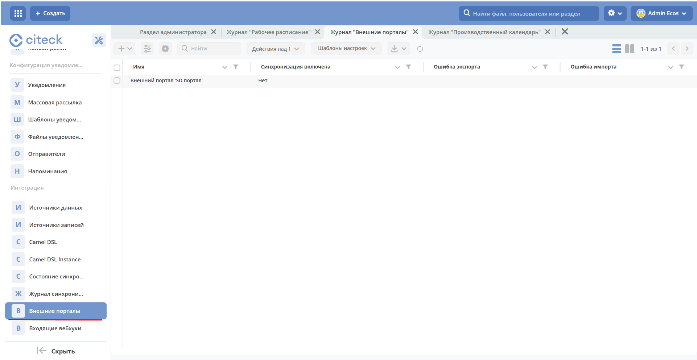

Форма настройки
----------------

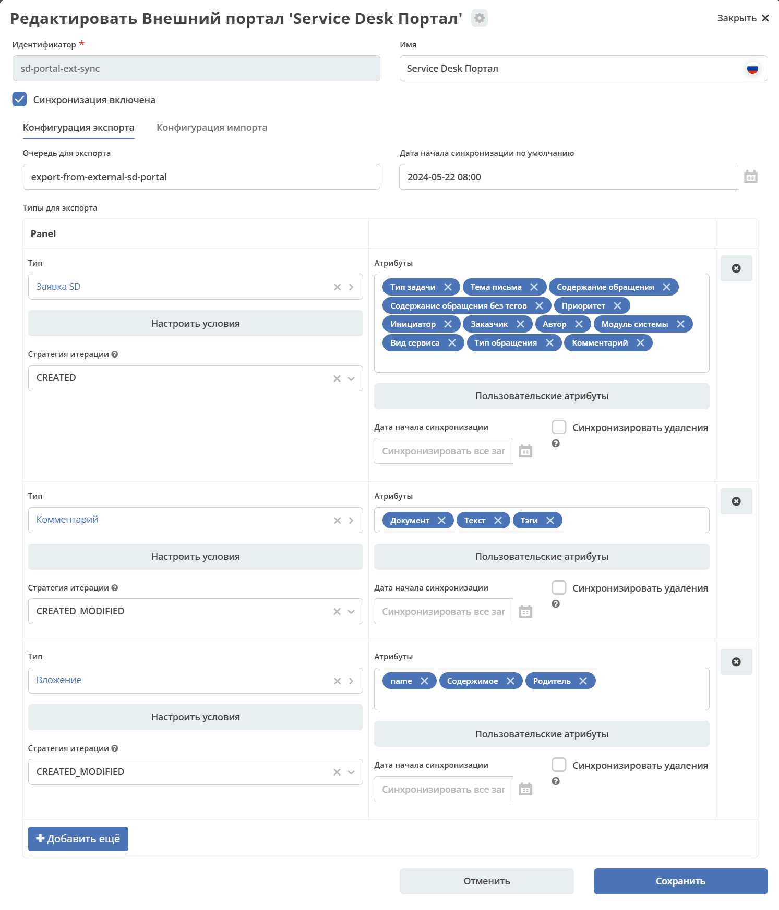

* **Идентификатор**, **Имя** как у любого артефакта
* **Конфигурация экспорта**, **Конфигурации импорта** подробно см. ниже
* **«Синхронизация включена»** (``syncEnabled``) — включает импорт и экспорт. По умолчанию новая конфигурация выключена.

После настройки подключений, очередей и типов на обеих сторонах включите синхронизацию в UI. При повторном развёртывании существующего артефакта текущее значение ``syncEnabled`` сохраняется: изменение флага только в YAML не переключает уже существующую синхронизацию.

Конфигурация импорта
---------------------

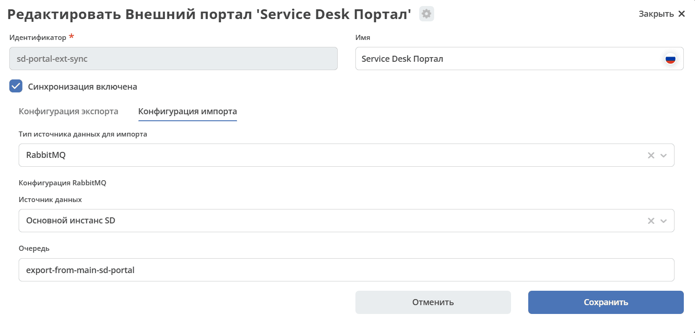

.. list-table::
   :widths: 20 40
   :header-rows: 1
   :class: tight-table

   * - Поле
     - Описание
   * - **Тип источника данных для импорта**
     - На данный момент доступен только **RabbitMQ**.
   * - **Источник данных**
     - Подключение к RabbitMQ, из которого импортируются данные. UI получает доступные источники типа rabbitmq из ``integrations/ecos-data-sources``. Сами подключения настраиваются в конфигурации окружения.
   * - **Очередь**
     - Из какой очереди выбранного источника импортировать.

Сокращённый пример конфигурации основного стенда для типа заявки SD. Полный поставляемый профиль ``sd-portal-main-sync`` также экспортирует заказчиков, комментарии и вложения:

.. code-block:: yaml

    ---
    id: sd-portal-main-sync
    syncEnabled: false
    name:
      ru: SD портал
      en: SD portal
    exportConfig:
      endpoint:
        type: rabbitmq
        config:
          queue: export-from-main-sd-portal
          dataSource: main-rabbitmq
      typesToSync:
        - typeRef: emodel/type@sd-request-type
          initDate: null
          syncDeletions: false
          queryPredicate: '{}'
          filterPredicate: '{}'
          attributesToSync:
            - _status
            - _docNum
            - initiator
            - client
            - author
            - letterTopic
            - letterContent
          iterationStrategy: CREATED_MODIFIED
    importConfig:
      endpoint:
        type: rabbitmq
        config:
          queue: export-from-external-sd-portal
          dataSource: sd-ext-instance-rmq

Конфигурация экспорта
---------------------

.. image:: _static/external_portal/04.png
    :width: 700
    :align: center

.. list-table::
   :widths: 20 40
   :header-rows: 1
   :class: tight-table

   * - Поле
     - Описание
   * - **Очередь для экспорта**
     - Очередь в RabbitMQ текущего стенда. В UI-форме выбор подключения для экспорта не предлагается; в YAML подключение задаётся через exportConfig.endpoint.config.dataSource.
   * - **Дата начала синхронизации по умолчанию**
     - Заявки и комментарии, которые были созданы до указанной даты, не будут обрабатываться.

Сокращённый пример конфигурации внешнего стенда. Типы и поля должны соответствовать установленному портальному приложению:

.. code-block:: yaml

    id: sd-portal-ext-sync
    syncEnabled: false
    exportConfig:
      endpoint:
        type: rabbitmq
        config:
          queue: export-from-external-sd-portal
          dataSource: main-rabbitmq
      typesToSync:
        - typeRef: emodel/type@sd-request-type
          initDate: null
          syncDeletions: false
          queryPredicate: |-
            {
            "t": "empty",
            "a": "ext-portal-sync:importSyncId"
            }
          filterPredicate: '{}'
          attributesToSync:
            - author
            - initiator
            - client
            - letterTopic
            - letterContent
    importConfig:
      endpoint:
        type: rabbitmq
        config:
          queue: export-from-main-sd-portal
          dataSource: sd-main-instance-rmq

Типы и атрибуты для экспорта
~~~~~~~~~~~~~~~~~~~~~~~~~~~~~~

Выбираем **типы данных**, выбираем **атрибуты** выбранного типа, которые необходимо синхронизировать:

Если список ``attributesToSync`` пуст, экспортируются атрибуты модели типа. Системные атрибуты идентификатора, типа и аудита добавляются отдельно. Для ограничения состава выгрузки задайте список явно.

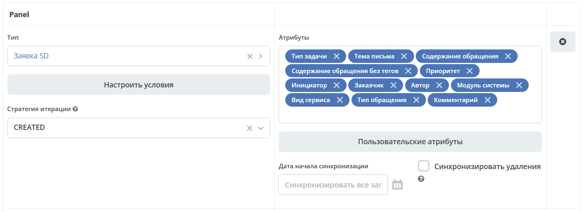

Настроить условия
~~~~~~~~~~~~~~~~~~

После выбора типа можно настроить условия: 

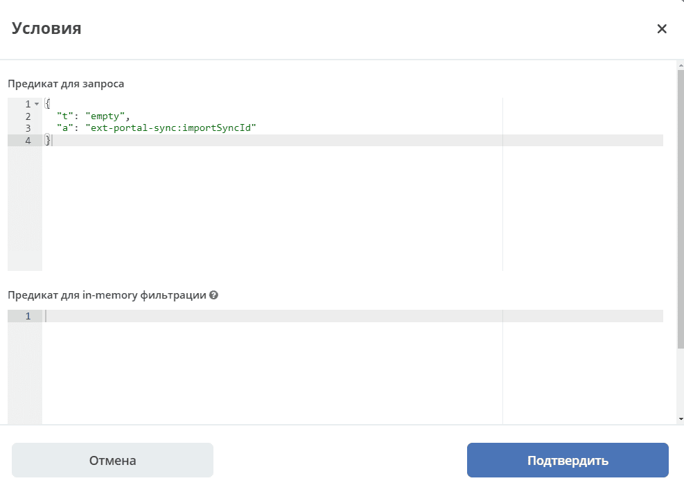

2 поля для условий:

.. list-table::
   :widths: 20 40
   :header-rows: 1
   :class: tight-table

   * - Поле
     - Описание
   * - **Предикат для запроса**
     - Условие отбора, передаваемое источнику данных вместе с выбранным типом. Дата начала и стратегия итерации задаются отдельно в настройках синхронизации.
   * - **Предикат для in-memory фильтрации**
     - Проверяется после выгрузки в ecos-integrations. То есть мы сначала сформировали запрос, отправили его, получили 100 записей, например, и каждую запись мы проверяем по этому дополнительному предикату.

Предикат для in-memory фильтрации позволяет фильтровать данные на основании любых атрибутов. Этот метод фильтрации обладает максимальной гибкостью, однако по возможности рекомендуется использовать предикат для запроса, чтобы сократить время обработки.

В запросе очень многие вещи проверить нельзя. Например, обратиться к атрибуту parent’a, сложный вложенный атрибут. Некоторые источники данных не умеют нормально преобразовывать предикаты в join.

В то же время предикат для in-memory фильтрации позволяет делать условия на любые атрибуты, в том числе и на очень вложенные.

Пример предиката для in-memory фильтрации:

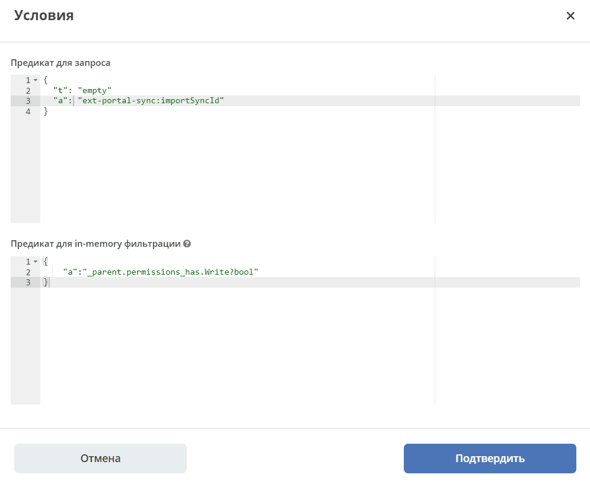

То есть перед тем, как отправить поисковый запрос со списком атрибутов для загрузки из предиката для in-memory фильтрации вытягиваются все атрибуты, которые необходимы для проверки условий. Соответственно, их дополнительно настраивать не нужно.

В  предикате для **in-memory фильтрации** указываем необходимый атрибут и в момент отправки запроса он будет также вытянут, а потом проверен.

Перечисляем **атрибуты** из модели, которые дальше обрабатываются в зависимости от их типа.

Атрибуты **простые** (текст, число, булево) загружаются из целевого источника данных, который определяется по типу, и отправляются в RabbitMQ.

Для более сложных, например, ассоциаций:

* Если **Target-ассоциация**, так выгружается ссылка;
* Если **Child-ассоциация**, то работает дополнительная логика, которая позволяет вытягивать все атрибуты, которые заданы у типа дочерней сущности, попадают в выгрузку, и сами сущности дочерние так же попадают в выгрузку. Если мы в списке атрибутов это укажем.

Как альтернативный вариант можно не указывать атрибуты с дочерними сущностями, а отдельный строкой **в типах для экспорта** показать, что необходимо выгрузить сущности и выгрузить их parent.
Так, например, сделано для **вложения**.

То есть вложение крепятся по docs:document (дочерняя ассоциация) и выгружаются как отдельный тип.

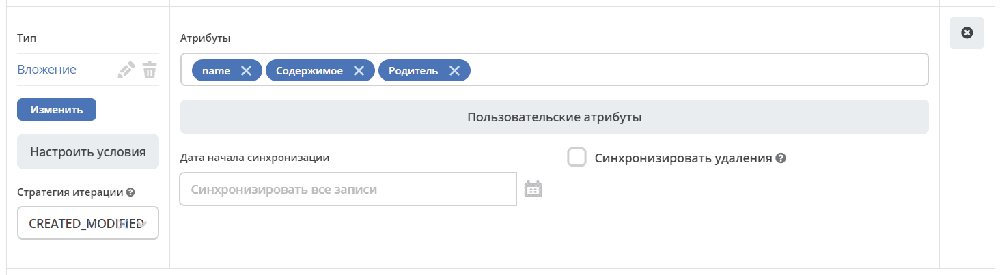

Пользовательские атрибуты
~~~~~~~~~~~~~~~~~~~~~~~~~~

Возможность настроить что-то сложное.

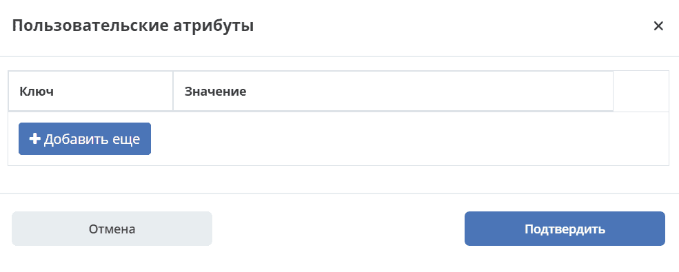

* **Ключ** - под каким алиасом результат будет загружен в RabbitMQ и, соответственно, на другой стенд.
* **Значение** – то, что нужно загрузить.

Для частных случаев. Дополнительная логика не используется, всё, что написано загружается и отправляется.

Дата начала синхронизации
~~~~~~~~~~~~~~~~~~~~~~~~~~

**Дата начала синхронизации** – настройка аналогична Дата начала синхронизации по умолчанию для конкретного типа. 

Если не указана, то используется **Дата начала синхронизации по умолчанию**.

Если обе даты не указаны, начальной датой служит ``1970-01-01T00:00:00Z``. При этом продолжают действовать предикаты и остальные фильтры экспорта.

Синхронизировать удаления
~~~~~~~~~~~~~~~~~~~~~~~~~~

Флаг ``syncDeletions`` включает передачу удалений для выбранного типа. По умолчанию он выключен. Событие удаления проходит настроенные предикаты и in-memory-фильтр.

На принимающей стороне удаляются только записи, у которых ``ext-portal-sync:importSyncId`` совпадает с идентификатором текущей принимающей синхронизации. Удаление произвольной записи другого происхождения не выполняется.

Стратегия итерации
~~~~~~~~~~~~~~~~~~~~

Стратегия итерации записей определяет последовательность обработки записей.

.. list-table::
   :widths: 20 40
   :header-rows: 1
   :class: tight-table

   * - Стратегия
     - Описание
   * - **CREATED**
     - Записи обрабатываются только по дате создания. Изменённые записи после первоначальной синхронизации не обрабатываются повторно.
   * - **CREATED_MODIFIED**
     - Записи обрабатываются по дате создания и по дате изменения с учётом условий отбора. При обходе по обеим датам одна запись может быть обработана повторно. Используется по умолчанию.
   * - **MODIFIED**
     - Записи обрабатываются только по дате изменения. Все записи обрабатываются, но порядок создания не учитывается.

Комментарии. Особенности настройки
~~~~~~~~~~~~~~~~~~~~~~~~~~~~~~~~~~~~~~~~

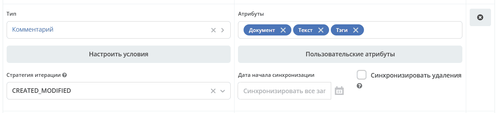

Комментарии выгружаются с условием, что **importSyncId** отсутствует:

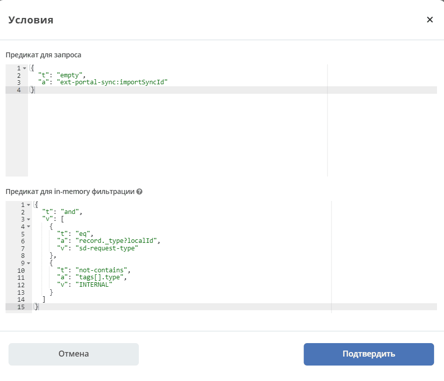

**importSyncId** (``ext-portal-sync:importSyncId``) заполняется при импорте идентификатором синхронизации **принимающего** портала. Для приведённой пары конфигураций на внешнем стенде это ``sd-portal-ext-sync``, на основном — ``sd-portal-main-sync``.

Такое условие гарантирует, что в выгрузку с текущего стенда на внешний портал попадут только те комментарии, которые были созданы именно здесь и не импортированы извне. И на другом портале то же самое условие, которое гарантирует, что комментарии один и тот же не будет синхронизироваться до бесконечности.

Настроен **предикат для in-memory фильтрации**. Проверяются тип записи (sd-request-type), к которой комментарий добавлен:

.. code-block:: json

    {
      "t": "eq",
      "a": "record._type?localId", 
      "v": "sd-request-type"
    }

и проверяется, что тэг комментария не внутренний: 

.. code-block:: json

    {
      "t": "not-contains",
      "a": "tags[].type",
      "v": "INTERNAL"
    }

то есть внутренний комментарий не выгружается.

Стратегия **CREATED_MODIFIED**: при создании комментарий будет прокинут на внешний сервер, и если будет отредактирован, то так же. 

Вложения. Особенности настройки
~~~~~~~~~~~~~~~~~~~~~~~~~~~~~~~~

Для атрибута Содержимое особая логика.

Содержимое в исходном поисковом запросе не запрашивается, чтобы не было out of memory ошибок в ecos-model.
Потом данные фильтруются следующими запросами:

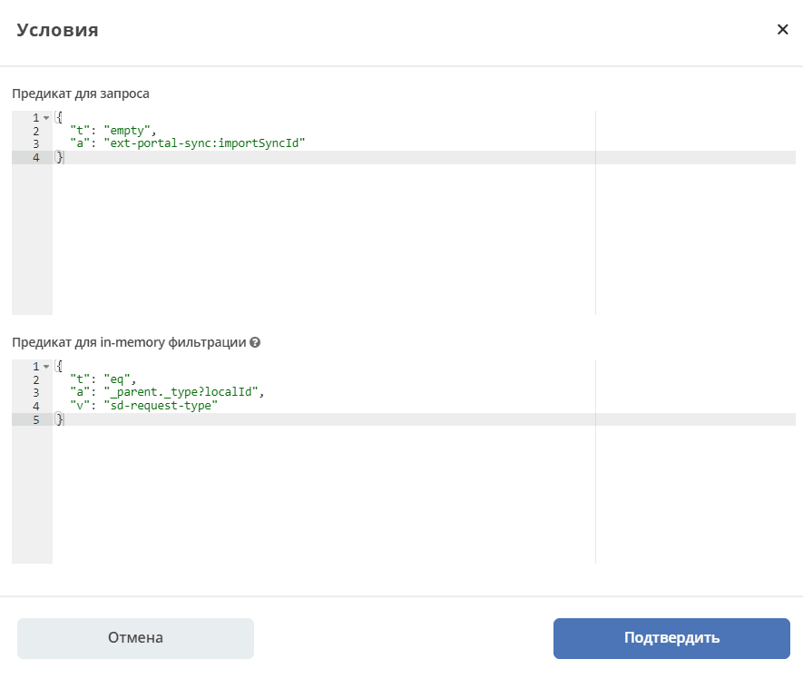

Сначала первым фильтром в поиске, потом вторым фильтром после загрузки.
Когда все фильтры пройдены, содержимое загружается и передаётся в RabbitMQ как base64 data URL вместе с MIME-типом и исходным именем файла.

Размер контента ограничен свойством ``ecos-integrations.ext-portal.export.contentSizeLimitMb``. В поставляемой конфигурации значение равно 14 (14 × 1024 × 1024 байт). Проверяется суммарный размер content-атрибутов одной записи. Дополнительно длина каждого base64 data URL ограничена 20 000 000 символов.

При превышении любого из лимитов вместо контента экспортируется запись ``emodel/web-url`` со ссылкой на исходную запись. Для дочернего вложения ссылка прикрепляется к родителю через ``webLinks``. Для открытия ссылки пользователю необходим доступ к исходному стенду и записи.

Приложение sd-ext-portal-ecos-app
----------------------------------

Меню, формы и матрицы внешнего портала задаются его отдельным приложением. В показанном примере используется **sd-ext-portal-ecos-app**, доступное в журнале **«Приложения ECOS» (Рабочее пространство "Раздел администратора" — Управление системой)**. Состав артефактов зависит от установленной версии приложения:

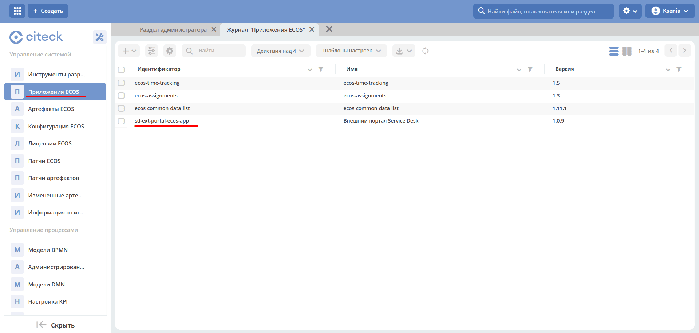

Матрицы прав
-------------

Ниже показан пример матриц прав внешнего портального приложения. Эти настройки следует отличать от матриц основного Service Desk:

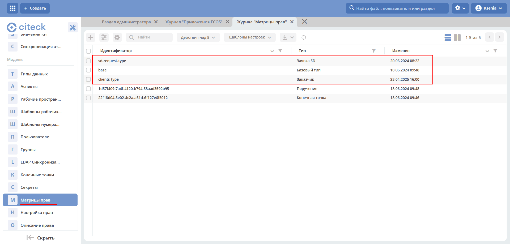

Настройка базового типа:

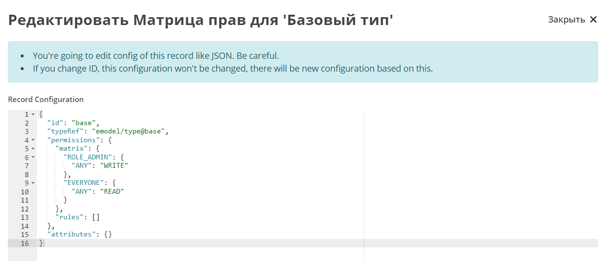

В показанном примере для базового типа администраторам разрешено редактирование, остальным — чтение. Это настройка приложения, а не универсальная матрица стандартной поставки ecos-model.

При настройке прав различайте **authorities** пользователя, **роли записи** и итоговые разрешения. Роли записи определяются моделью типа, а authorities включают полномочия пользователя, в том числе системные роли с префиксом **ROLE_**.

Наличие authority с префиксом **ROLE_** само по себе не означает, что она появится в справочнике выбора ролей. Проверяйте доступные роли и настройки матрицы в используемой версии приложения.

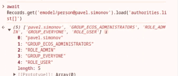

Матрицы привязаны к типам и рабочим пространствам. При переносе настроек проверьте, что матрица относится к нужному типу в нужном рабочем пространстве.

Итоговые права могут также учитывать пользовательские разрешения записи и наследование от родителя. Для проверки конкретной записи и пользователя администратор может использовать Records DAO ``emodel/permissions-diagnostic``: в запросе указываются ``recordRef`` и, при необходимости, ``user``. Отчёт содержит роли типа, роли пользователя и итоговые права чтения и записи.

В показанном внешнем приложении выделены три роли:

* Инициатор;
* Support организации;
* Технолог.

Это не полный перечень ролей основного SD. В текущей модели основного Service Desk определены восемь ролей: Инициатор, Support организации, исполнители трёх линий ТП, Руководитель ТП, Дополнительный участник и Технолог ТП.

В основном SD роль **Support организации** вычисляется из обеих ассоциаций карточки заказчика: ``client.users`` и ``client.authGroups``. Роль **Технолог ТП** определяется атрибутом заявки ``technologist``. На группу ``GROUP_support-lead`` напрямую назначена роль **Руководитель ТП**. Назначения ролей внешнего приложения проверяйте отдельно.

Видимость и возможность изменения заказчика зависят от матриц на соответствующем стенде. Доступ к рабочему пространству и права на карточку заказчика — отдельные настройки.

Заказчики
---------
 
Карточка заказчика содержит множественные ассоциации **Пользователи** (``users``) и **Группы** (``authGroups``).

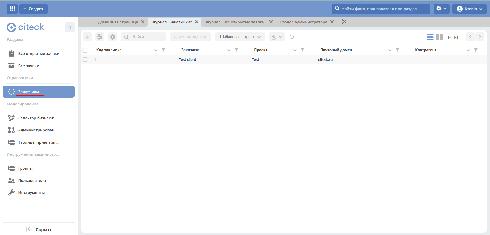
 
.. note::

    Справочник заказчиков ведётся на основном стенде в журнале ``https://host/v2/journals?journalId=sd-clients-journal&viewMode=table&ws=service-desk-workspace``. Штатная конфигурация синхронизации передаёт заказчиков на внешний портал; права на просмотр и изменение импортированных карточек задаются внешним приложением.

Для управления доступом можно использовать группы вместо перечисления отдельных пользователей. В основном SD роль **Support организации** учитывает оба способа назначения. Изменения ``users`` и ``authGroups`` также обновляют членство соответствующих пользователей и групп в ``service-desk-workspace`` с ролью USER; это не заменяет настройку прав на записи.

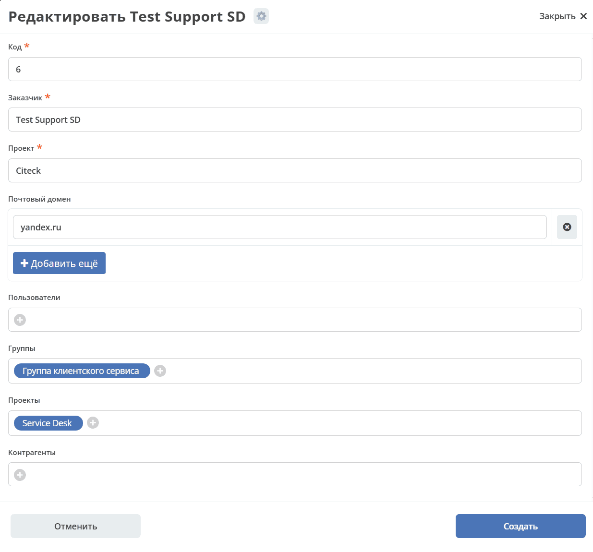

Логирование
-------------

Ошибки импорта, экспорта доступны в логах микросервиса интеграции, в журналах **Состояние синхронизации**, **Журнал синхронизации** **(Рабочее пространство "Раздел администратора" - Интеграция)**.

Состояние синхронизации
~~~~~~~~~~~~~~~~~~~~~~~~~

**Состояния синхронизации** определяют то, в каком сейчас состоянии находится синхронизация.

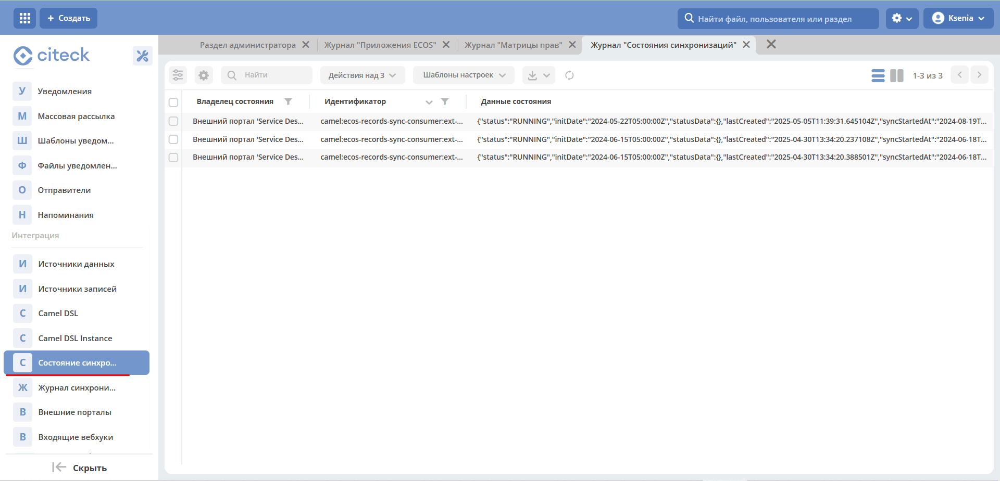

Состояния создаются для настроенных типов экспорта. Например:

.. list-table::
   :widths: 20 40
   :header-rows: 1
   :class: tight-table

   * - Тип
     - Описание
   * - **sd-request-type**
     - Заявка
   * - **ecos-comment**
     - Комментарий
   * - **attachment**
     - Вложение
   * - **clients-type**
     - Заказчик

Работает через ECOS Camel, такой же функционал как для миграции данных.

* **Владелец состояния** - настройка Service desk portal
* **Идентификатор** содержит в себе префикс Camel. Например:

*camel:ecos-records-sync-consumer:ext-portal-sd-portal-ext-sync-attachment*, где

.. list-table::
   :widths: 20 40
   :header-rows: 1
   :class: tight-table

   * - Часть идентификатора
     - Описание
   * - **ecos-records-sync-consumer**
     - Consumer синхронизации
   * - **ext-portal-sd-portal-ext-sync**
     - Id синхронизации
   * - **attachment**
     - Идентификатор типа

Если настроек для типа несколько, то добавляется индекс. 

В таком случае важен порядок в массиве **typesToSync**:

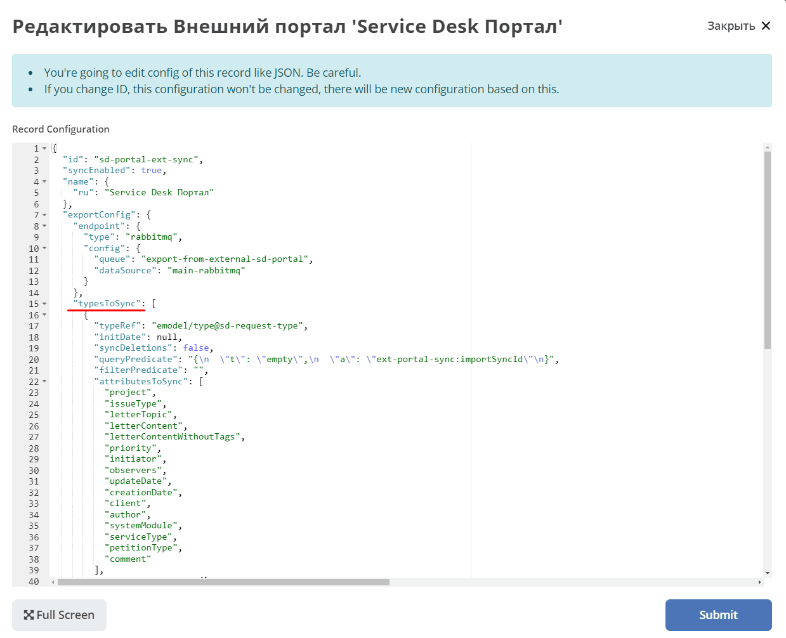

Конфигурация:

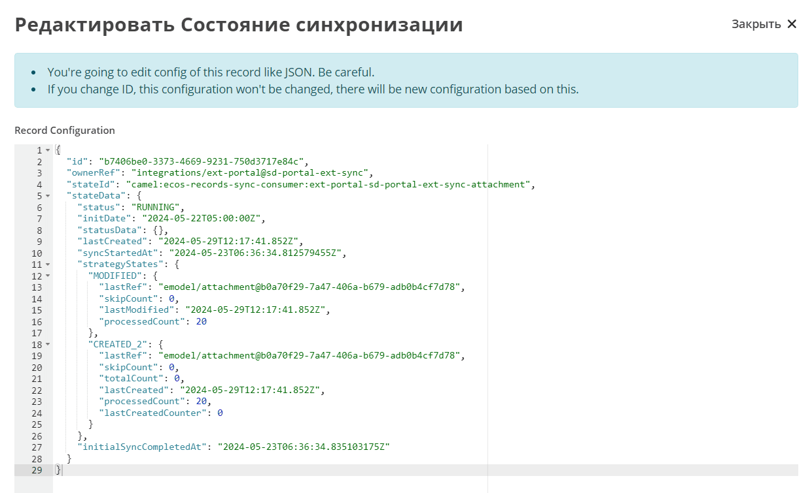

.. list-table::
   :widths: 20 40
   :header-rows: 1
   :class: tight-table

   * - Поле
     - Описание
   * - **Status**
     - Статусы синхронизации. RUNNING, если ERROR то выдается текст ошибки.
   * - **initDate**
     - Дата начала синхронизации. Заносится в state и остается константой до тех пор, пока state не убьется или дата не будет изменена вручную. Изменение даты синхронизации в настройках портала не меняет initDate.
   * - **lastCreated**
     - Дата последней созданной записи.
   * - **syncStartedAt**
     - Когда запустилась синхронизация.
   * - **strategyStates**
     - Состояния по стратегии (CREATED, MODIFIED, CREATED_MODIFIED). Если CREATED_MODIFIED, то 2. Если CREATED, MODIFIED, то 1.
   * - **processedCount**
     - Сколько записей обработано.
   * - **initialSyncCompletedAt**
     - Дата синхронизации всех записей и ожидания новых. Если не задан, то синхронизация не закончилась.

Журнал синхронизации
~~~~~~~~~~~~~~~~~~~~~

В журнале хранится информация о получаемых данных.

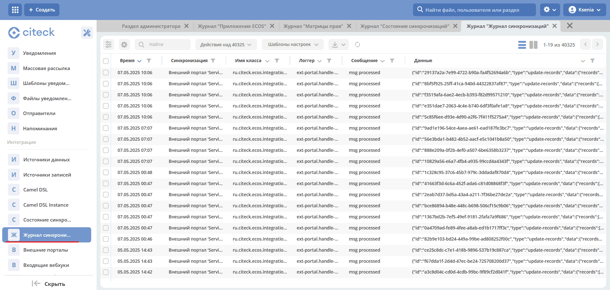

В случае ошибки содержит подробную информация о ней.

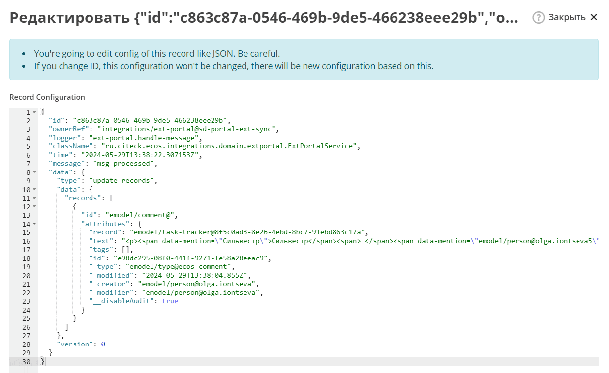

Создание заявки
----------------

Способ создания заявки зависит от установленного приложения и настроенных интеграций:

* на внешнем портале;
* через почту — при настроенном входящем почтовом маршруте заявка создаётся на основном стенде и затем экспортируется на внешний портал;
* на основном портале, потом экспортируются на внешний портал.

В основном SD для заявки задан шаблон нумерации ``sd-reg-number-template`` и формат идентификатора ``SD-{{_docNum}}``. Штатная конфигурация основного портала экспортирует номер ``_docNum`` и статус ``_status`` на внешний портал. Первоначальное создание заявки и назначение номера на внешней стороне зависят от конфигурации её приложения.

См. пользовательское описание :ref:`портала технической поддержки<portal_sd>`
