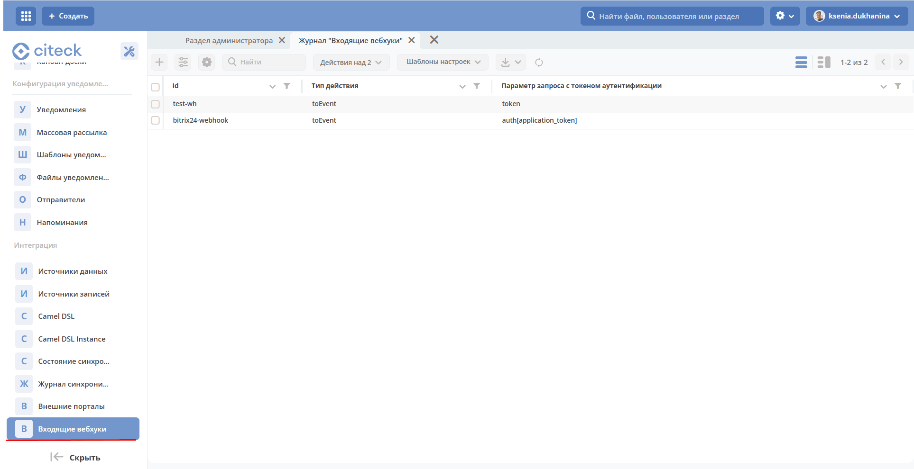
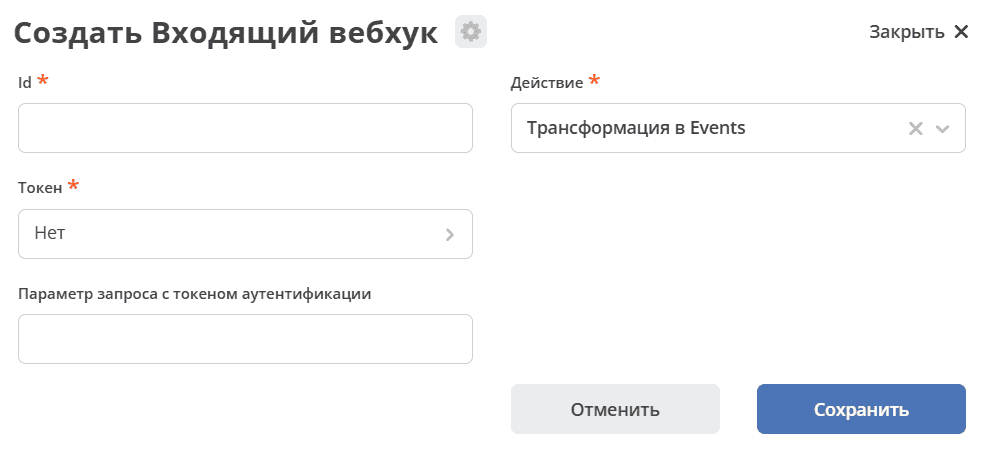

.. _webhooks:

Вебхуки
========

.. contents::
   :depth: 3

**Вебхук (webhook)** — механизм интеграции, при котором внешняя система отправляет HTTP-запрос в Citeck при наступлении определённого события. В отличие от опроса (polling), вебхук работает по принципу «push»: данные поступают сразу в момент события, без необходимости периодически запрашивать их.

Citeck поддерживает **входящие вебхуки**: внешняя система отправляет POST-запрос на специальный endpoint, Citeck проверяет токен или подпись запроса и публикует событие во внутреннюю шину. Далее событие может быть обработано любым подписчиком — BPMN-процессом, интеграционным маршрутом Camel DSL и т.д.

Типичный сценарий использования:

- внешняя CRM (например, Bitrix24) уведомляет Citeck о создании новой сделки;
- мессенджер или CI/CD-система отправляет событие по завершении задачи;
- любая сторонняя система инициирует запуск бизнес-процесса в Citeck.

Настройки доступны в журнале **«Входящие вебхуки»** (Рабочее пространство «Раздел администратора» — Интеграция).

Журнал доступен по адресу: ``v2/journals?journalId=in-webhook-journal&viewMode=table&ws=admin$workspace``

Расположение артефактов с данным типом: **integration/in-webhook**

Форма создания
---------------

Атрибуты (in-webhook):

.. list-table::
   :widths: 5 5 10
   :align: center
   :header-rows: 1
   :class: tight-table

   * - Атрибут
     - Тип
     - Описание
   * - id
     - Текст
     - Идентификатор, используется для формирования endpoint вебхука
   * - token
     - ASSOC (secret)
     - | :ref:`Секрет <ECOS_secrets>` для проверки запроса.
       | При authType=token используется секрет типа «Токен» (TOKEN).
       | При authType=signature тип секрета зависит от полей, указанных в signatureConfig: BASIC для username/password, TOKEN для token.
   * - actionType
     - Текст
     - Тип действия при обработке запроса. Поддерживается toEvent — трансформация в Events
   * - authType
     - Текст
     - Тип аутентификации: token или signature. Если не задан или пуст, используется token. Неизвестное непустое значение вызывает ошибку конфигурации
   * - authParameter
     - Текст
     - | Параметр запроса, в котором передаётся токен при authType=token.
       | Если не задан или пуст, используется значение по умолчанию: **token**. При authType=signature не используется
   * - signatureConfig
     - JSON
     - Конфигурация проверки подписи. Необходима при authType=signature

Пример конфигурации с проверкой токена:

.. code-block:: yaml

    ---
    id: bitrix24-webhook
    token: emodel/secret@bitrix24-webhook-token
    actionType: toEvent
    authType: token
    authParameter: auth[application_token]

Проверка подписи
~~~~~~~~~~~~~~~~

При ``authType: signature`` подпись передаётся в параметре запроса и проверяется по ``signatureConfig``. Параметры можно передавать в query string или в форме ``application/x-www-form-urlencoded``. Поля JSON-тела сами по себе не становятся параметрами запроса.

.. list-table:: Поля signatureConfig
   :widths: 5 5 10
   :header-rows: 1
   :class: tight-table

   * - Поле
     - По умолчанию
     - Описание
   * - algorithm
     - sha256
     - Алгоритм: sha256 или hmac-sha256
   * - payloadParam
     - json
     - Имя параметра с полезной нагрузкой, которая передаётся в body события
   * - signatureParam
     - sign
     - Имя параметра с hex-подписью запроса
   * - components
     - []
     - Непустой упорядоченный список ссылок на значения для формирования подписываемого сообщения
   * - keyComponent
     - null
     - Ссылка на ключ для hmac-sha256

В ``components`` и ``keyComponent`` используются ссылки ``secret.username``, ``secret.password``, ``secret.token`` или ``param.<имя>``. Поля ``secret.*`` берутся из секрета, указанного в атрибуте ``token`` вебхука, а ``param.*`` — из параметров запроса. Тип секрета должен соответствовать используемым полям.

- ``sha256``: значения всех ``components`` соединяются в указанном порядке без разделителей, переводятся в UTF-8 и хешируются SHA-256. Список должен содержать хотя бы одну ссылку на ``secret.password`` или ``secret.token``.
- ``hmac-sha256``: сообщение формируется из всех ``components`` тем же способом, ключ берётся отдельно из ``keyComponent``. Ключ должен ссылаться на ``secret.password`` или ``secret.token``.

В обоих случаях результат вычисления представлен в hex; регистр символов hex при сравнении не учитывается. Пустой список компонентов, неизвестный алгоритм или несовместимый тип секрета вызывают ошибку конфигурации.

Пример конфигурации Mango:

.. code-block:: yaml

    id: mango-webhook
    token: emodel/secret@mango-api
    actionType: toEvent
    authType: signature
    authParameter: ""
    signatureConfig:
      algorithm: sha256
      payloadParam: json
      signatureParam: sign
      components:
        - secret.username
        - param.json
        - secret.password

В этом примере используется BASIC-секрет: ``username`` содержит ключ API, ``password`` — salt. Подпись вычисляется как SHA-256 от конкатенации ключа API, значения параметра ``json`` и salt.

Отправка запроса
~~~~~~~~~~~~~~~~~

После создания входящего вебхука становится доступна отправка POST-запросов по адресу:

.. code-block:: text

    http://host/gateway/integrations/pub/webhook/${id}

где **id** — идентификатор, указанный при создании вебхука.

Поддерживаются и дополнительные сегменты пути, например ``/pub/webhook/mango-webhook/events/summary``. Для выбора вебхука используется только ``mango-webhook``; остаток пути не передаётся отдельным полем события.

HTTP-тело запроса необязательно. При проверке подписи запрос должен содержать параметры, необходимые для её вычисления.

В режиме ``token`` токен передаётся в параметре, указанном в ``authParameter``. Для конфигурации Bitrix24 выше URL с токеном выглядит так:

.. code-block:: text

    http://host/gateway/integrations/pub/webhook/bitrix24-webhook?auth%5Bapplication_token%5D=testAuthToken

Пример POST-запроса с параметрами формы (замените host и демонстрационный токен своими значениями):

.. code-block:: bash

    curl --request POST 'http://host/gateway/integrations/pub/webhook/bitrix24-webhook' --data-urlencode 'auth[application_token]=testAuthToken' --data-urlencode 'event=ONCRMDEALADD' --data-urlencode 'data[FIELDS][ID]=9'

Обработка запроса
~~~~~~~~~~~~~~~~~~

На данный момент доступен один тип действия — «Трансформация в Events» (``actionType: toEvent``). Перед выполнением действия проверяется токен или подпись в зависимости от ``authType``.

Если проверка прошла успешно, создаётся :ref:`ECOS Event <ecos_events>` в стандартную очередь **ecos-events** с типом **in-webhook-request**. Event содержит данные запроса:

.. list-table::
   :widths: 5 5
   :align: center
   :header-rows: 1
   :class: tight-table

   * - Поле
     - Тип
   * - webhookId
     - String
   * - params
     - Map<String, String>
   * - body
     - String

Например:

.. code-block:: json

    {
      "params": {"event":"ONCRMDEALADD","auth[application_token]":"123","data[FIELDS][ID]":"9"},
      "body":"event=ONCRMDEALADD&auth%5Bapplication_token%5D=123&data%5BFIELDS%5D%5BID%5D=9",
      "webhookId":"bitrix24-webhook"
    }

Значение ``body`` выбирается следующим образом:

1. В режиме ``signature`` берётся значение параметра, заданного в ``signatureConfig.payloadParam``, если этот параметр присутствует.
2. Иначе используется исходное HTTP-тело запроса.
3. Если HTTP-тела тоже нет, передаётся пустая строка.

Например, для Mango при ``payloadParam: json`` в ``body`` события передаётся JSON-строка из параметра ``json``, а не вся строка формы с подписью. Поля ``webhookId`` и ``params`` сохраняют тот же формат.

.. note::

   Доступ на чтение и редактирование вебхуков есть только у Администратора и Системы.

Ошибки
-------

При отправке запроса на вебхук возможны следующие ошибки:

.. list-table::
   :widths: 5 10 10
   :align: center
   :header-rows: 1
   :class: tight-table

   * - Код
     - Детали
     - Комментарий
   * - 500
     - Invalid webhook id={wh_id}
     - Вебхук с указанным id не найден
   * - 500
     - Secret ${webhook.token} not found
     - Секрет, заданный в вебхуке, не найден
   * - 500
     - Authentication token is not valid
     - Параметр с токеном отсутствует в запросе или токен неверный
   * - 500
     - Not found action type ${webhook.actionType}
     - Указан несуществующий тип действия
   * - 401
     - Webhook signature is not valid
     - При authType=signature подпись отсутствует или не совпадает с вычисленной
   * - 401
     - Request parameter '<name>' referenced by component '<component>' is missing
     - Отсутствует параметр запроса, указанный в компонентах подписи

Ошибки конфигурации также возникают при неизвестном ``authType``, отсутствии ``signatureConfig`` для режима ``signature``, неизвестном алгоритме или компоненте подписи, отсутствии допустимого HMAC-ключа и несовместимом типе секрета. Формат HTTP-ответа для этих ошибок определяется обработчиком ошибок используемой поставки.

.. seealso::

   Вебхук используется, например, для :ref:`синхронизации с Bitrix24 <bitrix24_crm>`.
