.. _corp_portal:

Корпоративный портал
=====================

.. contents::
    :depth: 3

**Корпоративный портал** — встроенное рабочее пространство Citeck для сотрудников компании. Объединяет корпоративные сервисы, информационные материалы и инструменты совместной работы в едином интерфейсе — без необходимости переключаться между сторонними системами.

По умолчанию пространство публичное. Группа всех пользователей включена в него с ролью **Участник**, а группа **Администраторы ECOS** — с ролью **Менеджер**. Состав участников и роли можно изменить в :ref:`настройках рабочего пространства <new_workspace>`.

Портал охватывает ключевые задачи внутренней коммуникации и операционной деятельности компании:

- **Информирование** — новости компании, анонсы мероприятий, дни рождения коллег.
- **Хранение знаний** — документы, регламенты, корпоративные ценности и структурированная база знаний.
- **HR-сервисы** — автоматизация кадровых и административных процессов: заявления на отпуск, заявки на пропуск и др.
- **Оргструктура** — визуализация иерархии компании с контактными данными сотрудников.

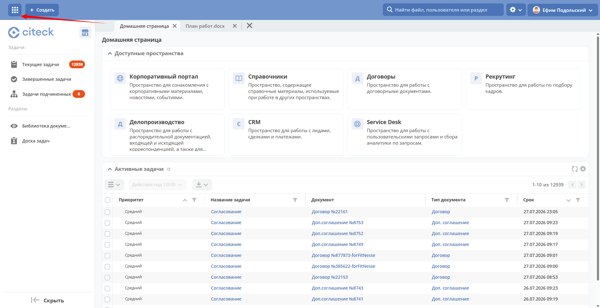

|

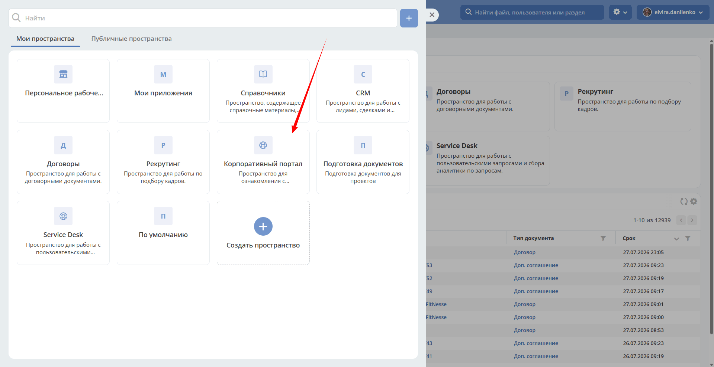

В настольном представлении главная страница содержит дашборд с приветственной информацией **(1)**, :ref:`новостями<widget_news>` **(2)**, :ref:`днями рождения<widget_birthdays>` сотрудников **(3)**. Также предусмотрена область для виджета :ref:`«Активности»<widget_activities>`; его отображение зависит от подключения соответствующего плагина и поставки Citeck.

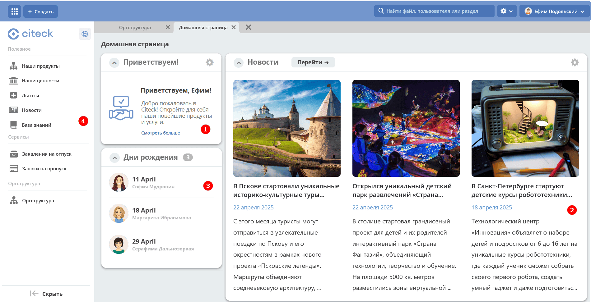

В мобильном представлении поставляемого готового пространства в одной колонке последовательно размещены приветственная информация, новости и дни рождения. Виджет «Активности» в эту раскладку не включён.

В меню **(4)** доступны основные разделы корпоративного портала: **Полезное**, **Сервисы** и **Оргструктура**. Менеджерам рабочего пространства также доступен раздел **Администрирование**.

В приветственном виджете по клику на **Смотреть больше** открывается :ref:`База знаний <wiki_corp>`.

Полезное
----------

Раздел содержит информационные материалы компании: документы, регламенты, корпоративные ценности, условия работы, а также ленту новостей и базу знаний.

В подразделах **Наши продукты**, **Наши ценности**, **Льготы** представлена информация в виде :ref:`библиотек документов<document_library>` — с файлами можно ознакомиться или скачать:

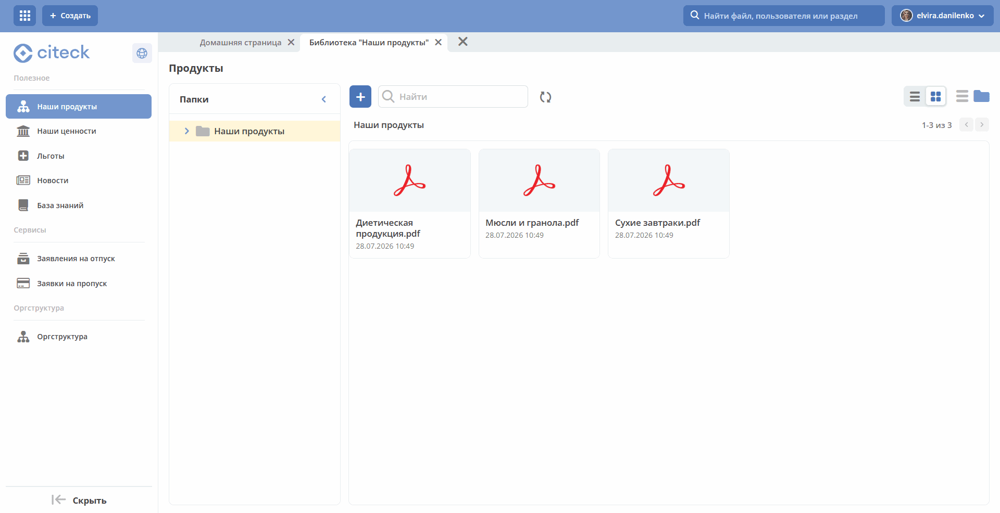

.. grid:: 2
   :gutter: 2

   .. grid-item::

      .. image:: _static/corp_portal/corp_01.png
         :width: 500
         :align: left

   .. grid-item::

      .. image:: _static/corp_portal/corp_02.png
         :width: 500
         :align: left

Новости
~~~~~~~~

В подразделе информация представлена в виде списка превью новостей:

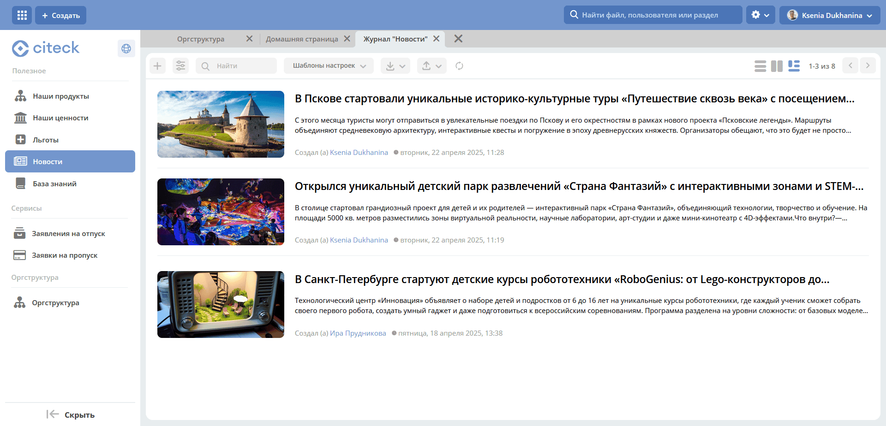

По клику на превью открывается карточка новости:

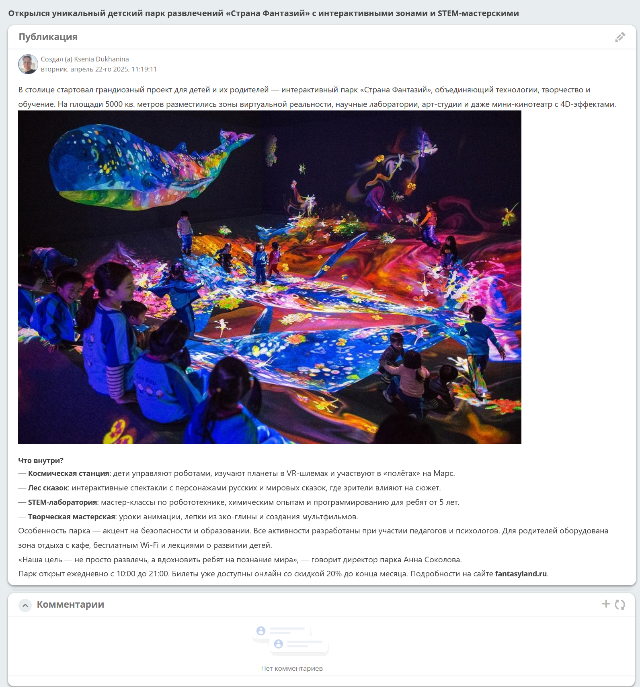

.. _wiki_corp:

База знаний
~~~~~~~~~~~~

В подразделе информация представлена в виде :ref:`иерархии<widget_knowledge_base>`. При выборе раздела справа открывается сама :ref:`публикация<widget_publication>`.

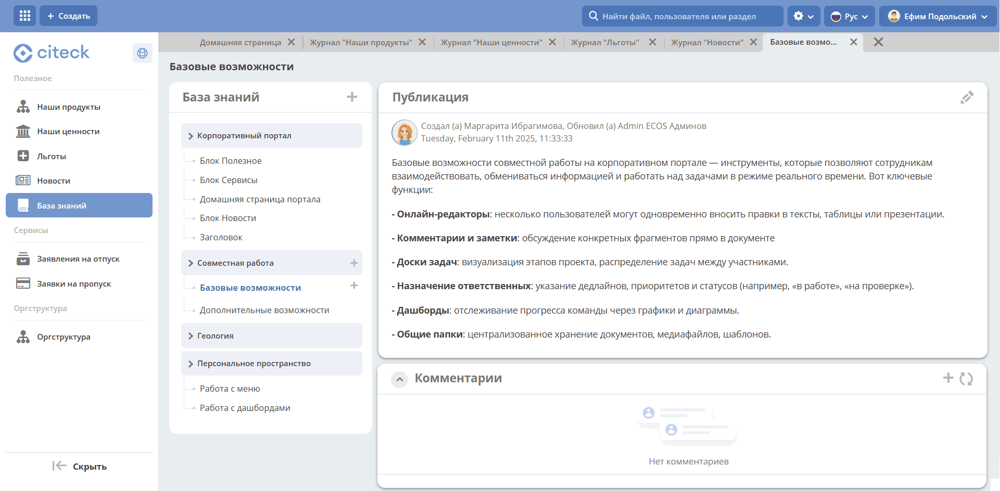

Сервисы
--------

Раздел предоставляет сотрудникам доступ к автоматизированным HR- и административным процессам без необходимости обращаться к другим разделам системы.

Для работы сервисов должны быть установлены соответствующие модули заявлений на отпуск и заявок на пропуск. Портал содержит ссылки на их журналы; доступ к записям и действиям определяется правами пользователя.

В меню раздела предусмотрены следующие сервисы. Подробности их работы приведены в профильных статьях:

.. grid:: 1
   :gutter: 2

   .. grid-item-card:: Заявления на отпуск
      :link: ecos-vacation
      :link-type: ref

      Создание и отслеживание заявлений на различные виды отпусков.

      .. image:: _static/corp_portal/corp_05.png
         :width: 700
         :align: center

   .. grid-item-card:: Заявки на пропуск
      :link: ecos-order-pass
      :link-type: ref

      Оформление и отслеживание заявок на пропуск.

      .. image:: _static/corp_portal/corp_06.png
         :width: 700
         :align: center

Оргструктура
--------------

Раздел отображает иерархию компании — подразделения, должности, сотрудников и их взаимосвязи. Удобен для поиска коллег, просмотра контактных данных и понимания структуры организации.

Форма оргструктуры разделена на две части и содержит:

- иерархическое дерево структуры с возможностью поиска;
- дашборд с информацией о выбранной части структуры (подразделении, должности или сотруднике).

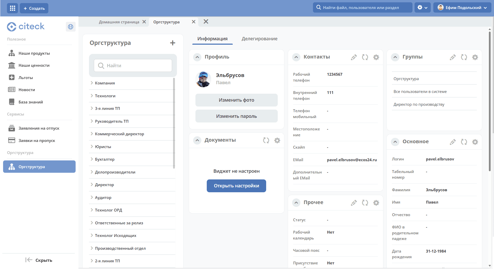

.. note::

   Для настройки и управления оргструктурой перейдите в раздел :ref:`Оргструктура<org_structure>`.

Добавление контента
---------------------

.. note::

   Добавление и редактирование контента определяется правами на соответствующие записи и типы контента. Участники и их роли задаются в :ref:`настройках рабочего пространства<new_workspace>`; роль в пространстве учитывается вместе с правилами доступа к конкретным данным.

Наполнение подразделов Наши продукты, Наши ценности, Льготы
~~~~~~~~~~~~~~~~~~~~~~~~~~~~~~~~~~~~~~~~~~~~~~~~~~~~~~~~~~~~

Выбранные папки, файлы перетащите в область загрузки:

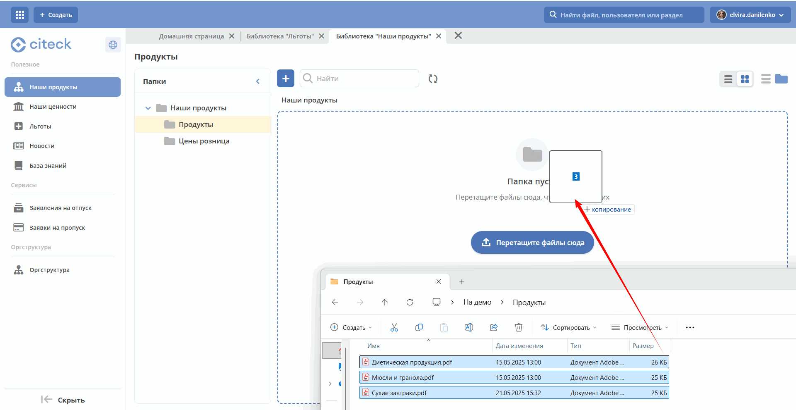

или воспользуйтесь кнопкой **+**:

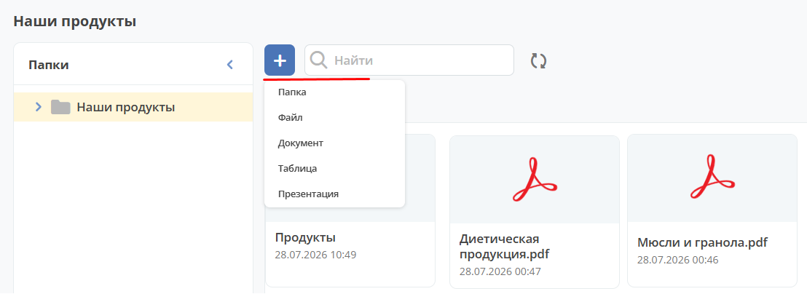

.. grid:: 2
   :gutter: 2

   .. grid-item::

      .. image:: _static/corp_portal/new_file_3.png
         :width: 500
         :align: left

   .. grid-item::

      .. image:: _static/corp_portal/new_file_4.png
         :width: 500
         :align: left

Подробно о :ref:`библиотеке документов<document_library>`.

Добавление новостей
~~~~~~~~~~~~~~~~~~~~~

Перейдите в журнал **«Новости»**:

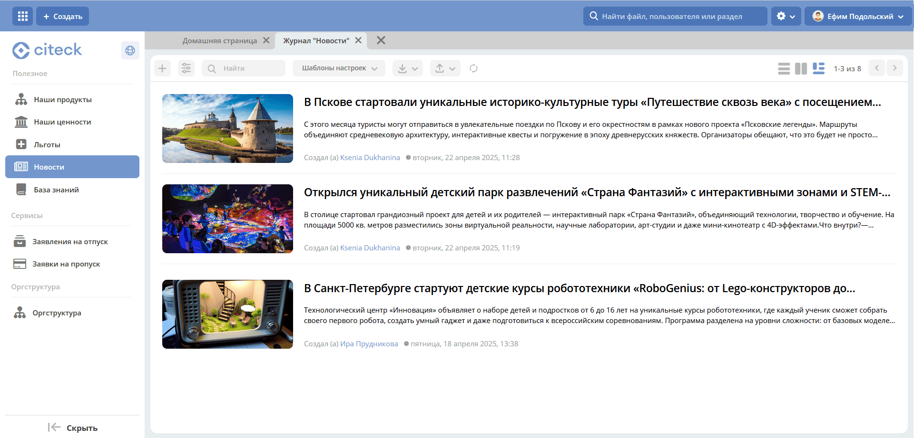

Нажмите **+** и с помощью :ref:`редактора<wysiwyg_editor>` оформите текст новости и сохраните:

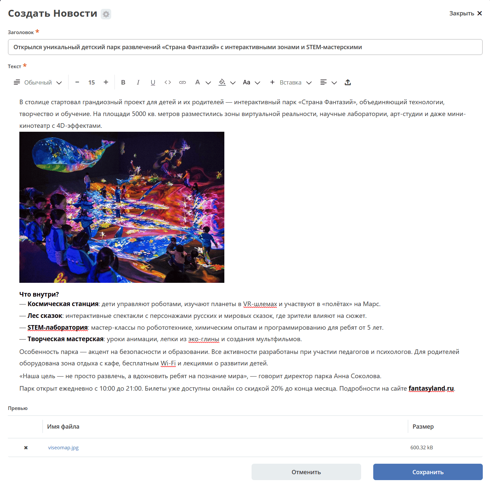

Добавление статей в базу знаний
~~~~~~~~~~~~~~~~~~~~~~~~~~~~~~~~~~~~

Перейдите в журнал **«База знаний»**:

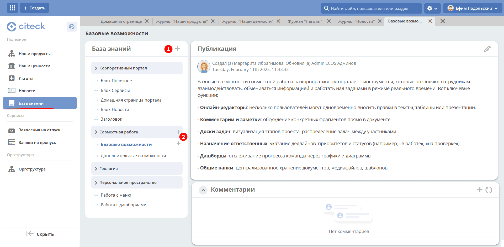

Для добавления публикации или раздела 1-го уровня нажмите большой **+** **(1)**, с использованием :ref:`редактора<wysiwyg_editor>` создайте контент, сохраните. Для добавления публикации или подраздела нажмите маленький **+** **(2)**. Количество создаваемых публикаций в каждом уровне не ограничено.

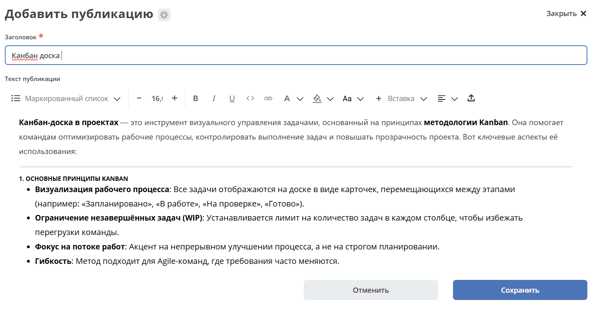

Добавленная публикация в структуре:

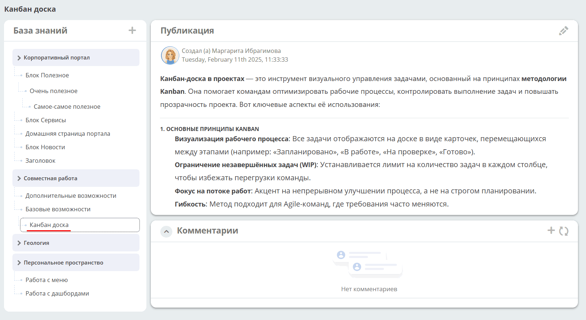

Первоначальное наполнение портала
----------------------------------

Модуль поставляет настроенное рабочее пространство «Корпоративный портал» и шаблон рабочего пространства с меню и дашбордом. Главная страница уже содержит приветственный блок. Корпоративные файлы, новости и статьи базы знаний добавляются при наполнении портала.

Пример портала без корпоративных материалов:

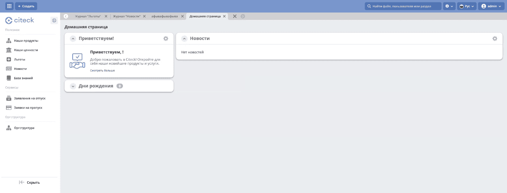

Содержимое разделов **Сервисы** и **Оргструктура** зависит от установленных модулей и уже имеющихся данных системы. Организационная структура, сотрудники и заявления могут быть созданы до настройки портала.

Рекомендуемый порядок первоначального наполнения:

1. Проверьте :ref:`организационную структуру<org_structure>` — при необходимости добавьте подразделения и сотрудников.
2. Наполните подразделы **Наши продукты**, **Наши ценности**, **Льготы** — загрузите файлы или создайте папки.
3. Добавьте первые новости в подраздел **Новости**.
4. Создайте статьи в **Базе знаний** для хранения корпоративных регламентов и инструкций.
