.. _corp_portal:

Корпоративный портал
=====================

.. contents::
    :depth: 3

**Корпоративный портал** — встроенное рабочее пространство Citeck для сотрудников компании. Объединяет корпоративные сервисы, информационные материалы и инструменты совместной работы в едином интерфейсе — без необходимости переключаться между сторонними системами.

Видимость пространства, состав участников и их роли определяются поставкой и настройками портала. Проверьте их в :ref:`настройках рабочего пространства <new_workspace>` перед началом работы.

Ниже описан типовой вариант портала. Названия и состав разделов, ссылки меню и раскладки дашбордов могут отличаться на конкретном стенде. Доступность виджетов новостей, публикаций, дерева базы знаний и активностей также зависит от подключённых плагинов.

Портал охватывает ключевые задачи внутренней коммуникации и операционной деятельности компании:

- **Информирование** — новости компании, анонсы мероприятий, дни рождения коллег.
- **Хранение знаний** — документы, регламенты, корпоративные ценности и структурированная база знаний.
- **HR-сервисы** — автоматизация кадровых и административных процессов: заявления на отпуск, заявки на пропуск и др.
- **Оргструктура** — визуализация иерархии компании с контактными данными сотрудников.

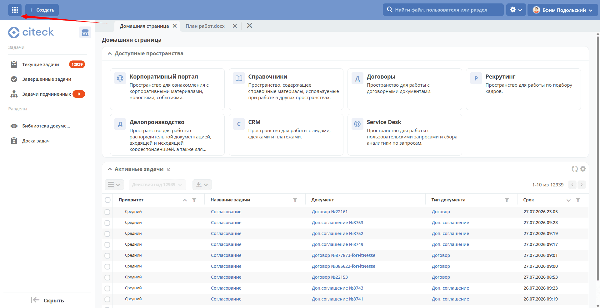

|

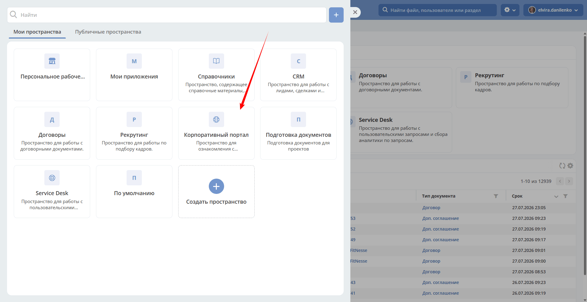

В показанном представлении главная страница содержит дашборд с приветственной информацией **(1)**, :ref:`новостями<widget_news>` **(2)**, :ref:`днями рождения<widget_birthdays>` сотрудников **(3)**. Также может быть добавлен виджет :ref:`«Активности»<widget_activities>`.

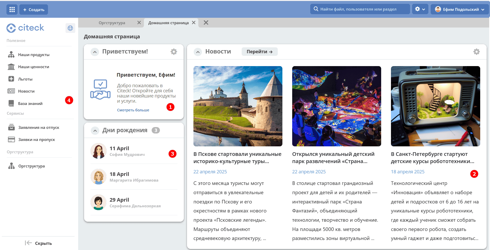

Для мобильного представления используется отдельная раскладка дашборда. Её состав и порядок виджетов определяются конфигурацией пространства и могут отличаться от настольного представления.

В показанном меню **(4)** доступны разделы **Полезное**, **Сервисы** и **Оргструктура**. Наличие раздела **Администрирование** и доступ к его пунктам зависят от конфигурации меню и прав пользователя.

В показанном варианте приветственного блока кнопка **Смотреть больше** ведёт в :ref:`Базу знаний <wiki_corp>`. Назначение ссылки задаётся при настройке портала.

Полезное
----------

Раздел содержит информационные материалы компании: документы, регламенты, корпоративные ценности, условия работы, а также ленту новостей и базу знаний.

В подразделах **Наши продукты**, **Наши ценности**, **Льготы** представлена информация в виде :ref:`библиотек документов<document_library>` — с файлами можно ознакомиться или скачать:

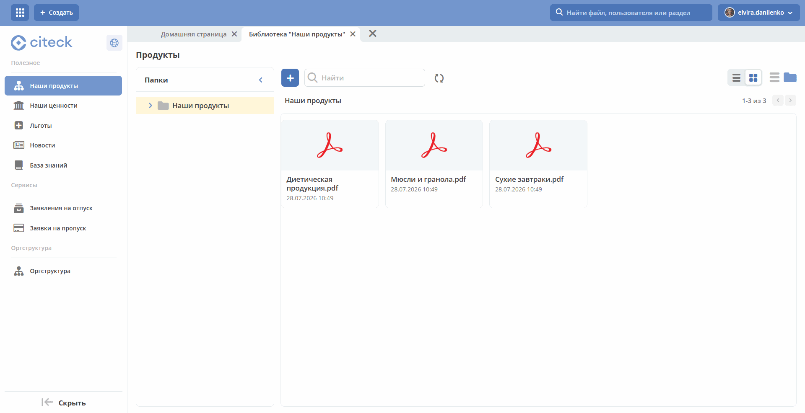

.. grid:: 2
   :gutter: 2

   .. grid-item::

      .. image:: _static/corp_portal/corp_01.png
         :width: 500
         :align: left

   .. grid-item::

      .. image:: _static/corp_portal/corp_02.png
         :width: 500
         :align: left

Новости
~~~~~~~~

В подразделе информация представлена в виде списка превью новостей:

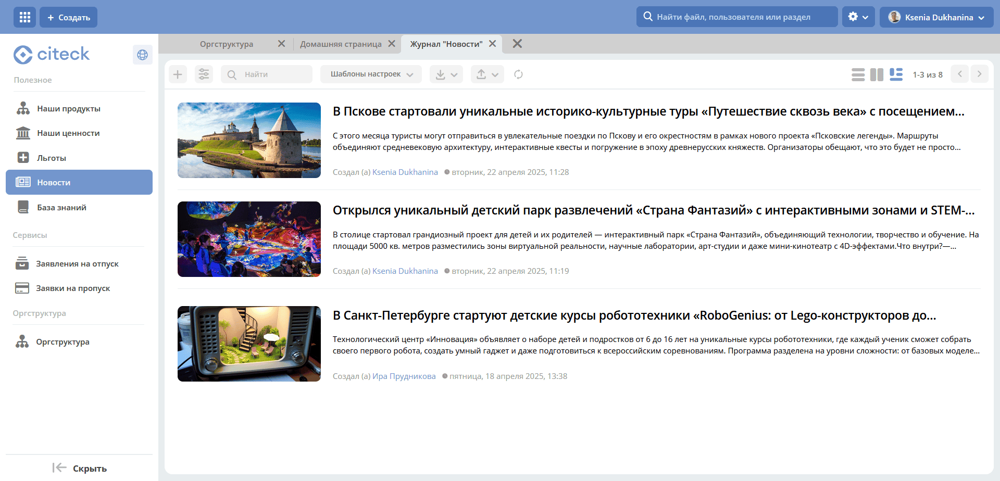

По клику на превью открывается карточка новости:

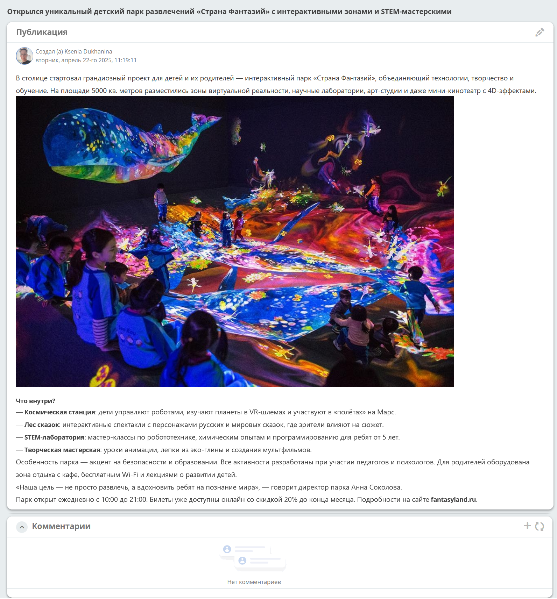

.. _wiki_corp:

База знаний
~~~~~~~~~~~~

В представлении информация показана в виде :ref:`иерархии<widget_knowledge_base>` слева. При выборе статьи справа открывается :ref:`публикация<widget_publication>`; ниже могут отображаться комментарии. Состав мобильного представления задаётся отдельно.

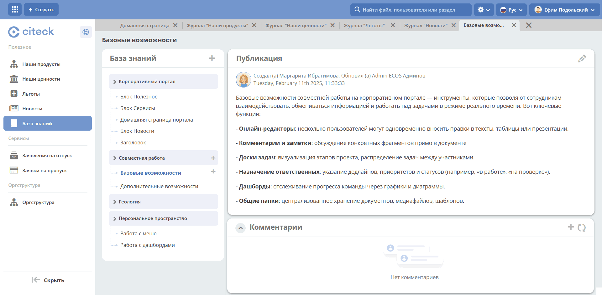

Сервисы
--------

Раздел предоставляет сотрудникам доступ к автоматизированным HR- и административным процессам без необходимости обращаться к другим разделам системы.

Для работы сервисов должны быть установлены соответствующие модули заявлений на отпуск и заявок на пропуск. Портал содержит ссылки на их журналы; доступ к записям и действиям определяется правами пользователя.

В меню раздела предусмотрены следующие сервисы. Подробности их работы приведены в профильных статьях:

.. grid:: 1
   :gutter: 2

   .. grid-item-card:: Заявления на отпуск
      :link: ecos-vacation
      :link-type: ref

      Создание и отслеживание заявлений на различные виды отпусков.

      .. image:: _static/corp_portal/corp_05.png
         :width: 700
         :align: center

   .. grid-item-card:: Заявки на пропуск
      :link: ecos-order-pass
      :link-type: ref

      Оформление и отслеживание заявок на пропуск.

      .. image:: _static/corp_portal/corp_06.png
         :width: 700
         :align: center

Оргструктура
--------------

Раздел отображает группы и сотрудников компании. Группы могут представлять подразделения, должности или роли. Раздел используется для поиска коллег, просмотра контактных данных и структуры организации.

Форма оргструктуры разделена на две части и содержит:

- иерархическое дерево структуры с возможностью поиска;
- дашборд с информацией о выбранной записи, например профилем сотрудника.

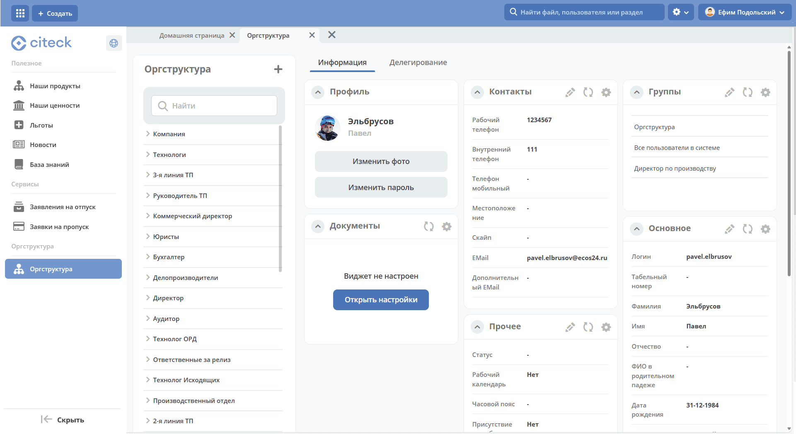

.. note::

   Для настройки и управления оргструктурой перейдите в раздел :ref:`Оргструктура<org_structure>`.

Добавление контента
---------------------

.. note::

   Добавление и редактирование контента определяется правами на соответствующие записи и типы контента. Участники и их роли задаются в :ref:`настройках рабочего пространства<new_workspace>`; роль в пространстве учитывается вместе с правилами доступа к конкретным данным.

Наполнение подразделов Наши продукты, Наши ценности, Льготы
~~~~~~~~~~~~~~~~~~~~~~~~~~~~~~~~~~~~~~~~~~~~~~~~~~~~~~~~~~~~

Выбранные папки, файлы перетащите в область загрузки:

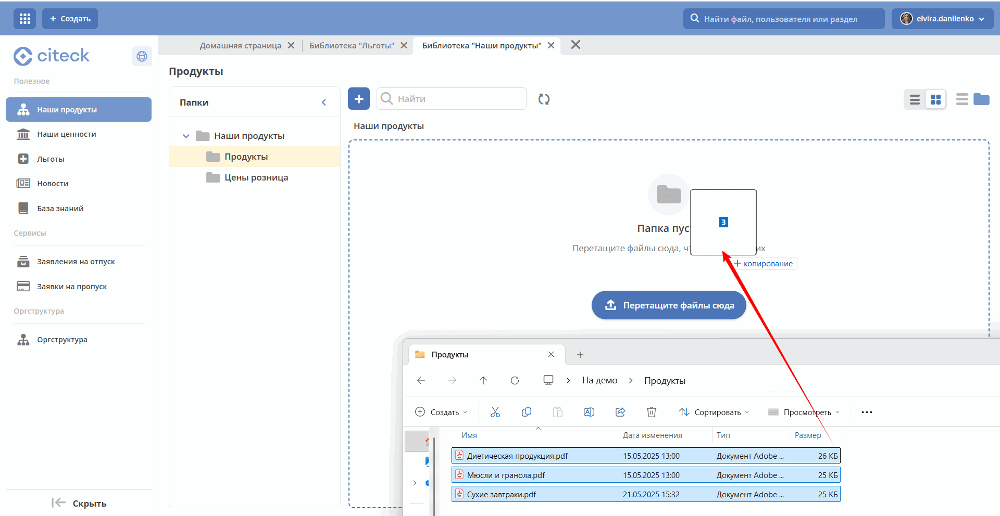

или воспользуйтесь кнопкой **+**:

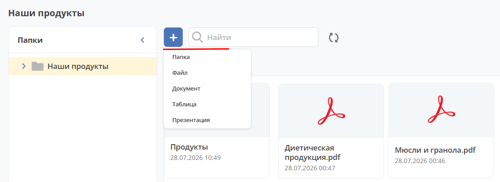

.. grid:: 2
   :gutter: 2

   .. grid-item::

      .. image:: _static/corp_portal/new_file_3.png
         :width: 500
         :align: left

   .. grid-item::

      .. image:: _static/corp_portal/new_file_4.png
         :width: 500
         :align: left

Подробно о :ref:`библиотеке документов<document_library>`.

Добавление новостей
~~~~~~~~~~~~~~~~~~~~~

Перейдите в журнал **«Новости»**:

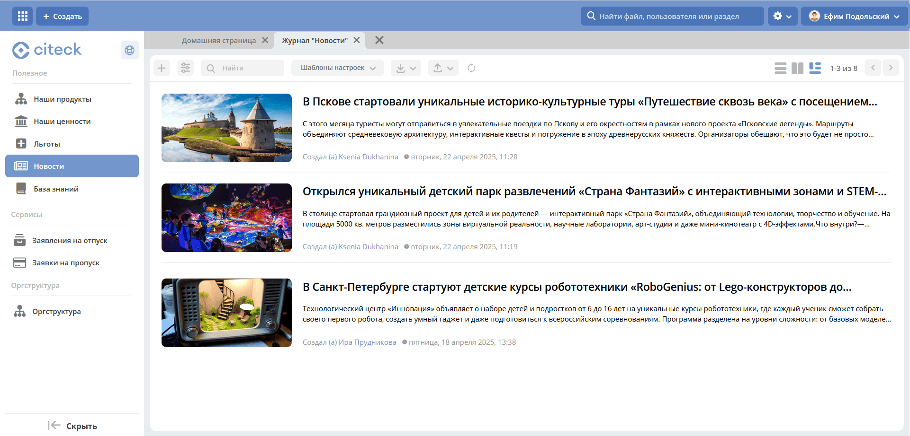

Нажмите **+**. В стандартной форме заполните обязательные поля **Заголовок** и **Текст**. Для текста используется визуальный :ref:`редактор Lexical<wysiwyg_editor>`. При необходимости добавьте изображение в поле **Превью**: стандартная форма принимает изображения размером до 10 МБ. Сохраните новость:

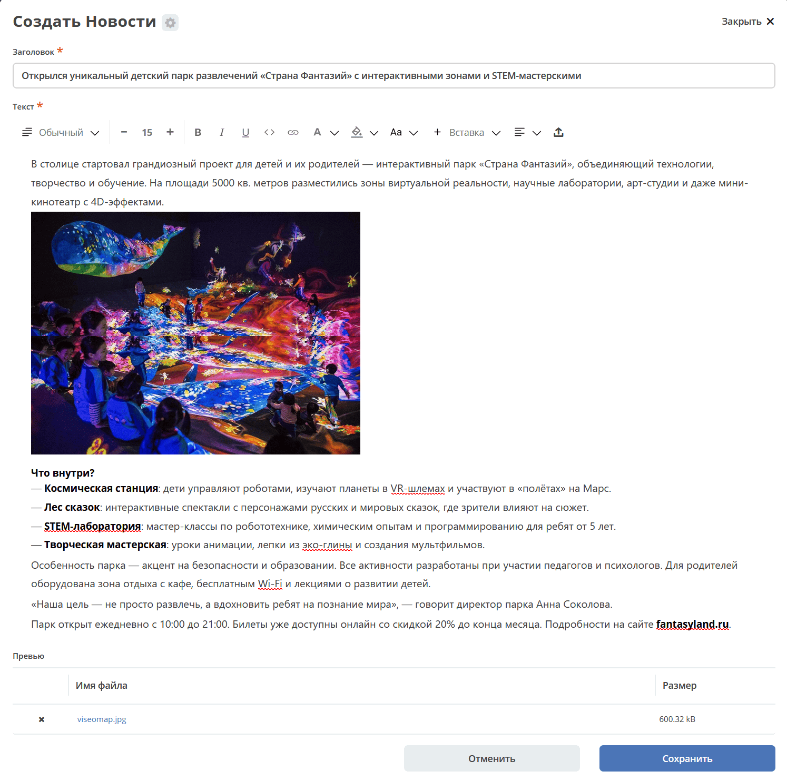

Добавление статей в базу знаний
~~~~~~~~~~~~~~~~~~~~~~~~~~~~~~~~~~~~

Перейдите в журнал **«База знаний»**:

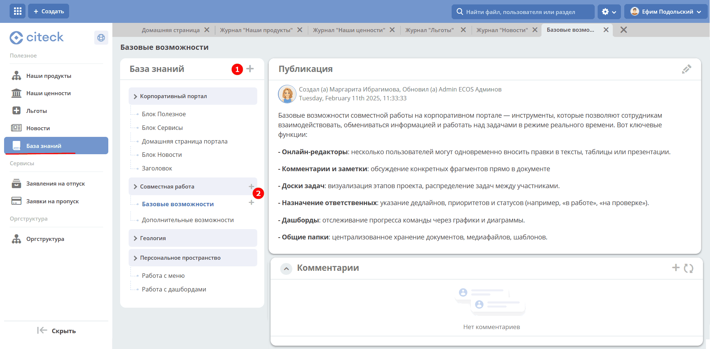

Для добавления статьи или раздела 1-го уровня нажмите большой **+** **(1)**. Для создания дочерней статьи или подраздела нажмите маленький **+** **(2)** у нужного узла. Кнопки доступны при наличии прав изменения дерева.

В стандартной форме укажите обязательный **Заголовок**. **Текст** оформляется с помощью визуального :ref:`редактора Lexical<wysiwyg_editor>`; для раздела его можно оставить пустым. Сохраните запись. Редактирование содержимого существующей публикации отдельно зависит от права её изменения.

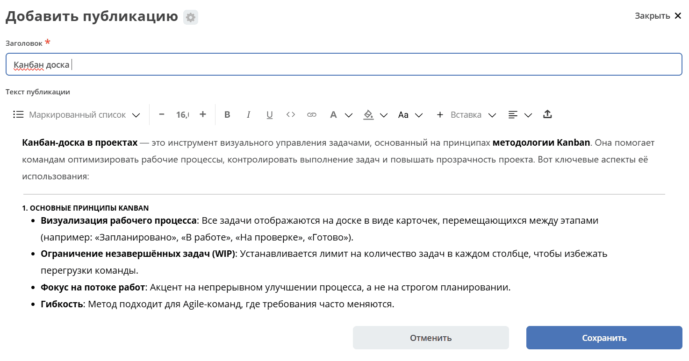

Добавленная публикация в структуре:

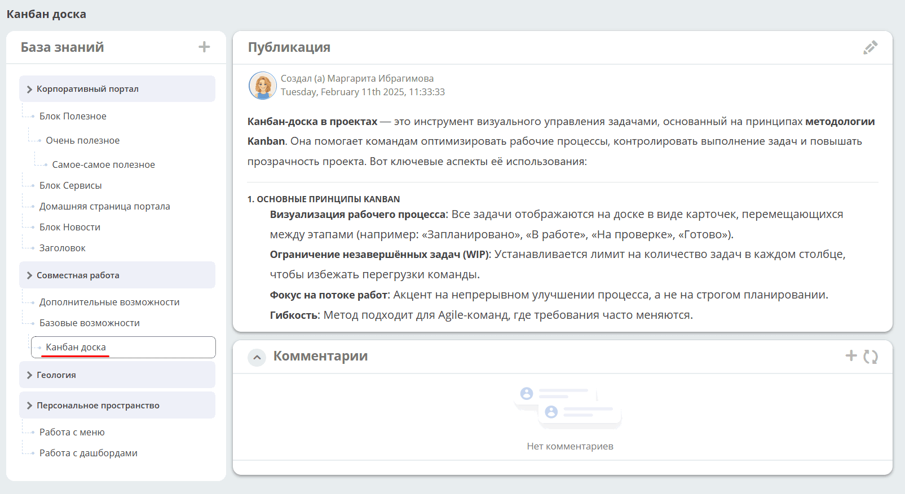

Первоначальное наполнение портала
----------------------------------

Перед наполнением проверьте конфигурацию установленного корпоративного пространства: меню, домашний дашборд, участников и доступные сервисы. Наличие готового пространства, шаблона и приветственного блока зависит от поставки.

Платформа предусматривает создание корневой страницы базы знаний рабочего пространства. Стандартный заголовок — **«Добро пожаловать!»**, текст — **«Добро пожаловать в базу знаний!»**; начальное содержимое задаётся конфигурацией ``wiki-initial-page-content``. На существующем стенде оно может быть изменено.

Корпоративные файлы, новости и содержательные статьи базы знаний добавляются при наполнении портала.

Пример портала без корпоративных материалов:

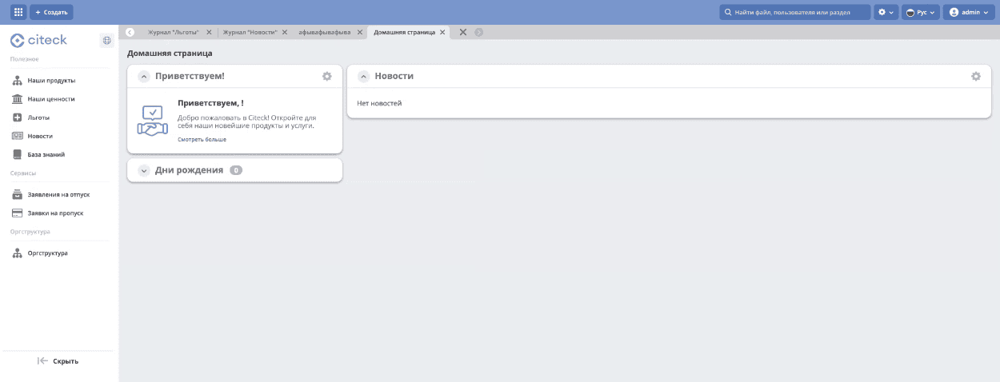

Содержимое разделов **Сервисы** и **Оргструктура** зависит от установленных модулей и уже имеющихся данных системы. Организационная структура, сотрудники и заявления могут быть созданы до настройки портала.

Рекомендуемый порядок первоначального наполнения:

1. Проверьте :ref:`организационную структуру<org_structure>` — при необходимости добавьте подразделения и сотрудников.
2. Наполните подразделы **Наши продукты**, **Наши ценности**, **Льготы** — загрузите файлы или создайте папки.
3. Добавьте первые новости в подраздел **Новости**.
4. Создайте статьи в **Базе знаний** для хранения корпоративных регламентов и инструкций.
