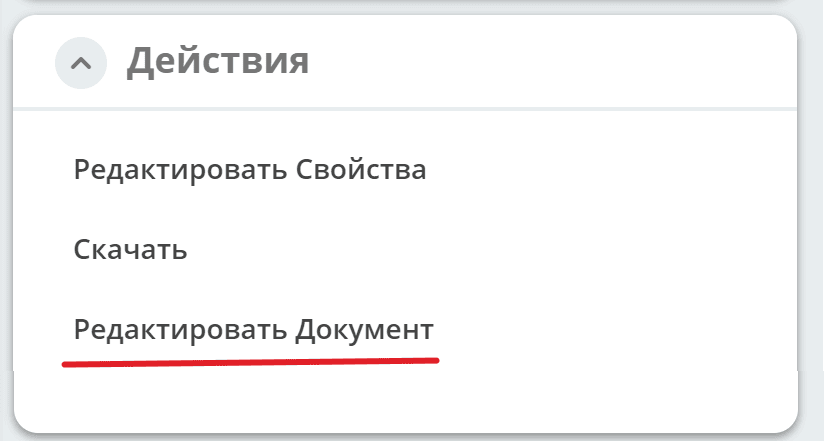
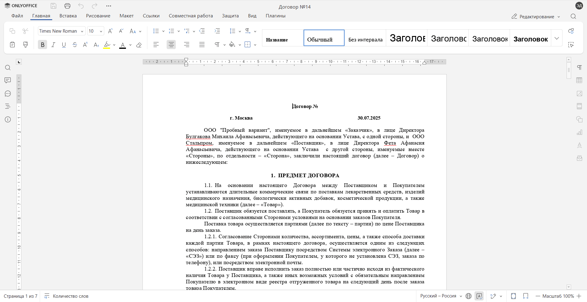
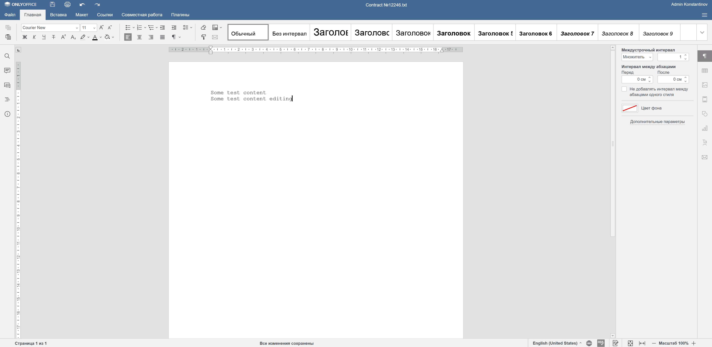
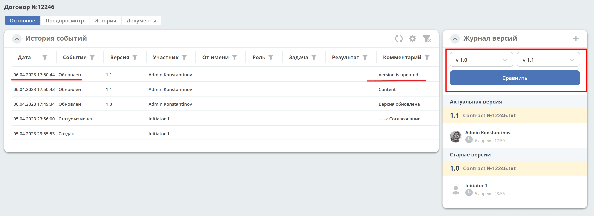
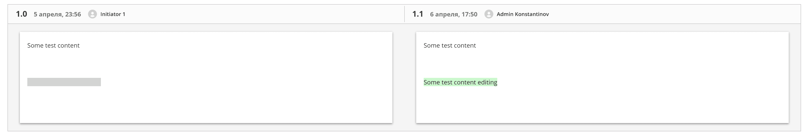

.. _edit_only_office:

Редактирование документа в OnlyOffice
=========================================================================

**OnlyOffice** — встроенный редактор документов в Citeck, позволяющий открывать и редактировать файлы форматов MS Office и OpenDocument прямо в браузере, без установки дополнительного программного обеспечения. Редактор поддерживает совместное редактирование в реальном времени: несколько пользователей одновременно открывают и редактируют один документ прямо в браузере, без скачивания файла. Изменения соавторов видны сразу, фрагменты, которые правят другие участники, помечаются цветом и именем автора. Каждая сохранённая редакция становится новой версией документа, версии можно сравнить с цветовой подсветкой различий.

Для редактирования файла используйте действие **«Редактировать документ»**:

В отдельной вкладке браузера в OnlyOffice откроется документ:

Внесите в документ изменения:

Система сохраняет внесённые изменения автоматически в новую версию документа. Изменения версий фиксируются в :ref:`виджете «Журнал версий» <widget_versions_journal>`.

Версии документов можно сравнить. Выберите версии и нажмите **Сравнить**. Различия будут подсвечены:

