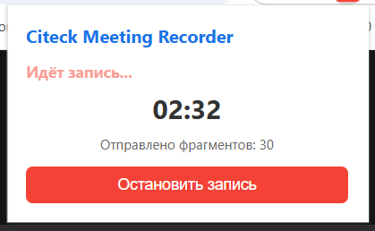
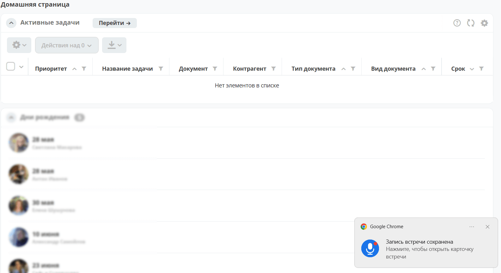

.. _meeting_record_plugin:

Chrome-расширение для записи совещаний
========================================

.. contents::
    :depth: 3

.. note::

    Доступно только в Enterprise версии.

**citeck-meeting-recorder** — Chrome-расширение, которое записывает аудио видеоконференции в Yandex Telemost и передаёт его на сервер для автоматической расшифровки речи и формирования резюме встречи. Результат сохраняется в платформе Citeck как активность. Если перед записью выбрана бизнес-сущность, например сделка или проект, активность привязывается к ней.

.. note::

    Функциональность доступна в Enterprise-версии Citeck при наличии настроенного микросервиса ``citeck-ai`` и сервиса транскрипции ``citeck-stt-sidecar``.

Возможности
-----------

.. list-table::
   :class: tight-table
   :header-rows: 1
   :widths: 30 70

   * - Возможность
     - Описание
   * - Запись конференций
     - В Yandex Telemost (включая ``telemost.360.yandex.ru``)
   * - Захват аудио
     - Звук вкладки и доступный микрофон пользователя объединяются в единый поток. Без доступа к микрофону записывается только звук вкладки
   * - Автоматическая транскрипция
     - Речь распознаётся через GigaAM
   * - Генерация резюме
     - Через LLM: ключевые темы, решения, задачи, открытые вопросы, участники
   * - Привязка к сущности
     - Необязательный выбор записи перед началом записи встречи. Доступные типы сущностей задаются на стенде, например сделка или проект
   * - Авто-остановка
     - При закрытии вкладки, уходе со страницы встречи или завершении захваченной аудиодорожки
   * - Авторизация
     - Через действующую сессию Citeck. При отсутствии сессии расширение предлагает войти в платформу

Принцип работы
--------------

    1. Пользователь открывает вкладку Yandex Telemost — расширение обнаруживает вкладку автоматически.
    2. В popup при необходимости выбирается бизнес-сущность и нажимается **Начать запись**. Запуск без привязки требует подтверждения.
    3. Расширение захватывает аудио участников (звук вкладки) и, при наличии разрешения, микрофон пользователя, микширует их и передаёт фрагментами по REST API в ``citeck-ai``.
    4. После остановки записи бэкенд транскрибирует аудио и генерирует резюме.
    5. Результат сохраняется как ``meeting-activity`` в Citeck. Если выбрана сущность, активность привязывается к ней.
    6. После успешной обработки расширение показывает ссылку на активность и создаёт Chrome-уведомление, если завершение обнаружено фоновым опросом.

Установка
---------

Загрузка в Chrome
~~~~~~~~~~~~~~~~~~

    1. Скачайте расширение в виде zip-архива из релизов GitHub.
    2. Распакуйте архив.
    3. Откройте ``chrome://extensions/``.
    4. Включите **Режим разработчика**.
    5. Нажмите **Загрузить распакованное расширение** и выберите папку, непосредственно содержащую ``manifest.json``.

Настройка
~~~~~~~~~~

    1. Нажмите на иконку расширения → **Открыть настройки**:
    2. Введите URL стенда Citeck (например, ``http://localhost``):
    3. Нажмите **Проверить подключение**:

    .. image:: _static/meeting_record_plugin/settings_02.png
        :width: 400
        :align: center

    Проверка подключения сохраняет введённый URL. Если расширение сообщает об отсутствии авторизации, нажмите **Войти в ECOS** в popup и войдите в Citeck на открывшейся странице.

Использование
-------------

1. Откройте конференцию в Yandex Telemost.
2. Нажмите иконку расширения в панели Chrome.
3. При необходимости выберите тип сущности и найдите запись для привязки. Доступные типы зависят от настроек стенда.
4. Нажмите **Начать запись**. Если сущность не выбрана, подтвердите запуск без привязки. При первом запуске разрешите доступ к микрофону в открывшемся окне записи.

Если доступ к микрофону не получен, запись продолжается только со звуком вкладки; собственная речь пользователя через микрофон в этот поток не добавляется.

После начала захвата отдельное окно записи автоматически сворачивается. Закрытие popup расширения не останавливает запись. Не закрывайте отдельное окно записи до её завершения.

.. grid:: 2
   :gutter: 2

   .. grid-item::

      .. image:: _static/meeting_record_plugin/record_01.png
         :width: 350
         :align: center

   .. grid-item::

      .. image:: _static/meeting_record_plugin/record_02.png
         :width: 350
         :align: center

5. По завершении нажмите **Остановить запись**. Автоматическая остановка предусмотрена при закрытии вкладки, уходе со страницы встречи или завершении захваченной аудиодорожки. Если вы вышли из звонка, но вкладка осталась открыта, проверьте состояние записи и при необходимости остановите её вручную.

6. Дождитесь завершения обработки. При успешной обработке в popup появится ссылка на активность; по ней можно открыть результат. Расширение также создаёт Chrome-уведомление, нажатие на которое открывает активность. При ошибке обработки отображается сообщение об ошибке.

Фоновый опрос завершения ограничен 15 минутами. Если обработка длится дольше или системное уведомление не появилось, проверьте состояние через popup расширения.

7. Итоги встречи автоматически сохраняются в Citeck и привязываются к записи, выбранной перед началом. При запуске без привязки создаётся отдельная активность; откройте её по прямой ссылке в расширении после завершения обработки.

.. grid:: 2
   :gutter: 2

   .. grid-item::

      .. image:: _static/meeting_record_plugin/record_06.png
         :width: 500
         :align: left

   .. grid-item::

      .. image:: _static/meeting_record_plugin/record_05.png
         :width: 500
         :align: left

Разрешения расширения
---------------------

.. list-table::
   :class: tight-table
   :header-rows: 1
   :widths: 30 70

   * - Разрешение
     - Назначение
   * - ``tabCapture``
     - Захват аудио вкладки
   * - ``activeTab``
     - Доступ к текущей вкладке
   * - ``storage``
     - Хранение настроек расширения
   * - ``notifications``
     - Уведомления о завершении и ошибках обработки записи
   * - ``<all_urls>``
     - Разрешение доступа к адресам (``host_permissions``) для API-запросов к произвольному стенду Citeck

Авторизация использует сессионные cookies, которые браузер передаёт с запросами через ``credentials: 'include'``. Отдельное разрешение ``cookies`` для их чтения расширением не запрашивается.

Зависимости
-----------

.. list-table::
   :class: tight-table
   :header-rows: 1
   :widths: 30 70

   * - Компонент
     - Роль
   * - citeck-ai
     - Бэкенд: REST API приёма фрагментов, конвейер «распознавание речи → резюме модели → сохранение активности»
   * - citeck-stt-sidecar
     - Сервис транскрипции на базе GigaAM (распознавание русской речи)
   * - gateway
     - Обычный маршрут ``/gateway/ai/`` — отдельная инфраструктура для передачи звука не нужна

.. note::

    В текущей реализации звук передаётся по REST с токеном загрузки сессии ``X-Upload-Token``. Отдельный маршрут ``/gateway/ai/ws/`` и аутентификация по ``wsToken`` в этом сценарии не используются: настраивать WebSocket-прокси не требуется.

Подробная техническая информация
---------------------------------

:ref:`Модуль записи совещаний (callrecording) <call-recording-module>`
