.. _org_structure:

Организационная структура
===========================

.. contents::
   :depth: 4

Раздел описывает работу с организационной структурой в Citeck: просмотр иерархии подразделений и сотрудников, создание групп и пользователей, редактирование профилей, а также настройку компонента **Оргструктура**, используемого в формах и бизнес-процессах.

Страница оргструктуры
----------------------

**Организационная структура** – система иерархически упорядоченных организационных единиц (должностей, отделов, подразделений). Она используется для назначения исполнителей в бизнес-процессах, настройки прав доступа, управления задачами и делегирования полномочий.

.. note::

 Оргструктура доступна в рабочем пространстве :ref:`Справочники<datalists>` и на :ref:`корпоративном портале<corp_portal>`.

Форма оргструктуры разделена на две части и содержит:

 - иерархическое дерево структуры с возможностью поиска **(1)**,
 - дашборд с информацией о выбранном подразделении или пользователе **(2)**: состав группы, список участников, контактные данные.

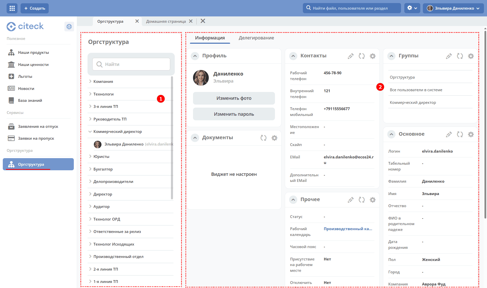

Создание группы
~~~~~~~~~~~~~~~~

.. _new_group:

Для создания группы в списке оргструктуры нажмите:

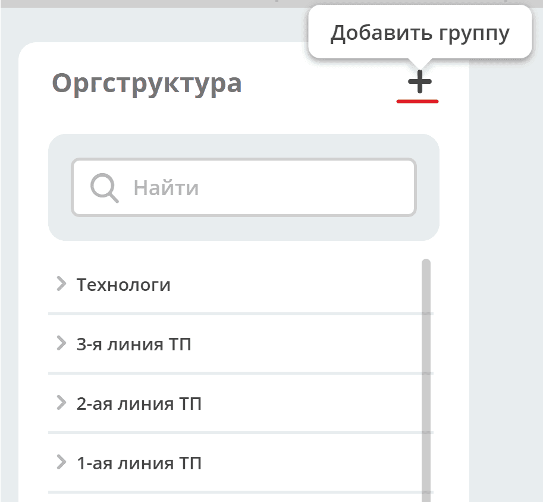

Группа **Оргструктура** добавлена по умолчанию как родительская. Кнопка создания доступна при наличии права изменения этой группы. Внесите данные в обязательные поля и нажмите **Сохранить**.

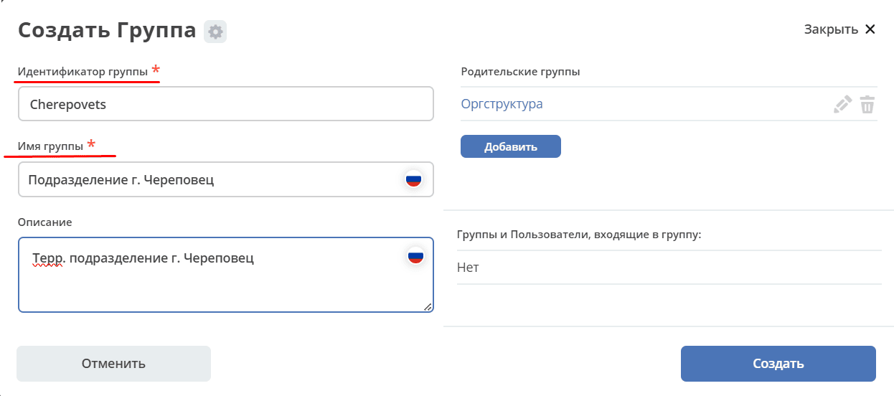

См. подробно о :ref:`приватных группах<UNIFIED_PRIVATE_GROUP>`

По кнопке **(1)** можно выбрать из оргструктуры родительскую группу, в которую будет входить создаваемая группа.

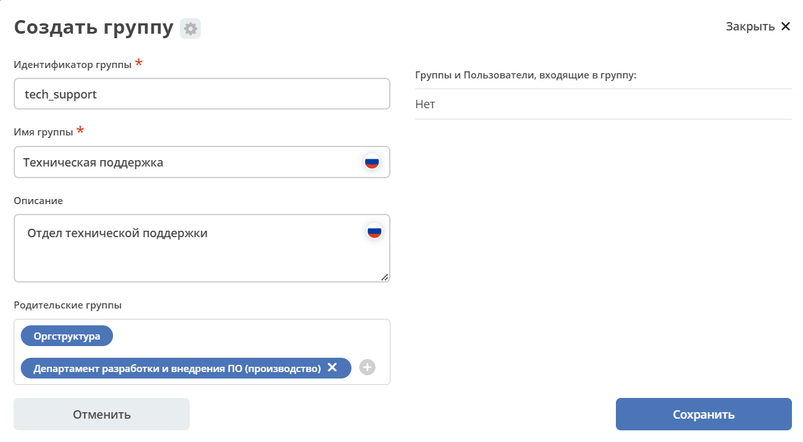

Добавление подгруппы и пользователя в группу
""""""""""""""""""""""""""""""""""""""""""""""""""""""

Кнопки управления группой отображаются при наведении на элемент. Их доступность зависит от права изменения выбранной группы.

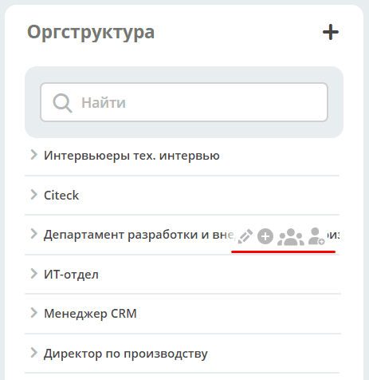

|

.. grid:: 1
   :gutter: 2

   .. grid-item-card:: Редактировать
      :class-header: sd-font-weight-bold

      .. image:: _static/org_structure/group_action_01.png
         :width: 30
         :align: left

      На форме отображены все группы и пользователи, входящие в группу, информация о родительских группах.

      Можно отредактировать **Имя группы**, **Описание**, **удалить (1)**, **добавить родительские группы (2)**.

      .. image:: _static/org_structure/edit.png
         :width: 500
         :align: center

      По клику на группу/пользователя **(3)** доступен просмотр информации:

      .. image:: _static/org_structure/edit_group.png
         :width: 500
         :align: center

      .. image:: _static/org_structure/edit_person.png
         :width: 500
         :align: center

   .. grid-item-card:: Добавить подгруппу
      :class-header: sd-font-weight-bold

      .. image:: _static/org_structure/group_action_02.png
         :width: 30
         :align: left

      Выберите **существующую** группу/группы из оргструктуры. Нажмите **Ок**.

      .. image:: _static/org_structure/add_subgroup.png
         :width: 400
         :align: center

      Пример иерархии подгрупп и пользователей в них:

      .. image:: _static/org_structure/structure.png
         :width: 300
         :align: center

   .. grid-item-card:: Добавить пользователя в группу
      :class-header: sd-font-weight-bold

      .. image:: _static/org_structure/group_action_03.png
         :width: 30
         :align: left

      Выберите **существующих** пользователей из оргструктуры. Нажмите **Ок**.

      .. image:: _static/org_structure/add_user.png
         :width: 400
         :align: center

   .. grid-item-card:: Создать пользователя
      :class-header: sd-font-weight-bold

      .. image:: _static/org_structure/group_action_04.png
         :width: 30
         :align: left

      Откроется форма создания пользователя. Внесите данные, проверьте состав групп и сохраните. Обязательные поля отмечены звёздочкой.

      Если форма содержит поле **Линейный руководитель**, укажите руководителя пользователя. Доступность задач для контроля определяется настройками соответствующих журналов и прав доступа.

      .. image:: _static/org_structure/add_new_user.png
         :width: 500
         :align: center

Просмотр и редактирование профиля пользователя, удаление пользователя из группы
"""""""""""""""""""""""""""""""""""""""""""""""""""""""""""""""""""""""""""""""""

Кнопки управления пользователем отображаются при наведении на элемент и зависят от права изменения записи. Исключение из группы доступно для записи пользователя, показанной внутри конкретной группы.

.. _user_profile:

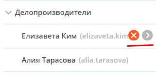

|

.. grid:: 1
   :gutter: 2

   .. grid-item-card:: Исключить пользователя из группы
      :class-header: sd-font-weight-bold

      .. image:: _static/org_structure/person_action_01.png
         :width: 30
         :align: left

      Действие необходимо подтвердить. Оно удаляет связь с выбранной группой; учётная запись пользователя сохраняется:

      .. image:: _static/org_structure/exclude_user.png
         :width: 500
         :align: center

   .. grid-item-card:: Открыть профиль пользователя
      :class-header: sd-font-weight-bold

      .. image:: _static/org_structure/person_action_02.png
         :width: 30
         :align: left

      .. image:: _static/org_structure/user_profile.png
         :width: 500
         :align: center

      Профиль представлен в виде :ref:`дашборда<dashboard>`. Дашборд состоит из :ref:`виджетов<widgets>`. Виджеты на дашборде можно конфигурировать - менять их местами, скрывать ненужные. См. подробно :ref:`о конфигурации дашбордов<dashboard_config>`.

      .. note::

         В виджете профиля кнопка редактирования доступна для своего профиля и для администратора. Сохранение изменений также зависит от серверных прав доступа.

      Для редактирования информации виджета нажмите:

      .. image:: _static/org_structure/edit_user_1.png
         :width: 300
         :align: center

      Или редактировать непосредственно в строке:

      .. image:: _static/org_structure/edit_user_2.png
         :width: 300
         :align: center

      .. image:: _static/org_structure/edit_user_3.png
         :width: 300
         :align: center

Компонент Оргструктура
------------------------

Компонент используется для выбора сотрудников и групп в формах документов, бизнес-процессов и других местах системы, где требуется указать исполнителя, ответственного или участника.

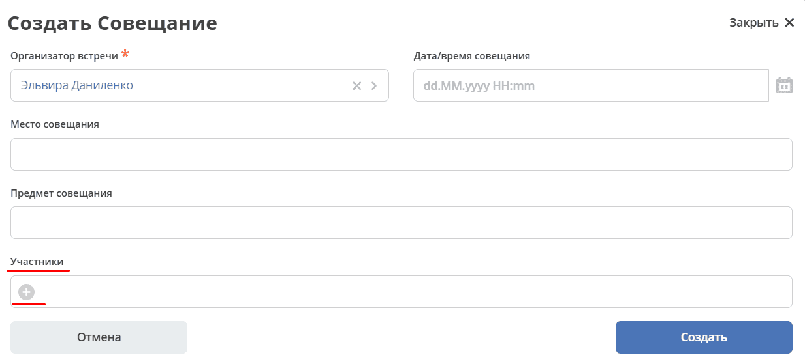

В типовой настройке оргструктура представлена вкладками **(1)**: **По уровням** и **Все пользователи**. Воспользуйтесь строкой поиска при необходимости **(2)**.

Вкладка **По уровням** открывается по умолчанию, но в настройках компонента формы можно выбрать другую начальную вкладку или скрыть переключатель. **Все пользователи** доступна, если разрешён выбор пользователей; при разрешённом выборе ролей также может отображаться вкладка ролей.

По уровням
~~~~~~~~~~~

Выберите сотрудника, нажав на **(3)**:

По умолчанию текстовый поиск ограничен корневой группой компонента и её иерархией. Настройка компонента **Search in all groups** позволяет искать по всем группам. Без поискового текста дерево показывает непосредственных участников раскрываемой группы.

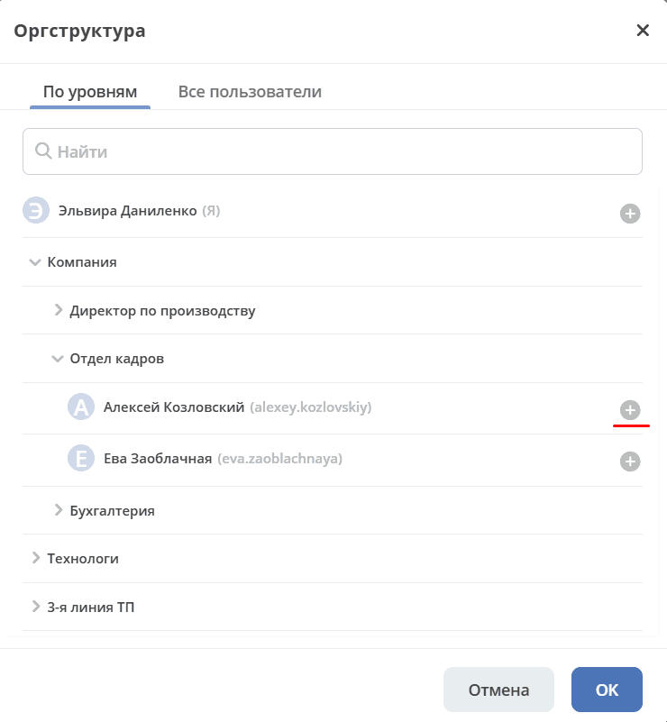

Все пользователи
~~~~~~~~~~~~~~~~~~

При включённых рабочих пространствах вкладка **Все пользователи** по умолчанию показывает пользователей текущего пространства. Настройка компонента **Display all users of the system** снимает это ограничение области поиска; серверные права доступа продолжают действовать.

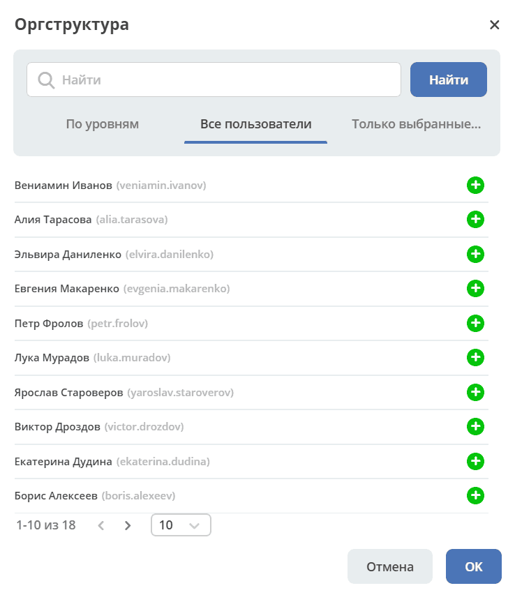

Неактивные пользователи, если они не скрыты настройками, отображаются с пониженной непрозрачностью.

Уже выбранные
~~~~~~~~~~~~~~

Уже выбранные сотрудники/группы отмечены:

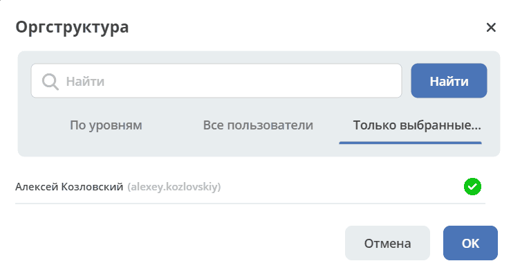

Конфигурация компонента оргструктуры
-------------------------------------

.. _orgstructure_config:

Перейдите в журнал :ref:`«Конфигурация ECOS»<configuration_admin>`.

Журнал доступен по адресу: ``v2/journals?journalId=ecos-configs&viewMode=table&ws=admin$workspace``

В поисковой строке введите **org** для поиска настроек оргструктуры. Настройку ``hide-disabled-users-for-everyone`` найдите отдельно по её идентификатору:

.. list-table::
      :widths: 45 55
      :header-rows: 1
      :align: center
      :class: tight-table

      * - Идентификатор
        - Описание
      * - ``orgstruct-username-mask``
        - Маска отображения имени пользователя в компоненте Оргструктура
      * - ``hide-in-orgstruct``
        - Список идентификаторов пользователей/групп, исключаемых из выдачи дерева и списка пользователей, в том числе без поискового текста
      * - ``hide-disabled-users-for-everyone``
        - Скрыть отключённых пользователей для всех, включая администраторов. Имеет приоритет над следующей настройкой
      * - ``orgstruct-show-inactive-user-only-for-admin``
        - Скрыть неактивных пользователей для всех, кроме администраторов
      * - ``orgstruct-search-user-extra-fields``
        - Дополнительные атрибуты для поиска пользователей
      * - ``orgstruct-search-user-middle-name``
        - Включить поиск пользователей по отчеству

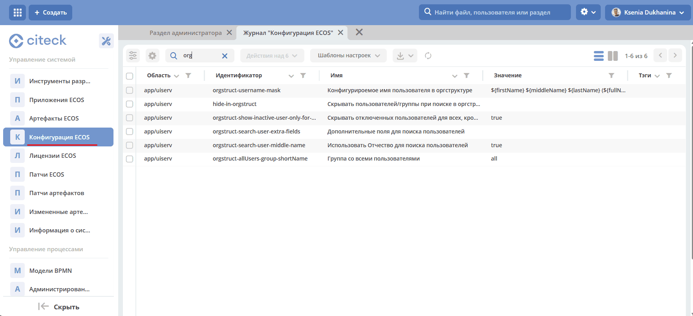

Изменение маски вывода данных пользователя
~~~~~~~~~~~~~~~~~~~~~~~~~~~~~~~~~~~~~~~~~~~

.. note::

    Маска задаётся централизованно и используется при отображении пользователей в списке выбора компонента Оргструктура. Отдельные представления могут использовать собственные подписи или не применять маску.

Маску для отображения информации о пользователе можно изменить. Откройте идентификатор **orgstruct-username-mask** в режиме редактирования:

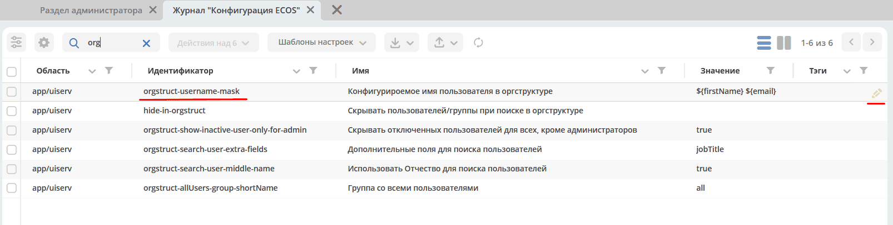

Укажите маску, например, **${firstName} ${lastName} ${email}** и сохраните:

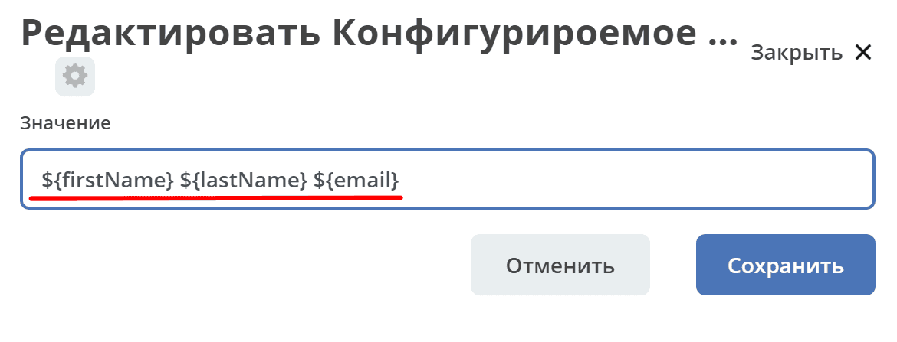

Измененный вывод данных пользователя в компоненте Оргструктура:

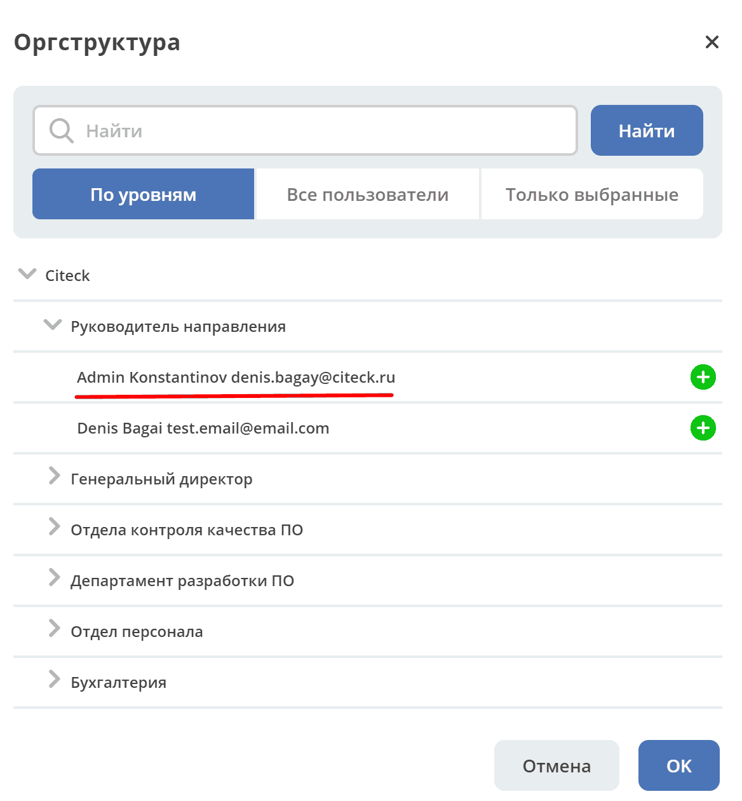

Добавлена возможность в конфигурации маски отображения пользователей в компоненте оргструктура использовать код HTML. 

Пример с использованием кода HTML. Маска:

.. code-block:: html

   ${firstName} ${lastName} <a style="color: #7396cd;" href="/v2/orgstructure?recordRef=emodel/person@${fullName}" target="_blank" rel="noopener noreferrer"><b>(${fullName})</b></a>

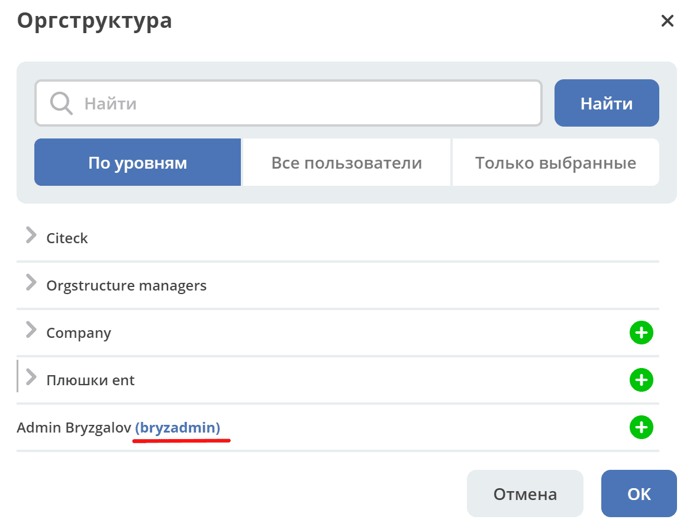

По клику на ссылку в отдельной вкладке открывается страница профиля пользователя.

Часто используемые атрибуты для маски:

В контексте этого компонента ``fullName`` содержит системное имя пользователя (``authorityName``). Значение одноимённого поля в других API может отличаться.

.. list-table::
      :widths: 30 70
      :header-rows: 1
      :align: center
      :class: tight-table

      * - Атрибут
        - Описание
      * - ``${firstName}``
        - Имя пользователя
      * - ``${lastName}``
        - Фамилия пользователя
      * - ``${middleName}``
        - Отчество пользователя
      * - ``${fullName}``
        - Системное имя (логин)
      * - ``${email}``
        - Электронная почта

Где найти атрибуты для маски
""""""""""""""""""""""""""""""

.. _org_structure_type_person:

Перейти в **Типы данных**, в настройках выставить :ref:`отображение системных типов<data_types_admin>`. Открыть тип **Person**, перейти в атрибуты:

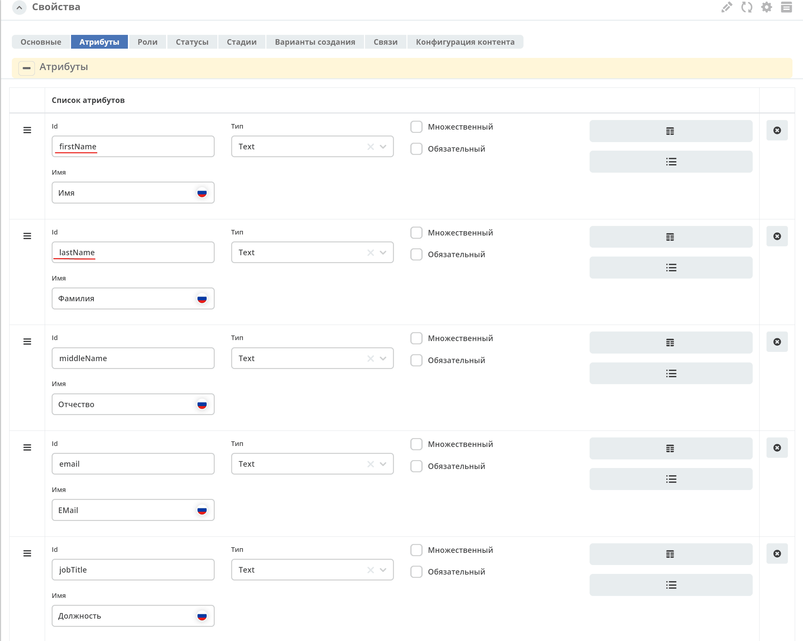

Значение в поле **Id** является атрибутом.

Скрывать пользователей/ группы при поиске в оргструктуре
~~~~~~~~~~~~~~~~~~~~~~~~~~~~~~~~~~~~~~~~~~~~~~~~~~~~~~~~~

Определённых пользователей или группы можно исключить из выдачи дерева и списка пользователей оргструктуры, в том числе без введённого поискового текста. Эта настройка не является запретом доступа к записи.

Откройте идентификатор **hide-in-orgstruct** в режиме редактирования. Укажите логины пользователей, например, **ivanov_ii,petrov_vv** и сохраните:

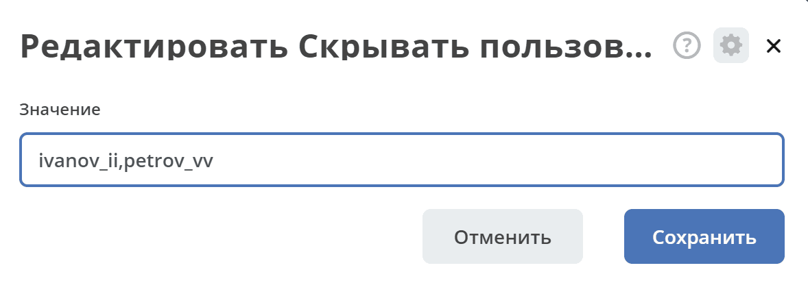

Поиск пользователя в компоненте **Оргструктура**:

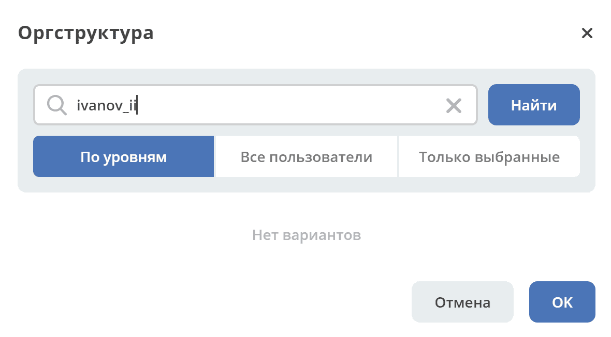

Скрывать отключенных пользователей для всех, кроме администраторов
~~~~~~~~~~~~~~~~~~~~~~~~~~~~~~~~~~~~~~~~~~~~~~~~~~~~~~~~~~~~~~~~~~~~

В оргструктуре отключённых пользователей можно скрыть для всех, кроме администраторов, если выключена настройка **hide-disabled-users-for-everyone**. При включённой **hide-disabled-users-for-everyone** они скрыты и от администраторов независимо от значения **orgstruct-show-inactive-user-only-for-admin**.

Клиентские значения по умолчанию: **hide-disabled-users-for-everyone** включена, **orgstruct-show-inactive-user-only-for-admin** выключена. На стенде эти значения могут быть переопределены.

Откройте идентификатор **orgstruct-show-inactive-user-only-for-admin** в режиме редактирования:

Установите флаг **«Включить»**.

Дополнительные поля для поиска пользователей
~~~~~~~~~~~~~~~~~~~~~~~~~~~~~~~~~~~~~~~~~~~~~~

Алгоритм поиска пользователей зависит от количества слов:

       * **1 слово** — по отображаемому имени и системному идентификатору, а также дополнительным настроенным полям;

              .. image:: _static/org_structure/search_defalt.png
                     :width: 300
                     :align: center

       * **2 слова** — по сочетаниям имени, фамилии и отчества с перестановкой слов, а также по полной строке в одном из полей ФИО;
       * **3 слова** — по имени, фамилии и отчеству с перестановками и вариантами составных частей ФИО;
       * **4 слова и более** — по полной строке и строке с обратным порядком слов в базовых и дополнительных полях.

Для двух и трёх слов используются специальные правила по полям ФИО: дополнительные поля не расширяют эти ветки поиска.

Для добавления дополнительных полей для поиска откройте идентификатор **orgstruct-search-user-extra-fields** в режиме редактирования:

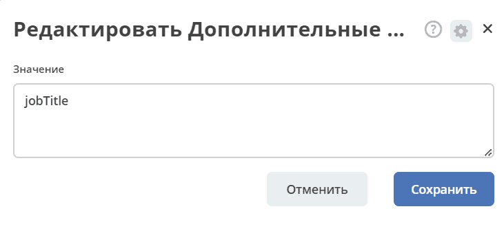

Укажите наименование :ref:`атрибута<org_structure_type_person>`, по которому необходимо искать. Несколько имён можно перечислить через запятую в одном значении настройки.

Поиск по добавленному в настройку полю:

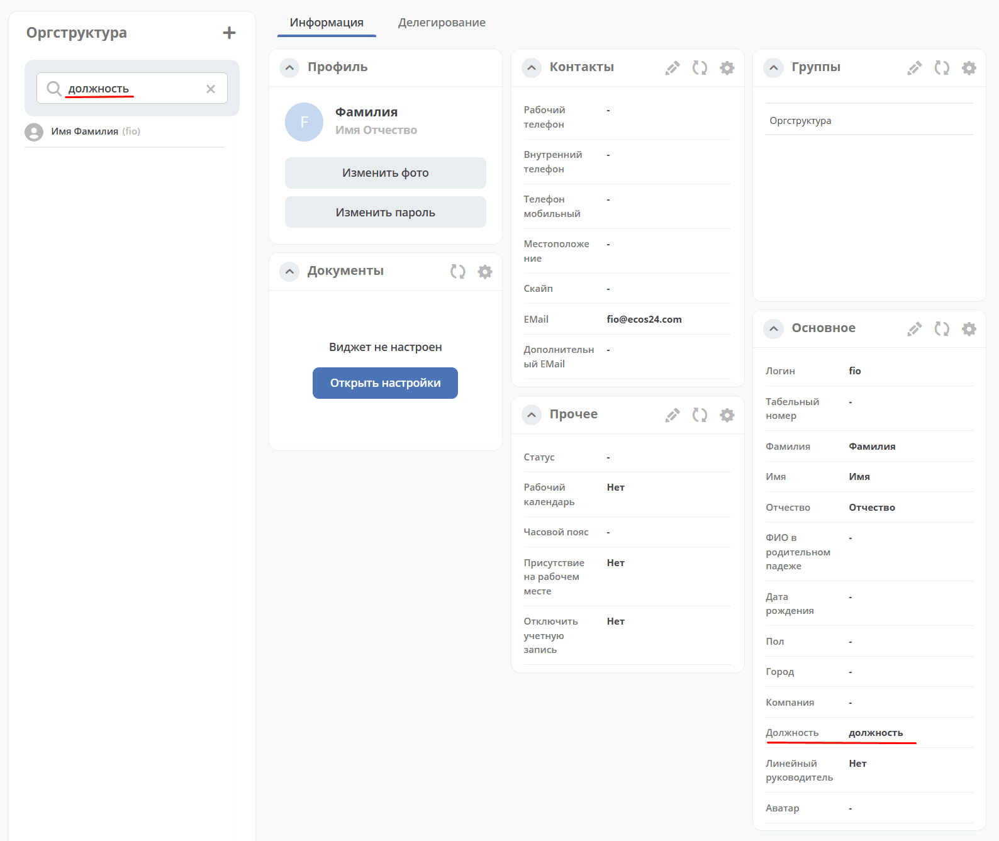

Использовать Отчество для поиска пользователей
~~~~~~~~~~~~~~~~~~~~~~~~~~~~~~~~~~~~~~~~~~~~~~

Чтобы добавить отчество в общий набор поисковых полей, откройте идентификатор **orgstruct-search-user-middle-name** в режиме редактирования. Это влияет на поиск по одному слову и по четырём и более словам; специальные правила для двух и трёх слов уже учитывают отчество независимо от флага.

Установите флаг **«Включить»**.

Поиск по отчеству - в самой оргструктуре:

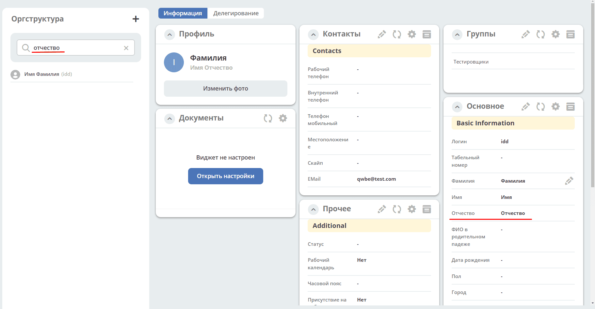

и в компоненте **Оргструктура**:

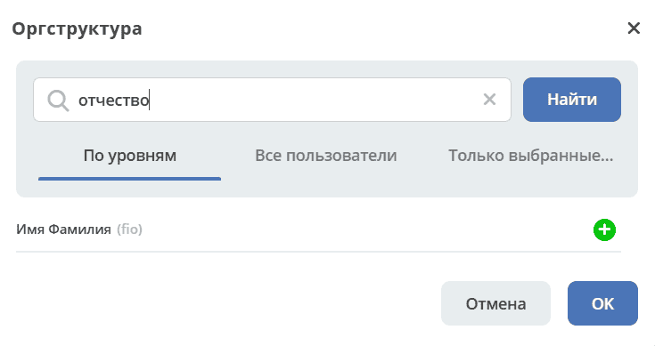
