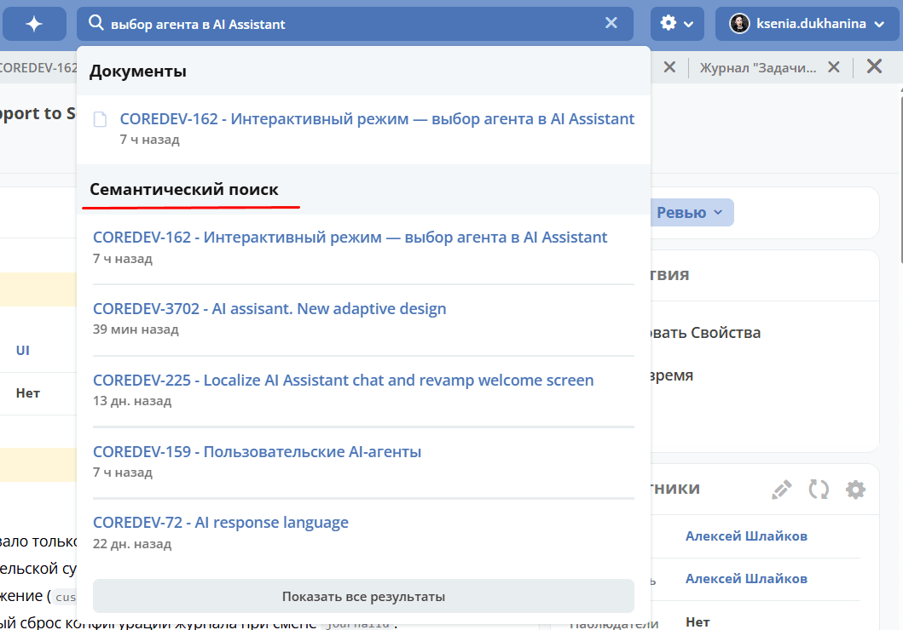

.. _rag-search:

Семантический поиск и индексация документов
============================================

.. note::

   Доступно только в enterprise версии.

Семантический поиск позволяет находить нужные документы по смыслу запроса, а не только по точному совпадению слов.

Сценарии использования
--------------------------------------------

- **Поиск в шапке** (живой поиск). При вводе текста в строку поиска в шапке платформы, помимо обычных результатов (документы, люди, пространства), появляется секция «Семантический поиск» с документами, релевантными по смыслу. Например, по запросу «условия оплаты для клиента» находятся договоры и коммерческие предложения, содержащие информацию об условиях оплаты, даже если в них нет точного совпадения с введённой фразой.

- **Поиск через журнал**. Семантический поиск также доступен на странице глобального поиска — результаты отображаются в отдельной группе SEMANTIC наряду с группами DOCUMENTS, PEOPLE и WORKSPACES.
- **Контроль доступа к записям Citeck**. Пользователь видит записи с учётом прав на документы и членства в рабочем пространстве. Для поиска пространство должно иметь включённую настройку RAG.
- **Поиск по коду и документации** (для разработчиков). Через :ref:`AI Ассистент <AI_assistant>` можно искать по содержимому подключённых GitLab‑репозиториев — исходному коду, README, конфигурациям. Инструменты ассистента обращаются к REST API сервиса RAG; знание конкретных файлов или путей не требуется. Особенности выбора GitLab-источников описаны в :ref:`конфигурации RAG <rag-config>`.

В настроенных рабочих пространствах создание, изменение и удаление записей обрабатываются автоматически по событиям с задержкой объединения повторных изменений (по умолчанию 5 секунд). Время обновления поиска зависит от нагрузки, извлечения текста и доступности сервисов; при временных сбоях выполняются повторные попытки. GitLab-репозитории синхронизируются отдельно — по расписанию или вручную.

Для вложений поиск использует текст, извлечённый конвертером платформы. По умолчанию поддерживаются PDF, DOC, DOCX, ODT и текстовые MIME-типы. Если формат не поддерживается или конвертер вернул пустой текст, запись ищется по атрибутам. Поиск по тексту скана без текстового слоя зависит от возможностей конвертера.

Настройка семантического поиска описана в разделе :ref:`Конфигурация RAG <rag-config>`.

