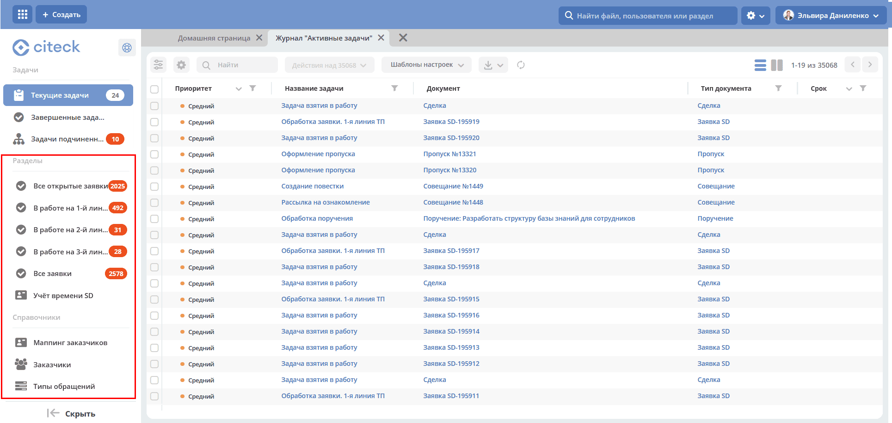
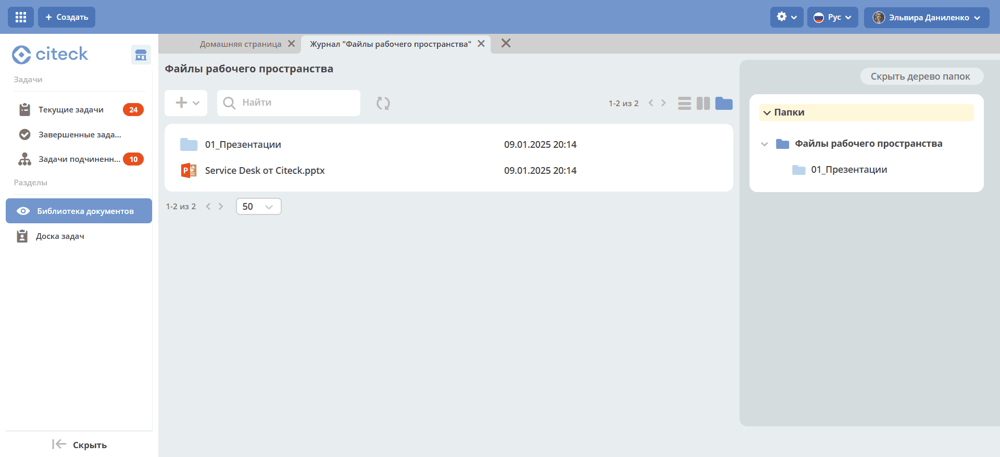

.. _workspaces:

Рабочие пространства
======================

.. contents::
   :depth: 2

.. grid:: 1
   :gutter: 2

   .. grid-item-card:: Выбор рабочего пространства
      :link: select_ws
      :link-type: ref

      Как переключиться на пространство, в котором вы уже состоите, или найти доступное через общее меню.

   .. grid-item-card:: Доступные рабочие пространства
      :link: types_ws
      :link-type: ref

      Персональное и совместное пространства: назначение и возможности каждого типа.

   .. grid-item-card:: Настройки рабочего пространства
      :link: workspace_settings
      :link-type: ref

      Настройка домашней страницы, меню и других параметров пространства.

   .. grid-item-card:: Создание и редактирование рабочего пространства
      :link: new_workspace
      :link-type: ref

      Как создать новое рабочее пространство или изменить существующее.

   .. grid-item-card:: Рабочее пространство администратора
      :link: ws_admin
      :link-type: ref

      Инструменты конфигурации и настройки платформы для системных администраторов.

   .. grid-item-card:: Создание артефактов в рабочем пространстве
      :link: ws_artifacts
      :link-type: ref

      No-code/low-code инструменты разработки внутри совместного рабочего пространства.

.. toctree::
    :maxdepth: 2
    :hidden:

    workspaces/select_ws
    workspaces/types_ws
    workspaces/settings_ws
    workspaces/new_ws
    workspaces/admin_ws
    workspaces/artifacts_ws

**Рабочее пространство (workspace)** — область в Citeck, объединяющая меню, данные и вкладки для определённой функциональности или команды. Пространства упрощают навигацию и разграничение данных. Доступ к конкретным объектам зависит также от видимости их типов и настроенных прав.

Например, пространство «Договоры и доверенности» собирает в одном интерфейсе договоры, доверенности и сопутствующие справочники, а пространство проекта — его тикеты и запросы на изменение. Для изоляции записей между проектами настраиваются их принадлежность пространствам, видимость и права.

Типы рабочих пространств
--------------------------

Поддерживается два типа рабочих пространств:

.. grid:: 1
   :gutter: 2

   .. grid-item-card:: Персональное
      :link: ws_personal
      :link-type: ref

      Индивидуальная область для управления задачами, документами и участия в бизнес-процессах.

   .. grid-item-card:: Совместное
      :link: ws_collaborative
      :link-type: ref

      Коллективная область для командной работы: объединяет участников, документы, задачи и бизнес-процессы в едином интерфейсе.

Видимость и роли
-------------------

По видимости пространство может быть **публичным** (аутентифицированные пользователи платформы могут присоединиться самостоятельно) или **приватным** (доступ предоставляется выбранным участникам). Для ADMIN и SYSTEM предусмотрен административный доступ. Гостевые, анонимные и системные учётные записи не используют самостоятельное вступление.

Каждый участник пространства получает одну из двух ролей:

.. list-table::
   :class: tight-table
   :header-rows: 1

   * - Роль
     - Описание
   * - Пользователь
     - Работает с данными пространства в рамках предоставленного доступа.
   * - Менеджер
     - Дополнительно управляет настройками пространства: меню, составом участников, артефактами. Роль автоматически присваивается пользователю, создавшему пространство.

Участие и роль могут назначаться пользователю напрямую или через группу. Для отдельных объектов пространства продолжают действовать их собственные права доступа.

Возможности пользователя
---------------------------

Выбор рабочего пространства
~~~~~~~~~~~~~~~~~~~~~~~~~~~~~

Пользователь может выбрать как рабочее пространство, в котором уже состоит, так и любое из списка доступных:

.. grid:: 2
   :gutter: 2

   .. grid-item::

      .. image:: _static/workspaces/01_button_select.png
         :width: 500
         :align: left

   .. grid-item::

      .. image:: _static/workspaces/01_button_select_1.png
         :width: 500
         :align: left

Меню и данные выбранного пространства
~~~~~~~~~~~~~~~~~~~~~~~~~~~~~~~~~~~~~~~

Выбранное пространство задаёт контекст меню, вкладок и запросов к данным. Журналы могут искать в текущем, дополнительных или всех доступных пространствах — в зависимости от настройки. Например, так выглядит интерфейс для пространства **Service Desk**:

Типы данных пространства
~~~~~~~~~~~~~~~~~~~~~~~~~~~

В пространстве могут использоваться его локальные типы и глобальные типы. Принадлежность определения типа глобальной области не делает все его записи общими: видимость записей задаётся отдельно и проверяется вместе с правами доступа.

Библиотека документов
~~~~~~~~~~~~~~~~~~~~~~~

Штатная библиотека документов разделяет файлы и папки по пространствам с учётом прав доступа:

Возможности администратора
------------------------------

- создаёт и изменяет пространства, удаляет несистемные пространства при наличии прав, настраивает меню и типы данных;
- задаёт область определения типа: глобальную или конкретное пространство;
- настраивает видимость записей и права. Например, для разделения договоров компаний записи относятся к соответствующим пространствам, а их тип и права настраиваются для приватной видимости.

.. note::

   При включённых рабочих пространствах и пустой настройке ``default-workspace`` открывается персональное пространство пользователя. Администратор может назначить другое стартовое пространство. Явный параметр ``ws`` в URL имеет приоритет. См. :ref:`Рабочее пространство администратора<ws_admin>`.

Коробочные :ref:`функциональные модули<ecos_modules>` разбиты по рабочим пространствам для удобства навигации.
