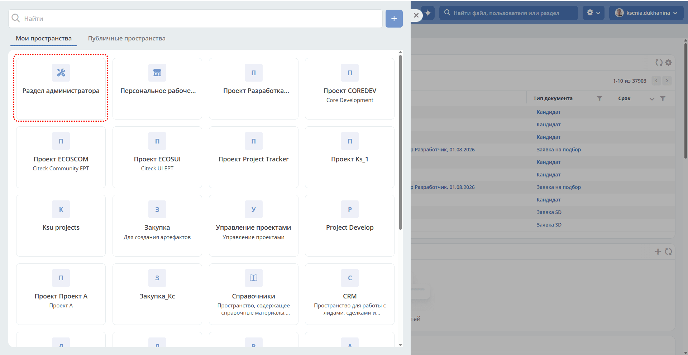

.. _ws_admin:

Рабочее пространство администратора
======================================

.. contents::
   :depth: 2

Пространство предназначено для системных администраторов и содержит инструменты конфигурации и настройки платформы.

 .. image:: _static/08_admin_workspace_01.png
       :width: 700
       :align: center

Конфигурации рабочего пространства
------------------------------------

Рабочее пространство, которое должно открываться по умолчанию
~~~~~~~~~~~~~~~~~~~~~~~~~~~~~~~~~~~~~~~~~~~~~~~~~~~~~~~~~~~~~~~

При включённых рабочих пространствах и пустой настройке **default-workspace** открывается :ref:`персональное рабочее пространство<ws_personal>`. Чтобы выбрать другое стартовое пространство, например корпоративный портал, укажите его ID в этой конфигурации. Явный параметр ``ws`` в URL имеет приоритет над настройкой. Она не предоставляет пользователю дополнительных прав на выбранное пространство.

Перейдите в журнал :ref:`«Конфигурация ECOS»<configuration_admin>`. Журнал доступен по адресу: ``v2/journals?journalId=ecos-configs&viewMode=table&ws=admin$workspace``

Конфигурация **default-workspace**:

 .. image:: _static/default_setting_01.png
       :width: 600
       :align: center

Укажите **id** рабочего пространства, которое должно открываться по умолчанию:

 .. image:: _static/default_setting_02.png
       :width: 400
       :align: center

Включить/Выключить возможность создания рабочих пространств всем пользователям
~~~~~~~~~~~~~~~~~~~~~~~~~~~~~~~~~~~~~~~~~~~~~~~~~~~~~~~~~~~~~~~~~~~~~~~~~~~~~~~~~

Конфигурация **workspaces-allow-create-for-all-users** разрешает создание рабочих пространств обычным аутентифицированным пользователям. Она управляет кнопкой в интерфейсе и проверяется сервером при создании через API. Например, на внешнем портале эту возможность можно отключить. ADMIN и SYSTEM сохраняют возможность создания; имеющиеся права редактирования пространства эта настройка не отменяет.

 .. image:: _static/allow_ws_01.png
       :width: 600
       :align: center

В поставляемой серверной конфигурации настройка включена. Гостевым и анонимным пользователям создание недоступно.

 .. image:: _static/allow_ws_02.png
       :width: 400
       :align: center
