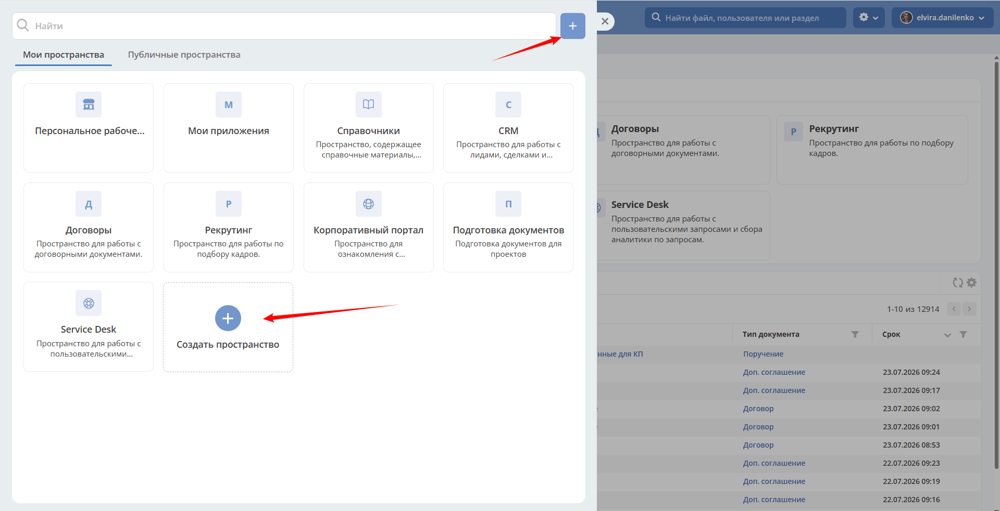
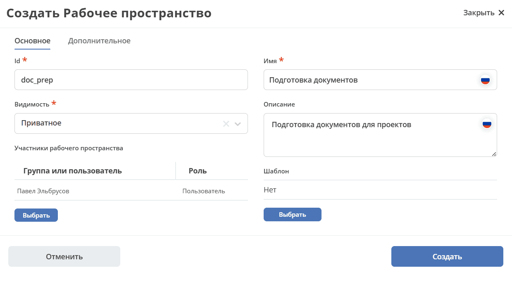
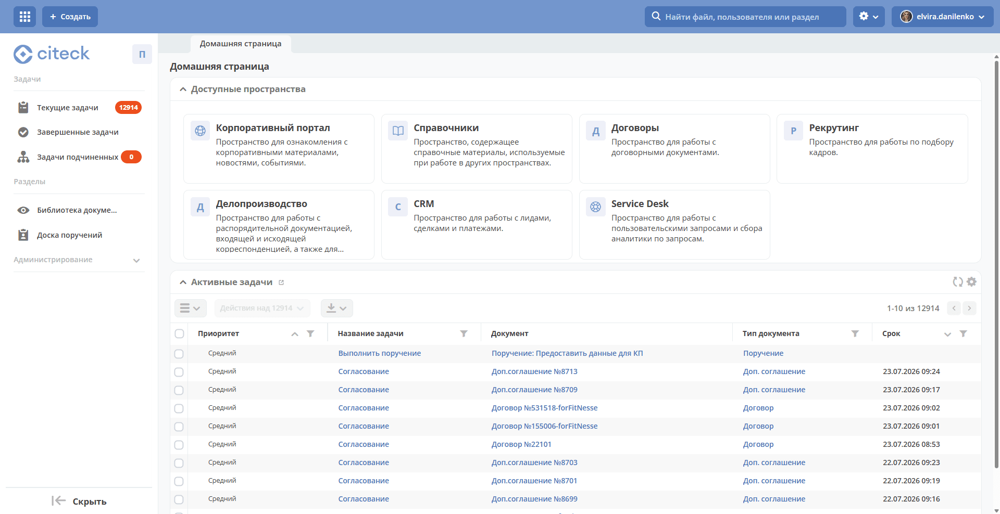
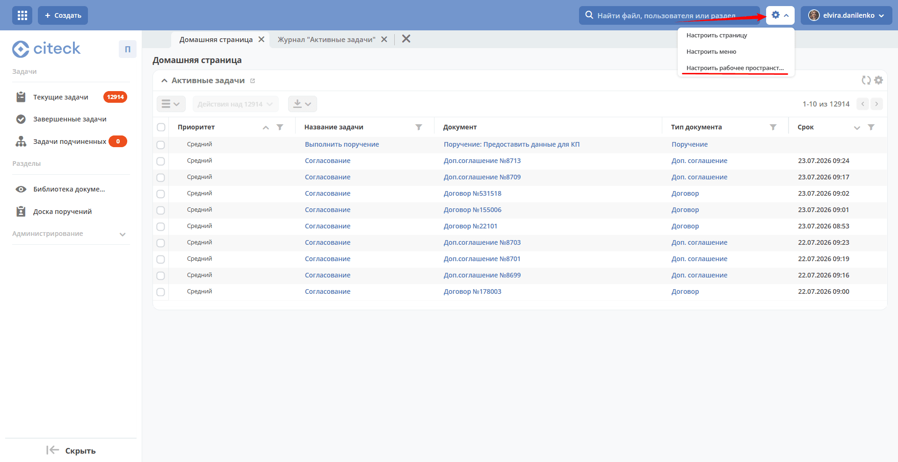
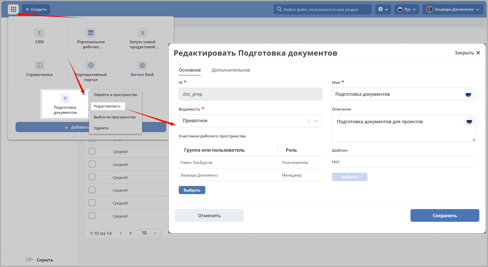

.. _new_workspace:

Создание и редактирование рабочего пространства
==================================================

.. contents::
   :depth: 2

В левом верхнем углу доступна кнопка для выбора рабочих пространств и создания нового:

 .. image:: _static/01_button_select_00.png
       :width: 700
       :align: center

Создание
----------

Нажмите **«Создать пространство»** или **+**: 

Создание доступно аутентифицированным пользователям, если включена настройка :ref:`workspaces-allow-create-for-all-users <ws_admin>`. При её выключении создавать пространства могут ADMIN и SYSTEM.

Вкладка **«Основное»**:

.. list-table::
      :widths: 5 10 30 30
      :header-rows: 1
      :align: center
      :class: tight-table

      * - п/п
        - Наименование
        - Описание
        - Пример заполнения
      * - 1
        - **Id**
        - Уникальный идентификатор рабочего пространства. Задаётся при создании, при редактировании в штатной форме заблокирован. Максимальная длина в форме — 100 символов; допустимость проверяет сервер.
        - doc_prep
      * - 2
        - **Имя**
        - Локализованное название рабочего пространства.
        - Подготовка документов
      * - 3
        - **Видимость**
        - | **Публичное** — аутентифицированные пользователи с ролью USER смогут присоединиться самостоятельно; гостевые, анонимные и системные учётные записи исключены.
          | **Приватное** — доступ предоставляется выбранным участникам; сохраняется административный доступ ADMIN/SYSTEM. Это начальное значение в форме.
        - Приватное
      * - 4
        - **Описание**
        - Локализованное описание рабочего пространства.
        - Подготовка документов для проектов
      * - 5
        - **Участники рабочего пространства**
        - | Выбор пользователей и групп из оргструктуры с ролью **Пользователь** или **Менеджер** (с возможностью управления пространством).
          | Пользователь, создающий пространство, автоматически получает роль **Менеджер** и фиксируется как создатель.
        -

            .. image:: _static/07_new_workspace_05.png
                  :width: 600
                  :align: center

      * - 6
        - **Шаблон**
        - Выбор :ref:`шаблона<template_workspace>` для копирования конфигураций меню и дашбордов, включая настройки их виджетов. Данные и внешние зависимости виджетов автоматически не копируются. Шаблон применяется при создании.
        -

Вкладка **«Дополнительно»**:

 .. image:: _static/07_new_workspace_02.png
       :width: 600
       :align: center

.. list-table::
      :widths: 5 10 30 30
      :header-rows: 1
      :align: center
      :class: tight-table

      * - п/п
        - Наименование
        - Описание
        - Пример заполнения
      * - 1
        - **Адрес домашней страницы**
        - | Адрес домашней страницы пространства. При переключении сначала восстанавливается последняя активная вкладка, если она сохранена.
          | При отсутствии сохранённой вкладки используется этот адрес, а если он не задан — **/v2/dashboard**.
        -
      * - 2
        - **Вложенные рабочие области**
        - | Позволяет включить одно или несколько дочерних рабочих пространств в текущее.
          | Вложенные пространства учитываются запросами, поддерживающими такой контекст. Результат зависит также от настроек журнала и прав на записи.
          | Нельзя добавить пространство в себя или назначить вложенное пространство, у которого уже есть собственные вложенные. Если текущее пространство уже вложено в другое, оно также не может иметь вложенных пространств.
        -
      * - 3
        - **Иконка**
        - Выбор иконки рабочего пространства для отображения в переключателе пространств.
        -

Созданное пространство становится доступно участникам, указанным при создании. В публичное пространство могут самостоятельно вступить другие допустимые пользователи.

Обычные новые пространства не должны использовать разделитель ``$`` в ID. Префикс ``admin$...`` зарезервирован для административных пространств. Помимо пользовательского ID сервер формирует отдельный ``systemId`` для технических идентификаторов области; его не нужно вводить вместо ID пространства.

В штатной конфигурации участники могут работать с файлами библиотеки документов и создавать поручения с учётом предоставленных прав.

Редактирование
----------------

Редактирование рабочего пространства доступно менеджерам, а также ADMIN/SYSTEM. Роль менеджера может быть предоставлена напрямую или через группу.

Перейдите в **настройки** и выберите **«Настроить рабочее пространство»**:

В форме редактирования можно изменить роли участников, добавить новых участников, обновить описание и видимость пространства:

В существующем пространстве должен оставаться хотя бы один менеджер: нельзя удалить последнего менеджера или снять с него эту роль. Поле выбора шаблона при редактировании заблокировано; обновление шаблона не применяется к уже созданному пространству автоматически.

