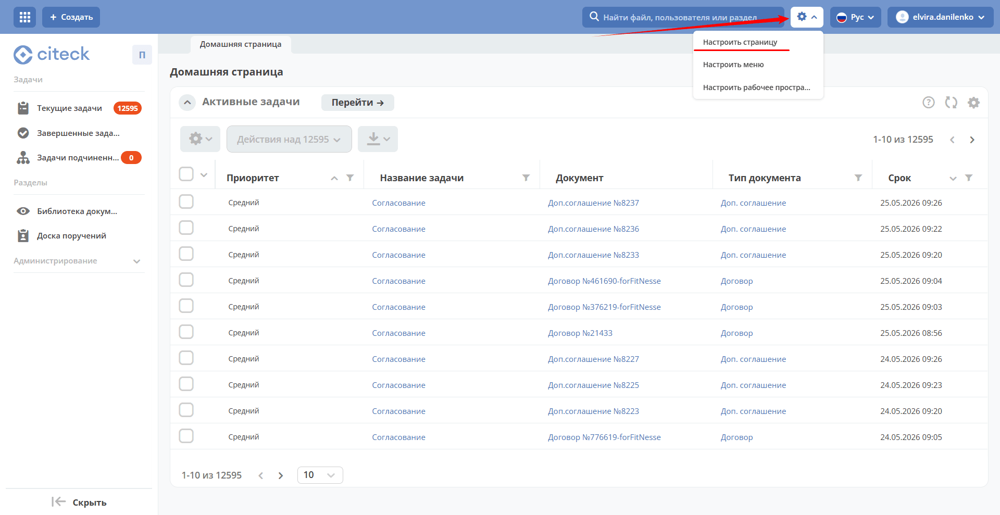
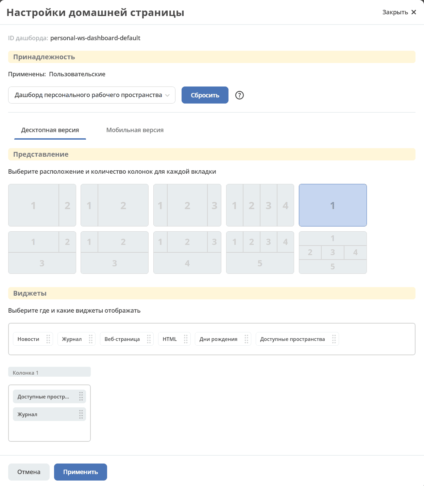
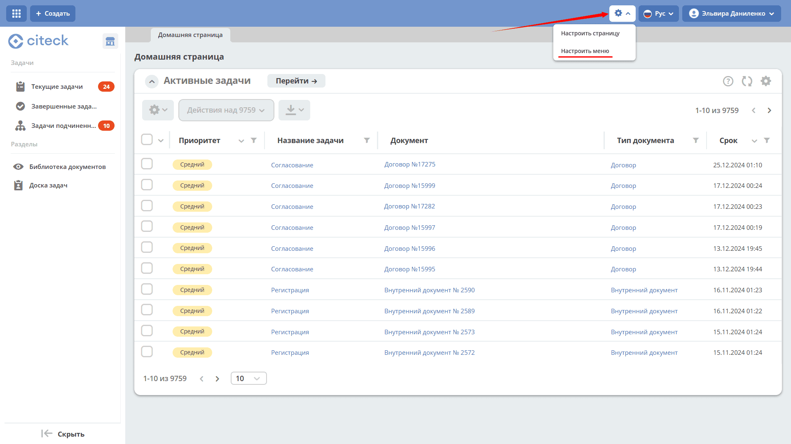
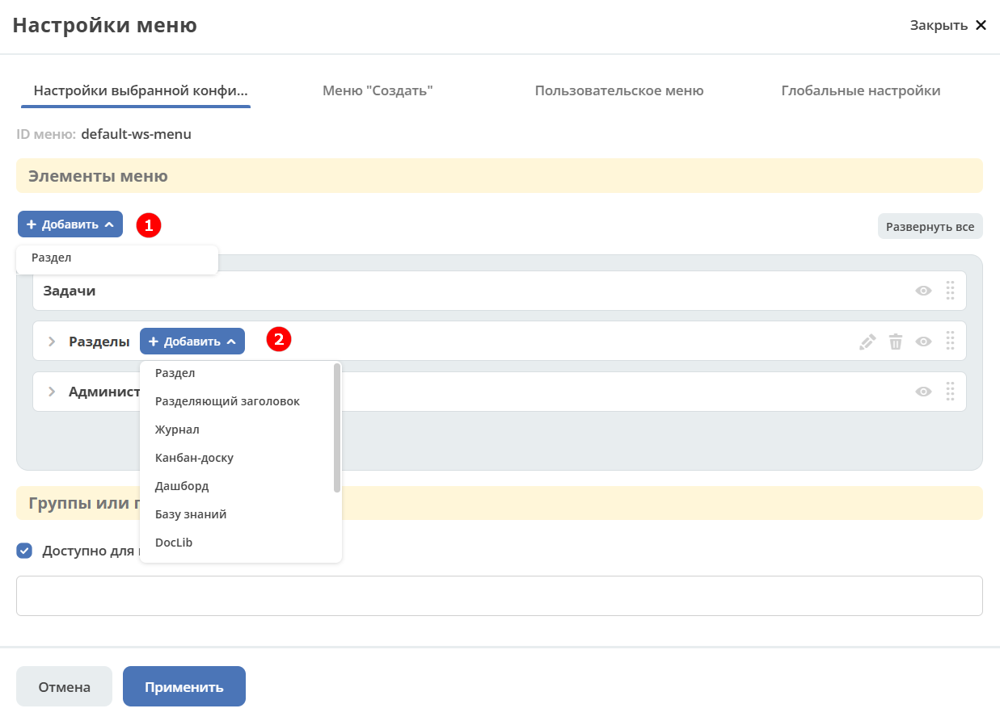
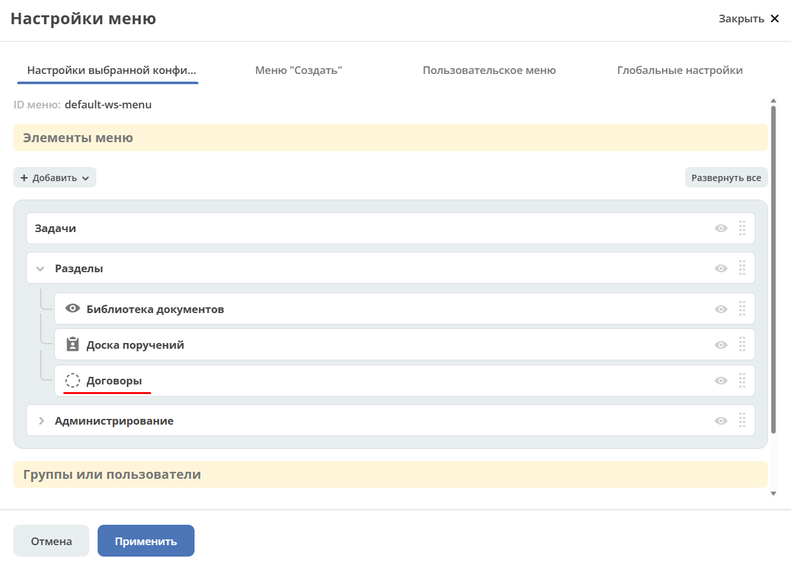
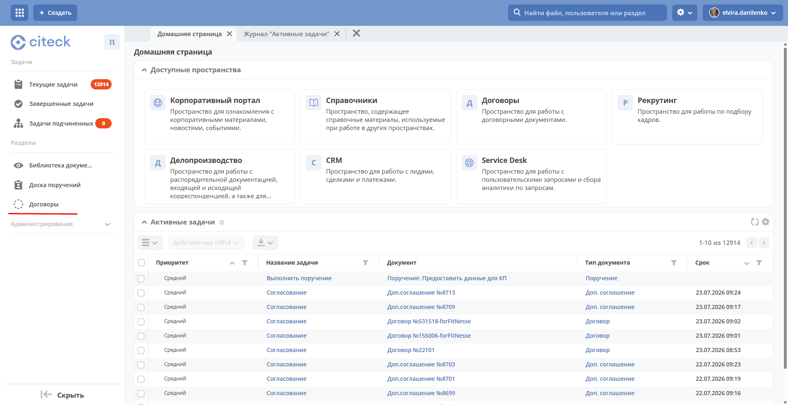

.. _workspace_settings:

Настройки рабочего пространства
==================================

.. contents::
   :depth: 2

Настройка домашней страницы
----------------------------

Если домашняя страница открывает дашборд, его конфигурация выбирается с учётом пространства, типа и пользователя. В поставке предусмотрены исходные конфигурации:

    -   специальный контекст ``default`` — **user-dashboard**;
    -   персональное рабочее пространство — **personal-ws-dashboard-default**;
    -   совместное рабочее пространство — **ws-dashboard-default**.

Пространство, выбранное стартовым через ``default-workspace``, использует конфигурацию своего типа. Например, назначение совместного пространства стартовым не переключает его на ``user-dashboard``. Локальные и пользовательские настройки могут переопределять исходный дашборд; при отсутствии подходящего локального варианта может использоваться глобальный.

При переключении пространства может восстановиться последняя открытая вкладка. Если её нет, используется ``homePageLink`` пространства или адрес дашборда.

Для настройки дашборда выберите нужное рабочее пространство: персональное или то, в котором вы являетесь **Менеджером**. Перейдите в **настройки** и выберите **«Настроить страницу»**:

Откроется страница настроек домашней страницы, где можно изменить схему расположения и набор отображаемых виджетов.

В блоке **«Колонки»** выберите количество и расположение колонок — для этого кликните по нужной схеме.

В блоке **«Виджеты»** перетащите необходимые виджеты в колонки домашней страницы.

Для сохранения изменений нажмите **«Применить»** внизу страницы.

Общая конфигурация пространства и персональный вариант дашборда различаются. При сохранении пользователем без прав изменения общего варианта сервис может привязать настройку к этому пользователю. Доступность редактора и отдельных настроек зависит от конфигурации интерфейса.

.. _menu_ws_settings:

Настройка меню
----------------

Выберите нужное рабочее пространство: персональное или то, в котором вы являетесь **Менеджером**. Перейдите в **настройки** и выберите **«Настроить меню»**:

Доступно добавление раздела **(1)** и элементов внутри раздела **(2)**:

См. подробно о каждом :ref:`добавляемом элементе<menu_element_types>`.

Пример: добавим в меню журнал «Договоры»:

Обновлённая общая конфигурация меню используется для участников пространства с учётом их прав и индивидуальных/групповых вариантов меню. Пункт меню сам по себе не предоставляет доступ к данным или действию.

