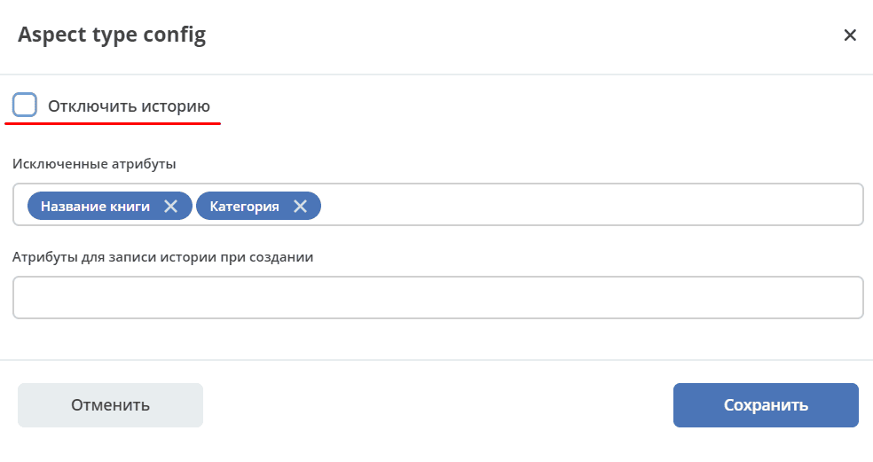
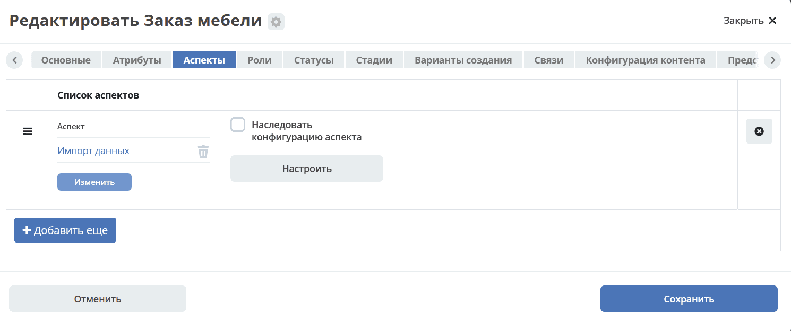
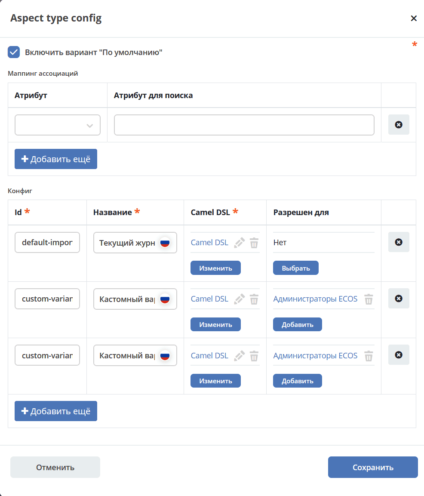
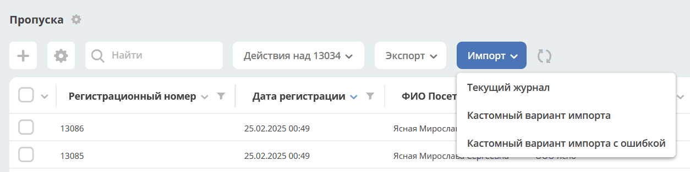
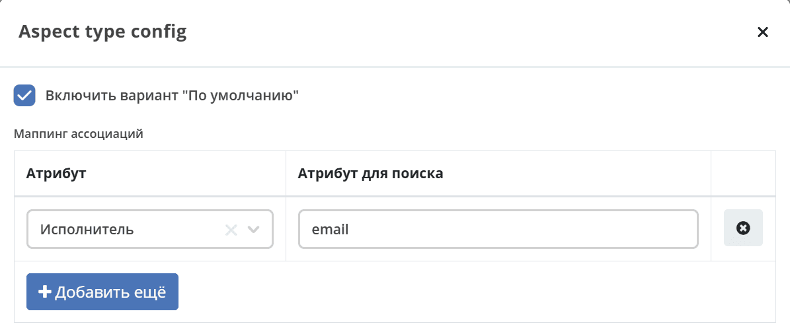
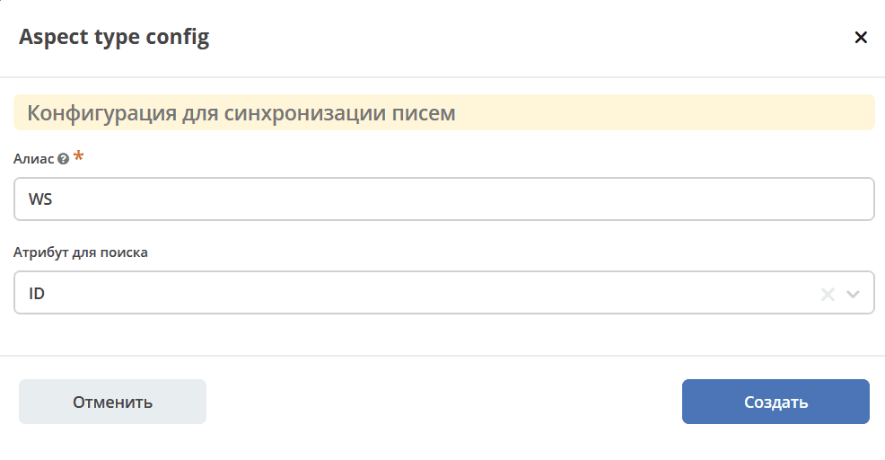

.. _aspects_user:

Аспекты
=========

.. contents::
   :depth: 3

**Аспект** — механизм расширения функционала :ref:`типа данных<data_types>` без изменения самого типа. Аспект добавляет к сущностям дополнительные атрибуты, форму конфигурации и связанное поведение, при этом тип данных остаётся неизменным.

Один и тот же аспект можно подключить к нескольким типам данных, что позволяет переиспользовать логику без дублирования. Аспект может быть добавлен к типу явно — через вкладку **Аспекты** в настройках типа, или автоматически — в зависимости от конфигурации.

Атрибуты аспекта доступны через префикс в формате ``{prefix}:{attribute.id}``, что позволяет однозначно идентифицировать их в формах, журналах, конфигурациях действий и мутациях записей.

В Citeck представлены системные аспекты для типовых задач:

  - учёт времени;
  - управление связями между документами;
  - генерация штрихкода;
  - конфигурация истории событий;
  - импорт данных;
  - обработка активностей.

Для просмотра существующих аспектов и их редактирования создан журнал **"Аспекты" (Рабочее пространство "Раздел администратора" - Модель)**:

 .. image:: _static/aspects/aspects_1.png
       :width: 600
       :align: center

В журнале администратору с каждой записью доступен стандартный набор действий:

  - редактировать json-файл;
  - редактировать свойства;
  - скачать;
  - удалить.

См. больше информации :ref:`о разработке<aspects>`

Создание нового аспекта
-------------------------

Форма создания нового аспекта состоит из 2 вкладок.

**Вкладка "Основные":**

 .. image:: _static/aspects/aspects_2.png
       :width: 600
       :align: center

.. list-table::
      :widths: 10 30 30
      :header-rows: 1
      :align: center
      :class: tight-table 

      * - п/п
        - Наименование
        - Описание
      * - 1
        - **Идентификатор**
        - уникальный идентификатор аспекта
      * - 2
        - **Префикс**
        - | Предназначен, чтобы различать атрибуты из разных аспектов.
          | Префикс добавляется ко всем атрибутам аспекта по шаблону ``{prefix}:{attribute.id}``. 
          | Таким образом атрибуты могут быть доступны в формах, конфигах действий, мутации записей.
          | Если префикс отдельно не задан, то по умолчанию равен идентификатору.
      * - 3
        - **Название**
        - локализованное наименование
      * - 4
        - **Форма конфигурации**
        - | Функционал позволяет расширять конфигурацию типа, не меняя форму типа.
          | Форма может быть выбрана из ранее созданных или создана.

**Вкладка "Атрибуты":**

 .. image:: _static/aspects/aspects_3.png
       :width: 600
       :align: center

Атрибуты аспекта и системные атрибуты аспекта, которые будут добавлены к сущностям с данным аспектом.

.. list-table::
      :widths: 10 30 30 30
      :header-rows: 1
      :align: center
      :class: tight-table 

      * - п/п
        - Наименование
        - Описание
        - Пример заполнения
      * - 1
        - **Id**
        - идентификатор поля, по которому оно будет доступно на форме, в журнале.
        - testAttribute (camelCase)
      * - 2
        - **Имя**
        - имя поля для отображения пользователю.
        - Тестовый атрибут
      * - 3
        - **Тип**
        - тип поля. :ref:`Поддерживаемые типы данных<ecos-model_types>`
        - выбирается из списка предлагаемых. По умолчанию выставляется text.
      * - 4
        - **Множественный**
        - множественный ввод разрешен
        - флаг
      * - 5
        - **Обязательный**
        - поле обязательно к заполнению
        - флаг
      * - 6
        - **Вычисляемые атрибуты**
        - функционал, позволяющий установить выражение-зависимость, позволяющий гибко создавать производные атрибуты :ref:`См. подробно<attribute_rights>`
        - настройка конфигурации в зависимости от типа и сложности вычисления атрибута

В поле ``_aspects`` как и при добавлении любого другого аспекта вносится информация об аспекте.

 .. image:: _static/aspects/aspects_4.png
       :width: 600
       :align: center

.. note::

  Каждый аспект может быть добавлен как явно (во вкладке Аспекты), так и автоматически (см. ниже **Учет времени**)

Примеры
--------

Связан с другим документом
~~~~~~~~~~~~~~~~~~~~~~~~~~~~

Аспект **"Связан с другим документом"** создан для работы виджета **"Связи документа"** (добавление и отображение связей с сущностью ):

 .. image:: _static/aspects/associated_1.png
       :width: 600
       :align: center

В поле ``assoc:associatedWith`` вносится информация о связанных сущностях.

 .. image:: _static/aspects/associated_2.png
       :width: 600
       :align: center

Имеет штрихкод
~~~~~~~~~~~~~~~

.. _barcode_aspect:

Аспект **"Имеет штрихкод"** создан для формирования штрихкода к документу:

 .. image:: _static/aspects/barcode_1.png
       :width: 600
       :align: center

В аспекте нет атрибутов, но есть форма настройки:

 .. image:: _static/aspects/barcode_2.png
       :width: 400
       :align: center

При выборе аспекта в типе данных можно настроить формат штрих-кода и атрибут, из которого брать данные для формирования штрих-кода (по умолчанию номер документа ``_docNum``).

Для реализации сложной логики - необходимо создать :ref:`вычисляемый атрибут<count_attributes>`, и на основе него добавить аспект и далее брать настройку штрих-кода из атрибута.

Учет времени
~~~~~~~~~~~~~~

.. _time-trackable_aspect:

Аспект **"Учет времени"** создает записи о потраченном времени по задаче:

 .. image:: _static/aspects/time_trackable_1.png
       :width: 600
       :align: center

В аспекте есть атрибут ``timeTracking`` - запись о потраченном времени:

 .. image:: _static/aspects/time_trackable_2.png
       :width: 500
       :align: center

Отражается в виде дочерней ассоциации: ``time-trackable:timeTracking``:

 .. image:: _static/aspects/time_trackable_3.png
       :width: 500
       :align: center

При таком выборе атрибут аспекта является дочерней ассоциацией.

Следовательно, по сущности ``timeTracking`` можно перейти к родителю. В атрибуте ``timeTracking``, соответственно, содержатся ссылки на все дочерние сущности. 

Таким образом образуется двухсторонняя связь: 

  - от дочернего к родителю по системному атрибуту ``_parent``, 
  - от родителя к дочернему по настроенному атрибуту.

Если удаляется родитель, то удаляются дочерние сущности по всем ассоциациям. 

Если заданы права по умолчанию, то дочерние наследуют права от родителей. Соответственно, просматривать ``timeTracking`` могут все, у кого доступ к документу.

При создании ``timeTracking``- сущности доступны 2 атрибута, которые позволяют сделать связь с родителем:

.. code-block:: text

  _parent?str: "emodel/type@document"  //Заявка, с которой мы связываем родителя.
  _parentAtt?str: "time-trackable:timeTracking"  //Атрибут от родителя к дочерней сущности, куда его нужно добавить.

Конфигурация истории
~~~~~~~~~~~~~~~~~~~~~~~

.. _history-config_aspect:

Аспект **«Конфигурация истории»** создан для возможности конфигурации записи свойств в историю.

.. grid:: 2
   :gutter: 2

   .. grid-item::

      .. image:: _static/aspects/history-config_08.png
         :width: 500
         :align: left

   .. grid-item::

      .. image:: _static/aspects/history-config_07.png
         :width: 500
         :align: left

Для настройки необходимо добавить этот аспект в тип данных на вкладке **Аспекты**:

 .. image:: _static/aspects/history-config_01.png
       :width: 600
       :align: center

Аспект добавляет 3 настройки, которые можно задать как в форме, так и напрямую в json:

.. list-table::
      :widths: 20 30
      :header-rows: 1
      :align: center
      :class: tight-table

      * - Настройка
        - Описание
      * - **Исключенные атрибуты** (``excludedAtts``)
        - атрибуты, изменение которых не записывается в историю
      * - **Атрибуты для записи истории при создании** (``onCreationHistoricalAtts``)
        - атрибуты, создание которых записывается в историю
      * - **Отключить историю**
        - полностью отключает запись изменений в историю

Исключенные атрибуты
"""""""""""""""""""""

По кнопке **Настроить** в строке **Исключенные атрибуты** доступен выбор атрибутов типа данных, информация об изменении которых не будет записываться в **историю**, и отражаться в виджете **«История событий»**, соответственно.

.. grid:: 2
   :gutter: 2

   .. grid-item::

      .. image:: _static/aspects/history-config_02.png
         :width: 500
         :align: left

   .. grid-item::

      .. image:: _static/aspects/history-config_03.png
         :width: 500
         :align: left

Например, если в карточке изменить информацию о наименовании, категории и стоимости, то в виджете **«История событий»** отразится информация только об измененной стоимости:

 .. image:: _static/aspects/history-config_04.png
       :width: 600
       :align: center

Если в типе данных настроены аспекты (например, **Версионные данные**, **Имеет документы**), то атрибуты из них так же можно выбрать: 

.. grid:: 2
   :gutter: 2

   .. grid-item::

      .. image:: _static/aspects/history-config_09.png
         :width: 500
         :align: left

   .. grid-item::

      .. image:: _static/aspects/history-config_10.png
         :width: 500
         :align: left

Атрибуты для записи истории при создании
""""""""""""""""""""""""""""""""""""""""""

По кнопке **Настроить** в строке **Атрибуты для записи истории при создании** доступен выбор атрибутов типа данных, информация о создании которых будет записываться в **историю**, и отражаться в виджете **«История событий»**, соответственно.

.. grid:: 2
   :gutter: 2

   .. grid-item::

      .. image:: _static/aspects/history-config_12.png
         :width: 500
         :align: left

   .. grid-item::

      .. image:: _static/aspects/history-config_13.png
         :width: 500
         :align: left

Например:

 .. image:: _static/aspects/history-config_14.png
       :width: 600
       :align: center

Также можно вносить атрибуты непосредственно в json:

  - **excludedAtts** - исключенные атрибуты;
  - **onCreationHistoricalAtts** - атрибуты для записи истории при создании

.. grid:: 2
   :gutter: 2

   .. grid-item::

      .. image:: _static/aspects/history-config_05.png
         :width: 500
         :align: left

   .. grid-item::

      .. image:: _static/aspects/history-config_06.png
         :width: 500
         :align: left

Отключить историю
""""""""""""""""""

При выставленном чекбоксе **Отключить историю** при изменении никакие данные не будут записываться в **историю**, и отражаться в виджете **«История событий»**, соответственно.

Импорт данных
~~~~~~~~~~~~~~~

.. _import-data-config_aspect:

Аспект **import-data-config (Импорт данных)** - необходим для настройки вариантов импорта данных.

Форма настройки:

* **id** - id варианта.
* **Название** - название варианта, которое будет отображаться в журнале.
* **Camel DSL** - Camel DSL с типом IMPORT_DATA, в котором описана обработка данных.
* **Разрешен для** - можно указать группы или пользователей напрямую. Если оставить пустым, вариант будет доступен всем.

Для типа данных может быть добавлено несколько конфигураций импорта.

Созданные конфигурации будут доступны в журнале по кнопке **Импорт**:

Вариант «По умолчанию»
"""""""""""""""""""""""""

Если вариант **«По умолчанию»** включен, можно указать **Маппинг для ассоциаций**.

Указывается **атрибут** в Типе данных и **атрибут** в связанном типе, **для поиска**. Атрибутов для поиска может быть указано несколько.
Если поле оставить пустым, то поиск будет вестись по системному атрибуту **_name**.

.. note:: 

      Шаблон для варианта **«По умолчанию»** формируется по журналу, в котором выполняется скачивание шаблона.

      Если в типе присутствуют обязательные атрибуты, которых нет в журнале, они будут добавлены в конец столбцов в шаблоне.

      В шаблон не выгружаются системные, вычисляемые (созданные и в типе данных, и в журнале), вложенные поля.

Для варианта **«По умолчанию»** добавлен универсальный CamelDSL **default-import-data**. 

Имеет активности
~~~~~~~~~~~~~~~~~~

.. _has-ecos-activities_aspect:

Чтобы письмо обрабатывалось и добавлялось как активность необходимо:

#. Добавить в тип данных аспект **Имеет активности** (has-ecos-activities) и настроить его конфигурацию:

   .. image:: _static/aspects/has-ecos-activities_1.png
         :width: 500
         :align: center

   Указать **алиас**, по которому будет осуществляться поиск типа данных в заголовке письма, выбрать **атрибут** типа данных.

#. В Теме сообщения в конце указывать связь в формате **(Алиас: Значение)**

   .. image:: _static/aspects/has-ecos-activities_2.png
         :width: 400
         :align: center

Для рабочих пространств по умолчанию добавлена следующая настройка аспекта:

Для включения обработки писем в виджете "Активности" необходимо указать почтовый ящик в настройке :ref:`mail-inbox-activity<mail-inbox-activity>`.

Вычисляемые атрибуты в аспекте
~~~~~~~~~~~~~~~~~~~~~~~~~~~~~~~~

.. _computed-atts_aspect:

Пример показывает, как один раз описать :ref:`вычисляемые атрибуты<count_attributes>` в аспекте и переиспользовать их в нескольких типах данных. Скрипт аспекта выполняется в контексте записи того типа, к которому подключён аспект, и может читать её атрибуты через ``value.load(...)``.

Пример состоит из трёх файлов:

.. list-table::
      :widths: 20 40
      :header-rows: 1
      :class: tight-table
      :align: center

      * - Файл
        - Назначение
      * - ``age-test-aspect.yml``
        - аспект **«Вычисление возраста»** с вычисляемыми атрибутами
      * - ``age-example-a-type.yml``
        - тип данных **«Пример возраста — тип A»**, к которому подключён аспект
      * - ``age-example-b-type.yml``
        - тип данных **«Пример возраста — тип B»**, к которому подключён тот же аспект

Аспект
"""""""

Аспект ``age-test`` содержит два вычисляемых атрибута типа ``SCRIPT``. Оба используют ``storingType: ON_MUTATE`` — значение пересчитывается и сохраняется при каждом изменении записи.

.. list-table::
      :widths: 15 15 40
      :header-rows: 1
      :class: tight-table
      :align: center

      * - Атрибут
        - Тип
        - Описание
      * - ``constant``
        - TEXT
        - всегда возвращает строку ``"Любой текст"``. Служит для проверки, что вычисляемые атрибуты аспекта работают на типе
      * - ``age``
        - NUMBER
        - возраст на дату расчёта, вычисленный по атрибутам записи ``dateBirth`` и ``calculationDate``

Алгоритм вычисления атрибута ``age``:

#. Прочитать из записи ``dateBirth`` и ``calculationDate`` в строковом виде (``?str``).
#. Если хотя бы одна из дат не заполнена — вернуть ``null``.
#. Разобрать обе даты на год, месяц и день (первые 10 символов в формате ``ГГГГ-ММ-ДД``).
#. Если дата расчёта раньше даты рождения — вернуть ``null``.
#. Вычесть год рождения из года расчёта. Если в году расчёта день рождения ещё не наступил — уменьшить результат на 1.

.. dropdown:: age-test-aspect.yml
   :color: secondary

   .. code-block:: yaml

      id: age-test
      name:
        ru: Вычисление возраста

      attributes:
        - id: constant
          name:
            ru: Проверка вычисления
          type: TEXT
          computed:
            type: SCRIPT
            storingType: ON_MUTATE
            config:
              fn: |
                return "Любой текст";

        - id: age
          name:
            ru: Возраст на дату расчёта
          type: NUMBER
          computed:
            type: SCRIPT
            storingType: ON_MUTATE
            config:
              fn: |
                var birth = value.load('dateBirth?str');
                var target = value.load('calculationDate?str');

                if (!birth || !target) return null;

                var b = birth.substring(0, 10).split('-').map(Number);
                var d = target.substring(0, 10).split('-').map(Number);

                if (d[0] < b[0] ||
                    (d[0] === b[0] &&
                     (d[1] < b[1] ||
                      (d[1] === b[1] && d[2] < b[2])))) {
                  return null;
                }

                var age = d[0] - b[0];

                if (d[1] < b[1] ||
                    (d[1] === b[1] && d[2] < b[2])) {
                  age--;
                }

                return age;

Типы данных
""""""""""""

Оба типа наследуются от ``emodel/type@user-base``, хранятся в ``ECOS_MODEL`` и подключают аспект через ``aspects: - ref: emodel/aspect@age-test``. Набор собственных атрибутов у типов одинаковый: ``name``, ``dateBirth``, ``calculationDate``. Типы различаются только идентификатором и названием.

.. tab-set::

   .. tab-item:: Тип A

      .. code-block:: yaml

         id: age-example-a
         name:
           ru: Пример возраста — тип A

         parentRef: emodel/type@user-base
         storageType: ECOS_MODEL

         aspects:
           - ref: emodel/aspect@age-test

         model:
           attributes:
             - id: name
               name:
                 ru: Имя
               type: TEXT

             - id: dateBirth
               name:
                 ru: Дата рождения
               type: DATE

             - id: calculationDate
               name:
                 ru: Дата расчёта
               type: DATE

   .. tab-item:: Тип B

      .. code-block:: yaml

         id: age-example-b
         name:
           ru: Пример возраста — тип B

         parentRef: emodel/type@user-base
         storageType: ECOS_MODEL

         aspects:
           - ref: emodel/aspect@age-test

         model:
           attributes:
             - id: name
               name:
                 ru: Имя
               type: TEXT

             - id: dateBirth
               name:
                 ru: Дата рождения
               type: DATE

             - id: calculationDate
               name:
                 ru: Дата расчёта
               type: DATE

В результате у записей обоих типов автоматически появляются атрибуты аспекта, которые вычисляются по данным самой записи. Префикс в аспекте не задан, поэтому он равен идентификатору, и атрибуты доступны как ``age-test:constant`` и ``age-test:age``.

.. note::

   Аспект не объявляет атрибуты ``dateBirth`` и ``calculationDate`` — он рассчитывает на то, что они есть в типе данных. Если подключить аспект к типу без этих атрибутов, ``age`` всегда будет ``null``, ошибки при этом не возникнет.

   Чтобы сделать аспект самодостаточным, ``dateBirth`` и ``calculationDate`` можно перенести в ``attributes`` самого аспекта — тогда в типах их объявлять не нужно.

