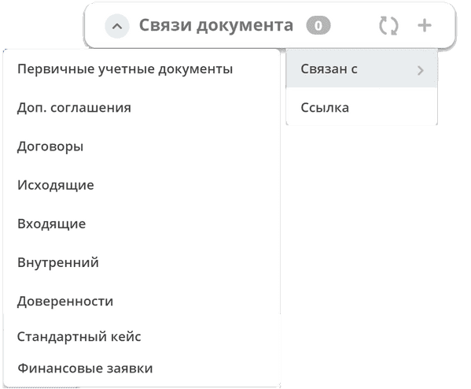
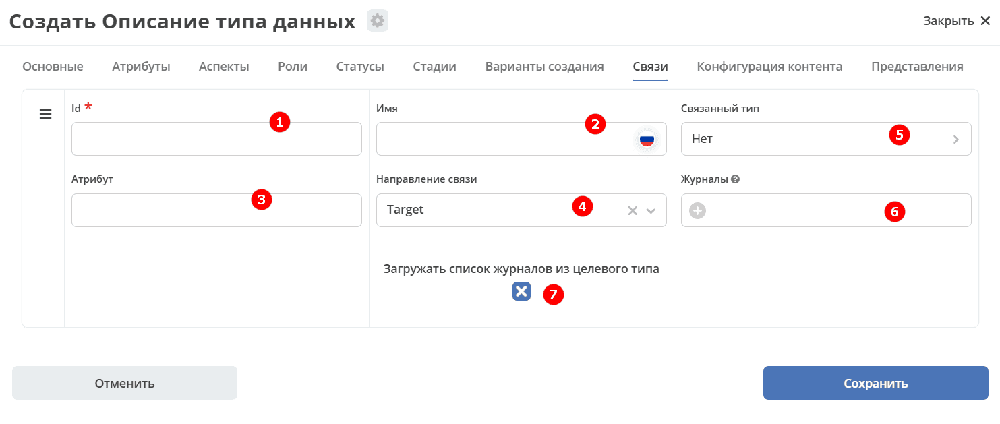
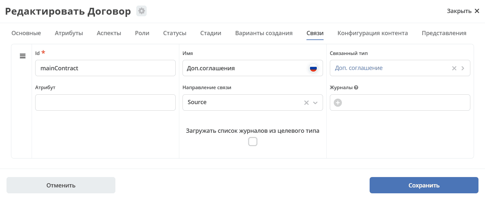
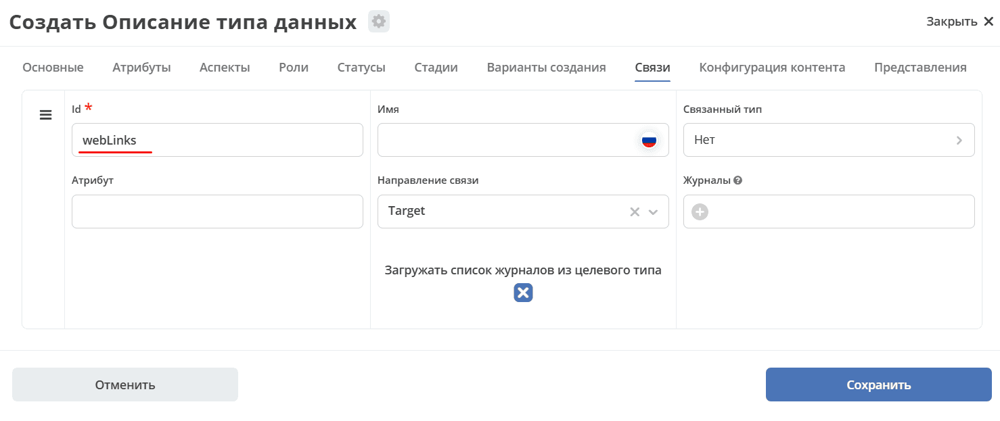

.. _datatypes_associations:

Связи
======

Вкладка **«Связи»** в настройках типа данных позволяет определить, какие ассоциации между объектами будут доступны пользователю: какие связанные документы отображать, как добавлять новые связи и удалять существующие.

**Связи (associations)** — это механизм, позволяющий связывать объекты разных типов данных между собой. Настроенные связи отображаются в виджете формы :ref:`«Связи документов» <widget_doc_associations>` на карточке объекта.

С помощью связей можно:

- отображать связанные с текущим объектом документы;
- добавлять новые связи между объектами;
- удалять существующие связи;
- настраивать направление связи — одностороннее или двустороннее.

Каждая связь задаётся с указанием идентификатора, имени, атрибута хранения и направления (``SOURCE``, ``TARGET`` или ``BOTH``).

.. list-table::
      :widths: 10 30 30
      :header-rows: 1
      :align: center
      :class: tight-table

      * - п/п
        - Наименование
        - Описание
      * - 1
        - **Id**
        - | идентификатор связи. Обязательное поле в форме настройки.
          | Это поле нужно для:
          | 1. Переопределения конфигурации связи в дочернем типе. При совпадении ID пустые поля «Атрибут», «Связанный тип», «Имя» и незаданный признак дочерней связи дозаполняются из родительской конфигурации.
          | 2. Указания атрибута хранения, если поле «Атрибут» пустое и атрибут не задан в родительской связи.
      * - 2
        - **Имя**
        - имя связи для отображения в интерфейсе
      * - 3
        - **Атрибут**
        -  | в который новые связи будут добавляться и из которого будут загружаться.
           | Как правило это ассоциация из вкладки :guilabel:`Атрибуты`. Если поле пустое, используется атрибут родительской связи с тем же ID; если его нет — значение ID.
      * - 4
        - **Направление связи**
        - | определяет какие связи отображать в виджете связей. Любая связь строится по принципу **SOURCE -> TARGET**
          |
          | - **SOURCE** - на карточке цели **TARGET** отображаются исходные документы **SOURCE**, ссылающиеся на неё.
          |
          | - **TARGET** - на карточке источника **SOURCE** отображаются связанные целевые документы **TARGET**. Эта настройка сама по себе не добавляет отображение обратной связи на карточке **TARGET**.
          |
          | - **BOTH** - двухсторонняя связь. И на карточке **SOURCE** и на карточке **TARGET** увидим нашу связь.
      * - 5
        - **Связанный тип**
        - тип сущностей, с которыми мы можем связать наш документ.
      * - 6
        - **Журналы**
        - список журналов, которые можно использовать для создания новой связи. Если необходимо создавать связи не с одним определенным типом.
      * - 7
        - **Загружать список журналов из целевого типа**
        - | загрузка списка журналов из типа данных.
          | При **false** используется явно заданный список журналов. При **null** и непустом явном списке используется этот список.
          | В остальных случаях система ищет журнал целевого типа, затем, если он не задан, журналы его потомков.

Если связанный тип не задан и не может быть получен из родительской связи или конфигурации атрибута ASSOC, связь исключается из итоговой конфигурации. Для обычной, не дочерней связи также требуется непустой результирующий список журналов.

Для дочерней связи список журналов очищается, а загрузка журналов из целевого типа отключается. Признак дочерней связи и целевой тип могут быть получены из настроек атрибута ASSOC, если они не заданы в конфигурации связи или её родителе.

Пример:

Связь документа с простой ссылкой
-----------------------------------

Для добавления возможности связать документ с простой ссылкой (**Id** - webLinks, **Направление связи** - Target):

.. _associations_both_sides:

Связь в обе стороны
--------------------

Для связи в обе стороны необходимо, чтобы у источника ассоциации и у цели ассоциации была настроена ассоциация в типе с одним ID.

.. grid:: 2
   :gutter: 2

   .. grid-item::

      .. image:: _static/both_link_1.png
         :width: 500
         :align: left

   .. grid-item::

      .. image:: _static/both_link_2.png
         :width: 500
         :align: left

.. dropdown:: Простой пример настройки связей
   :color: secondary

   1. Создадим 2 типа данных:

   **Sons**:

   .. grid:: 2
      :gutter: 2

      .. grid-item::

         .. image:: _static/Sample/r_01.png
            :width: 500
            :align: left

      .. grid-item::

         .. image:: _static/Sample/r_02.png
            :width: 500
            :align: left

   **Dad**:

   .. grid:: 2
      :gutter: 2

      .. grid-item::

         .. image:: _static/Sample/r_03.png
            :width: 500
            :align: left

      .. grid-item::

         .. image:: _static/Sample/r_04.png
            :width: 500
            :align: left

   **Son** зададим ассоциацией:

   .. image:: _static/Sample/r_05.png
      :width: 300
      :align: center

   2. Заполним журнал **Sons** элементами:

   .. image:: _static/Sample/r_06.png
      :width: 700
      :align: center

   3. Заполним **Dad** - добавим к нему **sons**:

   .. image:: _static/Sample/r_07.png
      :width: 700
      :align: center

   **Случай 1.** Чтобы **у Dad в виджете «Связи» отображались Sons.** Для этого необходимо:

   1. Перейти в тип данных **Dad** во вкладку **«Связи»**, настроить:

      .. image:: _static/Sample/r_08.png
         :width: 600
         :align: center

      a. **Идентификатор связи.**
      b. **Наименование связи**, которое будет использоваться в виджете.
      c. **Атрибут**, в который новые связи будут добавляться и из которого будут загружаться.
      d. **Направление связи.** **Source** является **Dad**, **target**, соответственно, **Sons**.
      e. **Тип данных.** Для добавления элементов в виджете по нажатию **+**, и правильного отображения столбцов в нем.

   2. Перейти в журнал **Dad**, открыть карточку:

      .. image:: _static/Sample/r_09.png
         :width: 700
         :align: center

      .. image:: _static/Sample/r_10.png
         :width: 600
         :align: center

   **Случай 2.** Чтобы **у каждого Son в виджете «Связи» отображался его Dad.** Для этого необходимо:

   1. Перейти в тип данных **Sons** во вкладку **«Связи»**, настроить:

      .. image:: _static/Sample/r_11.png
         :width: 600
         :align: center

      a. **Идентификатор связи.**
      b. **Наименование связи**, которое будет использоваться в виджете.
      c. **Атрибут**, в который новые связи будут добавляться и из которого будут загружаться.
      d. **Направление связи.** **Source** является **Son**, **target**, соответственно, **Dad**.
      e. **Тип данных.** Для добавления элементов в виджете по нажатию **+**, и правильного отображения столбцов в нем.

   2. Перейти в журнал **Sons**, открыть карточку:

      .. image:: _static/Sample/r_12.png
         :width: 600
         :align: center
