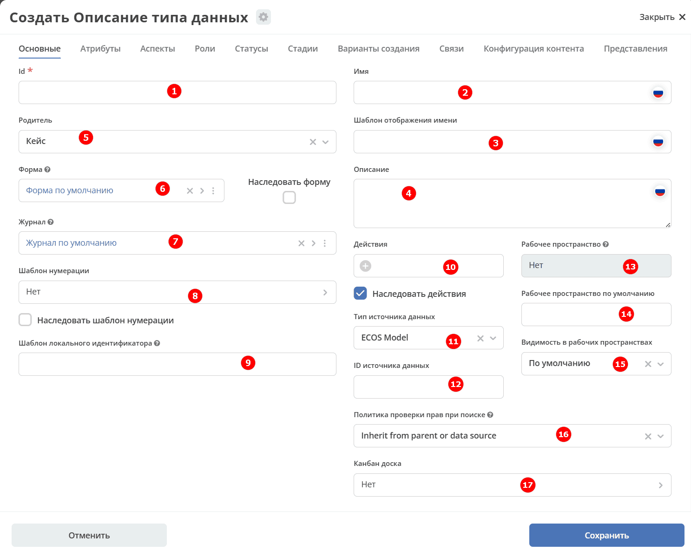
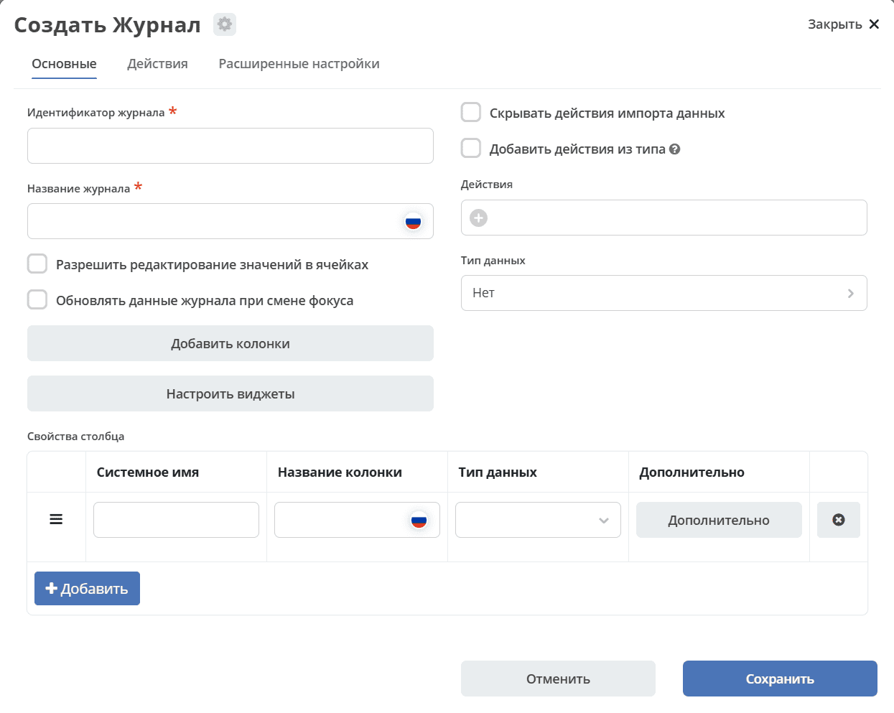
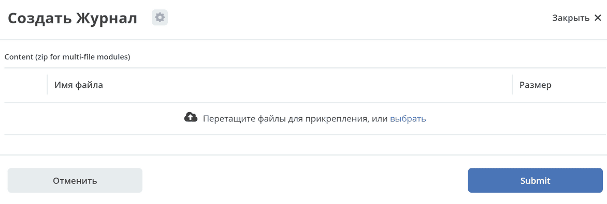
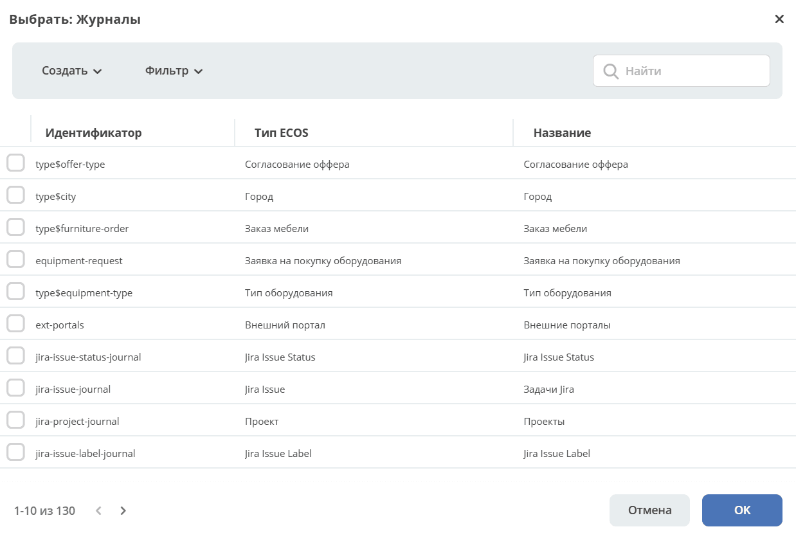

.. _data_types_main:

Основной
========

Вкладка **«Основной»** — отправная точка при создании или редактировании типа данных. Здесь задаются ключевые параметры типа: идентификатор, название, родительский тип, связанные форма и журнал, хранилище данных, шаблон нумерации, доступные действия и настройки видимости в рабочих пространствах.

Поля **«Родитель»**, **«Форма»** и **«Журнал»** заполняются автоматически значениями по умолчанию и могут быть изменены вручную.

Общая информация
-----------------

.. list-table::
      :widths: 10 30 30 30
      :header-rows: 1
      :align: center
      :class: tight-table

      * - п/п
        - Наименование
        - Описание
        - Пример заполнения
      * - 1
        - **Id (обязательное)**
        - уникальный идентификатор типа
        - test_type (snake case)
      * - 2
        - **Имя**
        - локализованное название компонента
        - Тестовый тип
      * - 3
        - **Шаблон отображения имени**
        - | локализованный шаблон заголовка записи, отображаемого при запросах ее локализованного имени (расширенный вариант для параметра **«Имя»**).
          | Поддерживает выражения с использованием данных записи
        - Тестовый тип № ${counter}
      * - 4
        - **Описание**
        - локализованное описание данного типа (необязательно).
        - Тип, используемый для тестовых целей
      * - 5
        - **Родитель**
        - тип данных, на основании которого, создается текущий.
        - | выбирается из списка предлагаемых:
          | :ref:`Кейс (по умолчанию), Справочник <data_types_types>`, Документ, Файл библиотеки документов, Публикация
          | Остальное – иные созданные ранее типы данных, на основе которых можно создать новый тип.

Родителем может быть глобальный тип или тип из того же рабочего пространства. Глобальный тип не может наследоваться от типа рабочего пространства. Циклическое наследование не допускается.

Форма, журнал и нумерация
--------------------------

.. list-table::
      :widths: 10 30 30 30
      :header-rows: 1
      :align: center
      :class: tight-table

      * - п/п
        - Наименование
        - Описание
        - Пример заполнения
      * - 1
        - **Форма**
        - | ссылка на форму, которая будет открываться при инициировании создания записи данного типа.
          | Для наследования формы включите **«Наследовать форму»** и очистите поле **«Форма»**. При разрешении типа будет использована форма родителя. Начальное значение **«Форма по умолчанию»** является собственной ссылкой и препятствует наследованию.
        - есть вариант создания автоматически по умолчанию (Форма по умолчанию), создания вручную (Создать-Создать форму), загрузки (Создать-Загрузить форму).
      * - 2
        - **Журнал**
        - ссылка на журнал, который будет отображать записи данного типа
        - есть вариант создания автоматически по умолчанию (Журнал по умолчанию), создания вручную (Создать-Создать журнал), загрузки (Создать-Загрузить журнал).
      * - 3
        - **Шаблон нумерации**
        - | шаблон нумерации :ref:`См. Шаблоны нумерации<number_template>`
          | Возможно наследование шаблона нумерации от родительского или же наоборот его запрет (управляется проставлением соответствующего флага).
        - выбирается из списка предлагаемых
      * - 4
        - **Шаблон локального идентификатора**
        - | Задаёт правило генерации локальной части идентификатора (localId) в EntityRef, где общий вид ссылки: ``{appName}/{sourceId}@{localId}``.
          | Укажите шаблон с переменными, например: ``SD-${_docNum}``.
          | Чтобы отключить шаблон, унаследованный от родительского типа, введите дефис: ``-``.
          | **Важно!** Изменение шаблона не влияет на уже созданные записи — их localId остаётся прежним. Чтобы обновить localId у существующих объектов в соответствии с новым шаблоном, воспользуйтесь функцией миграции в панели администратора.
        -
      * - 5
        - **Действия**
        - | ссылки на действия, которые будут доступны в соответствующем виджете всех записей данного типа, а также в журнале, связанном с типом (:ref:`подробнее о действиях<ui_actions>`).
          | Возможно наследование действий от родительского или же наоборот его запрет (управляется проставлением соответствующего флага)
        - выбирается из списка предлагаемых

Хранилище данных
------------------

.. list-table::
      :widths: 10 30 30 30
      :header-rows: 1
      :align: center
      :class: tight-table

      * - п/п
        - Наименование
        - Описание
        - Пример заполнения
      * - 1
        - **Тип источника данных**
        - | хранилище, в которое будут заноситься записи данного типа (название отражает не используемую БД, а сервис, в БД которого будут направляться запросы).
          | Значение **«По умолчанию» (DEFAULT)** разрешается с учётом родителя и ID источника данных. Обычно при пустом ID используется источник родителя.
          | Если у неабстрактного типа с DEFAULT и пустым ID источника абстрактный родитель без источника, используется политика хранилища родителя. Например, наследник ``case`` или ``data-list`` может получить ECOS_MODEL и собственный автоматически создаваемый источник.
          | Для типа рабочего пространства используется ECOS_MODEL; источник вычисляется с учётом пространства.
        - выбирается из списка предлагаемых.
      * - 2
        - **ID источника данных**
        - | идентификатор источника данных. Поле доступно для глобальных типов при выборе ECOS_MODEL или DEFAULT.
          | При ECOS_MODEL пустое значение вычисляется по идентификатору типа. При DEFAULT пустое значение разрешается с учётом родительского типа.
        - test_datasource (snake case)

Рабочие пространства и права поиска
--------------------------------------

.. list-table::
      :widths: 10 30 30 30
      :header-rows: 1
      :align: center
      :class: tight-table

      * - п/п
        - Наименование
        - Описание
        - Пример заполнения
      * - 1
        - **Рабочее пространство**
        - | рабочее пространство, к которому относится данный тип. Если указано значение, тип считается "ограниченным" и может использоваться только внутри заданного рабочего пространства.
          | Если значение не задано, тип считается глобальным. Доступ к его экземплярам зависит от видимости в рабочих пространствах и прав пользователей.
        -
      * - 2
        - **Рабочее пространство по умолчанию**
        - | рабочее пространство по умолчанию. У глобального типа пустое значение наследуется от родителя.
          | Для типа рабочего пространства используется пространство самого типа.
        -
      * - 3
        - **Видимость в рабочих пространствах**
        - | - **По умолчанию** – у глобального типа наследуется от родителя.
          | - **Приватная** – экземпляры типа данных доступны в рамках рабочего пространства, в котором созданы.
          | - **Публичная** – экземпляры типа данных доступны пользователям в соответствии с правами, независимо от рабочего пространства, в котором созданы.
          | Для типа рабочего пространства применяется приватная видимость. Поля источника данных, пространства по умолчанию и видимости в форме такого типа скрыты.
        -
      * - 4
        - **Политика проверки прав при поиске**
        - | позволяет настроить поиск с проверкой прав непосредственно записи, её родителя или вовсе отключить проверку прав при поиске.
          | В любом режиме результат поиска дополнительно проверяется на наличие доступа.
          | Вариант **Query is disabled (NONE)** отключает поиск.
        -
      * - 5
        - **Канбан доска**
        - выбор канбан-доски :ref:`См. Канбан-доска<kanban_board>`
        -

Создание и редактирование журнала, формы из типа данных
---------------------------------------------------------

Прямо из карточки типа данных можно создать новый журнал или форму, загрузить их из файла, а также перейти к редактированию уже привязанного артефакта. Рассмотрим на примере журнала:

- при нажатии на **"Создать-Создать журнал"** открывается форма создания журнала;

- при нажатии на **"Создать-Загрузить журнал"** открывается форма загрузки журнала (функциональность реализована в настройках компонента :ref:`Select Journal во вкладке "Кастомные"<select_journal_component>`);

- при нажатии на **"Изменить"** открывается журнал, содержащий все созданные в системе журналы, а по нажатию на **Редактировать** — форма редактирования выбранной сущности на новой вкладке.

