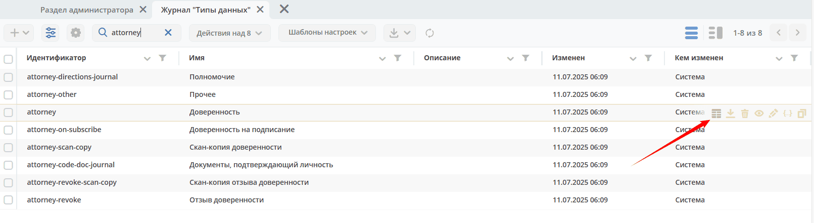
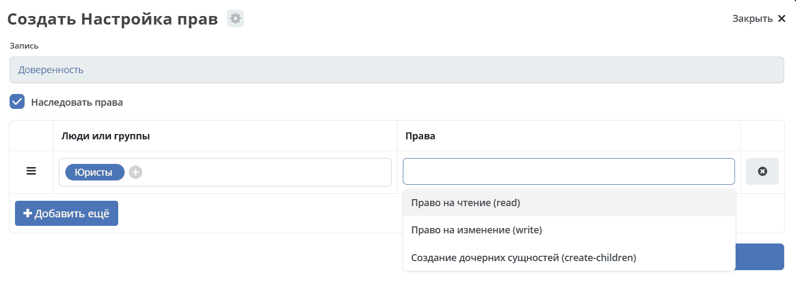

.. _data_type_rights:

Настройка прав для описания типов
===================================

Помимо матрицы прав на объекты (записи) в Citeck существует отдельный механизм управления доступом к самим **описаниям типов данных** — кто может просматривать, изменять или создавать дочерние типы.

Настройка прав на тип производится непосредственно из журнала типов данных и не влияет на права пользователей в отношении объектов этого типа.

В журнале типов для редактирования прав на конкретный тип доступна кнопка:

При нажатии на эту кнопку можно настроить права на конкретный тип:

Доступные права для редактирования:

.. list-table::
      :widths: 3 5
      :header-rows: 1
      :class: tight-table

      * - Идентификатор
        - Описание
      * - read
        - Право на чтение. На данный момент не проверяется, так как конфигурации типов доступны всем.
      * - write
        - Право на изменение типа.
      * - create-children
        - Право на создание дочерних типов.

Для **глобального типа** право изменения проверяется с учётом системных полномочий, назначенных прав **write** и авторства типа:

  1. Системные администраторы
  2. Пользователи, которым выданы права **write** системным администратором
  3. Создатель типа

При создании глобального типа, а также при изменении его родителя дополнительно проверяется право **create-children** на выбранного родителя.

Типы рабочего пространства
--------------------------

Для создания и изменения типа с заданным рабочим пространством действует отдельная проверка: операция доступна системному администратору, системному контексту или менеджеру этого пространства. Наличие обычного права **write** или авторство типа само по себе не заменяет эту проверку.

Менеджер рабочего пространства также учитывается при вычислении прав на описание типа. Права, показанные в интерфейсе, и разрешение конкретной операции сохранения следует различать.

Наследование прав
------------------

Все права по умолчанию наследуются от родительского типа к дочерним, но это поведение можно отключить если убрать флаг **"Наследовать права"** при настройке прав на тип.

Право на создание типа без родителя
-------------------------------------

Если в определении типа родитель не указан, при разрешении типа используется **base** (кроме самого корневого типа base). При проверке создания глобального типа без родителя право **create-children** также проверяется на **base**.

Выданные на base права могут наследоваться дочерними типами с учётом настройки **«Наследовать права»**. Это не отменяет проверку прав на выбранного родителя и отдельный порядок для типов рабочего пространства.

Родителем может быть глобальный тип или тип из того же рабочего пространства. Наследование глобального типа от типа рабочего пространства, наследование из другого пространства и циклическое наследование не допускаются.
