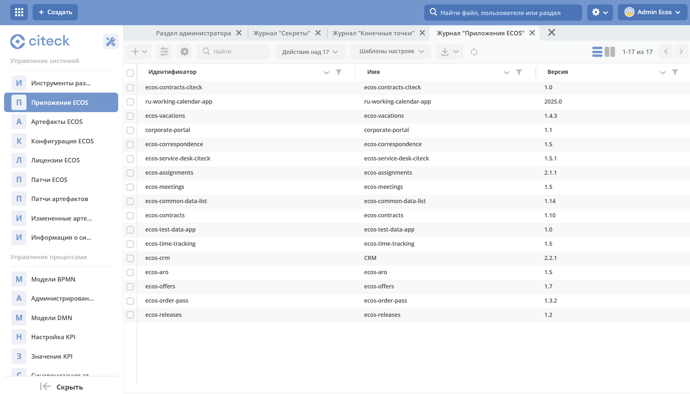
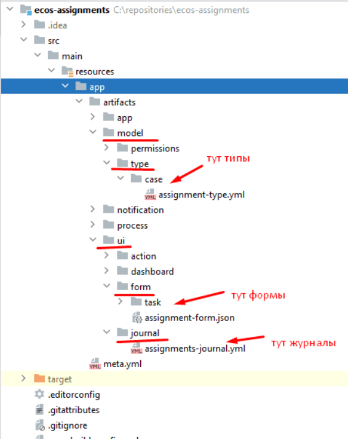
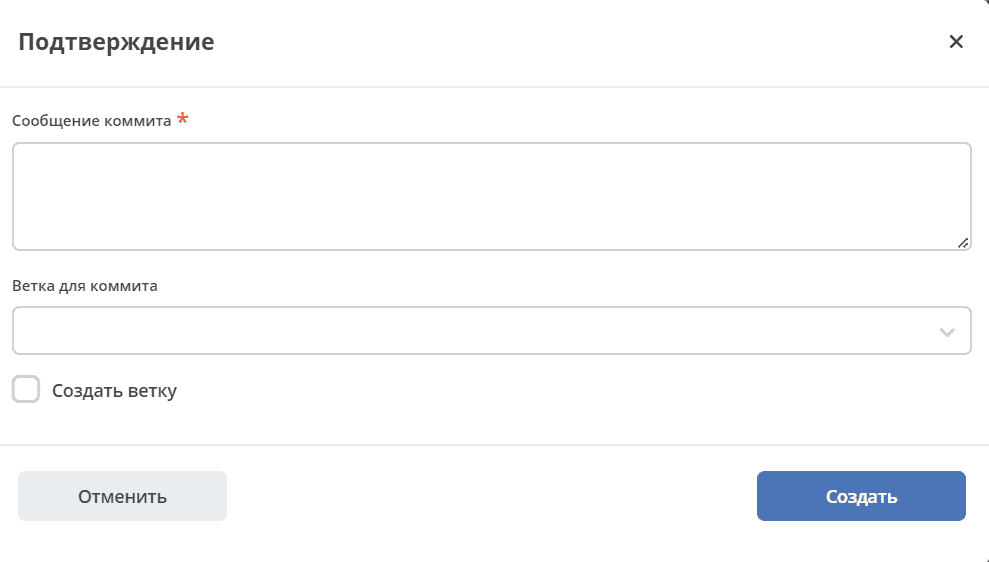
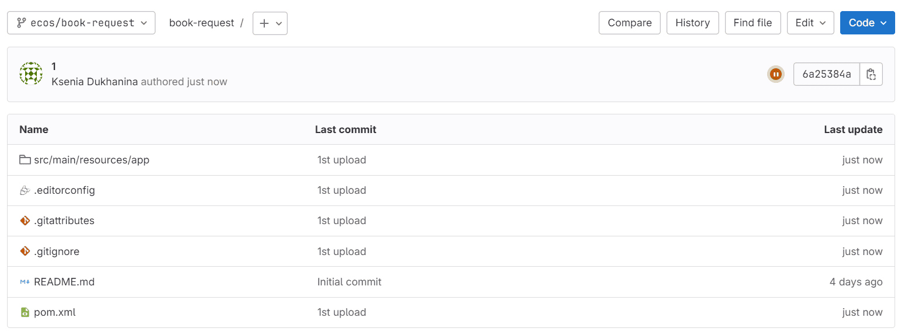

.. _applications:

Приложения Citeck
====================

.. contents::
    :depth: 3

**Приложения Citeck (ECOS Apps)** — механизм упаковки, переноса и версионирования :ref:`артефактов<ecos_artifacts>` платформы Citeck между различными стендами. Приложение представляет собой zip-архив, содержащий метаданные и набор артефактов: типы данных, формы, журналы, шаблоны и другие элементы конфигурации системы.

На этой странице описано:

- как создавать, скачивать и загружать приложения через интерфейс системы;
- как переносить конфигурацию между стендами и рабочими пространствами;
- как создавать ECOS Apps проекты и деплоить их вручную или автоматически через Docker;
- как настроить интеграцию с Git-репозиторием для версионирования артефактов.

Определения
--------------

**Приложение Citeck** (ECOS App) - приложение, которое содержит в себе :ref:`артефакты<ecos_artifacts>` (единицы расширения системы). Примеры артефактов: :guilabel:`Тип`, :guilabel:`Форма`, :guilabel:`Журнал`.

Приложение Citeck выгружается в zip-архив с метаданными и каталогом артефактов. Метаданные приложения, сформированного через журнал, содержат ``id``, ``name``, ``version``, ``repositoryEndpoint``, ``typeRefs``, ``artifacts`` и ``workspace``. Состав артефактов может включать формы, журналы, меню, типы данных и другие элементы конфигурации.

Основная задача приложений Citeck - переносимость артефактов между стендами и возможность версионирования.

**ECOS Application** сам является артефактом типа ``app/ecosapp``. Этот тип помечен как внутренний (``internal: true``) и исключён из обычного выбора артефактов для приложения. Признак внутреннего типа следует отличать от признака ``system`` у записи артефакта.

Работа с приложениями
-----------------------

Работа с приложениями осуществляется в журнале **"Приложения ECOS" (Рабочее пространство "Раздел администратора" - Управление системой)** :

Журнал доступен по адресу: ``v2/journals?journalId=ecos-apps&viewMode=table&ws=admin$workspace``

На этой странице можно:

  1. Создавать и редактировать приложения.
  2. Скачивать приложения.

Перенос конфигурации между стендами
-----------------------------------

Через **Приложения ECOS** переносятся выбранные артефакты конфигурации. Выбор типа данных и сбор связанных с ним артефактов не означает автоматического переноса всех документов или записей справочника этого типа.

См. подробней :ref:`пример<app_example>`

.. dropdown:: Как перенести конфигурацию между стендами
   :color: secondary

   1. Создать приложение по кнопке **+**.

   .. image:: _static/apps/new_app.png
          :width: 700
          :align: center
          :alt: Создать приложение

   Ввести наименование, выбрать тип данных и автоматически или вручную добавить соответствующие артефакты.

   2. Скачать приложение.

   .. image:: _static/apps/apps_page_1.png
          :width: 700
          :align: center
          :alt: Скачать приложение

   3. Загрузить приложение на необходимом стенде.

   .. image:: _static/apps/apps_page_2.png
          :width: 700
          :align: center
          :alt: Загрузить приложение

Рабочие пространства и права
~~~~~~~~~~~~~~~~~~~~~~~~~~~~

Приложение может быть глобальным или относиться к рабочему пространству. При экспорте ссылка на исходное пространство очищается в метаданных, а ссылки на артефакты этого пространства приводятся к переносимому виду с ``CURRENT_WS``. При импорте используется пространство назначения, и ссылки привязываются к нему.

Для создания, изменения, удаления и импорта глобального приложения нужны права администратора или системный контекст. Менеджер обычного рабочего пространства может выполнять эти операции с приложениями своего пространства; эти полномочия не распространяются на глобальные приложения и другие пространства. Для фиксации изменений в Git действует отдельное ограничение, описанное ниже.

Если импортируемый артефакт в целевом пространстве уже принадлежит другому приложению Citeck, импорт завершается ошибкой. Перед переносом согласуйте состав приложений и принадлежность общих артефактов.

Структура архива приложения
----------------------------

::

  meta.json // метаданные приложения
  artifacts: // папка с артефактами приложения
    type0:
      subType0:
        artifact0.json
        artifact1.json
        ...
      subType1:
        artifact0.json
        artifact1.json
        ...
    type1:
      subType0:
        artifact0.json
        ...
      subType1:
        artifact0.json
        ...
    ...

Формат файлов внутри ``artifacts`` определяется контроллером соответствующего типа: это могут быть JSON, YAML или другая структура файлов.

Архив, выгруженный через журнал приложений, содержит ``meta.json``; этот файл читает обработчик загрузки ZIP. Артефактный загрузчик ``app/ecosapp`` дополнительно поддерживает каталог приложения или ZIP с ``meta.yml``, ``meta.yaml`` либо ``meta.json`` (в таком порядке поиска). Для этого пути загрузки необходимы непустой ``id`` и каталог ``artifacts``; если версия не задана, используется ``1.0``.

.. _app_project:

Создание ECOS Apps проекта
-----------------------------

Для создания ECOS Apps проекта используется **Maven-проект** со сборочным parent. Ниже приведён пример конфигурации; версию parent и настройки упаковки выбирайте для используемой поставки:

.. code-block:: xml

  <?xml version="1.0" encoding="UTF-8"?>
  <project xmlns="http://maven.apache.org/POM/4.0.0"
          xmlns:xsi="http://www.w3.org/2001/XMLSchema-instance"
          xsi:schemaLocation="http://maven.apache.org/POM/4.0.0 http://maven.apache.org/xsd/maven-4.0.0.xsd">

      <modelVersion>4.0.0</modelVersion>

      <groupId>ru.citeck.ecos.eapps.assignments</groupId>
      <artifactId>ecos-assignments</artifactId>
      <version>1.0.0-snapshot</version>

      <parent>
          <groupId>ru.citeck.ecos.eapps.project</groupId>
          <artifactId>ecos-apps-simple-parent</artifactId>
          <version>1.0.3</version>
      </parent>

      <repositories>
          <repository>
              <id>citeck-public</id>
              <url>https://nexus.citeck.ru/repository/maven-public</url>
          </repository>
      </repositories>

  </project>

Приложения можно расположить двумя способами:

``src/main/resources/app`` - для варианта, когда приложение одно

``src/main/resources/apps/[app0,app1,…]`` - для варианта, когда приложений несколько

В корне приложения нужно разместить файл **meta.yml**, в котором можно указать:

.. code-block:: yaml

  id: ecos-assignments

* **id: String** - идентификатор приложения. Задайте его явно; генерация значения из artifactId зависит от сборочного parent.
* **name: MLText** - имя приложения

Создание отсутствующего **meta.yml** при сборке зависит от используемого parent. Артефактный загрузчик ожидает уже подготовленные метаданные с непустым **id**.

При сборке приложений получается набор **zip-архивов**, каждый из которых представляет из себя отдельное приложение.

Деплой
~~~~~~~

Есть два основных способа деплоя - ручной и автоматический.

.. tab-set::

   .. tab-item:: Ручной деплой

      .. _manual_deploy:

      При ручном деплое мы можем собрать приложения командой:

      .. code-block:: bash

       mvn clean package

      и загрузить полученный архив. Для приведённой схемы сборки используется папка ``target/classes/apps``; фактический выходной каталог определяется настройками проекта.

      .. image:: _static/apps/zip_arch.png
             :width: 400
             :align: center

      через журнал приложений, который доступен по ссылке ``v2/journals?journalId=ecos-apps&viewMode=table&ws=admin$workspace``

      .. image:: _static/apps/apps_page_2.png
             :width: 700
             :align: center

   .. tab-item:: Автоматический деплой

      .. _auto_deploy:

      Автоматический деплой осуществляется через механизм загрузки артефактов в микросервисе **ecos-apps**. Артефакты доставляются в виде docker образа.

      Команда для сборки docker образа:

      .. code-block:: bash

        mvn clean package jib:dockerBuild -Djib.docker.image.tag=1.0.0-snapshot

      где **1.0.0-snapshot** - тег для итогового образа в приведённой конфигурации сборочного parent. Настройки Jib должны быть предусмотрены проектом.

      После сборки образа мы подключаем его там, где развернут микросервис **ecos-apps**:

      .. code-block:: yaml

        ecos-assignments-ecos-apps:
          container_name: ecos-assignments-ecos-apps
          image: nexus.citeck.ru/ecos-assignments:1.0.0-snapshot
          environment:
            - ECOS_APPS_TARGET_DIR=/run/ecos-apps
          volumes:
            - ./volumes/ecos-apps:/run/ecos-apps

      Параметр **ECOS_APPS_TARGET_DIR** - папка, в которую будут скопированы все приложения, которые лежат внутри образа. Копирование происходит с помощью shell скрипта.

      .. note::

         По завершении копирования приложений Citeck образ сразу же останавливается т.к. на этом его работа заканчивается.

      Далее нам нужно подключить папку с артефактами (``./volumes/ecos-apps``) как volume в микросервис ecos-apps:

      .. code-block:: yaml

        eapps-app-dev:
          container_name: eapps-app-dev
          image: nexus.citeck.ru/ecos-apps:2.6.0-snapshot
          ports:
            - 8089:8089
          environment:
            # Остальные переменные окружения
            - ECOS_WEBAPP_EAPPS_ADDITIONAL_ARTIFACTS_LOCATIONS=/run/ecos-artifacts
          volumes:
            - ./volumes/ecos-apps:/run/ecos-artifacts/app/ecosapp

      В **env** переменной мы передаем конфигурацию **ECOS_WEBAPP_EAPPS_ADDITIONAL_ARTIFACTS_LOCATIONS**, которая указывает на дополнительные папки, из которых нужно загрузить артефакты (приложение Citeck тоже является артефактами с типом **app/ecosapp**).

      Нашу папку с архивами мы должны подключить как **volume** в директорию ``$ECOS_WEBAPP_EAPPS_ADDITIONAL_ARTIFACTS_LOCATIONS/app/ecosapp``

      При запуске микросервиса **ecos-apps** он начинает следить за директориями, которые указаны в **ECOS_WEBAPP_EAPPS_ADDITIONAL_ARTIFACTS_LOCATIONS**, и если приложения, которые там находятся изменяются, то микросервис автоматически их загружает к себе в БД и деплоит оттуда артефакты.

Интеграция с Git
-----------------

.. _git_integration:

.. note::

    Доступно только в enterprise версии.

Интеграция с Git позволяет связать приложение Citeck с Git репозиторием и по нажатию на действие **«Зафиксировать изменения в Git»** загрузить изменившиеся артефакты в указанный репозиторий.

Настройка
~~~~~~~~~~~~~~~~~~

.. dropdown:: Настройка интеграции с Git
   :color: secondary

   1. Открыть журнал **«Секреты»** ``v2/journals?journalId=ecos-secrets&viewMode=table&ws=admin$workspace``:

   .. image:: _static/apps/git_01.png
          :width: 700
          :align: center

   и создать пару **логин/пароль** (Тип - **Basic**) для доступа к Git репозиторию:

   .. image:: _static/apps/git_02.png
          :width: 500
          :align: center

   .. note::

      Для получения пароля в Gitlab для своей учетной записи можно сгенерировать `Personal Access Token <https://docs.gitlab.com/ee/user/profile/personal_access_tokens.html>`_  с указанием scopes **read_repository** и **write_repository** для нужных репозиториев.

      При этом на форме создания секрета выбрать тип= Basic, ввести свой логин и вместо своего пароля ввести сгенерированный токен.

   2. Открыть журнал **«Конечные точки»** ``v2/journals?journalId=endpoints&viewMode=table&ws=admin$workspace``

   .. image:: _static/apps/git_03.png
          :width: 700
          :align: center

   и добавить **ссылку** на Git репозиторий:

   .. image:: _static/apps/git_04.png
          :width: 500
          :align: center

   .. note::

      Для описанного способа аутентификации с секретом **Basic** используйте **HTTPS URL** репозитория.

      URL можно получить, открыв страницу с репозиторием и нажав **Code**. В появившемся окне скопировать **HTTPS URL**.

      .. image:: _static/apps/git_05.png
           :width: 400
           :align: center

   3. Открыть журнал **«Приложения ECOS»** ``v2/journals?journalId=ecos-apps&viewMode=table&ws=admin$workspace``

   .. image:: _static/apps/git_06.png
          :width: 700
          :align: center

   и открыть настройки нужного приложения Citeck. В настройках заполнить поле **«репозиторий»** конечной точкой, которая была создана в **п.2.**

   .. image:: _static/apps/git_07.png
          :width: 500
          :align: center

   Для администратора при доступной Git-интеграции на карточке настроенного приложения Citeck и карточках его артефактов доступно действие **«Зафиксировать изменения в Git»**:

   .. grid:: 2
      :gutter: 2

      .. grid-item::

         .. image:: _static/apps/git_08.png
            :width: 500
            :align: left

      .. grid-item::

         .. image:: _static/apps/git_08_1.png
            :width: 500
            :align: left

Проверка соединения
~~~~~~~~~~~~~~~~~~~~

По кнопке **«Проверить соединение»** можно проверить актуальный статус подключения к репозиторию:

.. grid:: 2
   :gutter: 2

   .. grid-item::

      .. image:: _static/apps/git_09.png
         :width: 300
         :align: center

   .. grid-item::

      .. image:: _static/apps/git_10.png
         :width: 300
         :align: center

Действие «Зафиксировать изменения в Git»
~~~~~~~~~~~~~~~~~~~~~~~~~~~~~~~~~~~~~~~~~

Действие доступно администратору на карточке приложения Citeck и карточках его артефактов при настроенном **Репозитории** и доступной возможности Git-интеграции. Для артефакта репозиторий определяется через приложение, которому он принадлежит.

При нажатии на действие появляется следующая форма:

На форме можно выбрать:

 -	либо существующую ветку:

    .. image:: _static/apps/git_12.png
          :width: 500       
          :align: center

 -	либо создать новую:

    .. image:: _static/apps/git_13.png
          :width: 500       
          :align: center

По умолчанию коммиты из Citeck можно делать в ветки, у которых имя начинается на **ecos/**. Это поведение можно изменить в журнале **ECOS конфигураций** → ``ecos-vcs-allowed-branches-to-commit``.

Значения настроек веток — регулярные выражения. Список фильтруется без учёта регистра.

При создании новой ветки в качестве базовой можно выбрать либо ветки, имя которых начинается на **ecos/**, либо стандартные ветки **develop, master, main**. Это поведение можно изменить в журнале **ECOS конфигураций** → ``ecos-vcs-allowed-base-branches``.

Если установить галку **«Создать ветку»**, то пользователю будет предложено указать имя новой ветки и ветку, которую нужно взять за основу. Новая ветка всегда имеет префикс **ecos/**, чтобы исключить случайную порчу артефактов в важных ветках репозитория.

Доступ к репозиторию настраивается через конечную точку и связанный с ней секрет. Правила авторства коммита и аутентификации определяются используемым компонентом Git-интеграции.

Пользовательское выполнение действия разрешено администраторам Citeck. Сервер также допускает системный контекст; полномочий менеджера рабочего пространства для Git-действия недостаточно.

Для фиксации берутся последние исходные ревизии выбранных артефактов без наложенных патчей. Ревизии с источником **ECOS_APP** пропускаются: в Git передаются изменения из других источников, например пользовательские правки. Удаление записи в интерфейсе Citeck не следует использовать как способ удаления файла из Git; удаление файлов выполняйте в репозитории.

Структура проекта
~~~~~~~~~~~~~~~~~~~~

Артефакты записываются в ``src/main/resources/app/artifacts``, метаданные — в ``src/main/resources/app/meta.json``. Подготовка недостающего каркаса проекта зависит от компонента Git-интеграции и поставляемого шаблона Maven. Для самостоятельной подготовки проекта можно использовать архетип `ecos application <https://gitlab.citeck.ru/citeck-projects/ecos-projects-archetypes>`_.

Настройки конфигурации
~~~~~~~~~~~~~~~~~~~~~~~~

Для настройки конфигурации необходимо открыть журнал **«Конфигурация ECOS»** ``v2/journals?journalId=ecos-configs&viewMode=table&ws=admin$workspace``:

  .. image:: _static/apps/git_15.png
        :width: 700       
        :align: center

- ``ecos-vcs-allowed-branches-to-commit`` — разрешённые ветки для коммита
- ``ecos-vcs-allowed-base-branches`` — разрешённые базовые ветки
