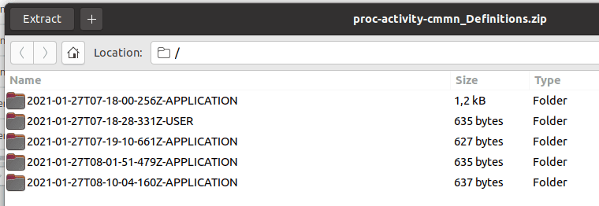
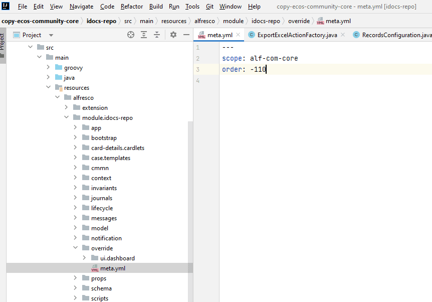

.. _ecos_artifacts:

Артефакты Citeck
==================

.. contents::
  :depth: 2

**Артефакты** — базовые единицы расширения и конфигурации платформы Citeck. Любой элемент системы — тип данных, форма, журнал, процесс, шаблон уведомления — является артефактом. Артефакты хранятся в микросервисе **ecos-apps**, который управляет их версионностью и доставкой до целевых микросервисов.

На этой странице описано:

- что такое артефакт и как устроена его идентификация;
- как управлять артефактами через журнал «Артефакты ECOS»;
- источники артефактов и политики обновления;
- расположение артефактов в файловой структуре проекта;
- основные типы артефактов по микросервисам;
- переопределение артефактов и патчи;
- YAML-формат описания артефактов;
- создание нового типа артефакта.

Определения
-------------

**Артефакт** - единица расширения в Citeck. Артефактами являются формы, журналы, типы, матрицы прав, действия, описания процессов и многие другие сущности в системе.

:ref:`Микросервис ecos-apps<apps_service>` управляет артефактами, ведёт их версионность и доставляет до целевого микросервиса. Изменения сохраняются новыми ревизиями со ссылкой на предыдущие. Повторная загрузка того же содержимого из того же типа источника не создаёт новую обычную ревизию; перед созданием также проверяется политика источника.

Примеры артефактов: :guilabel:`Тип`, :guilabel:`Форма`, :guilabel:`Журнал`.

  -	**Тип данных** - основной артефакт ECM, описывающий объект. В типе данных определяются метаданные, которые будет содержать объект, статусы жизненного цикла, роли, которые могут работать с объектом. Тип данных связан с формой и журналом. 
  -	**Форма** - графическое представление объекта в виде набора элементов интерфейса для манипуляции данными объекта. Элементы интерфейса ссылаются на атрибуты, заданные в типе данных.
  -	**Журнал** - табличная форма представления объектов с возможностью настройки отображения столбцов, фильтрации и манипуляции объектами. Столбцы соответствует данным объекта или могут вычисляться на их основе.

Тип артефакта как правило состоит из двух частей разделенных символом ``/``.

  * Первая часть - область системы к которой относится артефакт. Обычно за одну область отвечает один микросервис.
  * Вторая часть - локальный идентификатор типа

Например, в типе ``ui/form`` **ui** - область, а **form** - локальный идентификатор.

.. note:: 

  Если сконфигурированные в конструкторе артефакты покрывают необходимую функциональность, то их можно выгрузить в виде :ref:`приложения<applications>`.

  Если функциональности не достаточно, то можно создать :ref:`отдельный микросервис<mcs_setup>`, который будет содержать и сконфигурированные в конструкторе артефакты, и необходимую дополнительную логику.

Журнал «Артефакты ECOS»
-------------------------

Для управления :ref:`артефактами<ecos_artifacts>` предусмотрен журнал **Артефакты ECOS**. Он показывает артефакты невнутренних типов с сохранённой ревизией, которые не удалены и относятся к доступным пользователю рабочим пространствам. По умолчанию действует дополнительный фильтр ``system = false``, скрывающий системные артефакты.

Расположен **Рабочее пространство "Раздел администратора" - Управление системой**:

  .. image:: _static/artifacts/artifact_journal.png
       :width: 700
       :align: center

Доступные действия
~~~~~~~~~~~~~~~~~~~

**1. Скачать историю артефакта**

* При нажатии на действие можно выбрать дату, с которой необходимо выгрузить историю артефакта.
* При отправке формы скачивается **zip** с не более чем **1000 последними ревизиями**, созданными строго после указанного момента, в порядке от новых к старым.
* Если подходящих ревизий нет, выгружается последняя доступная ревизия. Для этого артефакт должен существовать, иметь ревизию и известный системе тип.
* Имя папки строится из момента создания в UTC и типа источника. Для активной ревизии добавляется суффикс **ACTIVE**. Все символы, кроме латинских букв, цифр, ``_`` и ``-``, заменяются на ``-`` — в том числе двоеточия и точка в записи времени.
* Помимо **USER**, **APPLICATION** и **ECOS_APP**, в истории может встречаться **PATCH** — результирующая ревизия после наложения патчей. Это не отдельный источник пользовательской загрузки.

**2. Скачать артефакт**

Всегда скачивается *zip* архив с выбранным артефактом.

**3. Передеплоить артефакт вручную**

Отправить артефакт из ``ecos-apps`` в микросервис. Может быть полезно при разработке или после сбоя в базе целевого микросервиса т.е. ``ecos-apps`` не пропускает артефакт если он ранее был успешно задеплоен.

**4. Сбросить пользовательскую версию артефакта**

Сброс доступен, если текущая обычная ревизия имеет источник **USER** и в её истории есть предыдущая непользовательская ревизия, например **APPLICATION** или **ECOS_APP**. Если история состоит только из USER, сброс не выполняется.

Операция создаёт новую ревизию с содержимым и источником найденной базовой версии, очищает результат наложения патчей и переводит артефакт в состояние ожидания деплоя. Пользовательские ревизии остаются в истории.

Источники артефактов
-------------------------

Есть 3 возможных источника артефактов:

1. **USER** - артефакт добавляет или модифицирует пользователь;
2. **APPLICATION** - артефакт загружается из приложений, которые подключены к интерфейсу команд;
3. **ECOS_APP** - артефакт загружается из приложения Citeck;

Обновление артефактов
-------------------------

Все 3 источника имеют свою политику по обновлению артефактов:

   * **USER** - политика источника разрешает загрузку безусловно. Общие проверки прав и совпадения содержимого выполняются отдельно.

   *  **APPLICATION** - Артефакт обновляется если он не принадлежит никакому приложению Citeck и была загружена версия артефакта, которая отличается от предыдущей загруженной из ``APPLICATION``. Пример: Если у нас есть следующие ревизии артефакта:

      - **rev2** USER
      - **rev1** USER
      - **rev0** APPLICATION

То **rev0** - самая первая версия артефакта, а **rev2** - самая последняя версия артефакта. Мы видим, что первая версия артефакта поступила из приложения, а другие две от пользователя.

Если в такой ситуации в микросервис приходит версия **rev0** от APPLICATION, то ничего не поменяется не смотря на то что **rev2** != **rev0**.

Если из приложения придет **rev3**, то новая ревизия загрузится и станет актуальной:

  - **rev3** APPLICATION
  - **rev2** USER
  - **rev1** USER
  - **rev0** APPLICATION

**ECOS_APP** - при отсутствии владельца загрузка разрешается; артефакт связывается с приложением. Если владелец уже задан, обновление допускается только из того же приложения и при отличии от последней ревизии источников ECOS_APP/APPLICATION. Из APPLICATION или другого ECOS App такой артефакт не обновляется.

Расположение артефактов
------------------------------

Все артефакты располагаются в директориях, которые соответствуют типу.

В приложении настраивается корневая папка с артефактами и в ней можно создавать подпапки ``ui/form``, ``model/type`` и тд.

По умолчанию корневой папкой с артефактами для приложения Citeck - ``src/main/resources/app/artifacts``, для микросервиса -  ``src/main/resources/eapps/artifacts``

.. grid:: 2
   :gutter: 2

   .. grid-item-card:: Приложение Citeck

      .. image:: _static/artifacts/ecos_app.png
         :width: 400
         :align: center

   .. grid-item-card:: Микросервис Citeck

      .. image:: _static/artifacts/ecos_mks.png
         :width: 400
         :align: center

Например, для **ECOS приложения Поручения**, структура папки следующая:

  .. image:: _static/artifacts/folder_example.png
       :width: 400
       :align: center

Типы артефактов
---------------

.. dropdown:: Основные типы артефактов по микросервисам
   :color: secondary

   .. list-table::
         :widths: 15 15 20
         :header-rows: 1
         :class: tight-table
         :align: center

         * - Тип
           - Микросервис
           - Примечание
         * - model/aspect
           - ecos-model
           - Аспект
         * - model/authorities-sync
           - ecos-model
           - Синхронизация пользователей и групп
         * - model/endpoint
           - ecos-model
           - Конечная точка
         * - model/num-template
           - ecos-model
           - Шаблоны нумерации
         * - model/permission-def
           - ecos-model
           - Описание права
         * - model/permission-settings
           - ecos-model
           - Настройка прав
         * - model/permissions
           - ecos-model
           - Права доступа
         * - model/secret
           - ecos-model
           - Секрет
         * - model/type
           - ecos-model
           - Типы данных
         * - model/working-calendar
           - ecos-model
           - Производственный календарь
         * - model/working-schedule
           - ecos-model
           - Рабочее расписание
         * - model/workspace
           - ecos-model
           - Рабочее пространство
         * - model/workspace-template
           - ecos-model
           - Шаблон рабочего пространства
         * - model/workspace-member
           - ecos-model
           - Участник рабочего пространства
         * - 
           - 
           - 
         * - ui/action
           - ecos-uiserv
           - Действия
         * - ui/admin-sections-group
           - ecos-uiserv
           - Группа разделов администратора
         * - ui/board
           - ecos-uiserv
           - Канбан доска
         * - ui/dashboard
           - ecos-uiserv
           - Дашборды
         * - ui/form
           - ecos-uiserv
           - Формы
         * - ui/i18n
           - ecos-uiserv
           - Локализация
         * - ui/icon
           - ecos-uiserv
           - Набор иконок
         * - ui/journal-settings
           - ecos-uiserv
           - Настройки журнала
         * - ui/journal
           - ecos-uiserv
           - Журналы
         * - ui/menu
           - ecos-uiserv
           - Меню
         * - ui/theme
           - ecos-uiserv
           - Пользовательские темы
         * - 
           - 
           - 
         * - app/artifact-patch
           - ecos-apps
           - Патч для артефакта
         * - app/config
           - ecos-apps
           - Конфигурация
         * - app/dev-module
           - ecos-apps
           - Модуль разработки
         * - app/ecosapp
           - ecos-apps
           - Приложение ECOS
         * - app/license
           - ecos-apps
           - Лицензия ECOS
         * - app/patch
           - ecos-apps
           - Патч
         * - app/system-info
           - ecos-apps
           - Информация о системе
         * - 
           - 
           - 
         * - integration/camel-dsl
           - ecos-integrations
           - Конфигурации Camel DSL
         * - integration/credentials
           - ecos-integrations
           - Учетные данные
         * - integration/datasource
           - ecos-integrations
           - Источник данных
         * - integration/ext-portal
           - ecos-integrations
           - Внешний портал
         * - integration/file-import-config
           - ecos-integrations
           - Конфигурация импорта файлов
         * - integration/in-webhook
           - ecos-integrations
           - Вебхук
         * - integration/osgi-bundles
           - ecos-integrations
           - OSGi Пакет
         * - integration/recsrc
           - ecos-integrations
           - Настройки внешней БД
         * - integration/sync
           - ecos-integrations
           - Синхронизации
         * - 
           - 
           - 
         * - transformation/template
           - ecos-transformations
           - Шаблон документа
         * - 
           - 
           - 
         * - process/bpmn-kpi-settings
           - ecos-process
           - Настройка BPMN KPI
         * - process/bpmn-section
           - ecos-process
           - BPMN раздел
         * - process/bpmn-task-atts-sync
           - ecos-process
           - Синхронизация атрибутов задач BPMN
         * - process/bpmn
           - ecos-process
           - BPMN процесс
         * - process/dmn-section
           - ecos-process
           - DMN раздел
         * - process/dmn
           - ecos-process
           - DMN
         * - 
           - 
           - 
         * - notification/file
           - ecos-notifications
           - Файлы уведомлений
         * - notification/template
           - ecos-notifications
           - Шаблоны уведомлений
         * - notification/sender
           - ecos-notifications
           - Отправители
         * - notification/reminder
           - ecos-notifications
           - Напоминание

Внутренние типы (``internal: true``) исключены из обычного выбора артефактов. Например, в ecos-model есть внутренние типы ``model/attrs_permission``, ``model/delete``, ``model/section`` и ``model/tk_type``; в ecos-apps — ``app/ecosapp`` и устаревший ``app/module-patch``. Признак ``internal`` относится к типу артефакта и отличается от ``system`` у его записи. В таблице также приведён ``app/ecosapp`` как часть инфраструктуры приложений.

Переопределение артефактов
--------------------------

Для переопределения артефактов можно создать папку с именем ``override`` в корне директории с артефактами.

Пример структуры папок:

.. code-block:: text

  eapps:
    - artifacts:
        - ui:
            - form:
                - some-form.json
            - journal:
                - some-journal.yml
        - override:
            - ui:
                - form:
                    - some-form.json

Для формы **some-form.json** будет создан патч с типом **override** и порядком -100 (по умолчанию). 

Если требуется настроить порядок, то следует в корне папки override создать файл ``meta.yml``. В нем возможны следующие настройки:

.. list-table:: Список возможных настроек в override/meta.yml
    :header-rows: 1
    :align: center

    *   - Название
        - Тип данных
        - Описание
    *   - order
        - float
        - Порядок патча для перезаписи артефакта. Сначала применяются патчи с меньшим порядком.
    *   - scope
        - string
        - | Параметр служит для исключения коллизий идентификаторов override патчей.
          | Идентификатор патча формируется по следующему шаблону: override[_{{scope}}]$ui/form$some-form

**Особенности**

1. Применение переопределения зависит от источника текущей ревизии. Пользовательская ревизия **USER** не патчится; подробнее — :ref:`artifact_patch`.

Создание нового типа артефакта
-------------------------------

.. dropdown:: Пошаговая инструкция по созданию нового типа артефакта
   :color: secondary

   1. Определяемся в какой микросервис должен попасть артефакт после деплоя.

   2. В целевом микросервисе создаём определение типа в ``src/main/resources/eapps/types/<область>/<тип>/``. Например, для ``model/example`` используется каталог ``eapps/types/model/example``:

      * первый уровень - раздел к которому относится артефакт (обычно 1 раздел == 1 микросервис. Например, ui → ecos-uiserv, integration → ecos-integrations, model → ecos-model и тд.)

      * второй уровень - локальный идентификатор типа (action, form, menu, dashboard, type, section и т.д.)

   Иерархия внутри ``eapps/types`` определяет идентификатор типа артефакта.

   .. note:: 

     Следует учитывать, что создаваемая иерархия директорий будет использована как идентификатор типа артефакта. Поэтому следует внимательно к ней отнестись.

   3. Создаём ``eapps/types/model/example/type.yml``:

   .. code-block:: yaml

     modelVersion: "1.0"

     sourceId: "example"

     controller:
         type: json
          config:
              format: yaml

   **modelVersion** - версия модели артефакта.

   **sourceId** - ID источника данных (RecordsDAO), через который доступны записи артефактов. Он используется для сопоставления записи и типа артефакта, в том числе при разрешении зависимостей и фиксации изменений в Git.

   **controller.type** определяет чтение и запись файлов артефакта. Для структурированных данных используется **json**; ``controller.config.format: yaml`` задаёт YAML-формат записи. Для собственной файловой структуры можно использовать **script** с Groovy-реализацией ``ArtifactController`` и методами ``read``, ``write``, ``getMeta``.

   4. Регистрируем Spring-компонент, реализующий ``EcosArtifactHandler``. Ниже каркас обработчика; ``ExampleArtifactService`` — прикладной сервис хранения, который нужно реализовать и зарегистрировать в своём микросервисе:

   .. code-block:: kotlin

     import org.springframework.stereotype.Component
     import ru.citeck.ecos.apps.app.domain.handler.EcosArtifactHandler
     import ru.citeck.ecos.commons.data.MLText
     import java.util.function.Consumer

     data class ExampleArtifact(val id: String, val name: MLText = MLText())

     interface ExampleArtifactService {
         fun save(artifact: ExampleArtifact)
         fun delete(id: String)
         fun addChangeListener(listener: Consumer<ExampleArtifact>)
     }

     @Component
     class ExampleArtifactHandler(
         private val service: ExampleArtifactService
     ) : EcosArtifactHandler<ExampleArtifact> {

         override fun deployArtifact(artifact: ExampleArtifact) {
             service.save(artifact)
         }

         override fun deleteArtifact(artifactId: String) {
             service.delete(artifactId)
         }

         override fun getArtifactType(): String = "model/example"

         override fun listenChanges(listener: Consumer<ExampleArtifact>) {
             service.addChangeListener(listener)
         }
     }

   Callback ``listenChanges`` передаёт локальные изменения в инфраструктуру артефактов для сохранения ревизий. Зависимости можно задать в определении типа через ``controller.config.metaFields.dependencies``; например, у ``model/type`` там указаны ссылки на родительский тип.

   Если артефакт относится к рабочему пространству, используйте ``WsAwareArtifactHandler<T>``: методы ``deployArtifact`` и ``deleteArtifact`` получают отдельный аргумент ``workspace``, а ``listenChanges`` принимает ``BiConsumer<T, String>``. Обработчик должен учитывать пространство при сохранении, удалении и подготовке переносимых ссылок.

   5. Экземпляры нового артефакта разместите отдельно от определения типа — в ``src/main/resources/eapps/artifacts/model/example/``. Для приведённого контроллера можно использовать YAML или JSON.

   При добавлении нового типа перезагрузки требует только микросервис, где мы этот тип описываем.

.. _ecos-artifacts_yaml:

YAML формат артефакта
----------------------

С версии 3.25.0 ядра community добавлена поддержка формата yaml для описания артефактов. Версия формата YAML 1.2

Описывать в виде yaml можно любые артефакты, которые загружаются в json формате (типы, журналы, формы и др.).

После прочтения yaml файл будет преобразован в json и далее в таком виде и попадет на целевой микросервис. 

Внутреннее JSON-представление следует отличать от формата выгрузки. Файлы формируются контроллером соответствующего типа; например, ``controller.config.format: yaml`` задаёт YAML-формат записи. Центральный журнал **«Артефакты ECOS»** скачивает ZIP-контейнер, а предметный журнал может выгружать YAML напрямую — как журнал типов данных.

Пример описания журнала форм:

.. code-block:: yaml

  id: ecos-forms
  label: { ru: Формы, en: Forms }

  typeRef: emodel/type@form
  sourceId: uiserv/eform

  attributes:
    actionFormatter: '' #include include/legacy-actions.js

  actions:
    - uiserv/action@ecos-module-download
    - uiserv/action@delete
    - uiserv/action@edit

  columns:

    - name: moduleId
      label: { ru: Идентификатор, en: Id }

    - name: formKey
      label: { ru: Ключ формы, en: Form key }

    - name: title
      label: { ru: Название, en: Name }

    - name: description
      label: { ru: Описание, en: Description }

Возможности и особенности формата (ст - стандартные возможности, нм - наша модификация):

1. (ст) YAML 1.2 - надмножество формата JSON. Из этого следует, что можно просто изменить расширение у артефакта с **.json** на **.yaml** и все будет работать как раньше без дополнительных изменений.

2. (нм) Поддержка #include, которая позволяет включать содержимое внешних файлов в текущую конфигурацию. 

Общий вид использования: somekey: ``'' #include filename`` 

На месте ‘' могут быть следующие значения: ‘’, ““ (для импорта содержимого файла как текста) и {} (для импорта внешней yaml конфигурации). 

filename - относительный путь до включаемого файла.

При чтении конфигурации все места с #include будут заменены на содержимое указанного файла (если будет два include одного файла, то он дважды добавится в конфиг)

3. (ст) Поддержка переиспользования частей конфига ( `https://confluence.atlassian.com/bitbucket/yaml-anchors-960154027.html <https://confluence.atlassian.com/bitbucket/yaml-anchors-960154027.html>`_ ):

.. code-block:: yaml

  some-reusable-value: &my-anchor
    aa: bb
    cc: dd

  other-key: *my-anchor
  other2-key: *my-anchor

4. (нм) Поддержка переиспользование частей конфига с переопределением значений (полу-стандартный механизм, но используемая библиотека его не поддерживала): 

.. code-block:: yaml

  some-reusable-value: &my-anchor
    aa: bb
    cc: dd

  other-key:
    <<: *my-anchor
    cc: ee

В other-key мы получим {“aa”: “bb“, “cc“: “ee“}

.. _artifact_patch:

Патчи для артефактов
--------------------

С версии ecos-apps 1.9.0 добавлена поддержка патчей для артефактов. Патчи сами являются артефактами и могут быть так же пропатчены. 

Патчи служат заменой механизма override, когда мы в артефакте заказчика полностью перезаписывали файлы конфигурации. Как показала практика такой подход приводит к множеству багов при переходе на новую версию коробки т.к. базовые конфигурации со временем меняются.

Патчи применяются асинхронно при изменении исходной ревизии артефакта или настроек патча с учётом источника ревизии. При удалении или отключении последнего действующего патча его результат снимается. Время применения зависит от цикла синхронизации, доступности микросервисов и нагрузки; состояние проверяйте в журнале и логах.

Список патчей в системе можно посмотреть в **системных журналах → патчи артефактов**.

Также для них действуют возможности, которые описаны в разделе "YAML формат артефактов".

К текущей обычной ревизии с источником **USER** патчи не применяются. Поэтому пользовательское изменение записи через интерфейс может снять результат патча. После успешной загрузки новой обычной ревизии из **APPLICATION** или **ECOS_APP** патчи снова учитываются; повторная загрузка прежнего содержимого может быть отклонена политикой источника.

Для артефакта APPLICATION допускаются патчи любого источника, для ECOS_APP — патчи APPLICATION, ECOS_APP и USER. При сохранении патча пользователем его источник становится USER; при деплое источник берётся из метаданных загрузки.

Формат патча:

.. list-table::
      :widths: 5 5 5 5 40
      :header-rows: 1
      :class: tight-table
      :align: center

      * - Поле
        - Тип
        - Обязательность
        - Значение по умолчанию
        - Описание
      * - **order**
        - Float
        - Нет
        - 0
        - | Порядок патча.
          | Если в системе есть несколько патчей для одного артефакта, они применяются от меньшего порядка к большему. При одинаковом порядке патчи сортируются по id.
      * - **id**
        - String
        - Да
        - `-`
        - | Идентификатор. 
          | Уникальный среди всех патчей для артефактов в системе.
      * - **target**
        - ArtifactRef
        - Да
        - `-`
        - | Целевой артефакт, который будет пропатчен.
          | Записывается в виде ``тип_артефакта$локальный_id``. Пример: ``ui/journal$ecos-journals``
          | Идентификатор рабочего пространства в ``target`` не указывается — он задаётся отдельным полем ``workspace``.
      * - **workspace**
        - String
        - Нет
        - `""`
        - | Идентификатор рабочего пространства, в котором находится целевой артефакт.
          | Заполняется, если цель патча — артефакт внутри рабочего пространства. Пустая строка означает глобальный артефакт.
          | Один и тот же ``target`` в разных рабочих пространствах патчится независимо — на каждое сочетание ``target`` + ``workspace`` нужен отдельный патч.
          | Для обратной совместимости патчи к ``ui/menu$admin-workspace-menu`` без указания ``workspace`` при сохранении автоматически привязываются к рабочему пространству ``admin$workspace``.
      * - **type**
        - String
        - Да
        - `-`
        - | Тип патча.
          | Для частичного изменения конфигурации используется json. Полное переопределение override описано выше.
      * - **config**
        - ObjectData
        - Да
        - `-`
        - | Конфигурация патча
          | 
      * - **enabled**
        - Boolean
        - Нет
        - true
        - Включён ли патч. Значение false позволяет отключить патч без удаления.
      * - **sourceType**
        - ArtifactSourceType
        - Нет
        - Определяется при сохранении
        - Источник патча. Задаётся метаданными деплоя, а при пользовательском сохранении нормализуется в USER; участвует в отборе применимых патчей.

В микросервисе патчи размещаются в ``src/main/resources/eapps/artifacts/app/artifact-patch``. В проекте приложения с корнем ``src/main/resources/app`` используется каталог ``src/main/resources/app/artifacts/app/artifact-patch``.

Журнал «Патчи артефактов»
~~~~~~~~~~~~~~~~~~~~~~~~~~

Расположен **Рабочее пространство "Раздел администратора" - Управление системой - Патчи артефактов**:

  .. image:: _static/artifacts/artifact_patches_journal.png
       :width: 700
       :align: center

Доступные действия:

  - Скачать;
  - Удалить;
  - Просмотреть;
  - Редактировать свойства;
  - Редактор JSON.

Типы патчей
~~~~~~~~~~~~

Тип патча "json"
""""""""""""""""""

В конфигурации указывается 1 параметр - **operations** с типом **массив объектов**.

Все операции из массива **operations** применяются последовательно к результату изменений предыдущей операции.

Тип операции определяется в ключе op и может быть следующим:

.. list-table::
      :widths: 10 10 40
      :header-rows: 1
      :class: tight-table
      :align: center

      * - op
        - Описание
        - Параметры
      * - **add**
        - Добавить элемент или массив элементов в массив по пути.
        - | **path** - JsonPath до массива, в который нужно добавить элемент
          | **value** - значение или массив значений, которые следует добавить
          | **idx** - индекс, по которому следует добавить значение. По умолчанию значение добавляется в конец. Можно указывать значения вне диапазона существующего массива. В таком случае элементы будут добавляться или в начало или в конец.
      * - **set**
        - Установить явное значение любому полю.
        - | **path** - JsonPath до элемента, в который нужно поместить value
          | **key** - опциональное поле, которое определяет ключ, по которому следует поместить значение
          | **value** - значение или массив значений, которые следует установить
      * - **remove**
        - Удалить элемент из конфигурации
        - | **path** - JsonPath до элемента, который нужно удалить
      * - **rename-key**
        - Переименовать ключ в объекте внутри конфигурации.
        - | **path** - JsonPath до объекта, в котором нужно переименовать ключ.
          | **oldKey** - старое наименование ключа
          | **newKey** - новое наименование ключа

Примеры
"""""""""

.. tab-set::

   .. tab-item:: Изменить атрибут для формы

      .. code-block:: yaml

        id: change-label-for-form-field

        name:
          ru: Изменить название кнопки на форме
          en: Change button label on form

        target: ui/form$ECOS_FORM

        type: json
        config:
          operations:
            - { op: set, path: '$..[?(@.key == "localization")].label', value: 'Свое название для кнопки локализации' }

   .. tab-item:: Добавить действие для типа

      .. code-block:: yaml

        id: add-some-action-for-case

        name:
          ru: Добавить действия для кейса
          en: Add actions for case

        target: model/type$cat-doc-type-general-case

        type: json
        config:
          operations:
            - { op: add, path: 'actions', value: 'uiserv/action@pdf-content-with-barcode' }

   .. tab-item:: Изменить текст в локализации по ключу

      .. code-block:: yaml

        id: change-ui-admin-localization

        name:
          ru: Изменить локализацию для раздела администратора
          en: Change localization for admin section

        target: ui/i18n$menu-messages

        type: json
        config:
          operations:
            - { op: set, path: '$["messages"]["menu.header.admin-tools"][1]', value: 'Опциональный заголовок для меню администратора' }

   .. tab-item:: Удалить действие

      .. code-block:: yaml

        id: delete-action

        name:
          ru: Удалить действие из типа
          en: Delete action from type

        target: model/type$contracts-cat-doctype-contract

        type: json
        config:
          operations:
            - { op: remove, path: '$.actions[?(@=="uiserv/action@edit-in-onlyoffice")]'}

   .. tab-item:: Изменить значение параметра конфигурации

      Изменить значение параметра Конфигурации ECOS some-config-id на 123:

      .. code-block:: yaml

        id: some-patch-id

        name:
          ru: Изменение значения параметра конфигурации some-config-id
          en: Change some-config-id config value

        target: app/config$app/notifications$some-config-id

        type: json
        config:
          operations:
            - { op: set, path: '$.value', value: [ 123 ] }
            - { op: set, path: '$.version', value: 1 }

   .. tab-item:: Добавить раздел меню

      .. code-block:: yaml

        id: menu-change-test
        name: {ru: Добавить раздел, en: Add section }
        target: 'ui/menu$default-menu-v1'
        type: json
        config:
          operations:
            - op: add
              path: '$..[?(@.id == "sections")].items'
              value: {
                "id": "custom-meetings-section",
                "label": {
                  "ru": "Совещания"
                },
                "icon": "ui/icon@i-leftmenu-meetings",
                "type": "SECTION",
                "items": [
                  {
                    "id": "123-123-123-123-123",
                    "label": {
                      "en": "Совещания"
                    },
                    "type": "JOURNAL",
                    "config": {
                      "recordRef": "uiserv/journal@meetings"
                    },
                    "items": [],
                    "allowedFor": []
                  }
                ]
              }

   .. tab-item:: Патч для артефакта в рабочем пространстве

      .. code-block:: yaml

        id: hide-field-in-team-workspace-form

        name:
          ru: Скрыть поле на форме в рабочем пространстве team-a
          en: Hide field on form in workspace team-a

        target: ui/form$some-form
        workspace: team-a

        type: json
        config:
          operations:
            - { op: set, path: '$..[?(@.key == "internalNote")]', key: hidden, value: true }

   .. tab-item:: Патч к булевым атрибутам формы

      Ниже приведён фрагмент поля **config** для json-патча. Для самостоятельного артефакта добавьте внешние поля **id**, **target** и **type: json**.

      .. code-block:: json

        {
          "operations": [
            {
              "op": "set",
              "path": "$..[?(@.key==\"meetDateTime\")]",
              "key": "hidden",
              "value": true
            }
          ]
        }

Отображение артефактов разных категорий
---------------------------------------

В журналах **«Типы данных», «Формы» и «Журналы»** в фильтрах настройки таблицы можно выбрать какую категорию артефакта отражать – бизнес-данные или системные.

В фильтрах по умолчанию стоит **Системный тип (форма|журнал)= НЕТ**. 

Если выставить **ДА**, то в списке будут отражены системные записи.

Если снять ограничение по системности, будут отражены системные и несистемные записи с учётом остальных фильтров и доступных рабочих пространств.

  .. image:: _static/artifacts/artifact_type.png
       :width: 600
       :align: center
