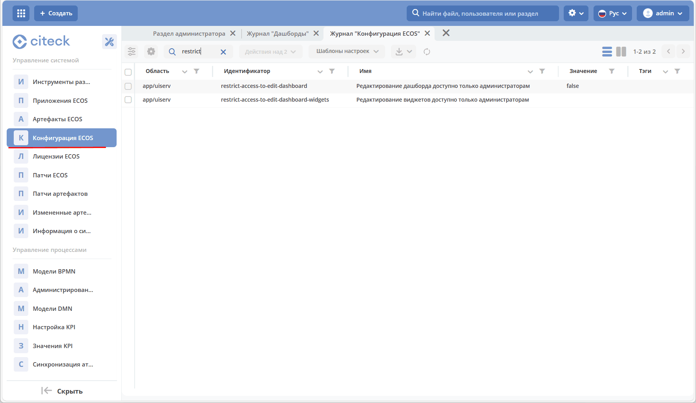
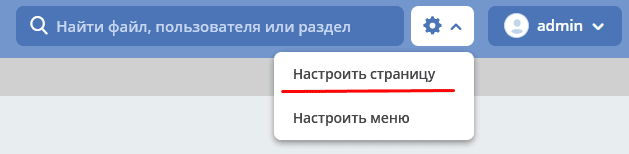
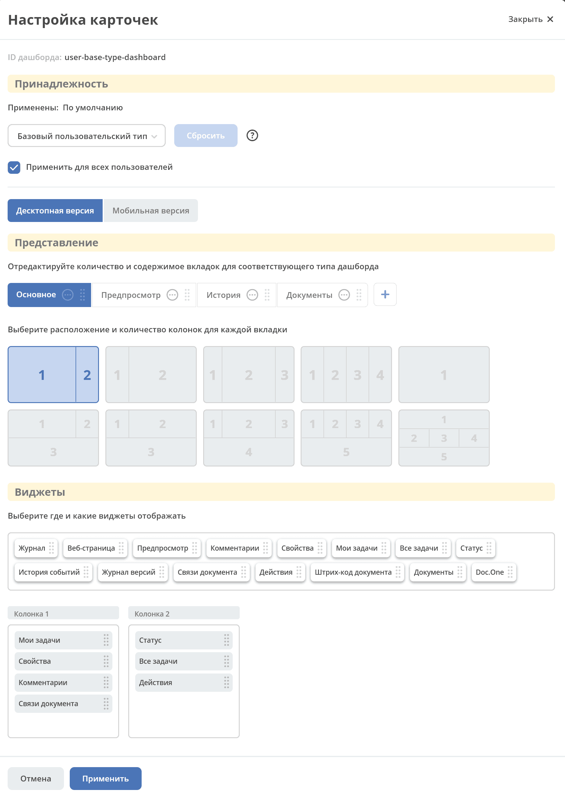
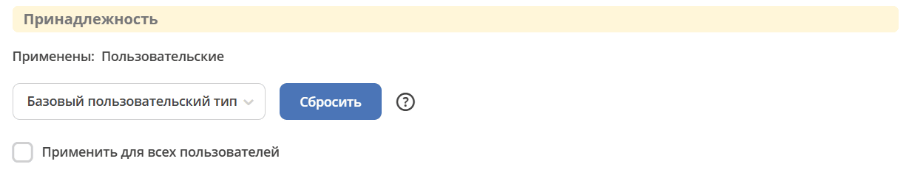
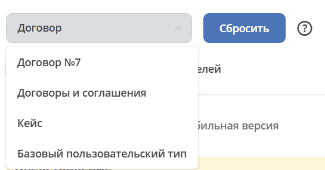
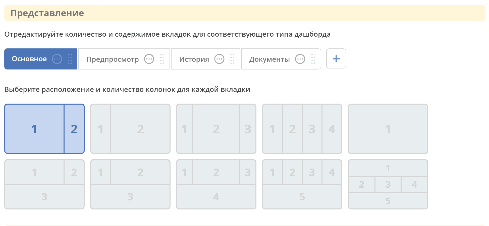
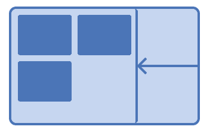
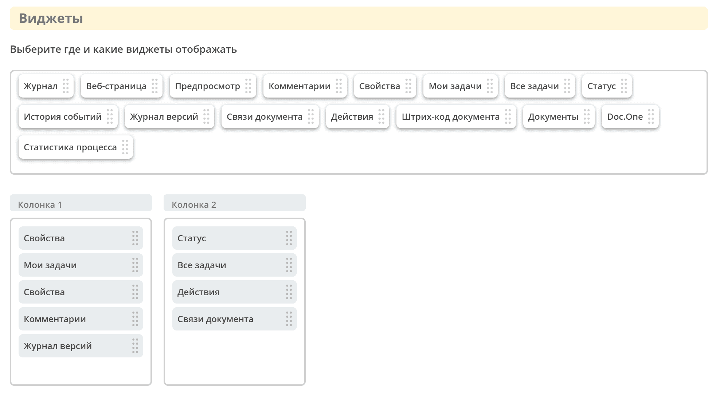
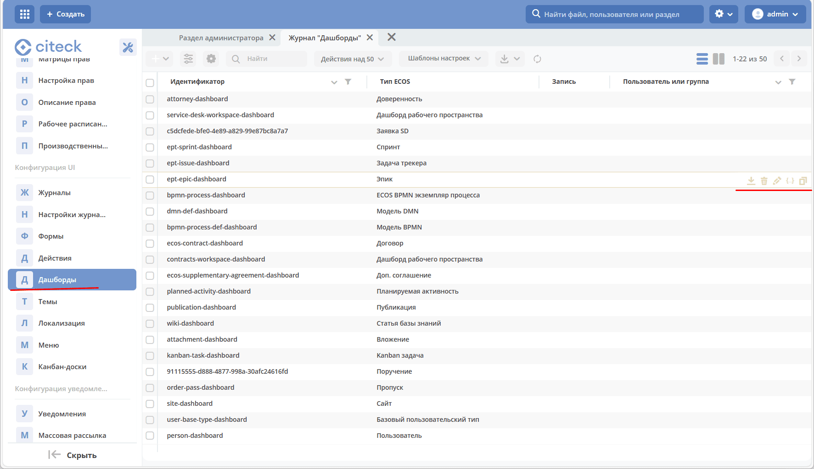

.. _dashboard:

Дашборды
=========

.. contents::
    :depth: 4

Для отображения домашней страницы пользователя или информации в карточке в Citeck предусмотрены дашборды.

Дашборд позволяет добавлять и убирать виджеты, конфигурировать каждый виджет индивидуально. См. отдельную статью :ref:`виджеты <widgets>`

Все настройки хранятся в том же json, что и конфигурация дашборда.

.. _dashboard_types:

Виды дашбордов
---------------

Вид дашборда определяет набор доступных виджетов и раскладок. Он отличается от типа данных записи и идентификатора сохранённой конфигурации.

case-details
~~~~~~~~~~~~~

Дашборд карточки кейса - информация по документу (задачи, свойства, действия, история и др.).

Запись задаётся параметром ``recordRef`` в URL. Для подбора конфигурации клиент загружает её тип и передаёт серверу контекст пользователя и рабочего пространства.

Например: ``host/v2/dashboard?activeTab=0&recordRef=emodel/type-id@local-id``

site-details
~~~~~~~~~~~~~

Страница раздела, которая позволяет отображать общие данные по разделу.

Раздел задаётся через ``recordRef``, например ``/v2/dashboard?recordRef=site@contracts``. Подбор конфигурации выполняется сервером; клиент не формирует ключ ``site_<siteId>`` для перебора конфигураций.

user-dashboard
~~~~~~~~~~~~~~~

Домашняя страница пользователя при выключенных рабочих пространствах. Открывается без ``recordRef`` и без явного ``dashboardId``.

Например: ``host/v2/dashboard``

Для подбора конфигурации используется тип данных ``emodel/type@user-dashboard``.

profile-details
~~~~~~~~~~~~~~~~

Страница профиля пользователя, которая доступна из меню действий с учетной записью пользователя, пункт «Мой профиль» (см. :ref:`Панель управления <control_panel>`).

Например: ``host/v2/dashboard?activeTab=0&recordRef=emodel/person@username``

Другие виды
~~~~~~~~~~~

В реестре интерфейса также определены:

- ``process-dashboard`` — дашборд процесса;
- ``publication-details`` — дашборд публикации;
- ``orgstructure-person-dashboard`` — карточка человека в оргструктуре;
- ``orgstructure-dashboard`` — страница оргструктуры без выбранного человека;
- ``custom`` — самостоятельный дашборд, открываемый по ``dashboardId``;
- ``wiki`` — дашборд базы знаний.

Для открытия конкретной конфигурации используйте ``/v2/dashboard?dashboardId=<id>``. Параметр ``dashboardKey`` в текущем пути загрузки не выбирает конфигурацию вместо ``dashboardId``.

Дашборды рабочих пространств
~~~~~~~~~~~~~~~~~~~~~~~~~~~~

Домашняя страница :ref:`рабочего пространства <workspaces>` открывается с параметром ``ws``. Например:

- для персонального рабочего пространства: ``host/v2/dashboard?ws=user$username``
- для неперсонального рабочего пространства: ``host/v2/dashboard?ws=workspacename``

При отсутствии записи клиент выбирает тип данных для запроса конфигурации:

.. list-table::
    :widths: 35 65
    :header-rows: 1
    :class: tight-table

    * - Контекст
      - Тип данных
    * - Рабочие пространства выключены
      - ``emodel/type@user-dashboard``
    * - Персональное рабочее пространство (``ws`` содержит ``user$``)
      - ``emodel/type@personal-workspace-dashboard``
    * - Другое рабочее пространство
      - ``emodel/type@workspace-dashboard``

Конкретную конфигурацию по умолчанию выбирает сервер. Её идентификатор и состав виджетов зависят от поставляемых настроек, в том числе настроек :ref:`корпоративного портала <corp_portal>`. ``ws-dashboard`` не является отдельным значением реестра видов дашбордов интерфейса.

Параметр activeTab
~~~~~~~~~~~~~~~~~~~

``activeTab=N`` выбирает вкладку дашборда. Нумерация начинается с ``0``; например: ``/v2/dashboard?activeTab=1&recordRef=emodel/person@someuser``. Если указанной вкладки нет, используется первая. Для первой вкладки параметр может отсутствовать в URL.

Алгоритм выбора конфигурации
~~~~~~~~~~~~~~~~~~~~~~~~~~~~

.. dropdown:: Показать шаги алгоритма
   :color: secondary

   1. Если задан ``dashboardId``, клиент загружает эту конфигурацию из ``uiserv/dashboard`` напрямую.
   2. Иначе для ``recordRef`` загружается ``_etype?id``. При отсутствии типа используется базовый тип записи; для домашней страницы без записи — тип данных из таблицы выше.
   3. В источник ``uiserv/dashboard`` отправляется запрос с ``typeRef``, ``authority`` (текущий пользователь), ``recordRef`` и, при включённых рабочих пространствах, ``workspace``.
   4. Для страницы оргструктуры дополнительно передаётся ``scope: orgstructure``. Без выбранного человека используется ``emodel/type@orgstructure-dashboard``, с выбранным — ``emodel/type@person``.
   5. Предварительный запрос ``typeRef?id`` используется для ключа кэша. При отсутствии конфигурации в кэше клиент запрашивает её у сервера в том же контексте.

Наследование и выбор конфигурации по умолчанию выполняются на сервере. Клиент не перебирает ``_dashboardKey[]`` и не выполняет отдельный поиск ключа ``DEFAULT``. Атрибут ``_dashboardType`` используется в других операциях, например при получении заголовка записи.

Кэширование
-----------

Клиент хранит загруженные конфигурации в памяти открытой страницы. Ключ кэша учитывает тип или конкретную запись, пользователя, рабочее пространство (если включено) и область ``scope``. Поэтому профиль человека и его карточка в оргструктуре используют разные записи кэша.

Сохранение, создание и удаление конфигурации очищают этот кэш. Кэш конфигураций дашборда работает отдельно от общего кэша атрибутов Records.

.. _dashboard_config:

Настройка прав на редактирование
--------------------------------

В системе для пользователей можно разграничить права на настройку дашборда (**restrict-access-to-edit-dashboard**) и настройку виджетов (**restrict-access-to-edit-dashboard-widgets**).

То есть у пользователя могут быть права на настройку дашборда, но запрещена настройка виджетов.

Администратору доступны оба уровня настройки. Для остальных пользователей:

- ограничение настройки дашборда запрещает её при включённом ``restrict-access-to-edit-dashboard``;
- пустое или незаданное ограничение виджетов наследует ограничение дашборда;
- явно заданное строковое значение ``true`` в ``restrict-access-to-edit-dashboard-widgets`` запрещает настройку виджетов. Клиент сравнивает именно строку ``true``; булево значение не следует считать её эквивалентом в этой проверке.

Конфиги хранятся в разделе **Управление системой – Конфигурация ECOS** (``v2/journals?journalId=ecos-configs&viewMode=table&ws=admin$workspace``):

Включение настройки:

.. _dashboard_settings:

Конфигурация дашборда
------------------------

При открытии карточки, профиля пользователя или домашней страницы сервер подбирает конфигурацию по типу, записи, пользователю и рабочему пространству. Настройку можно привязать к типу данных или конкретной записи; самостоятельные дашборды открываются по идентификатору конфигурации.

Чтобы дополнительно конфигурировать дашборд – изменить настройки, убрать или добавить виджеты, необходимо перейти в карточку кейса, профиль пользователя или домашнюю страницу и **нажать шестеренку- > «Настроить страницу»**:

Общая форма настройки имеет следующий вид:

Разделы дашборда
~~~~~~~~~~~~~~~~~~

«Принадлежность»
""""""""""""""""""

В верхней части указан **id дашборда** и **тип данных**, для которого он настраивается.

Тип данных может быть изменен из доступного выпадающего списка. Например:

Отдельный дашборд может быть настроен для определенного документа (если на примере выбрать тип «Договор№512», то при открытии карточки данного договора будет отображаться дашборд, сконфигурированный именно для данного документа).

Чекбокс **«Применить для всех пользователей»** доступен администратору или менеджеру текущего рабочего пространства, кроме настройки самостоятельного дашборда. При его включении конфигурация сохраняется без привязки к конкретному пользователю (``authority: null``). При выключении сохраняется пользовательская конфигурация. Для обычного пользователя интерфейс при сохранении подставляет его имя.

Этот флажок не выбирает первую группу пользователя в оргструктуре. Область применения общей конфигурации и её приоритет относительно других настроек определяются сервером с учётом выбранной привязки и рабочего пространства.

.. _dashboard_view:

«Представление»
""""""""""""""""""

Доступен выбор настройки для десктопной или мобильной версии Citeck.

Укажите количество и содержимое вкладок, выберите расположение и количество колонок для каждой вкладки.

В адаптивных раскладках расположение виджетов подстраивается под размер окна браузера. Вариант ``adaptive`` доступен для ``profile-details`` и ``orgstructure-person-dashboard``; ``adaptive-same-widgets`` — для остальных видов, кроме ``orgstructure-person-dashboard``. Доступность раскладки определяется её настройками разрешённых и запрещённых видов дашбордов:

Названия вкладок поддерживают локализацию в общем редакторе дашборда. Пример настройки:

.. grid:: 3
   :gutter: 2

   .. grid-item::

      .. image:: _static/dashboards/dashboards_lang_1.png
         :width: 500
         :align: left

   .. grid-item::

      .. image:: _static/dashboards/dashboards_lang_2.png
         :width: 500
         :align: left

   .. grid-item::

      .. image:: _static/dashboards/dashboards_lang_3.png
         :width: 500
         :align: left

.. important::

   Для мобильной версии отображаются только те виджеты, которые уже были настроены для десктопной версии и несут в себе те же настройки:

   .. image:: _static/dashboards/dashboards_7.png
         :width: 500
         :align: center

«Виджеты»
"""""""""

Созданные колонки можно заполнить доступными виджетами – перетащите виджет в необходимую колонку:

Набор доступных виджетов зависит от вида дашборда.

Настройки виджетов на дашбордах
--------------------------------

Настройка виджета осуществляется в карточке каждого виджета. См. отдельную статью :ref:`Виджеты <widgets>`

Доступность типа виджета в редакторе определяется клиентским реестром: поддерживаемыми видами дашборда, проверкой ``checkIsAvailable``, подключёнными плагинами и конфигурацией системы.

Для отображения конкретного виджета задаётся условие **props.config.widgetDisplayCondition**. Оно поддерживает объект предиката, массив предикатов или строку с корректным JSON. Общий редактор сохраняет объект. Синтаксис описан в статье :ref:`Язык предикатов <ecos-predicate_main>`.

Клиент отправляет условие вместе с записью в серверный источник ``uiserv/predicate`` и получает ``result?bool``. Для массива требуется истинность всех результатов. Если условия нет, виджет отображается; при ошибке серверной проверки — скрывается. Некорректная JSON-строка может прервать загрузку конфигурации ещё до запроса, поэтому используйте валидное условие.

Журнал "Дашборды"
-----------------

Журнал расположен в **разделе администратора -> Конфигурация UI - > Дашборды**:

Дашборд можно скачать, удалить, отредактировать в форме или через json-файл, копировать.
