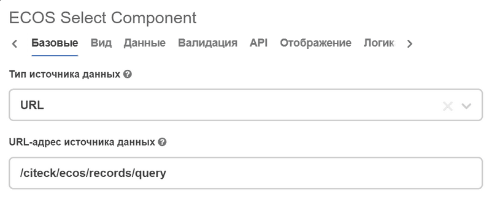

.. _ecos_select_component:

Ecos Select
===========

.. contents::
   :depth: 4
   

Компонент предназначен для выбора значения из списка. Поддерживает автоматическое получение доступных значений атрибута через Records API.

Для атрибута с набором допустимых значений, например статуса, на вкладке :guilabel:`Данные` выберите **Тип источника данных — URL**. Если URL и фильтр не заданы, компонент получает варианты текущего атрибута через Records API (``#имяАтрибута?options``). Адрес ``/citeck/ecos/records/query`` также поддерживается для совместимости: при отсутствии фильтра он включает тот же способ загрузки.

На вкладке **API** укажите атрибут, для которого нужно получить доступные значения.

Значение в режиме просмотра
----------------------------

В компоненте список представляется как набор объектов со свойствами ``value & label``. 

Есть два режима представления значения на карточке:

  * **текст**;
  * **ссылка (по умолчанию)**

На отображение влияют:

  * флаг **Отобразить выбранное значение в виде текста. Значение по умолчанию — ссылка/Display selected value as a text. Default value is link**;
  * формирование списка элементов

Если флаг установлен - текст. 

Если задано значение ``recordRef`` (это может быть актуально когда ``value`` отлично от ``recordRef`` для формирования ссылки), то оно представляется в виде ссылки. 

Если параметры не подходят - текст.

Примеры заполнения для типа источника Custom
---------------------------------------------

Данные берутся из Async Data с типом **Records Query**:

.. list-table::
      :widths: 20 20
      :align: center

      * - |

          .. image:: _static/ecos_select/Records_Query_01.png
                :width: 600
                :align: center

        - |

            .. image:: _static/ecos_select/Records_Query_02.png
                  :width: 400
                  :align: center

Данные берутся из Async Data с типом **Records Array**:

.. list-table::
      :widths: 20 20
      :align: center

      * - |

            .. image:: _static/ecos_select/Records_Array_01.png
                  :width: 600
                  :align: center

        - |

            .. image:: _static/ecos_select/Records_Array_02.png
                  :width: 400
                  :align: center
