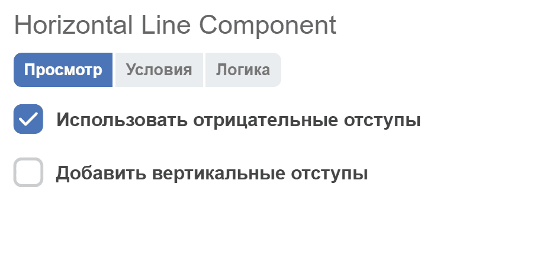
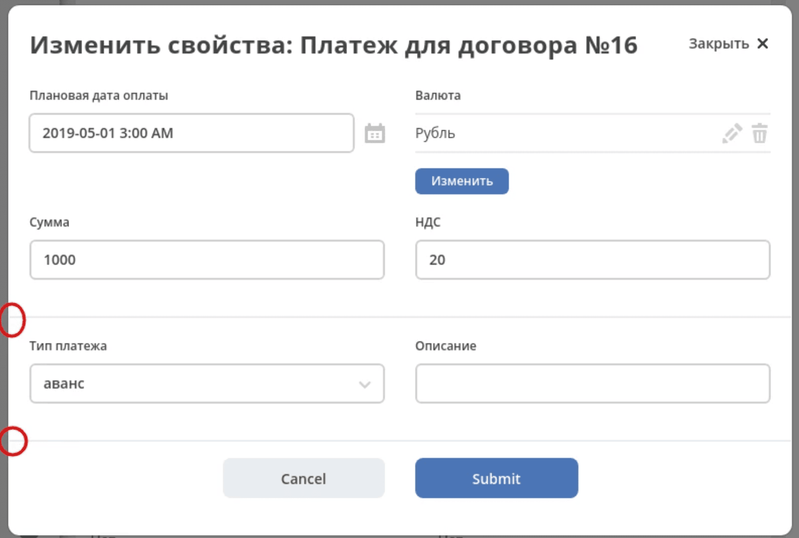

.. _horizontal_line_component:

Horizontal line
===============

**Horizontal Line** — компонент для отображения разделителя блоков. В конструкторе форм располагается в блоке :guilabel:`Макет`.

Для добавления вертикальных отступов предусмотрена опция **Добавить вертикальные отступы**.

Так как формы в основном отображаются в модальных окнах, а модальные окна имеют отступ, было решено добавить опцию **Использовать отрицательные отступы** (включена по умолчанию), которая позволяет увеличить ширину разделителя до границ модального окна.

В режиме чтения ``viewOnly`` компонент создаёт скрытый элемент вместо линии. Условие отображения на вкладке :guilabel:`Условия` не меняет этот способ отрисовки: для показа разделителя в режиме чтения требуется отдельная доработка компонента.

