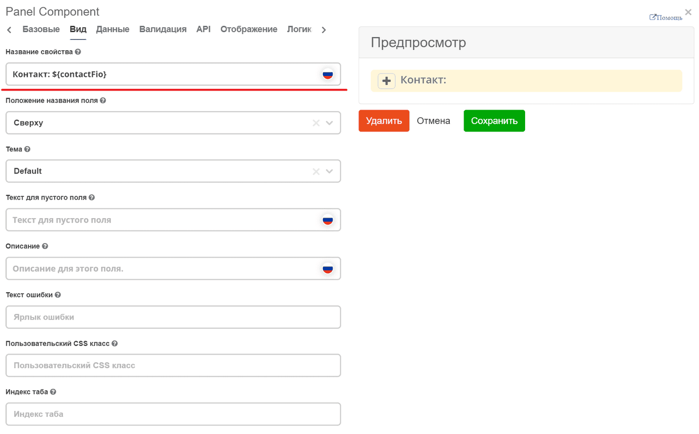
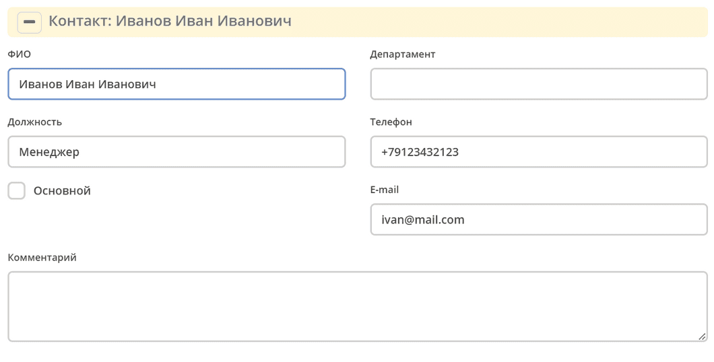
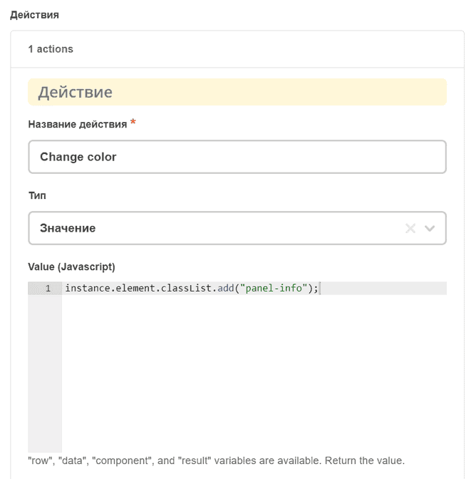
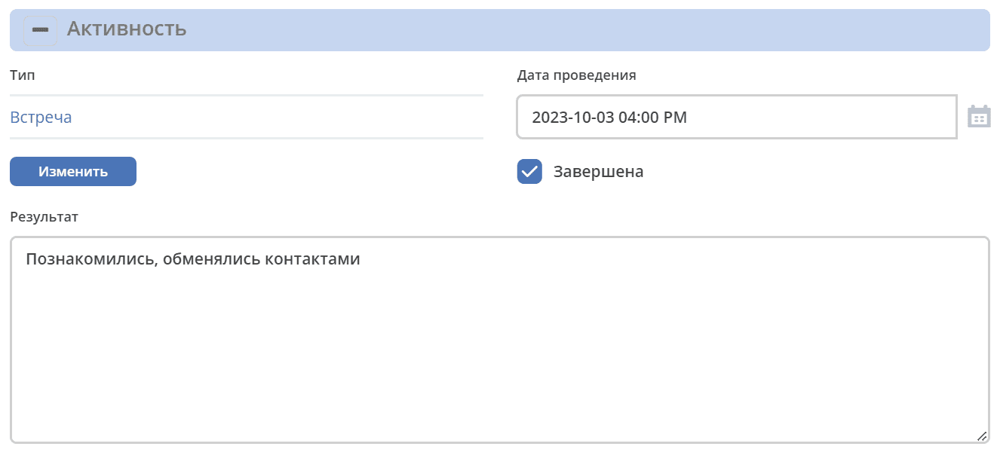

.. _panel_component:

Panel
======

Контрол **Panel** позволяет группировать несколько элементов формы в визуально обособленный блок с заголовком. Поддерживает динамическое отображение значений полей в заголовке и изменение стиля панели через CSS-классы Bootstrap.

На вкладке **Вид (View)** в поле заголовка панели (``title``) можно использовать значения из текущего контекста данных формы. Имя свойства (``key``) задаётся отдельно и не используется как шаблон заголовка.
Используются вставки вида ``${…}``. 

Например: ``${someField}``

В данном примере в название панели будет выведено ФИО контактного лица.

Также мы можем изменить цвет самой панели. Для этого необходимо добавить нужный класс Bootstrap ``instance.element.classList.add("panel-info");``.

Например по какой-то логике добавить действие:

В данном примере цвет панели будет меняться на ``panel-info``, если чекбокс **Завершена** активен:

