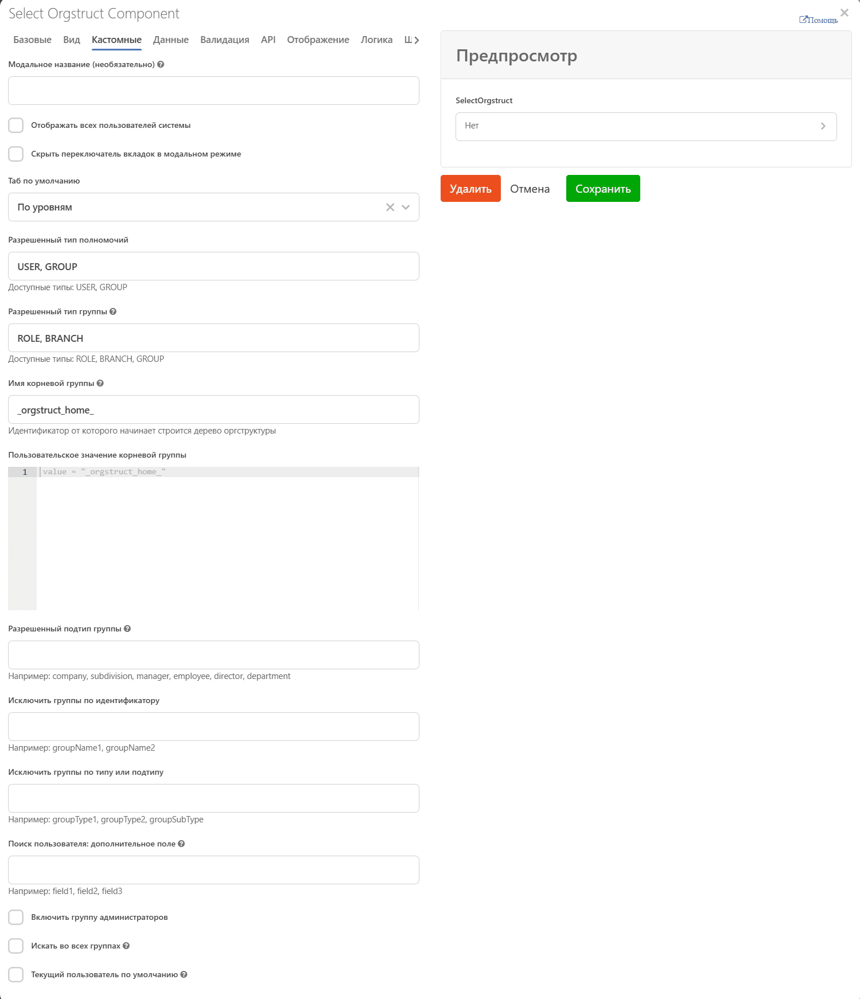
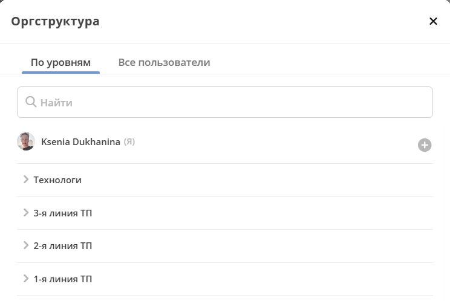
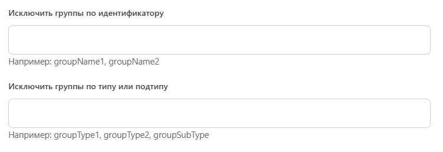
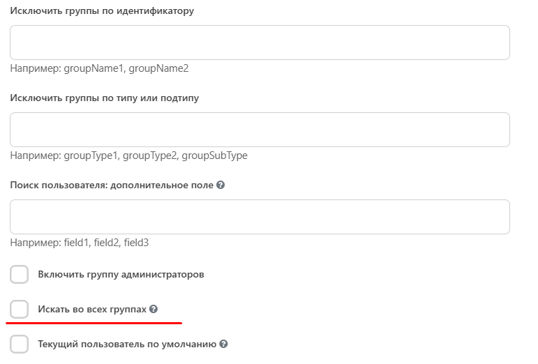
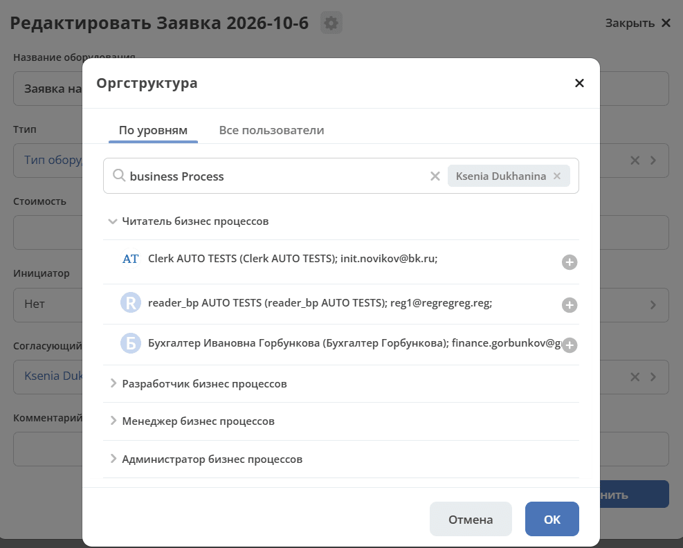
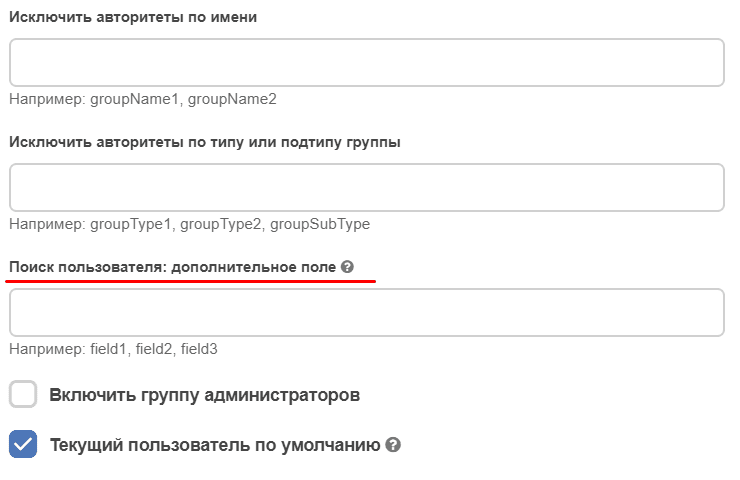
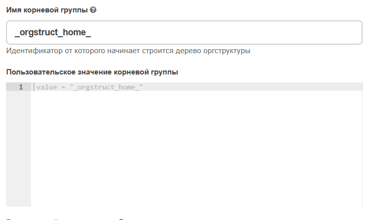
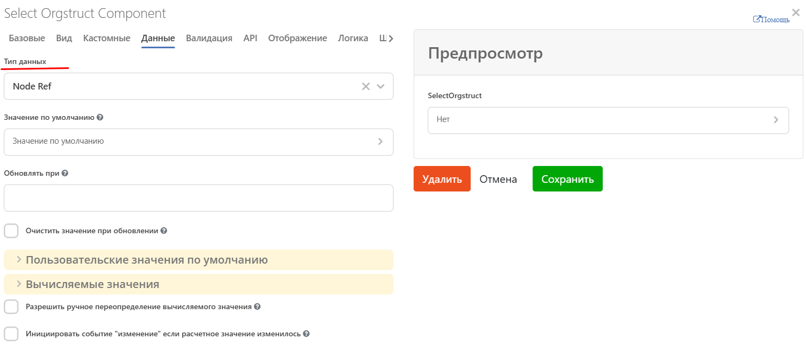
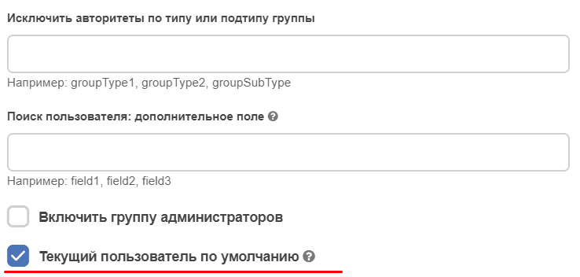
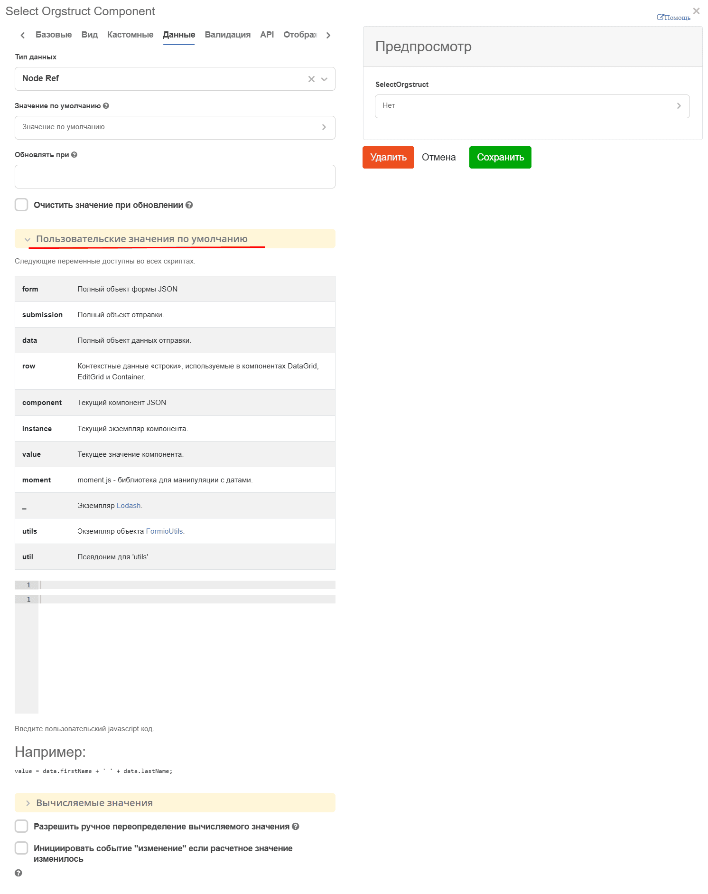

.. _Select_orgstruct_component:

Select orgstruct
================

Контрол **Select orgstruct** позволяет выбирать пользователей и группы из организационной структуры системы. Поддерживает фильтрацию по типу полномочий, типу и подтипу группы, динамическое задание корневой группы и гибкую настройку отображаемых элементов.

.. contents::
   :depth: 4

Настройка доступных для выбора элементов
-----------------------------------------

**Отображать всех пользователей системы** - в компоненте во вкладке **Все пользователи** будут отображать все пользователи, а не только пользователи рабочего пространства.

**Таб по умолчанию: Все пользователи, По уровням** - таб, показываемый по умолчанию:

**Разрешенный тип полномочий** - типы элементов, доступные до выбора. Доступные значения: **USER** - пользователи, **GROUP** - группы. Можно указать оба типа через запятую.

**Разрешенный тип группы** - типы групп, доступных для выбора. Работает в случае, если **Разрешенный тип полномочий** содержит **GROUP**. Можно указать несколько групп через запятую.

**Разрешенный подтип группы** - типы подгрупп, доступных для выбора. Можно указать несколько подгрупп через запятую. Если поле заполнено, для выбора будут доступны только те элементы, которые проходят фильтр по этому полю, остальные группы выбрать нельзя.

Скрытие групп и подгрупп
------------------------

**Исключить группы по идентификатору** -  список групп, перечисленных через запятую, для фильтрации по имени . Группы, добавленные в это поле, и все их дочерние элементы не отображаются в оргструктуре

Скрытие ветки дерева и исключение её элементов из результатов поиска — разные настройки. Обработку шаблонов имён и исключение дочерних элементов из поиска следует согласовать с серверной конфигурацией: сам компонент не разбирает нотации ``GROUP_NAME/*`` и ``GROUP_NAME/**`` как правила глубины вложенности.

**Исключить группы по типу или подтипу** - список групп, перечисленных через запятую, для фильтрации по типу. Элементы, соответствующие этим типам, не отображаются в оргструктуре.

Поиск во всех группах
------------------------

Вкладка **Кастомные** - **«Искать во всех группах»**. По умолчанию  выключена. 

- **Выключена** — всё как раньше: поиск находит группы и пользователей только внутри корневой группы оргструктуры (_orgstruct_home_).
- **Включена** — поиск находит группы и пользователей по всей системе, в том числе группы, которые не входят в оргструктуру (например, системные группы или группы портала).

Без ввода текста в поиск окно выбора в обоих случаях показывает дерево оргструктуры — группы вне её находятся только поиском.
Настройку можно включить, например, для выбора родительских групп или добавления участников рабочего пространства. Её значение на конкретной форме определяется конфигурацией этой формы.

Например, при включенной настройке доступен поиск системных групп:

Настройка полей для поиска пользователя
-----------------------------------------

Базовые поля поиска — ``id`` и ``_name``. Набор расширяется глобальной настройкой поиска и дополнительными полями компонента; по отдельному флагу добавляется ``middleName``. Для многословного поиска предусмотрена логика комбинирования имени, фамилии и отчества. Фактический набор полей зависит от конфигурации системы.

Подробно о вариантах расширения списка полей для поиска пользователей см. :ref:`конфигурация компонента оргструктуры <orgstructure_config>` 

Возможность динамически задавать корневую группу 
--------------------------------------------------

Для динамического выбора корневой группы задайте выражение **Пользовательское значение корневой группы** (``customRootGroupName``). Результат нужно присвоить переменной ``value``. Например:

.. code-block:: javascript

      if (data.someAtt === 'someValue') {
        value = '_orgstruct_home_';
      } else {
        value = 'someGroupId';
      }

Выражение корневой группы вычисляется независимо от разрешённого типа полномочий. Настройки **Разрешенный тип полномочий**, **Разрешенный тип группы** и **Разрешенный подтип группы** определяют, какие элементы пользователь сможет выбрать.

Тип данных
-----------

Настройка **"Тип Данных"** определяет формат данных, отправляемых на сервер при сохранении формы. Доступны два режима:

.. list-table::
      :widths: 10 30 30
      :header-rows: 1
      :align: center
      :class: tight-table

      * - Режим
        - Описание
        - Когда использовать
      * - **Node Ref**
        - Сохраняет полную ссылку на сущность в формате :ref:`RecordRef<RecordRef>` (например, ``emodel/person@user``)
        - Когда атрибут на сервере ожидает ссылку на запись, например ассоциацию с пользователем или группой
      * - **Authority**
        - Отправляет строковый идентификатор (например, ``user`` или ``GROUP_my_group``)
        - Когда атрибут на сервере ожидает строковый идентификатор полномочия

.. important::

  Выбирайте формат в соответствии с типом атрибута на сервере. Компонент поддерживает оба режима; выбор не определяется только тем, является запись бизнес-сущностью или системным артефактом.

Прочее
--------

Текущий пользователь
~~~~~~~~~~~~~~~~~~~~~

На вкладке :guilabel:`Кастомные` настройка **Текущий пользователь по умолчанию** заполняет пустое поле текущим пользователем. Она применяется к ещё не изменённому пользователем полю при создании записи (``CREATE``), вне режима чтения. Значение нормализуется в ссылку через Records API.

На вкладке :guilabel:`Данные` в разделе **Пользовательские значения по умолчанию**:

указать:

.. code-block:: javascript

    value = Citeck.constants.USERNAME;
